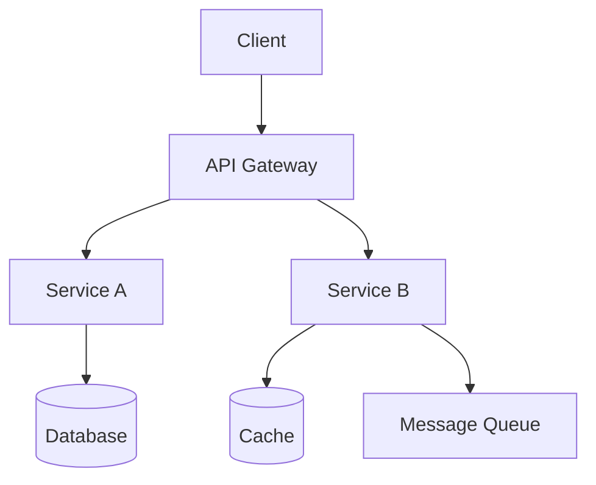
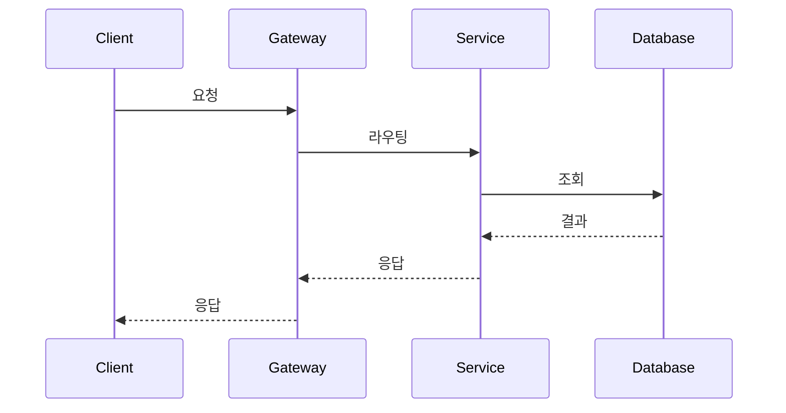
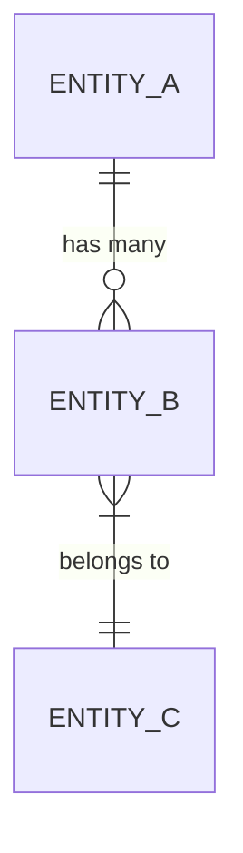
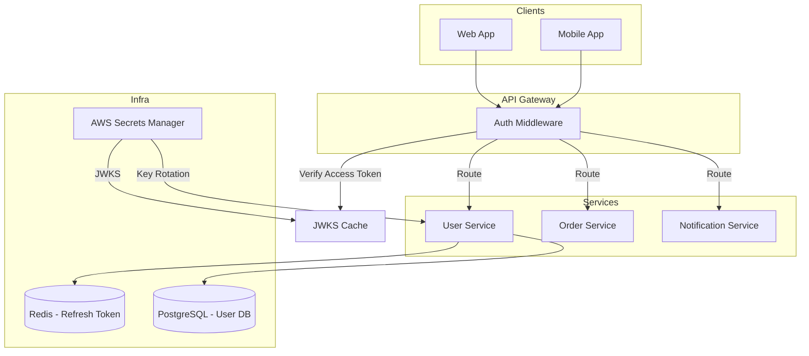
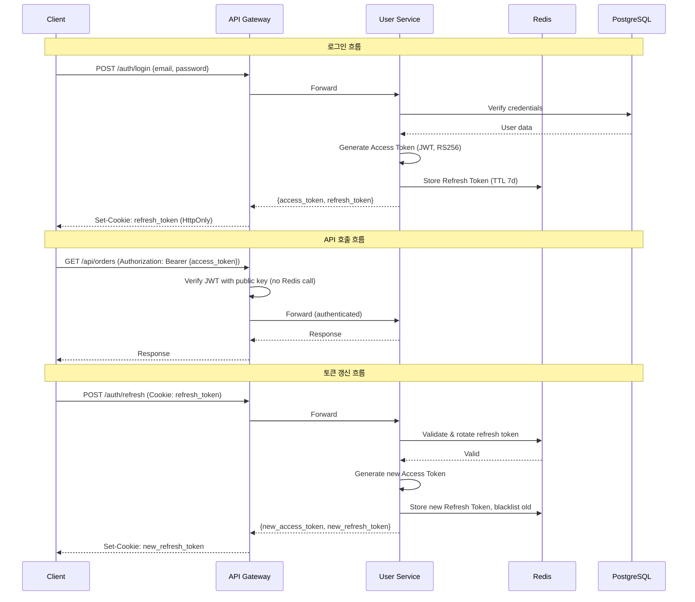
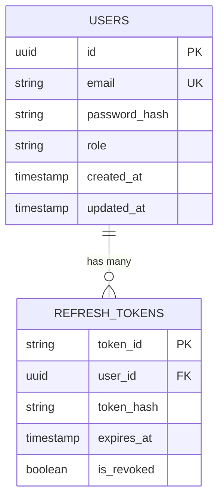

# Design Doc 템플릿

> Google Design Doc 스타일 기반 기술 설계 문서 템플릿.
> 프로세스 가이드: [Design Doc / RFC 프로세스 가이드](../../docs/guides/design-doc-process.md)

---

## 사용법

1. 이 파일을 `docs/design-docs/YYYY-MM-DD_제목.md`로 복사한다
2. 메타데이터(Title ~ Date)를 채운다
3. 각 섹션을 작성한다. 해당 없는 섹션은 "N/A - [사유]"로 표기한다
4. Git에 커밋하고 PR로 리뷰를 진행한다
5. 구현 완료 후 ADR을 생성하고 이 문서를 Archived 처리한다

### 상태(Status) 정의

| Status | 의미 |
|--------|------|
| `Draft` | 작성 중. 리뷰 전 |
| `In Review` | 리뷰어 검토 중 |
| `Approved` | 승인 완료. 구현 가능 |
| `Rejected` | 불채택. 사유 기록 필수 |
| `Implementing` | 구현 진행 중 |
| `Archived` | 완료. ADR로 전환됨 |

---

## 템플릿

````markdown
# [Design Doc 제목]

## Metadata

| 항목 | 내용 |
|------|------|
| **Author(s)** | @작성자 |
| **Reviewer(s)** | @리뷰어1, @리뷰어2 |
| **Status** | Draft / In Review / Approved / Rejected / Implementing / Archived |
| **Created** | YYYY-MM-DD |
| **Last Updated** | YYYY-MM-DD |
| **Related ADR** | (구현 완료 후 링크 추가) |
| **Related Issues** | #이슈번호 |

---

## 1. Context & Problem Statement

이 Design Doc이 다루는 문제의 배경과 맥락을 설명한다.

### 1.1 배경

- 현재 시스템의 상태와 제약
- 이 문제가 발생한 원인
- 이 문제를 지금 해결해야 하는 이유

### 1.2 문제 정의

(해결하려는 핵심 문제를 1-3문장으로 명확히 기술한다)

### 1.3 영향 범위

| 영향 대상 | 설명 |
|-----------|------|
| 사용자 | (영향받는 사용자 유형과 규모) |
| 서비스 | (영향받는 서비스/컴포넌트) |
| 팀 | (관련 팀) |

---

## 2. Goals & Non-Goals

### 2.1 Goals

이 Design Doc이 달성하려는 목표. 측정 가능하게 기술한다.

- **G1**: (목표 1 -- 측정 기준 포함)
- **G2**: (목표 2 -- 측정 기준 포함)
- **G3**: (목표 3 -- 측정 기준 포함)

### 2.2 Non-Goals

의도적으로 이번 범위에서 제외하는 항목. 향후 별도 Design Doc에서 다룰 수 있다.

- **NG1**: (제외 항목 1 -- 제외 이유)
- **NG2**: (제외 항목 2 -- 제외 이유)

---

## 3. Proposed Design

### 3.1 개요

제안하는 설계의 핵심 아이디어를 1-2 문단으로 요약한다.

### 3.2 상세 설계

설계의 구체적인 내용을 기술한다. 하위 섹션을 자유롭게 추가한다.

#### 3.2.1 (설계 요소 1)

(설명)

#### 3.2.2 (설계 요소 2)

(설명)

### 3.3 핵심 설계 결정

| 결정 사항 | 선택 | 근거 |
|-----------|------|------|
| (결정 1) | (선택안) | (근거) |
| (결정 2) | (선택안) | (근거) |

---

## 4. System Architecture

### 4.1 시스템 구성도



### 4.2 시퀀스 다이어그램



### 4.3 컴포넌트 간 의존성

| 컴포넌트 | 의존 대상 | 통신 방식 | 장애 시 영향 |
|----------|----------|----------|-------------|
| (컴포넌트 A) | (대상) | REST / gRPC / Event | (영향) |

---

## 5. Data Model

### 5.1 엔티티 관계도



### 5.2 주요 테이블/컬렉션

| 테이블명 | 용도 | 예상 크기 | 인덱스 전략 |
|----------|------|----------|------------|
| (테이블 A) | (용도) | (행 수, 크기) | (PK, 복합 인덱스 등) |

### 5.3 데이터 마이그레이션

(기존 데이터 스키마 변경 시 마이그레이션 전략 기술)

---

## 6. API Design

### 6.1 신규/변경 API 목록

| Method | Endpoint | 설명 | 변경 유형 |
|--------|----------|------|----------|
| `POST` | `/api/v1/resource` | 리소스 생성 | 신규 |
| `PUT` | `/api/v1/resource/{id}` | 리소스 수정 | 변경 |

### 6.2 요청/응답 예시

```json
// POST /api/v1/resource
// Request
{
  "name": "example",
  "type": "standard"
}

// Response (201 Created)
{
  "id": "res_abc123",
  "name": "example",
  "type": "standard",
  "created_at": "2026-03-12T09:00:00Z"
}
```

### 6.3 에러 응답

| HTTP 코드 | 에러 코드 | 설명 |
|-----------|----------|------|
| 400 | `INVALID_INPUT` | 입력값 검증 실패 |
| 409 | `RESOURCE_CONFLICT` | 리소스 중복 |

### 6.4 하위 호환성

(기존 API와의 하위 호환성 유지 방안. 버전 관리 전략)

---

## 7. Alternatives Considered

### 7.1 비교표

| 기준 | 제안 설계 | 대안 A: (이름) | 대안 B: (이름) |
|------|----------|---------------|---------------|
| **구현 복잡도** | (평가) | (평가) | (평가) |
| **성능** | (평가) | (평가) | (평가) |
| **확장성** | (평가) | (평가) | (평가) |
| **운영 비용** | (평가) | (평가) | (평가) |
| **팀 역량** | (평가) | (평가) | (평가) |

### 7.2 대안 A: (이름)

- **설명**: (대안 설명)
- **장점**: (장점)
- **단점**: (단점)
- **불채택 사유**: (왜 이 대안을 선택하지 않았는가)

### 7.3 대안 B: (이름)

- **설명**: (대안 설명)
- **장점**: (장점)
- **단점**: (단점)
- **불채택 사유**: (왜 이 대안을 선택하지 않았는가)

---

## 8. Cross-Cutting Concerns

### 8.1 보안 (Security)

| 항목 | 대응 방안 |
|------|----------|
| 인증/인가 | (인증 방식, 권한 모델) |
| 데이터 보호 | (암호화, PII 처리) |
| 입력 검증 | (검증 전략) |
| 감사 로그 | (감사 추적 방안) |

### 8.2 성능 (Performance)

| 메트릭 | 현재 | 목표 | 달성 방안 |
|--------|------|------|----------|
| P50 레이턴시 | (현재값) | (목표값) | (방안) |
| P99 레이턴시 | (현재값) | (목표값) | (방안) |
| 처리량 (RPS) | (현재값) | (목표값) | (방안) |

### 8.3 모니터링 & 관측 가능성 (Observability)

- **메트릭**: (수집할 핵심 메트릭)
- **로깅**: (로그 레벨, 구조화된 로깅)
- **트레이싱**: (분산 트레이싱 계획)
- **알림**: (알림 조건, 대응 절차)
- **대시보드**: (모니터링 대시보드 계획)

### 8.4 테스트 전략 (Testing)

| 테스트 유형 | 범위 | 도구 |
|------------|------|------|
| 단위 테스트 | (범위) | (도구) |
| 통합 테스트 | (범위) | (도구) |
| E2E 테스트 | (범위) | (도구) |
| 부하 테스트 | (범위) | (도구) |

---

## 9. Migration Plan

### 9.1 마이그레이션 전략

(기존 시스템에서 새 시스템으로 전환하는 전략. N/A인 경우 생략)

### 9.2 단계별 계획

| 단계 | 내용 | 롤백 가능 여부 |
|------|------|---------------|
| Phase 1 | (내용) | Yes / No |
| Phase 2 | (내용) | Yes / No |

### 9.3 롤백 계획

(실패 시 이전 상태로 복원하는 절차)

---

## 10. Open Questions

해결되지 않은 질문. 리뷰를 통해 답을 찾는다.

| # | 질문 | 상태 | 답변/결론 |
|---|------|------|----------|
| 1 | (질문) | Open / Resolved | (답변) |
| 2 | (질문) | Open / Resolved | (답변) |

---

## 11. Timeline

| 마일스톤 | 예상 일정 | 담당 | 의존성 |
|----------|----------|------|--------|
| Design Doc 승인 | YYYY-MM-DD | (담당자) | - |
| Phase 1 구현 | YYYY-MM-DD | (담당자) | Design Doc 승인 |
| Phase 2 구현 | YYYY-MM-DD | (담당자) | Phase 1 완료 |
| 테스트 완료 | YYYY-MM-DD | (담당자) | Phase 2 완료 |
| 프로덕션 배포 | YYYY-MM-DD | (담당자) | 테스트 완료 |
| ADR 작성 | YYYY-MM-DD | Author | 프로덕션 배포 |

---

## Appendix

(필요 시 상세 데이터, 벤치마크 결과, 참고 자료 등을 추가)

````

---

## 예시: 인증 시스템 설계

아래는 이 템플릿을 활용한 실제 예시다.

````markdown
# 사용자 인증 시스템 JWT 기반 마이그레이션

## Metadata

| 항목 | 내용 |
|------|------|
| **Author(s)** | @kim-backend |
| **Reviewer(s)** | @lee-architect, @park-security, @choi-frontend |
| **Status** | Approved |
| **Created** | 2026-03-01 |
| **Last Updated** | 2026-03-10 |
| **Related ADR** | docs/adr/0005-JWT-인증-마이그레이션.md |
| **Related Issues** | #142, #158 |

---

## 1. Context & Problem Statement

### 1.1 배경

- 현재 세션 기반 인증(Express-session + Redis)을 사용 중
- 서비스 확장에 따라 3개의 백엔드 서비스가 각각 세션 스토어에 접근
- Redis 단일 장애점(SPOF)으로 인해 2026-02-15 전체 서비스 30분 중단 발생 (Incident #87)
- 모바일 앱 출시 예정(2026-Q2)으로 Stateless 인증 필요

### 1.2 문제 정의

세션 기반 인증의 수평 확장 한계와 단일 장애점(SPOF) 문제를 해결하고, 모바일 클라이언트를 지원하는 Stateless 인증 체계로 전환해야 한다.

### 1.3 영향 범위

| 영향 대상 | 설명 |
|-----------|------|
| 사용자 | 전체 사용자 (MAU 50K). 마이그레이션 중 재로그인 필요 |
| 서비스 | API Gateway, User Service, Order Service, Notification Service |
| 팀 | Backend팀, Frontend팀, Mobile팀, DevOps팀 |

---

## 2. Goals & Non-Goals

### 2.1 Goals

- **G1**: Stateless 인증으로 전환하여 Redis 세션 스토어 의존성 제거
- **G2**: 인증 관련 P99 레이턴시 50ms 이하 유지 (현재 35ms)
- **G3**: 모바일/웹 클라이언트 동일 인증 흐름 지원
- **G4**: Zero-downtime 마이그레이션 (사용자 영향 최소화)

### 2.2 Non-Goals

- **NG1**: OAuth2 소셜 로그인 통합 -- 별도 Design Doc에서 다룸 (Q3 예정)
- **NG2**: RBAC(Role-Based Access Control) 고도화 -- 현재 역할 모델 유지
- **NG3**: SSO(Single Sign-On) 구현 -- 현재 단일 서비스 도메인 유지

---

## 3. Proposed Design

### 3.1 개요

JWT(JSON Web Token) 기반 인증으로 전환한다. Access Token(15분) + Refresh Token(7일) 이중 토큰 구조를 채택하고, RS256 비대칭 알고리즘으로 서명한다. Refresh Token만 Redis에 저장하여 즉시 폐기를 가능하게 하되, Access Token 검증은 Redis 호출 없이 공개키로 수행한다.

### 3.2 상세 설계

#### 3.2.1 토큰 구조

**Access Token (JWT)**
- 알고리즘: RS256 (비대칭. 서비스별 공개키로 독립 검증)
- 만료: 15분
- 페이로드: `{ sub, role, iat, exp }`
- 저장: 클라이언트 메모리 (웹: 변수, 모바일: Keychain)

**Refresh Token**
- 형식: Opaque (UUID v4)
- 만료: 7일
- 저장: Redis (서버), HttpOnly Secure Cookie (클라이언트)
- 로테이션: 사용 시 새 Refresh Token 발급, 기존 토큰 블랙리스트 등록

#### 3.2.2 키 관리

- RSA 2048-bit 키 페어. 90일 주기 자동 로테이션
- 키 저장: AWS Secrets Manager
- JWKS(JSON Web Key Set) 엔드포인트 제공 (`/.well-known/jwks.json`)
- 각 서비스는 JWKS를 5분 간격으로 캐시

### 3.3 핵심 설계 결정

| 결정 사항 | 선택 | 근거 |
|-----------|------|------|
| 서명 알고리즘 | RS256 | 서비스별 독립 검증. HS256은 시크릿 공유 필요 |
| Access Token 만료 | 15분 | 보안(짧을수록 안전) vs UX(길수록 편리) 균형점 |
| Refresh Token 저장 | Redis | 즉시 폐기 필요. DB보다 조회 빠름 |
| 키 로테이션 주기 | 90일 | NIST 권고 기반. 운영 부담과 보안의 균형 |

---

## 4. System Architecture

### 4.1 시스템 구성도



### 4.2 시퀀스 다이어그램



### 4.3 컴포넌트 간 의존성

| 컴포넌트 | 의존 대상 | 통신 방식 | 장애 시 영향 |
|----------|----------|----------|-------------|
| API Gateway | JWKS Cache | 인메모리 | 캐시 만료 전까지 정상 동작, 이후 인증 불가 |
| User Service | PostgreSQL | TCP | 로그인/회원가입 불가. 기존 토큰은 유효 |
| User Service | Redis | TCP | Refresh 불가. Access Token 만료 시 재로그인 필요 |
| All Services | Secrets Manager | HTTPS | 키 로테이션 불가. 기존 키로 계속 동작 |

---

## 5. Data Model

### 5.1 엔티티 관계도



### 5.2 주요 테이블/컬렉션

| 테이블명 | 용도 | 예상 크기 | 인덱스 전략 |
|----------|------|----------|------------|
| `users` | 사용자 정보 | 50K rows, 10MB | PK(id), UNIQUE(email) |
| Redis: `refresh:{token_id}` | Refresh Token 저장 | 50K keys, 5MB | TTL 기반 자동 만료 |
| Redis: `blacklist:{token_id}` | 블랙리스트 | 최대 100K keys | TTL = Access Token 잔여 시간 |

### 5.3 데이터 마이그레이션

기존 `sessions` 테이블 삭제 예정. 마이그레이션 기간(2주) 동안 세션/JWT 병렬 운영 후 세션 데이터 제거.

---

## 6. API Design

### 6.1 신규/변경 API 목록

| Method | Endpoint | 설명 | 변경 유형 |
|--------|----------|------|----------|
| `POST` | `/auth/login` | 로그인 (JWT 발급) | 변경 (응답 형식) |
| `POST` | `/auth/refresh` | 토큰 갱신 | 신규 |
| `POST` | `/auth/logout` | 로그아웃 (토큰 폐기) | 변경 |
| `GET` | `/.well-known/jwks.json` | 공개키 조회 | 신규 |

### 6.2 요청/응답 예시

```json
// POST /auth/login
// Request
{
  "email": "user@example.com",
  "password": "s3cur3P@ss"
}

// Response (200 OK)
{
  "access_token": "eyJhbGciOiJSUzI1NiIs...",
  "token_type": "Bearer",
  "expires_in": 900
}
// + Set-Cookie: refresh_token=uuid-v4; HttpOnly; Secure; SameSite=Strict; Path=/auth; Max-Age=604800
```

```json
// POST /auth/refresh
// Cookie: refresh_token=uuid-v4

// Response (200 OK)
{
  "access_token": "eyJhbGciOiJSUzI1NiIs...(new)",
  "token_type": "Bearer",
  "expires_in": 900
}
// + Set-Cookie: refresh_token=new-uuid-v4; ...
```

### 6.3 에러 응답

| HTTP 코드 | 에러 코드 | 설명 |
|-----------|----------|------|
| 401 | `INVALID_CREDENTIALS` | 이메일 또는 비밀번호 불일치 |
| 401 | `TOKEN_EXPIRED` | Access Token 만료 |
| 401 | `REFRESH_TOKEN_REVOKED` | Refresh Token 폐기됨 |
| 429 | `RATE_LIMIT_EXCEEDED` | 로그인 시도 횟수 초과 (5회/분) |

### 6.4 하위 호환성

마이그레이션 기간(2주) 동안 세션 쿠키와 JWT Bearer 토큰 모두 인정. API Gateway에서 두 인증 방식을 병렬로 검증한다. 마이그레이션 완료 후 세션 인증 제거.

---

## 7. Alternatives Considered

### 7.1 비교표

| 기준 | 제안: JWT (RS256) | 대안 A: JWT (HS256) | 대안 B: OAuth2 + Opaque Token |
|------|------------------|--------------------|-----------------------------|
| **구현 복잡도** | 중간 (키 관리 필요) | 낮음 | 높음 (Authorization Server 필요) |
| **성능** | 높음 (로컬 검증) | 높음 (로컬 검증) | 낮음 (매 요청 Auth Server 호출) |
| **확장성** | 높음 (독립 검증) | 중간 (시크릿 공유) | 높음 (표준 프로토콜) |
| **보안** | 높음 (비대칭 키) | 중간 (시크릿 노출 위험) | 매우 높음 |
| **팀 역량** | 충분 | 충분 | 부족 (OAuth2 경험 없음) |

### 7.2 대안 A: JWT with HS256

- **설명**: 대칭키(HMAC-SHA256)로 서명하는 JWT
- **장점**: 구현 단순, 라이브러리 지원 풍부
- **단점**: 모든 서비스가 동일 시크릿 공유 필요. 서비스 수 증가 시 시크릿 관리 복잡도 급증
- **불채택 사유**: 3개 서비스에 시크릿을 공유해야 하며, 하나라도 노출되면 전체 토큰 위조 가능. RS256으로 공개키만 배포하는 것이 보안상 우월

### 7.3 대안 B: OAuth2 + Opaque Token

- **설명**: 별도 Authorization Server를 두고 Opaque Token을 발급. 각 서비스는 Auth Server에 토큰 검증 요청
- **장점**: 업계 표준 프로토콜, 토큰 즉시 폐기 가능, SSO 확장 용이
- **단점**: Authorization Server 구축/운영 필요, 매 요청마다 Auth Server 호출로 레이턴시 증가
- **불채택 사유**: 현재 팀에 OAuth2 운영 경험이 없고, 50K MAU 규모에서 별도 Auth Server는 과투자. G2(P99 50ms 이하) 달성이 어려움. SSO가 필요해지는 시점(NG3)에 재검토

---

## 8. Cross-Cutting Concerns

### 8.1 보안 (Security)

| 항목 | 대응 방안 |
|------|----------|
| 인증/인가 | RS256 JWT. Role 기반 인가 유지 |
| 데이터 보호 | 비밀번호 bcrypt 해싱(cost 12). Token 전송 HTTPS only |
| 입력 검증 | 이메일 형식 검증, 비밀번호 정책(8자 이상, 영문+숫자+특수문자) |
| 감사 로그 | 로그인/로그아웃/토큰갱신/실패 시도 모두 구조화된 로그 기록 |
| Rate Limiting | 로그인: 5회/분/IP, Refresh: 10회/분/사용자 |

### 8.2 성능 (Performance)

| 메트릭 | 현재 (세션) | 목표 (JWT) | 달성 방안 |
|--------|-----------|-----------|----------|
| P50 레이턴시 | 15ms | 10ms | Access Token 로컬 검증 (Redis 호출 제거) |
| P99 레이턴시 | 35ms | 50ms 이하 | JWKS 5분 캐시, Connection Pool |
| 처리량 | 1,000 RPS | 2,000 RPS | Redis 의존 제거로 병목 해소 |

### 8.3 모니터링 & 관측 가능성 (Observability)

- **메트릭**: `auth.login.count`, `auth.login.latency`, `auth.token.refresh.count`, `auth.token.verify.failure`
- **로깅**: 구조화된 JSON 로그. 사용자 ID, 요청 IP, 성공/실패, 실패 사유 포함
- **트레이싱**: OpenTelemetry span으로 인증 흐름 전체 추적
- **알림**: 로그인 실패율 > 10% 시 PagerDuty 알림, JWT 검증 실패 급증 시 알림
- **대시보드**: Grafana 인증 대시보드 (로그인 성공률, 토큰 갱신률, 에러율)

### 8.4 테스트 전략 (Testing)

| 테스트 유형 | 범위 | 도구 |
|------------|------|------|
| 단위 테스트 | JWT 발급/검증, 키 로테이션, Rate Limiter | pytest, 커버리지 90%+ |
| 통합 테스트 | 로그인 -> 토큰 발급 -> API 호출 -> 갱신 전체 흐름 | pytest + testcontainers |
| E2E 테스트 | 웹/모바일 로그인 시나리오 | Playwright |
| 부하 테스트 | 2,000 RPS 동시 인증 요청 | k6 |

---

## 9. Migration Plan

### 9.1 마이그레이션 전략

병렬 운영(Parallel Run) 방식. 2주간 세션 + JWT를 동시에 운영한 후, 세션을 제거한다.

### 9.2 단계별 계획

| 단계 | 내용 | 롤백 가능 여부 |
|------|------|---------------|
| Phase 1 (Day 1-3) | JWT 인증 모듈 구현 + 테스트 | Yes (미배포) |
| Phase 2 (Day 4-5) | API Gateway에 JWT 검증 추가 (세션도 유지) | Yes (JWT 비활성화) |
| Phase 3 (Day 6-7) | 프론트엔드 JWT 전환 + Canary 배포 (10%) | Yes (Canary 롤백) |
| Phase 4 (Day 8-14) | 전체 배포 + 세션/JWT 병렬 운영 | Yes (세션 폴백) |
| Phase 5 (Day 15) | 세션 인증 제거, Redis 세션 데이터 삭제 | No (Point of No Return) |

### 9.3 롤백 계획

- Phase 1-4: API Gateway 설정 변경으로 세션 인증으로 즉시 복귀 (5분 이내)
- Phase 5 이후: 롤백 불가. Phase 4까지 충분한 검증 필수
- 롤백 트리거: 인증 에러율 > 5% 또는 P99 레이턴시 > 200ms

---

## 10. Open Questions

| # | 질문 | 상태 | 답변/결론 |
|---|------|------|----------|
| 1 | Refresh Token 탈취 시 대응 방안은? | Resolved | Token Rotation + 사용된 토큰 감지 시 해당 사용자의 전체 세션 무효화 |
| 2 | 키 로테이션 중 다운타임 발생 가능성은? | Resolved | JWKS에 현재 키 + 이전 키 함께 게시. 전환 기간(24h) 운영 |
| 3 | 모바일 앱에서 Refresh Token 저장 위치는? | Open | iOS Keychain / Android EncryptedSharedPreferences 검토 중 |

---

## 11. Timeline

| 마일스톤 | 예상 일정 | 담당 | 의존성 |
|----------|----------|------|--------|
| Design Doc 승인 | 2026-03-10 | @kim-backend | - |
| JWT 모듈 구현 + 단위 테스트 | 2026-03-14 | @kim-backend | Design Doc 승인 |
| API Gateway 통합 | 2026-03-17 | @kim-backend, @devops | JWT 모듈 |
| 프론트엔드 전환 | 2026-03-19 | @choi-frontend | API Gateway 통합 |
| Canary 배포 (10%) | 2026-03-20 | @devops | 프론트엔드 전환 |
| 전체 배포 + 병렬 운영 | 2026-03-21 | @devops | Canary 검증 |
| 세션 제거 + ADR 작성 | 2026-04-04 | @kim-backend | 병렬 운영 2주 |

---

## Appendix

### A. JWT 토큰 페이로드 상세

```json
{
  "sub": "user_abc123",
  "role": "admin",
  "iat": 1709280000,
  "exp": 1709280900,
  "iss": "auth.example.com",
  "aud": "api.example.com"
}
```

### B. JWKS 응답 형식

```json
{
  "keys": [
    {
      "kty": "RSA",
      "kid": "2026-03-01",
      "use": "sig",
      "alg": "RS256",
      "n": "...",
      "e": "AQAB"
    }
  ]
}
```
````
