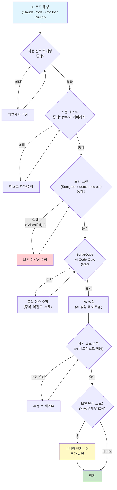

# AI 생성 코드 리뷰 가이드

> **작성일**: 2026-03-12
> **대상 도구**: Claude Code, GitHub Copilot, Cursor, Windsurf, Cody 등
> **기반 표준**: OWASP Top 10 2025, SonarQube "Sonar way for AI Code", 빅테크 AI 거버넌스 프레임워크
> **적용 수준**: AI가 생성한 모든 코드에 적용

---

## 목차

1. [AI 생성 코드의 특성과 위험](#1-ai-생성-코드의-특성과-위험)
2. [AI 코드 리뷰 체크리스트](#2-ai-코드-리뷰-체크리스트)
3. [AI 코드 품질 기준 강화](#3-ai-코드-품질-기준-강화)
4. [AI 도구별 가이드](#4-ai-도구별-가이드)
5. [AI 코드 승인 프로세스](#5-ai-코드-승인-프로세스)
6. [팀 가이드라인](#6-팀-가이드라인)
7. [참고 자료](#7-참고-자료)

---

## 1. AI 생성 코드의 특성과 위험

### 1.1 핵심 원칙

> **"AI 자율성을 높이려면 검증 인프라를 동시에 높여야 한다."**
> -- 2026년 AI 코드 품질 관리의 핵심 원칙

AI가 코드의 40% 이상을 생성하는 시대에 진입했다. AI 코딩 도구는 생산성을 극적으로 향상시키지만, 그 출력물은 **사람이 작성한 코드와 질적으로 다른 위험 프로파일**을 가진다. 이 가이드는 AI 생성 코드를 안전하고 신뢰할 수 있게 팀에 통합하기 위한 리뷰 표준이다.

### 1.2 AI 코드의 일반적 문제 패턴

#### (1) 환각 (Hallucination)

AI는 **존재하지 않는 API, 함수, 라이브러리를 자신 있게 호출**한다.

| 환각 유형 | 예시 | 위험도 |
|-----------|------|--------|
| 존재하지 않는 API | `requests.get(..., verify_ssl=True)` (올바른 파라미터: `verify`) | 높음 |
| 폐기된 함수 | Python 3.12+에서 `datetime.utcnow()` 사용 (deprecated) | 중간 |
| 가짜 라이브러리 | `import fast_json_validator` (존재하지 않는 패키지) | 높음 |
| 잘못된 시그니처 | 실제와 다른 함수 매개변수 순서나 타입 | 중간 |
| 가짜 설정 옵션 | 프레임워크에 없는 설정값 사용 | 중간 |

```python
# BAD: AI hallucination -- datetime.utcnow() is deprecated since Python 3.12
from datetime import datetime
timestamp = datetime.utcnow()

# GOOD: timezone-aware datetime
from datetime import datetime, timezone
timestamp = datetime.now(timezone.utc)
```

#### (2) 보안 취약점 재생산

AI는 훈련 데이터에 포함된 **안전하지 않은 코드 패턴을 높은 확률로 재생산**한다.

| 취약점 유형 | 발생 빈도 | 심각도 |
|------------|-----------|--------|
| SQL 인젝션 (문자열 포매팅 쿼리) | 높음 | Critical |
| 하드코딩된 시크릿 / API 키 | 높음 | Critical |
| 입력 검증 누락 | 매우 높음 | High |
| 안전하지 않은 역직렬화 | 중간 | Critical |
| 취약한 암호화 알고리즘 (MD5, SHA-1) | 중간 | High |
| 디렉터리 탐색 취약점 | 중간 | High |
| CORS 와일드카드 설정 | 높음 | Medium |

```python
# BAD: AI frequently generates SQL injection vulnerable code
query = f"SELECT * FROM users WHERE name = '{user_input}'"
cursor.execute(query)

# GOOD: parameterized query
query = "SELECT * FROM users WHERE name = %s"
cursor.execute(query, (user_input,))
```

**2025-2026 연구 데이터:**

- AI 생성 코드에서 보안 취약점이 발견되는 비율은 연구에 따라 30-40% 수준으로 보고됨 (Stanford 연구 등 다수)
- GitHub Copilot이 제안하는 코드 중 CWE Top 25 취약점을 포함하는 비율이 유의미하게 높음
- AI가 생성한 코드를 사용하는 개발자는 "코드가 안전하다"고 과신하는 경향이 있음 (자동화 편향)
- OWASP는 2025 Top 10에서 공급망 공격(A03)을 신규 확장하며, AI 생성 코드의 의존성 위험을 경고

#### (3) 과도한 추상화 / 불필요한 복잡성

AI는 간단한 문제에 대해 **불필요하게 복잡한 솔루션을 제안**하는 경향이 있다.

| 패턴 | 설명 |
|------|------|
| 과도한 디자인 패턴 | 단순 CRUD에 Strategy + Factory + Builder 결합 |
| 불필요한 추상화 계층 | 하나의 구현체만 있는 인터페이스/추상 클래스 |
| 과도한 제네릭 | 실제로 한 가지 타입만 사용하는 제네릭 구조 |
| 프레임워크 과잉 | 10줄이면 충분한 작업에 외부 라이브러리 도입 |
| 미사용 코드 | 요청하지 않은 유틸리티 함수, 헬퍼 클래스 생성 |

```typescript
// BAD: AI over-engineering -- unnecessary abstraction for simple task
interface IUserNameFormatter {
  format(user: User): string;
}

class DefaultUserNameFormatter implements IUserNameFormatter {
  format(user: User): string {
    return `${user.firstName} ${user.lastName}`;
  }
}

class UserNameFormatterFactory {
  static create(): IUserNameFormatter {
    return new DefaultUserNameFormatter();
  }
}

// GOOD: simple and direct
function formatUserName(user: User): string {
  return `${user.firstName} ${user.lastName}`;
}
```

#### (4) 레거시 패턴 / 구버전 API 사용

AI 모델의 훈련 데이터 컷오프로 인해 **최신 API 대신 구버전 패턴을 생성**한다.

| 언어 | 레거시 패턴 (AI가 자주 생성) | 현재 권장 패턴 |
|------|---------------------------|---------------|
| Python | `os.path.join()` | `pathlib.Path` |
| Python | `typing.Dict`, `typing.List` | `dict`, `list` (3.9+) |
| Python | `unittest.TestCase` | `pytest` 함수 기반 |
| TypeScript | `enum` | `as const` 객체 또는 union |
| TypeScript | `React.FC` | 일반 함수 컴포넌트 |
| Kotlin | `java.util.Date` | `java.time.LocalDateTime` |
| JavaScript | `var` 선언 | `const` / `let` |
| JavaScript | CommonJS `require()` | ES Module `import` |

#### (5) 컨텍스트 맹점

AI는 **현재 프로젝트의 고유한 컨텍스트를 충분히 이해하지 못한다**.

| 맹점 유형 | 설명 |
|-----------|------|
| 프로젝트 아키텍처 불일치 | 프로젝트가 레이어드 아키텍처인데 헥사고날 패턴 코드 생성 |
| 기존 유틸리티 무시 | 프로젝트에 이미 존재하는 헬퍼를 재구현 |
| 네이밍 컨벤션 불일치 | 프로젝트가 `snake_case`인데 `camelCase` 생성 |
| 의존성 버전 불일치 | 프로젝트에 설치되지 않은 라이브러리 버전의 API 사용 |
| 환경 설정 무시 | `.env` 변수명, DB 스키마, 설정 구조 불일치 |

### 1.3 위험도 분류 매트릭스

| 위험 수준 | 패턴 | 리뷰 대응 |
|-----------|------|-----------|
| **Critical** | 보안 취약점, 데이터 손실 가능성 | 즉시 수정, 머지 차단 |
| **High** | 환각 (존재하지 않는 API), 잘못된 비즈니스 로직 | 수정 후 재리뷰 필수 |
| **Medium** | 레거시 패턴, 구버전 API, 과도한 추상화 | 수정 권고, 타임라인 설정 |
| **Low** | 네이밍 불일치, 스타일 미준수 | 자동 린터로 해결 |

---

## 2. AI 코드 리뷰 체크리스트

### 2.1 일반 코드 리뷰 항목 (기본 적용)

기존 코드 리뷰 체크리스트의 모든 항목이 AI 생성 코드에도 동일하게 적용된다.

| 카테고리 | 필수 항목 |
|----------|----------|
| 기능 | 요구사항을 정확히 구현하는가? |
| 가독성 | 코드가 명확하고 자기 문서화되는가? |
| 성능 | N+1 쿼리, 불필요한 루프, 메모리 누수가 없는가? |
| 에러 핸들링 | 실패 시나리오를 적절히 처리하는가? |
| 스타일 | 프로젝트 코딩 스타일 가이드를 준수하는가? |

### 2.2 AI 전용 추가 체크리스트

아래 항목은 **AI 생성 코드에만 추가로 적용**되는 검증 항목이다.

#### (A) 정확성 검증 -- MUST

| # | 검증 항목 | 확인 방법 |
|---|----------|-----------|
| A1 | 사용된 API/함수가 **실제로 존재**하는가? | 공식 문서에서 확인 |
| A2 | 함수 시그니처(매개변수 이름, 순서, 타입)가 **정확**한가? | IDE 자동완성 또는 공식 문서 대조 |
| A3 | 사용된 라이브러리가 **프로젝트에 설치되어 있고 버전이 호환**되는가? | `requirements.txt`, `package.json`, `build.gradle.kts` 확인 |
| A4 | deprecated 함수를 사용하지 않는가? | 경고 메시지, 공식 마이그레이션 가이드 확인 |
| A5 | import 경로가 **프로젝트 구조와 일치**하는가? | 실제 파일 경로 확인 |
| A6 | 알고리즘/비즈니스 로직이 **요구사항과 정확히 일치**하는가? | 명세서/티켓 대조 |
| A7 | 에지 케이스(null, 빈 값, 경계값, 큰 입력)를 **올바르게 처리**하는가? | 수동 검토 + 테스트 |

#### (B) 보안 강화 검증 -- MUST

| # | 검증 항목 | 자동 검출 도구 |
|---|----------|---------------|
| B1 | 모든 사용자 입력에 **유효성 검증**이 있는가? | Semgrep, SonarQube |
| B2 | SQL 쿼리가 **파라미터화**되어 있는가? (문자열 포매팅 금지) | Semgrep, Ruff S608 |
| B3 | 하드코딩된 **시크릿/API 키/비밀번호**가 없는가? | detect-secrets, gitleaks |
| B4 | 에러 응답에 **스택 트레이스, 내부 경로**가 노출되지 않는가? | 수동 검토 |
| B5 | 암호화에 **안전한 알고리즘**을 사용하는가? (MD5/SHA-1 금지) | SonarQube, Semgrep |
| B6 | 파일 경로 처리에 **디렉터리 탐색 취약점**이 없는가? | Semgrep |
| B7 | CORS 설정이 **와일드카드(`*`)가 아닌 화이트리스트 방식**인가? | 수동 검토 |
| B8 | 외부 입력의 **역직렬화**가 안전한가? (pickle, yaml.load 금지) | Ruff S301/S506, Semgrep |
| B9 | 인증/인가 검증이 **모든 엔드포인트**에 적용되어 있는가? | 수동 검토 |

#### (C) 아키텍처 적합성 -- MUST

| # | 검증 항목 | 판단 기준 |
|---|----------|-----------|
| C1 | **프로젝트 아키텍처 패턴**을 준수하는가? | 레이어드/클린/헥사고날 등 기존 패턴 확인 |
| C2 | **불필요한 외부 의존성**을 추가하지 않았는가? | 표준 라이브러리로 해결 가능한지 확인 |
| C3 | **기존 유틸리티/헬퍼를 재구현**하지 않았는가? | 코드베이스 검색 (grep, IDE Find) |
| C4 | **과도한 추상화**가 없는가? (YAGNI 원칙) | 현재 필요한 것만 구현되었는지 확인 |
| C5 | **네이밍 컨벤션**이 프로젝트와 일치하는가? | 코딩 스타일 가이드 대조 |
| C6 | **파일 배치**가 프로젝트 구조를 따르는가? | 디렉터리 구조 확인 |
| C7 | **에러 핸들링 패턴**이 프로젝트 표준과 일치하는가? | 기존 코드 패턴 대조 |

#### (D) 테스트 품질 -- MUST

| # | 검증 항목 | 기준 |
|---|----------|------|
| D1 | 테스트가 **의미 있는 assertion**을 포함하는가? | `assertTrue(true)` 금지 |
| D2 | **엣지 케이스**를 테스트하는가? (null, 빈 값, 경계값, 에러 경로) | 최소 3개 이상의 엣지 케이스 |
| D3 | **비즈니스 로직**을 테스트하는가? (구현 상세가 아닌 행동) | 행동 기반 테스트 확인 |
| D4 | 모킹이 **과도하지 않은가**? | 외부 의존성만 모킹, 내부 로직 모킹 금지 |
| D5 | AI 생성 코드의 커버리지가 **90% 이상**인가? | CI 커버리지 리포트 |
| D6 | 테스트가 **독립적으로 실행**되는가? (순서 의존성 없음) | `pytest --randomly`, `--shuffle` |
| D7 | AI가 생성한 테스트가 **실제 버그를 잡을 수 있는가?** | 의도적으로 코드를 깨뜨려서 확인 (Mutation Testing) |

#### (E) 라이선스 검증 -- SHOULD

| # | 검증 항목 | 도구 |
|---|----------|------|
| E1 | 추가된 의존성의 **라이선스가 프로젝트와 호환**되는가? | `license-checker`, FOSSA |
| E2 | **GPL 오염 위험**이 없는가? (GPL 라이브러리를 프로젝트에 연결) | 라이선스 감사 도구 |
| E3 | AI가 생성한 코드가 **특정 오픈소스를 거의 그대로 복사**하지 않았는가? | 코드 유사도 검사 |
| E4 | 새 의존성의 **유지보수 상태**가 양호한가? (마지막 업데이트, 이슈 현황) | GitHub 저장소 확인 |

### 2.3 리뷰 코멘트 접두사

AI 생성 코드 리뷰 시 아래 접두사를 사용하여 심각도를 명확히 한다.

| 접두사 | 의미 | 대응 |
|--------|------|------|
| `[AI-CRITICAL]` | 보안 취약점, 환각 API, 데이터 손실 위험 | 즉시 수정, 머지 차단 |
| `[AI-VERIFY]` | 정확성 확인 필요 (API 존재 여부, 버전 호환성 등) | 확인 후 수정 |
| `[AI-PATTERN]` | 프로젝트 패턴 불일치, 과도한 추상화 | 패턴 맞춤 수정 |
| `[AI-STYLE]` | 네이밍, 포매팅 등 스타일 이슈 | 자동 도구로 수정 가능 |

---

## 3. AI 코드 품질 기준 강화

### 3.1 기준 비교표

AI 생성 코드는 일반 코드보다 **더 높은 품질 기준**을 적용한다. 이는 AI가 대량의 코드를 빠르게 생성하므로, 낮은 품질의 코드가 빠르게 누적되는 것을 방지하기 위함이다.

| 항목 | 일반 코드 기준 | AI 코드 기준 | 근거 |
|------|---------------|-------------|------|
| 라인 커버리지 | 80% | **90%** | AI 코드의 환각 및 에지 케이스 미처리 위험 |
| 코드 중복률 | 3% | **1%** | AI가 컨텍스트 부족으로 기존 코드를 재구현하는 경향 |
| 복잡도 (McCabe) | 15 이하 | **10 이하** | AI가 과도하게 복잡한 로직을 생성하는 경향 |
| 보안 핫스팟 | 0 Critical | **0 Critical + 0 High** | AI가 보안 취약 패턴을 자주 재생산 |
| 기술 부채 비율 | 5% | **3%** | 대량 생성의 누적 효과 방지 |
| Mutation Testing Score | 권장 | **70% 이상 필수** | AI 생성 테스트의 실효성 검증 |

### 3.2 SonarQube Quality Gate 설정

SonarQube 2026.1 LTA 이상에서 **"Sonar way for AI Code"** 프로파일을 사용하거나, 아래 커스텀 Quality Gate를 설정한다.

```
Quality Gate: AI Code Gate
--------------------------
Condition                          Operator    Value
--------------------------         --------    -----
Coverage on New Code               <           90%
Duplicated Lines (%) on New Code   >           1.0%
Maintainability Rating on New Code worse than  A
Reliability Rating on New Code     worse than  A
Security Rating on New Code        worse than  A
Security Hotspots Reviewed         <           100%
Blocker Issues                     >           0
Critical Issues                    >           0
```

### 3.3 SonarQube AI Code Assurance 설정

SonarQube 의 **AI Code Assurance** 는 커밋을 보고 AI 코드를 감지하지 않는다. 프로젝트 단위로 "AI 코드 포함" 표시를 켜고, AI 용으로 인정된(qualified) 품질 게이트를 지정하는 두 단계다.

1. **Project settings > AI-generated code > Contains AI-generated code** 를 켠다
2. **Project settings > Quality Gate** 에서 AI 인정 게이트(예: Sonar way for AI Code)를 고른다 — §3.2 처럼 커스텀 게이트를 쓰려면 Sonar 가 그 게이트를 AI 인정(qualified)으로 판정하는 조건을 충족해야 한다

```bash
# same two steps via the Web API
curl -XPOST -H "Authorization: Bearer $SONAR_TOKEN" \
  "$SONAR_HOST_URL/api/projects/set_contains_ai_code?contains_ai_code=true&project=$PROJECT_KEY"
curl -XPOST -H "Authorization: Bearer $SONAR_TOKEN" \
  "$SONAR_HOST_URL/api/qualitygates/select?gateName=Sonar%20way%20for%20AI%20Code&projectKey=$PROJECT_KEY"
```

### 3.4 CI 파이프라인 통합

AI 사용 여부는 커밋 트레일러로 믿을 만하게 알 수 없다(§6.3 — 빼거나 지어내도 구분되지 않는다). 그래서 강화 게이트를 "AI 표시가 있을 때만" 켜지 않고 **모든 PR 에 같은 기준**으로 건다. 트레일러로 분기하면 트레일러를 빼는 것만으로 게이트를 건너뛸 수 있다.

```yaml
# .github/workflows/quality-gate.yml (example) — same gate for every PR, no AI detection
name: Quality Gate

on:
  pull_request:

permissions:
  contents: read

jobs:
  quality:
    runs-on: ubuntu-latest
    steps:
      - uses: actions/checkout@v4
        with:
          persist-credentials: false
      # each step fails the job on its own; there is no "AI only" branch to skip
      - name: Tests with coverage threshold
        run: <project test command with coverage fail-under>   # §3.3 에서 AI 표시한 프로젝트는 §3.1 표의 AI 기준을 쓴다
      - name: Security scan
        run: <semgrep / gitleaks as in common/security-templates/security-review.yml>
      - name: SonarQube (AI-qualified quality gate assigned to the project, §3.3)
        run: <sonar scanner with -Dsonar.qualitygate.wait=true>
```

---

## 4. AI 도구별 가이드

### 4.1 Claude Code

Claude Code는 에이전틱(Agentic) 코딩 도구로, 프로젝트 전체 컨텍스트를 읽고 코드를 생성/수정한다.

#### 필수 설정

**CLAUDE.md (프로젝트 루트)**

CLAUDE.md는 Claude Code가 세션 시작 시 읽는 프로젝트 컨텍스트 파일이다. 아래 항목을 반드시 포함한다.

```markdown
# CLAUDE.md

## 프로젝트 개요
- 프로젝트 목적, 기술 스택, 아키텍처 패턴

## 코딩 규칙
- 사용하는 코딩 스타일 가이드 참조
- 프로젝트 고유 패턴 (에러 핸들링, 로깅, 인증 방식)

## 금지 사항
- 사용하면 안 되는 라이브러리, 패턴, API
- deprecated API 목록

## 주요 커맨드
- 빌드, 테스트, 린트 실행 방법
```

**Rules (`.claude/rules/` 디렉터리)**

Rules는 특정 파일 경로 패턴에 자동으로 적용되는 규칙이다.

```markdown
---
paths:
  - "**/*"
---
# AI Code Quality Rules

- All AI-generated code MUST have 90% test coverage
- Never use deprecated APIs (check official docs)
- Never hardcode secrets, API keys, or passwords
- Use parameterized queries for all database operations
- Follow project architecture patterns strictly
```

**Hooks (`settings.json`)**

Hooks는 Claude Code의 특정 이벤트에 자동으로 실행되는 스크립트다.

```json
{
  "hooks": {
    "postToolUse": [
      {
        "matcher": "write|edit",
        "command": "ruff check --select S $FILEPATH 2>/dev/null || true"
      }
    ],
    "preCommit": [
      {
        "command": "pytest --cov --cov-fail-under=90 -q 2>/dev/null || echo 'WARN: coverage check failed'"
      }
    ]
  }
}
```

#### Claude Code 사용 시 주의사항

| 항목 | 설명 |
|------|------|
| 컨텍스트 유지 | 대규모 리팩터링 시 `/clear` 후 CLAUDE.md로 컨텍스트 재로드 |
| 점진적 생성 | 한 번에 큰 기능을 요청하지 말고 단계별로 나누어 생성 |
| TDD 강제 | "테스트를 먼저 작성하고, 그 다음 구현하라" 패턴 사용 |
| 결과 검증 | 생성 후 반드시 빌드/테스트/린트 실행 확인 |

### 4.2 GitHub Copilot

Copilot은 IDE 내에서 인라인 코드 제안을 제공하는 도구로, 자동완성에 최적화되어 있다.

#### 필수 설정

**`.github/copilot-instructions.md`**

```markdown
# Copilot Instructions

## Coding Standards
- Follow the project's coding style guide (see docs/guides/coding-style-guide.md)
- Use parameterized queries for all database access
- Never hardcode secrets or API keys
- Prefer standard library over external dependencies

## Architecture
- Follow layered architecture: Controller -> Service -> Repository
- All business logic in Service layer
- Input validation at Controller boundary

## Testing
- Generate tests alongside implementation
- Include edge cases: null, empty, boundary values
- Use project's test framework (pytest/vitest/kotest)

## Forbidden Patterns
- No `eval()` or dynamic code execution
- No `var` declarations (use const/let)
- No any type in TypeScript
- No raw SQL string concatenation
```

#### Copilot 사용 시 주의사항

| 항목 | 설명 |
|------|------|
| 제안 수락 전 검토 | Tab으로 자동 수락하기 전 반드시 생성 코드 확인 |
| 컨텍스트 제공 | 관련 파일을 열어두어 Copilot이 패턴을 학습하도록 유도 |
| 주석 활용 | 의도를 명확히 기술한 주석 후 코드 생성 유도 |
| 보안 민감 코드 | 인증, 암호화, 결제 관련 코드는 Copilot 제안을 특히 주의하여 리뷰 |

### 4.3 Cursor

Cursor는 VS Code 기반 AI 코딩 에디터로, 프로젝트 인덱싱과 컨텍스트 인식 코딩을 지원한다.

#### 필수 설정

**`.cursor/rules/` 디렉터리 (Project Rules)**

Cursor는 `.cursor/rules/` 하위에 `.mdc` 파일로 규칙을 관리한다. 파일별로 적용 패턴을 지정할 수 있다.

```markdown
---
description: Security rules for all code
globs: ["**/*.py", "**/*.ts", "**/*.kt"]
alwaysApply: true
---

# Security Rules
- NEVER generate hardcoded secrets or API keys
- ALWAYS use parameterized queries for database operations
- ALWAYS validate user input at system boundaries
- NEVER use eval(), exec(), or dynamic code execution with user input
- ALWAYS use bcrypt/argon2 for password hashing (never MD5/SHA-1)
```

```markdown
---
description: Architecture rules for service layer
globs: ["**/services/**", "**/service/**"]
alwaysApply: false
---

# Service Layer Rules
- Services contain business logic only
- No direct HTTP request/response handling
- Use dependency injection for repositories
- Return domain objects, not database entities
```

**`.cursorignore`**

민감 파일이 Cursor 인덱스에 포함되지 않도록 한다.

```
.env
.env.*
**/secrets/**
**/credentials/**
*.pem
*.key
```

#### Cursor 사용 시 주의사항

| 항목 | 설명 |
|------|------|
| Rules 우선 설정 | 프로젝트 시작 전 `.cursor/rules/`에 규칙 파일 생성 |
| 인덱싱 확인 | `.cursorignore`로 민감 파일 인덱스 제외 |
| Composer 활용 | 대규모 변경 시 Composer 모드에서 여러 파일 동시 편집 |
| 리뷰 모드 | 생성 후 diff 뷰에서 변경사항 라인별 확인 |

### 4.4 도구 간 설정 통합 전략

여러 AI 도구를 혼용하는 팀은 **규칙의 단일 소스(Single Source of Truth)**를 유지해야 한다.

```
dev-standards/
├── common/rules/           # Claude Code Rules (원본)
├── .github/
│   └── copilot-instructions.md  # Copilot용 (common/rules에서 파생)
├── .cursor/
│   └── rules/              # Cursor용 (common/rules에서 파생)
└── docs/guides/
    └── ai-code-review-guide.md  # 이 문서
```

규칙 업데이트 시 원본(`common/rules/`)을 먼저 수정하고, 각 도구별 설정 파일에 동기화한다.

---

## 5. AI 코드 승인 프로세스

### 5.1 핵심 원칙

> **"AI는 제안하고, 사람이 결정한다."**

AI 생성 코드는 아무리 높은 품질이라 해도 **사람의 리뷰 없이 프로덕션에 배포되어서는 안 된다**. 이는 다음의 이유에서다:

1. AI는 비즈니스 컨텍스트를 완전히 이해하지 못한다
2. AI는 보안 취약점을 높은 확률로 재생산한다
3. AI의 출력은 비결정적이다 (같은 프롬프트에 다른 결과)
4. 책임 소재는 최종 커밋한 사람에게 있다

### 5.2 승인 프로세스 플로우



### 5.3 자동 게이트 (CI/CD)

| 순서 | 게이트 | 도구 | 차단 기준 |
|------|--------|------|-----------|
| 1 | 린트/포매팅 | Ruff, ESLint, detekt, golangci-lint | 경고 0 |
| 2 | 타입 체크 | mypy, tsc, Kotlin compiler | 에러 0 |
| 3 | 단위/통합 테스트 | pytest, vitest, kotest | 실패 0, 커버리지 90%+ |
| 4 | 보안 스캔 | Semgrep, detect-secrets, Trivy | Critical/High 0 |
| 5 | 품질 게이트 | SonarQube AI Code Gate | 위 3.2절 기준 충족 |

### 5.4 사람 리뷰 게이트

| 코드 유형 | 최소 리뷰어 | 추가 요구사항 |
|-----------|------------|--------------|
| 일반 비즈니스 로직 | 1명 | AI 체크리스트 적용 |
| 보안 민감 코드 (인증, 암호화, 결제) | 2명 (시니어 1명 포함) | 보안 체크리스트 추가 |
| 인프라/배포 코드 | 2명 | DevOps 리뷰어 포함 |
| 데이터베이스 스키마 변경 | 2명 | DBA 또는 시니어 리뷰 |

### 5.5 긴급 상황 예외

핫픽스 등 긴급 상황에서도 다음은 **절대 건너뛸 수 없다**:

- 보안 스캔 (Critical/High 취약점)
- 최소 1명의 사람 리뷰
- 기본 테스트 통과

---

## 6. 팀 가이드라인

### 6.1 AI 코드 사용 정책

#### AI 사용이 권장되는 경우

| 시나리오 | 이유 |
|----------|------|
| 보일러플레이트 코드 생성 | 반복적 패턴, 사람의 실수 감소 |
| 테스트 코드 작성 | 엣지 케이스 발견에 유리 (단, 사람이 검증) |
| 리팩터링 | 패턴 변환, 네이밍 개선 |
| 문서화 | 코드 기반 문서 초안 생성 |
| 프로토타이핑 | 빠른 PoC 구현 |
| 코드 리뷰 보조 | 잠재적 이슈 사전 탐지 |

#### AI 사용 시 주의가 필요한 경우

| 시나리오 | 주의사항 |
|----------|---------|
| 보안 민감 코드 (인증, 암호화) | 시니어 리뷰 필수, 공식 문서 대조 필수 |
| 핵심 비즈니스 로직 | AI 제안을 참고만 하고 직접 구현 권장 |
| 데이터베이스 마이그레이션 | 데이터 손실 위험, 반드시 DBA 리뷰 |
| 성능 크리티컬 코드 | 벤치마크로 실제 성능 검증 필수 |

#### AI 사용이 금지되는 경우

| 시나리오 | 이유 |
|----------|------|
| 고객 데이터 직접 포함한 프롬프트 | 데이터 유출 위험 |
| 사내 시크릿/API 키를 프롬프트에 포함 | 보안 위반 |
| 규제 대상 코드 (의료, 금융, 항공) | 감사 추적 및 규제 준수 필수 |
| AI 도구에 프로덕션 DB 접근 권한 부여 | 데이터 손실/유출 위험 |

### 6.2 저작권 및 라이선스 고려사항

#### 현재 법적 상황 (2026년 기준)

AI 생성 코드의 저작권은 전 세계적으로 아직 확정되지 않은 영역이다. 팀은 다음 원칙을 따른다.

| 항목 | 정책 |
|------|------|
| AI 생성 코드 소유권 | 회사/프로젝트에 귀속 (AI 도구 이용 약관 확인 필수) |
| 오픈소스 코드 복사 | AI가 오픈소스를 그대로 복사했을 가능성 항상 경계 |
| GPL 오염 | AI가 GPL 코드를 학습하여 유사 코드 생성 시 GPL 의무 발생 가능 |
| 라이선스 감사 | 분기별 의존성 + 코드 라이선스 감사 실시 |

#### 보호 조치

```yaml
# CI에서 라이선스 검사 실행
- name: License Check
  run: |
    # Node.js projects
    npx license-checker --failOn "GPL-2.0;GPL-3.0;AGPL-3.0"

    # Python projects
    pip-licenses --fail-on="GPLv2;GPLv3;AGPLv3"
```

### 6.3 AI 코드 표시 규칙

#### 커밋 메시지 표시

AI 도구 표시(`Co-Authored-By` 트레일러)는 **팀이 정하는 선택 사항**이다. 의무로 두지 않는 이유는 두 가지다.

- **강제할 수 없다**: 트레일러는 작성자가 스스로 적는 자기신고라, 빠뜨리거나 지어내도 기계가 구분하지 못한다. AI 코드 비율·품질 판정의 근거로 쓰면 안 된다 — 완료·품질 판정은 CI 상태 체크·리뷰 승인 같은 위조할 수 없는 근거로 한다(`common/templates/DEFINITION_OF_DONE.md`).
- **책임은 사람이 진다**: AI 가 쓴 코드도 커밋·머지한 사람이 책임진다. 책임 표시가 필요하면 사람만 붙이도록 **정한** `Signed-off-by`(DCO)와 PR 리뷰 승인으로 한다 — DCO 도 `git commit -s` 로 누구나 붙일 수 있으므로, 실제 근거는 리뷰 승인 기록이다.

표시하기로 했다면 아래 형식을 쓴다.

```
기능: 사용자 프로필 조회 API 추가

- GET /api/users/{id}/profile 엔드포인트 구현
- 응답 캐싱 (5분 TTL) 적용
- 프로필 이미지 URL 서명 로직 추가

Co-Authored-By: Claude Code <noreply@anthropic.com>
```

```
수정: 날짜 파싱 에러 핸들링 개선

- ISO 8601 형식 외 입력에 대한 검증 추가
- 에러 메시지 사용자 친화적으로 변경

Co-Authored-By: GitHub Copilot <noreply@github.com>
```

#### PR 표시

PR 본문에 AI 도구 사용 여부와 범위를 명시한다.

```markdown
## AI 도구 사용 내역
- **도구**: Claude Code
- **범위**: Service 계층 구현, 테스트 코드 생성
- **사람 작업**: 아키텍처 설계, 보안 검토, 비즈니스 로직 검증
```

#### Git 트레일러 표준

| 트레일러 | 용도 |
|----------|------|
| `Co-Authored-By: Claude Code <noreply@anthropic.com>` | Claude Code 사용 시 |
| `Co-Authored-By: GitHub Copilot <noreply@github.com>` | GitHub Copilot 사용 시 |
| `Co-Authored-By: Cursor <noreply@cursor.com>` | Cursor 사용 시 |

### 6.4 팀 교육 및 온보딩

#### AI 도구 사용 교육 필수 항목

| 주제 | 내용 | 대상 |
|------|------|------|
| AI 코드의 위험 이해 | 환각, 보안 취약점, 레거시 패턴 | 전 개발자 |
| AI 코드 리뷰 방법 | 이 가이드의 체크리스트 활용법 | 전 개발자 |
| 도구별 설정 방법 | CLAUDE.md, copilot-instructions, .cursor/rules | 전 개발자 |
| 보안 리뷰 강화 | AI 코드의 보안 검증 방법 | 시니어 개발자 |
| 프롬프트 작성 기법 | 맥락 제공, 제약 조건 명시, 단계별 요청 | 전 개발자 |

#### 정기 리뷰 주기

| 활동 | 주기 | 담당 |
|------|------|------|
| AI 코드 품질 메트릭 리뷰 | 주간 | 테크 리드 |
| AI 도구 설정 업데이트 | 월간 | 팀 전체 |
| AI 코드 사고 리뷰 (회고) | 발생 시 | 팀 전체 |
| 라이선스 감사 | 분기별 | 법무 + 엔지니어링 |
| 가이드 업데이트 | 분기별 | 테크 리드 |

---

## 7. 참고 자료

### AI 코드 품질 (2025-2026)

- [Building the Verification Layer (Qodo)](https://www.qodo.ai/blog/building-the-verification-layer-how-implementing-code-standards-unlock-ai-code-at-scale/) -- AI 코드의 4계층 검증 프레임워크
- [Establishing Code Review Standards for AI-Generated Code (MetaCTO)](https://www.metacto.com/blogs/establishing-code-review-standards-for-ai-generated-code) -- AI 코드 리뷰 표준 수립
- [AI Code Quality 2026: Guardrails for AI-Generated Code (TFIR)](https://tfir.io/ai-code-quality-2026-guardrails/) -- 2026년 AI 코드 가드레일 동향
- [8 Best AI Code Review Tools 2026 (Qodo)](https://www.qodo.ai/blog/best-ai-code-review-tools-2026/) -- AI 코드 리뷰 도구 비교

### 보안 연구

- [OWASP Top 10 2025 (8th Edition)](https://owasp.org/www-project-top-ten/) -- 웹 애플리케이션 보안 위협 Top 10
- [CWE Top 25 Most Dangerous Software Weaknesses](https://cwe.mitre.org/top25/) -- 소프트웨어 취약점 Top 25
- [Do Users Write More Insecure Code with AI Assistants? (Stanford, 2023)](https://arxiv.org/abs/2211.03622) -- AI 보조 코딩의 보안 영향 연구
- [Asleep at the Keyboard? Assessing the Security of GitHub Copilot (NYU, 2023)](https://arxiv.org/abs/2108.09293) -- Copilot 보안 평가 연구

### 도구 공식 문서

- [Claude Code Documentation (Anthropic)](https://docs.anthropic.com/en/docs/claude-code) -- CLAUDE.md, Rules, Hooks 설정
- [GitHub Copilot Documentation](https://docs.github.com/en/copilot) -- copilot-instructions.md 설정
- [Cursor Documentation](https://docs.cursor.com/) -- .cursor/rules 설정

### 관련 프로젝트 문서

- [코딩 스타일 가이드](./coding-style-guide.md)
- [시큐어 코딩 가이드](./secure-coding-guide.md)
- [Git 컨벤션](./git-convention.md)
- [린팅 통합 가이드](./linting-integration-guide.md)
