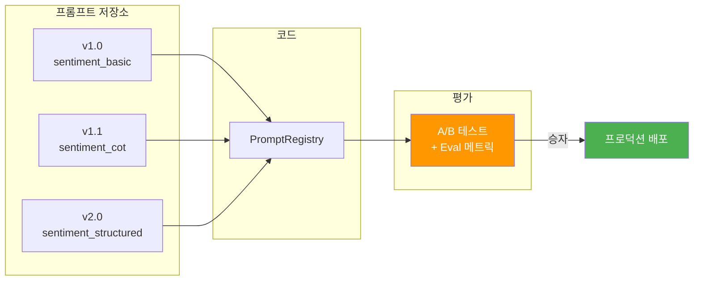
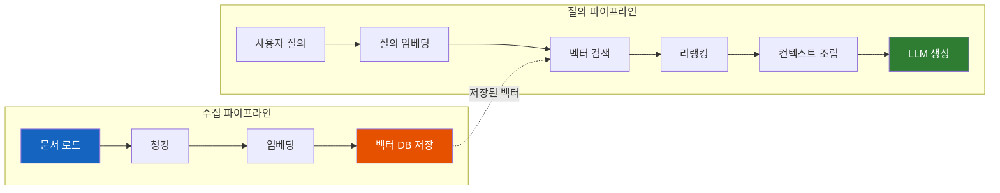
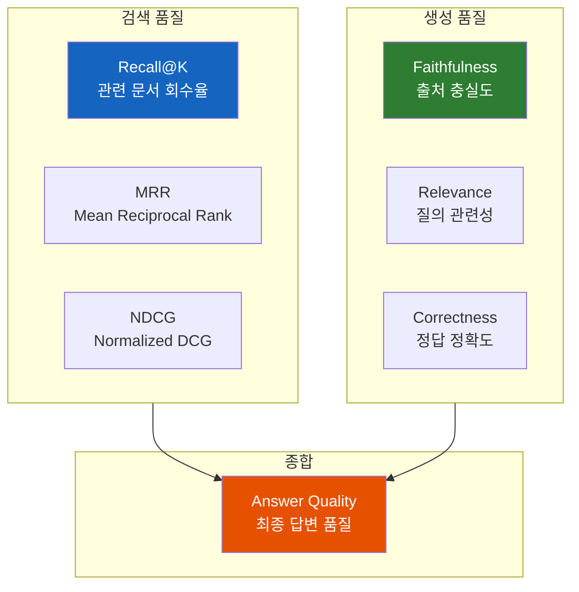
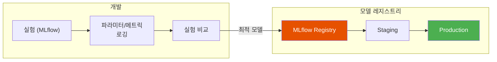
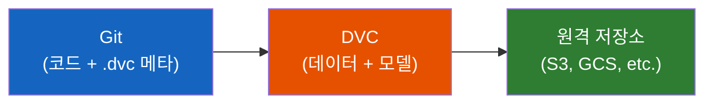
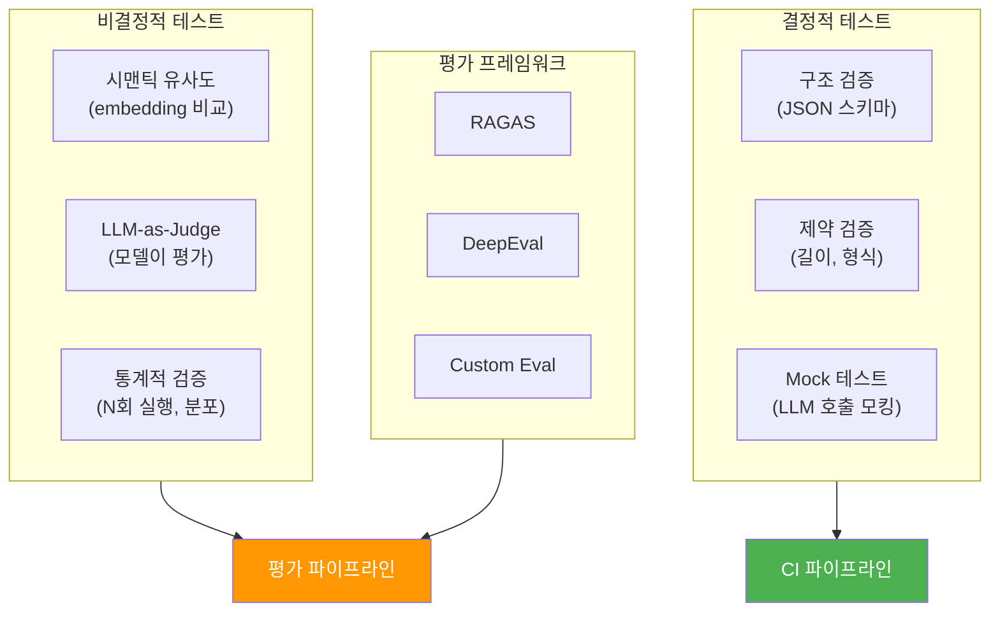

# AI/ML 코드 품질 가이드

> **작성일**: 2026-03-14
> **대상**: LLM 앱(LangChain, LlamaIndex, CrewAI), RAG 시스템, MLOps 파이프라인
> **기반 표준**: Google ML Best Practices, Stripe ML Code Quality, Meta AI Infra Standards
> **적용 수준**: 빅테크 기준 팀 운영표준

---

## 목차

1. [LLM 앱 코드 품질](#1-llm-앱-코드-품질)
2. [프롬프트 관리](#2-프롬프트-관리)
3. [RAG 아키텍처 품질](#3-rag-아키텍처-품질)
4. [MLOps 도구 표준](#4-mlops-도구-표준)
5. [Jupyter Notebook 품질](#5-jupyter-notebook-품질)
6. [AI 코드 테스트](#6-ai-코드-테스트)
7. [체크리스트](#7-체크리스트)

---

## 1. LLM 앱 코드 품질

### 1.1 공통 도구 체인

LLM 앱 프로젝트(LangChain, LlamaIndex, CrewAI 등)는 일반 Python 프로젝트와 동일한 품질 도구 체인을 적용하되, AI/ML 특화 규칙을 추가한다.

| 역할 | 도구 | AI/ML 추가 설정 |
|------|------|------------------|
| **패키지 관리** | uv | `uv.lock` 커밋, 재현 가능한 환경 |
| **린터** | Ruff | AI/ML 전용 ignore 규칙 추가 |
| **타입 체크** | mypy --strict | `disallow_any_generics = true` |
| **포매터** | Ruff format | 기본 Python 설정 동일 |
| **Pre-commit** | pre-commit | nbqa + nbstripout 훅 추가 |
| **시크릿 탐지** | detect-secrets | API 키 패턴 확장 |

#### pyproject.toml -- AI/ML 프로젝트 추가 설정

```toml
[tool.ruff.lint]
select = [
    "E", "F", "W", "I", "N", "UP", "B", "A",
    "SIM", "TCH", "PT", "PERF", "RUF", "S", "C90", "PL",
]
ignore = [
    "B008",      # FastAPI Depends() pattern
    "S101",      # assert in tests
    "PLR0913",   # many-args: LLM chain constructors often need 6+ params
    "PLR2004",   # magic values: temperature, top_p, etc. are domain constants
]

[tool.ruff.lint.per-file-ignores]
"tests/**/*.py" = ["S101", "S106", "PLR2004", "PLR0913"]
"notebooks/**/*.py" = ["E402", "T201"]  # import order, print() in notebooks
"**/prompts/**/*.py" = ["E501"]         # long prompt strings allowed

[tool.mypy]
python_version = "3.11"
strict = true
plugins = ["pydantic.mypy"]

[[tool.mypy.overrides]]
module = ["langchain.*", "llama_index.*", "crewai.*", "chromadb.*"]
ignore_missing_imports = true
```

### 1.2 uv 기반 의존성 관리

```bash
# Initialize project with uv
uv init my-llm-app
cd my-llm-app

# Add dependencies
uv add langchain langchain-openai langchain-community
uv add qdrant-client chromadb
uv add --dev ruff mypy pytest pytest-cov pre-commit nbqa nbstripout

# Lock and sync
uv lock
uv sync
```

**uv.lock 반드시 커밋** -- 재현 가능한 빌드를 보장한다. `pip freeze > requirements.txt` 방식은 LLM 앱에서 의존성 충돌이 빈번하므로 uv를 권장한다.

### 1.3 LLM 프로젝트 디렉토리 구조

```
my-llm-app/
├── src/
│   ├── chains/           # LangChain chain definitions
│   ├── agents/           # Agent definitions (CrewAI, LangGraph)
│   ├── prompts/          # Prompt templates (versioned)
│   ├── embeddings/       # Embedding pipeline
│   ├── retrievers/       # RAG retrieval logic
│   ├── tools/            # Agent tools
│   ├── models/           # Data models (Pydantic)
│   └── config/           # Settings, constants
├── tests/
│   ├── unit/
│   ├── integration/
│   └── evaluation/       # LLM output evaluation
├── notebooks/            # Jupyter notebooks (exploration)
├── data/                 # Sample data, fixtures
├── prompts/              # Prompt YAML/JSON files (non-code)
├── pyproject.toml
└── uv.lock
```

### 1.4 LLM 클라이언트 래핑 패턴

LLM API 호출을 직접 사용하지 않고, 래퍼를 통해 재시도, 비용 추적, 폴백을 중앙화한다.

```python
from __future__ import annotations

import contextlib
import logging
import time
from dataclasses import dataclass, field
from typing import Any, Protocol, runtime_checkable

logger = logging.getLogger(__name__)

# Domain constants
DEFAULT_MAX_RETRIES = 3
RETRY_BASE_DELAY_SECONDS = 1.0
RETRY_MULTIPLIER = 2.0


@runtime_checkable
class LLMProvider(Protocol):
    """Structural interface for LLM providers."""

    async def invoke(self, prompt: str, **kwargs: Any) -> str: ...


@dataclass(frozen=True)
class TokenUsage:
    """Immutable token usage record."""

    prompt_tokens: int
    completion_tokens: int
    model: str
    cost_usd: float
    latency_ms: float


@dataclass(frozen=True)
class LLMResponse:
    """Immutable LLM response with metadata."""

    content: str
    usage: TokenUsage
    raw_response: dict[str, Any] = field(default_factory=dict)


class LLMClient:
    """Centralized LLM client with retry, cost tracking, and fallback.

    Args:
        primary: Primary LLM provider.
        fallback: Optional fallback provider for resilience.
        max_retries: Maximum retry attempts on transient failures.
    """

    def __init__(
        self,
        primary: LLMProvider,
        fallback: LLMProvider | None = None,
        max_retries: int = DEFAULT_MAX_RETRIES,
    ) -> None:
        self._primary = primary
        self._fallback = fallback
        self._max_retries = max_retries
        self._total_cost_usd: float = 0.0

    async def generate(self, prompt: str, **kwargs: Any) -> LLMResponse:
        """Generate response with retry and fallback logic.

        Args:
            prompt: Input prompt string.
            **kwargs: Additional provider-specific parameters.

        Returns:
            LLMResponse with content and usage metadata.

        Raises:
            RuntimeError: If all providers and retries are exhausted.
        """
        for attempt in range(self._max_retries):
            with contextlib.suppress(Exception):
                return await self._invoke_provider(self._primary, prompt, **kwargs)
            delay = RETRY_BASE_DELAY_SECONDS * (RETRY_MULTIPLIER ** attempt)
            logger.warning("Primary LLM failed (attempt %d), retrying in %.1fs", attempt + 1, delay)
            time.sleep(delay)

        if self._fallback is not None:
            logger.warning("Primary exhausted, falling back to secondary provider")
            return await self._invoke_provider(self._fallback, prompt, **kwargs)

        raise RuntimeError("All LLM providers exhausted")

    async def _invoke_provider(
        self, provider: LLMProvider, prompt: str, **kwargs: Any,
    ) -> LLMResponse:
        """Invoke a single provider and track usage."""
        start = time.monotonic()
        content = await provider.invoke(prompt, **kwargs)
        latency_ms = (time.monotonic() - start) * 1000
        # Token counting and cost calculation would be provider-specific
        usage = TokenUsage(
            prompt_tokens=0, completion_tokens=0,
            model="unknown", cost_usd=0.0, latency_ms=latency_ms,
        )
        self._total_cost_usd += usage.cost_usd
        return LLMResponse(content=content, usage=usage)

    @property
    def total_cost_usd(self) -> float:
        """Accumulated cost across all invocations."""
        return self._total_cost_usd
```

### 1.5 Structured Output 패턴

LLM 응답을 Pydantic 모델로 파싱하여 타입 안전성을 확보한다.

```python
from __future__ import annotations

from pydantic import BaseModel, Field


class SentimentResult(BaseModel):
    """Structured output for sentiment analysis."""

    sentiment: str = Field(description="positive, negative, or neutral")
    confidence: float = Field(ge=0.0, le=1.0, description="Confidence score")
    reasoning: str = Field(description="Brief explanation of the classification")


class ExtractionResult(BaseModel):
    """Structured output for entity extraction."""

    entities: tuple[Entity, ...] = Field(default_factory=tuple)
    raw_text: str


class Entity(BaseModel):
    """Single extracted entity."""

    name: str
    entity_type: str
    confidence: float = Field(ge=0.0, le=1.0)
```

**규칙**: LLM 출력은 반드시 Pydantic 모델을 거쳐 검증한다. `json.loads()` 직접 사용은 금지한다.

---

## 2. 프롬프트 관리

### 2.1 프롬프트 버전 관리

프롬프트는 코드와 동일하게 버전 관리한다. 하드코딩된 프롬프트 문자열은 금지한다.



#### 프롬프트 파일 구조 (YAML)

```yaml
# prompts/sentiment/v2.0.yaml
metadata:
  name: sentiment_analysis
  version: "2.0"
  author: "ml-team"
  created_at: "2026-03-14"
  description: "Structured sentiment analysis with chain-of-thought"
  tags: ["sentiment", "classification", "cot"]

template: |
  You are a sentiment analysis expert.

  Analyze the following text and classify the sentiment.
  Think step by step before giving your final answer.

  Text: {text}

  Respond in JSON format:
  {{
    "sentiment": "positive|negative|neutral",
    "confidence": 0.0-1.0,
    "reasoning": "brief explanation"
  }}

input_variables:
  - name: text
    type: string
    required: true
    description: "Text to analyze"

model_config:
  model: "gpt-4o"
  temperature: 0.0
  max_tokens: 256

evaluation:
  dataset: "sentiment_eval_v2"
  metrics: ["accuracy", "f1_macro"]
  baseline_accuracy: 0.85
```

#### Python -- 프롬프트 레지스트리

```python
from __future__ import annotations

import logging
from dataclasses import dataclass
from pathlib import Path
from typing import Any

import yaml

logger = logging.getLogger(__name__)

PROMPTS_DIR = Path("prompts")


@dataclass(frozen=True)
class PromptTemplate:
    """Immutable prompt template loaded from YAML."""

    name: str
    version: str
    template: str
    input_variables: tuple[str, ...]
    model_config: dict[str, Any]


class PromptRegistry:
    """Central registry for versioned prompt templates.

    Loads prompts from YAML files and supports version-based retrieval.
    """

    def __init__(self, prompts_dir: Path = PROMPTS_DIR) -> None:
        self._prompts: dict[str, PromptTemplate] = {}
        self._prompts_dir = prompts_dir

    def load(self, name: str, version: str) -> PromptTemplate:
        """Load a specific prompt version from YAML.

        Args:
            name: Prompt name (directory name).
            version: Semantic version string.

        Returns:
            Loaded PromptTemplate instance.

        Raises:
            FileNotFoundError: If prompt YAML file does not exist.
        """
        key = f"{name}:{version}"
        if key in self._prompts:
            return self._prompts[key]

        path = self._prompts_dir / name / f"v{version}.yaml"
        with path.open() as f:
            data = yaml.safe_load(f)

        template = PromptTemplate(
            name=data["metadata"]["name"],
            version=data["metadata"]["version"],
            template=data["template"],
            input_variables=tuple(v["name"] for v in data["input_variables"]),
            model_config=data.get("model_config", {}),
        )
        self._prompts[key] = template
        logger.info("Loaded prompt %s v%s", name, version)
        return template

    def render(self, name: str, version: str, **variables: str) -> str:
        """Render prompt template with variables.

        Args:
            name: Prompt name.
            version: Semantic version string.
            **variables: Template variable values.

        Returns:
            Rendered prompt string.
        """
        template = self.load(name, version)
        return template.template.format(**variables)
```

### 2.2 프롬프트 테스트 전략

| 테스트 유형 | 목적 | 실행 시점 |
|-------------|------|-----------|
| **구문 테스트** | 변수 치환 오류, YAML 파싱 오류 검출 | Pre-commit |
| **스냅샷 테스트** | 렌더링 결과 변경 감지 | CI |
| **평가 테스트** | 정확도, F1 등 품질 메트릭 검증 | PR 머지 전 |
| **A/B 테스트** | 버전 간 성능 비교 | 스테이징/프로덕션 |

```python
from __future__ import annotations

import pytest
from src.prompts.registry import PromptRegistry


class TestPromptSyntax:
    """Verify prompt templates parse and render correctly."""

    def test_sentiment_v2_renders(self) -> None:
        registry = PromptRegistry()
        result = registry.render(
            "sentiment", "2.0",
            text="This product is amazing!",
        )
        assert "This product is amazing!" in result
        assert "{text}" not in result  # no unresolved variables

    def test_all_prompts_valid_yaml(self, prompt_files: list[str]) -> None:
        """Ensure all prompt YAML files parse without errors."""
        registry = PromptRegistry()
        for path in prompt_files:
            # Should not raise
            registry.load_from_path(path)
```

### 2.3 프롬프트 린팅 규칙

| 규칙 | 설명 | 심각도 |
|------|------|--------|
| `PROMPT-001` | 하드코딩된 프롬프트 문자열 금지 (3줄 이상 f-string) | ERROR |
| `PROMPT-002` | 프롬프트에 PII(개인정보) 포함 금지 | ERROR |
| `PROMPT-003` | temperature, max_tokens 등 하드코딩 금지 (설정에서 로드) | WARNING |
| `PROMPT-004` | system/user role 구분 없는 단일 프롬프트 | WARNING |
| `PROMPT-005` | 버전 미지정 프롬프트 사용 | WARNING |

#### Semgrep 커스텀 규칙 -- 프롬프트 린팅

```yaml
# .semgrep/prompt-rules.yml
rules:
  - id: hardcoded-prompt-string
    patterns:
      - pattern: |
          $LLM.invoke(f"...", ...)
      - metavariable-regex:
          metavariable: $LLM
          regex: "(llm|model|client|chain)"
    message: "Hardcoded prompt string detected. Use PromptRegistry for versioned prompts."
    languages: [python]
    severity: ERROR

  - id: hardcoded-temperature
    pattern: temperature=$VALUE
    message: "Hardcoded temperature. Load from config or prompt YAML."
    languages: [python]
    severity: WARNING

  - id: raw-json-parse-llm-output
    pattern: json.loads($RESPONSE)
    message: "Use Pydantic model validation instead of raw json.loads() for LLM output."
    languages: [python]
    severity: WARNING
```

---

## 3. RAG 아키텍처 품질

### 3.1 RAG 파이프라인 개요



### 3.2 임베딩 파이프라인 코드 규칙

#### 청킹 전략 선택 기준

| 전략 | 청크 크기 | 적합 대상 | 오버랩 |
|------|-----------|-----------|--------|
| **Fixed-size** | 512~1024 토큰 | 범용 텍스트 | 10~20% |
| **Recursive character** | 512~1024 토큰 | 코드, 마크다운 | 구분자 기반 |
| **Semantic** | 가변 | 학술 논문, 긴 문서 | 의미 단위 |
| **Document-based** | 문서 구조 따름 | HTML, PDF 섹션 | 섹션 단위 |

```python
from __future__ import annotations

from dataclasses import dataclass

# Chunking constants
DEFAULT_CHUNK_SIZE = 512
DEFAULT_CHUNK_OVERLAP = 64
MIN_CHUNK_SIZE = 100
MAX_CHUNK_SIZE = 2048


@dataclass(frozen=True)
class ChunkConfig:
    """Immutable chunking configuration.

    Args:
        chunk_size: Target tokens per chunk.
        chunk_overlap: Overlap tokens between consecutive chunks.
        separators: Ordered list of separators for recursive splitting.
    """

    chunk_size: int = DEFAULT_CHUNK_SIZE
    chunk_overlap: int = DEFAULT_CHUNK_OVERLAP
    separators: tuple[str, ...] = ("\n\n", "\n", ". ", " ")

    def __post_init__(self) -> None:
        """Validate configuration constraints."""
        if not MIN_CHUNK_SIZE <= self.chunk_size <= MAX_CHUNK_SIZE:
            msg = f"chunk_size must be {MIN_CHUNK_SIZE}-{MAX_CHUNK_SIZE}, got {self.chunk_size}"
            raise ValueError(msg)
        if self.chunk_overlap >= self.chunk_size:
            msg = "chunk_overlap must be less than chunk_size"
            raise ValueError(msg)
```

#### 임베딩 모델 표준 인터페이스

```python
from __future__ import annotations

from typing import Any, Protocol, runtime_checkable


@runtime_checkable
class EmbeddingModel(Protocol):
    """Structural interface for embedding models."""

    async def embed_texts(self, texts: tuple[str, ...]) -> tuple[tuple[float, ...], ...]: ...

    async def embed_query(self, query: str) -> tuple[float, ...]: ...

    @property
    def dimension(self) -> int: ...

    @property
    def model_name(self) -> str: ...
```

**규칙**:
- 임베딩 모델은 Protocol로 추상화하여 교체 가능하게 설계한다
- 벡터 차원은 모델 속성으로 노출한다 (하드코딩 금지)
- 배치 임베딩을 기본으로 사용한다 (단건 호출 반복 금지)

### 3.3 벡터 DB 접근 패턴

#### 벡터 DB 선택 가이드

| DB | 적합 사례 | 스케일링 | 메타데이터 필터 |
|----|-----------|----------|-----------------|
| **Qdrant** | 프로덕션, 고성능 필터링 | 분산 클러스터 | 풍부한 필터 문법 |
| **Pinecone** | 서버리스, 관리형 | 자동 스케일링 | 네임스페이스 + 메타데이터 |
| **Weaviate** | 하이브리드 검색 (벡터+키워드) | 자동 샤딩 | GraphQL 기반 |
| **ChromaDB** | 로컬 개발, 프로토타입 | 단일 노드 | 기본 필터 |
| **pgvector** | PostgreSQL 기존 인프라 활용 | pg 스케일링 | SQL WHERE 절 |

#### 벡터 DB 클라이언트 래핑 패턴

```python
from __future__ import annotations

from dataclasses import dataclass
from typing import Any, Protocol, runtime_checkable

# Search constants
DEFAULT_TOP_K = 10
DEFAULT_SCORE_THRESHOLD = 0.7


@dataclass(frozen=True)
class SearchResult:
    """Immutable vector search result."""

    document_id: str
    content: str
    score: float
    metadata: dict[str, Any]


@runtime_checkable
class VectorStore(Protocol):
    """Structural interface for vector database operations."""

    async def upsert(
        self,
        ids: tuple[str, ...],
        vectors: tuple[tuple[float, ...], ...],
        documents: tuple[str, ...],
        metadata: tuple[dict[str, Any], ...] | None = None,
    ) -> None: ...

    async def search(
        self,
        query_vector: tuple[float, ...],
        top_k: int = DEFAULT_TOP_K,
        score_threshold: float = DEFAULT_SCORE_THRESHOLD,
        filters: dict[str, Any] | None = None,
    ) -> tuple[SearchResult, ...]: ...

    async def delete(self, ids: tuple[str, ...]) -> None: ...
```

**규칙**:
- 벡터 DB 클라이언트는 Protocol로 추상화한다 (DB 교체 용이)
- `search()` 결과는 불변 dataclass 튜플로 반환한다
- score_threshold를 명시적으로 설정한다 (무관련 결과 필터링)
- 벡터 DB 연결은 애플리케이션 시작 시 1회 초기화, 요청별 재연결 금지

### 3.4 RAG 품질 메트릭



| 메트릭 | 설명 | 목표값 | 측정 도구 |
|--------|------|--------|-----------|
| **Recall@10** | 상위 10개 결과 중 관련 문서 비율 | >= 0.85 | RAGAS, custom |
| **MRR** | 첫 번째 관련 결과의 역순위 평균 | >= 0.7 | RAGAS |
| **Faithfulness** | 생성 답변이 검색 문서에 충실한 정도 | >= 0.9 | RAGAS, DeepEval |
| **Answer Relevance** | 답변이 질의에 얼마나 관련되는지 | >= 0.85 | RAGAS |
| **Hallucination Rate** | 출처에 없는 정보를 생성한 비율 | <= 5% | DeepEval |

---

## 4. MLOps 도구 표준

### 4.1 MLflow 실험 추적



#### 실험 추적 표준 패턴

```python
from __future__ import annotations

import logging
from dataclasses import dataclass
from typing import Any

import mlflow

logger = logging.getLogger(__name__)

# Experiment tracking constants
EXPERIMENT_PREFIX = "llm-app"


@dataclass(frozen=True)
class ExperimentConfig:
    """Immutable experiment configuration."""

    experiment_name: str
    run_name: str
    tags: dict[str, str]


def track_llm_experiment(
    config: ExperimentConfig,
    params: dict[str, Any],
    metrics: dict[str, float],
    artifacts: dict[str, str] | None = None,
) -> str:
    """Track an LLM experiment run in MLflow.

    Args:
        config: Experiment configuration.
        params: Hyperparameters to log.
        metrics: Evaluation metrics to log.
        artifacts: Optional file artifacts to log.

    Returns:
        MLflow run ID.
    """
    mlflow.set_experiment(f"{EXPERIMENT_PREFIX}/{config.experiment_name}")

    with mlflow.start_run(run_name=config.run_name, tags=config.tags) as run:
        mlflow.log_params(params)
        mlflow.log_metrics(metrics)

        if artifacts:
            for name, path in artifacts.items():
                mlflow.log_artifact(path, artifact_path=name)

        logger.info("Tracked experiment run: %s", run.info.run_id)
        return run.info.run_id
```

**필수 로깅 항목** (LLM 앱):

| 카테고리 | 항목 | 예시 |
|----------|------|------|
| **파라미터** | 모델명, temperature, max_tokens, 프롬프트 버전 | `model=gpt-4o, temp=0.0, prompt_v=2.0` |
| **메트릭** | 정확도, latency, 비용, 토큰 수 | `accuracy=0.92, latency_p95=1.2s, cost=0.03` |
| **아티팩트** | 프롬프트 파일, 평가 결과 CSV, 혼동 행렬 | `prompts/v2.0.yaml`, `eval_results.csv` |
| **태그** | 실험 목적, 데이터셋 버전, 담당자 | `purpose=prompt-tuning, dataset=v3` |

### 4.2 Weights & Biases (W&B) 로깅

W&B는 실험 추적 + 시각화 + 팀 협업에 특화된 플랫폼이다. MLflow와 병행하거나 대체할 수 있다.

```python
from __future__ import annotations

import logging
from dataclasses import dataclass
from typing import Any

import wandb

logger = logging.getLogger(__name__)


@dataclass(frozen=True)
class WandbConfig:
    """Immutable W&B run configuration."""

    project: str
    entity: str
    run_name: str
    tags: tuple[str, ...]


def track_with_wandb(
    config: WandbConfig,
    params: dict[str, Any],
    metrics: dict[str, float],
) -> str:
    """Track experiment with Weights & Biases.

    Args:
        config: W&B configuration.
        params: Hyperparameters.
        metrics: Evaluation metrics.

    Returns:
        W&B run URL.
    """
    run = wandb.init(
        project=config.project,
        entity=config.entity,
        name=config.run_name,
        tags=list(config.tags),
        config=params,
    )
    wandb.log(metrics)
    logger.info("W&B run: %s", run.url)
    run_url: str = run.url
    wandb.finish()
    return run_url
```

### 4.3 DVC 데이터 버전 관리

임베딩 데이터셋, 평가 데이터셋, 모델 가중치 등 대용량 파일은 Git에 직접 커밋하지 않는다.



#### DVC 워크플로우

```bash
# Initialize DVC
dvc init
dvc remote add -d storage s3://my-bucket/dvc-store

# Track large data files
dvc add data/embeddings/corpus_v3.parquet
dvc add models/fine-tuned/llama-3-8b-lora/

# Commit metadata (not data)
git add data/embeddings/corpus_v3.parquet.dvc .gitignore
git commit -m "데이터: 임베딩 코퍼스 v3 추가"

# Push data to remote
dvc push
```

**규칙**:
- `.dvc` 파일만 Git에 커밋한다 (실제 데이터는 원격 저장소)
- 데이터셋 버전은 시맨틱 버전으로 관리한다 (`corpus_v3`, `eval_v2`)
- `dvc.yaml` 파이프라인으로 재현 가능한 데이터 처리를 정의한다
- DVC 파이프라인 단계에 해시 기반 캐싱을 활용한다

#### dvc.yaml 파이프라인 예시

```yaml
stages:
  preprocess:
    cmd: python src/data/preprocess.py
    deps:
      - src/data/preprocess.py
      - data/raw/documents/
    outs:
      - data/processed/chunks.jsonl

  embed:
    cmd: python src/embeddings/generate.py
    deps:
      - src/embeddings/generate.py
      - data/processed/chunks.jsonl
    outs:
      - data/embeddings/vectors.parquet
    params:
      - embed.model_name
      - embed.batch_size

  evaluate:
    cmd: python src/evaluation/run_eval.py
    deps:
      - src/evaluation/run_eval.py
      - data/embeddings/vectors.parquet
      - data/eval/golden_set.jsonl
    metrics:
      - reports/eval_metrics.json:
          cache: false
    plots:
      - reports/precision_recall.csv:
          x: recall
          y: precision
```

### 4.4 MLOps 도구 비교

| 기능 | **MLflow** | **W&B** | **DVC** |
|------|-----------|---------|---------|
| 실험 추적 | O | O | 메트릭만 |
| 모델 레지스트리 | O | O | - |
| 데이터 버전 관리 | - | 아티팩트 | O (핵심) |
| 파이프라인 | - | - | O |
| 시각화 | 기본 | 풍부 | 기본 |
| 비용 | OSS 무료 | 유료 (팀) | OSS 무료 |
| 권장 조합 | 실험+레지스트리 | 시각화+협업 | 데이터+파이프라인 |

**권장 조합**: MLflow(실험 추적 + 모델 레지스트리) + DVC(데이터 버전 관리 + 파이프라인) + W&B(팀 대시보드, 선택)

---

## 5. Jupyter Notebook 품질

### 5.1 Notebook의 문제점

| 문제 | 설명 |
|------|------|
| **재현성 결여** | 셀 실행 순서에 따라 결과가 달라진다 |
| **품질 도구 미적용** | ruff, mypy가 기본적으로 .ipynb를 처리하지 않는다 |
| **Git 충돌** | 출력(이미지, 로그)이 포함되어 diff가 불가능하다 |
| **코드 리뷰 불가** | 수백 줄의 JSON 구조로 리뷰가 어렵다 |

### 5.2 nbqa -- Notebook에 린터 적용

[nbqa](https://github.com/nbQA-dev/nbQA)는 Jupyter Notebook에 기존 Python 린터를 적용하는 도구다.

```bash
# Install
uv add --dev nbqa

# Run ruff on notebooks
nbqa ruff notebooks/ --fix
nbqa ruff notebooks/ --select=E,F,W,I,B

# Run mypy on notebooks
nbqa mypy notebooks/ --ignore-missing-imports

# Run ruff format on notebooks
nbqa ruff-format notebooks/
```

#### Pre-commit 훅 설정

```yaml
# .pre-commit-config.yaml (notebook hooks)
repos:
  - repo: https://github.com/nbQA-dev/nbQA
    rev: 1.9.1
    hooks:
      - id: nbqa-ruff
        args: ["--fix", "--select=E,F,W,I,B"]
      - id: nbqa-mypy
        args: ["--ignore-missing-imports"]

  - repo: https://github.com/kynan/nbstripout
    rev: 0.8.1
    hooks:
      - id: nbstripout
        args: ["--extra-keys", "metadata.kernelspec"]
```

### 5.3 nbstripout -- 출력 제거

[nbstripout](https://github.com/kynan/nbstripout)은 Notebook에서 셀 출력, 실행 카운트, 메타데이터를 제거하여 깨끗한 Git diff를 보장한다.

```bash
# Install and enable globally for the repo
uv add --dev nbstripout
nbstripout --install

# Manual strip
nbstripout notebooks/*.ipynb

# Verify notebooks are clean
nbstripout --verify notebooks/
```

**규칙**:
- Notebook 출력은 절대 Git에 커밋하지 않는다
- `nbstripout --install`로 Git filter를 설정한다
- CI에서 `nbstripout --verify`로 출력 포함 여부를 검증한다

### 5.4 Notebook 작성 규칙

| 규칙 | 설명 |
|------|------|
| **탐색 전용** | Notebook은 탐색/실험 전용이다. 프로덕션 로직은 `.py`로 추출한다 |
| **셀 길이 제한** | 셀당 20줄 이하 |
| **마크다운 필수** | 각 코드 셀 앞에 설명 마크다운 셀을 배치한다 |
| **재시작 실행 테스트** | "Restart & Run All"이 오류 없이 통과해야 한다 |
| **매직 커맨드 최소화** | `%matplotlib inline` 외 셀 매직 사용 자제 |
| **시크릿 금지** | API 키는 환경 변수로 로드한다 (`os.environ["OPENAI_API_KEY"]`) |

#### CI에서 Notebook 검증

```yaml
# .github/workflows/notebook-quality.yml
- name: Notebook lint (nbqa + ruff)
  run: nbqa ruff notebooks/ --select=E,F,W,I,B

- name: Notebook output check (nbstripout)
  run: nbstripout --verify notebooks/ || (echo "Notebook outputs must be stripped" && exit 1)

- name: Notebook execution test
  run: |
    for nb in notebooks/*.ipynb; do
      jupyter nbconvert --to notebook --execute "$nb" --output /dev/null
    done
```

---

## 6. AI 코드 테스트

### 6.1 LLM 응답 테스트의 특수성

LLM 응답은 본질적으로 비결정적(non-deterministic)이다. 동일 입력에도 출력이 매번 달라질 수 있으므로, 기존 단위 테스트 방식(exact match)만으로는 불충분하다.



### 6.2 결정적(Deterministic) 테스트

CI에서 매번 실행하며, LLM을 실제 호출하지 않는다.

```python
from __future__ import annotations

import json
from unittest.mock import AsyncMock

import pytest
from pydantic import ValidationError

from src.chains.sentiment import SentimentChain
from src.models.sentiment import SentimentResult

# Deterministic test constants
MOCK_LLM_RESPONSE = '{"sentiment": "positive", "confidence": 0.95, "reasoning": "test"}'


class TestSentimentChainDeterministic:
    """Deterministic tests that mock LLM calls."""

    @pytest.fixture
    def mock_llm(self) -> AsyncMock:
        """Create a mock LLM that returns a fixed response."""
        llm = AsyncMock()
        llm.invoke.return_value = MOCK_LLM_RESPONSE
        return llm

    async def test_output_schema_valid(self, mock_llm: AsyncMock) -> None:
        """Verify LLM output parses to expected Pydantic model."""
        chain = SentimentChain(llm=mock_llm)
        result = await chain.analyze("test text")
        assert isinstance(result, SentimentResult)
        assert result.sentiment in ("positive", "negative", "neutral")
        assert 0.0 <= result.confidence <= 1.0

    async def test_invalid_json_handled(self, mock_llm: AsyncMock) -> None:
        """Verify graceful handling of malformed LLM output."""
        mock_llm.invoke.return_value = "not valid json"
        chain = SentimentChain(llm=mock_llm)
        with pytest.raises(ValidationError):
            await chain.analyze("test text")

    async def test_empty_response_handled(self, mock_llm: AsyncMock) -> None:
        """Verify empty LLM response raises appropriate error."""
        mock_llm.invoke.return_value = ""
        chain = SentimentChain(llm=mock_llm)
        with pytest.raises(ValueError, match="Empty LLM response"):
            await chain.analyze("test text")

    def test_prompt_renders_correctly(self) -> None:
        """Verify prompt template substitution works."""
        chain = SentimentChain(llm=AsyncMock())
        prompt = chain.build_prompt("Hello world")
        assert "Hello world" in prompt
        assert "{text}" not in prompt  # no unresolved variables
```

### 6.3 비결정적(Non-Deterministic) 테스트

실제 LLM을 호출하며, 평가 파이프라인에서 실행한다. CI에서는 `@pytest.mark.evaluation`으로 선택적 실행한다.

```python
from __future__ import annotations

import numpy as np
import pytest

from src.chains.sentiment import SentimentChain
from src.evaluation.metrics import semantic_similarity

# Evaluation constants
MIN_ACCURACY_THRESHOLD = 0.85
EVAL_RUNS = 5
SEMANTIC_SIMILARITY_THRESHOLD = 0.8


@pytest.mark.evaluation
class TestSentimentChainEvaluation:
    """Non-deterministic evaluation tests using real LLM calls."""

    async def test_accuracy_above_threshold(self, real_llm: object) -> None:
        """Run evaluation dataset and check accuracy threshold."""
        chain = SentimentChain(llm=real_llm)
        test_cases = [
            ("I love this product!", "positive"),
            ("This is terrible.", "negative"),
            ("It's okay, nothing special.", "neutral"),
        ]
        correct = 0
        for text, expected in test_cases:
            result = await chain.analyze(text)
            if result.sentiment == expected:
                correct += 1

        accuracy = correct / len(test_cases)
        assert accuracy >= MIN_ACCURACY_THRESHOLD, (
            f"Accuracy {accuracy:.2f} below threshold {MIN_ACCURACY_THRESHOLD}"
        )

    async def test_output_consistency(self, real_llm: object) -> None:
        """Run same input multiple times, check consistency."""
        chain = SentimentChain(llm=real_llm)
        results = []
        for _ in range(EVAL_RUNS):
            result = await chain.analyze("I love this product!")
            results.append(result.sentiment)

        # At least 80% of runs should agree
        most_common = max(set(results), key=results.count)
        consistency = results.count(most_common) / len(results)
        assert consistency >= 0.8, f"Inconsistent outputs: {results}"

    async def test_semantic_similarity_to_reference(self, real_llm: object) -> None:
        """Check generated answer is semantically similar to reference."""
        chain = SentimentChain(llm=real_llm)
        result = await chain.analyze("Best purchase ever!")
        similarity = await semantic_similarity(
            result.reasoning,
            "The text expresses strong positive sentiment about a purchase.",
        )
        assert similarity >= SEMANTIC_SIMILARITY_THRESHOLD
```

### 6.4 Evaluation 메트릭 프레임워크

| 메트릭 | 유형 | 도구 | 사용 사례 |
|--------|------|------|-----------|
| **Exact Match** | 결정적 | pytest | 분류 정확도 |
| **Cosine Similarity** | 비결정적 | sentence-transformers | 텍스트 유사도 |
| **BLEU / ROUGE** | 비결정적 | evaluate (HF) | 요약, 번역 |
| **Faithfulness** | 비결정적 | RAGAS | RAG 충실도 |
| **Answer Relevance** | 비결정적 | RAGAS | RAG 관련성 |
| **LLM-as-Judge** | 비결정적 | DeepEval, custom | 범용 품질 평가 |
| **Hallucination Detection** | 비결정적 | DeepEval | 환각 비율 |

#### RAGAS를 활용한 RAG 평가

```python
from __future__ import annotations

from dataclasses import dataclass

import pytest
from ragas import evaluate
from ragas.metrics import answer_relevancy, context_precision, faithfulness

# RAGAS evaluation thresholds
FAITHFULNESS_THRESHOLD = 0.9
RELEVANCY_THRESHOLD = 0.85
PRECISION_THRESHOLD = 0.8


@dataclass(frozen=True)
class RAGEvalCase:
    """Immutable RAG evaluation test case."""

    question: str
    answer: str
    contexts: tuple[str, ...]
    ground_truth: str


@pytest.mark.evaluation
async def test_rag_pipeline_quality(rag_eval_dataset: list[RAGEvalCase]) -> None:
    """Evaluate RAG pipeline using RAGAS metrics."""
    result = evaluate(
        dataset=rag_eval_dataset,
        metrics=[faithfulness, answer_relevancy, context_precision],
    )

    assert result["faithfulness"] >= FAITHFULNESS_THRESHOLD, (
        f"Faithfulness {result['faithfulness']:.2f} below {FAITHFULNESS_THRESHOLD}"
    )
    assert result["answer_relevancy"] >= RELEVANCY_THRESHOLD, (
        f"Relevancy {result['answer_relevancy']:.2f} below {RELEVANCY_THRESHOLD}"
    )
    assert result["context_precision"] >= PRECISION_THRESHOLD, (
        f"Precision {result['context_precision']:.2f} below {PRECISION_THRESHOLD}"
    )
```

### 6.5 테스트 실행 전략

```yaml
# pytest.ini / pyproject.toml
[tool.pytest.ini_options]
markers = [
    "evaluation: LLM evaluation tests (require API keys, slow)",
    "integration: Integration tests with external services",
]
addopts = "-m 'not evaluation'"  # default: skip eval tests

# CI: Run deterministic tests
# pytest (default markers exclude evaluation)

# Evaluation pipeline: Run all including evaluation
# pytest -m evaluation --tb=short
```

| 실행 환경 | 테스트 범위 | 실행 빈도 |
|-----------|-------------|-----------|
| **로컬 (pre-commit)** | 구문 테스트, 프롬프트 검증 | 매 커밋 |
| **CI (PR)** | 결정적 테스트 + 모킹 | 매 PR |
| **평가 파이프라인** | 비결정적 테스트 + RAGAS | 일 1회 또는 수동 |
| **프롬프트 변경 시** | 전체 평가 스위트 | 프롬프트 PR 시 |

---

## 7. 체크리스트

### 7.1 LLM 앱 체크리스트

| 항목 | 체크 |
|------|------|
| LLM API 키가 환경 변수로 관리되는가 | [ ] |
| LLM 클라이언트에 재시도(retry) + 폴백(fallback) 로직이 있는가 | [ ] |
| 토큰 사용량 + 비용이 추적되는가 | [ ] |
| LLM 응답이 Pydantic 모델로 검증되는가 | [ ] |
| 프롬프트가 버전 관리(YAML)되는가 | [ ] |
| 하드코딩된 프롬프트 문자열이 없는가 | [ ] |
| temperature, max_tokens가 설정 파일에서 로드되는가 | [ ] |
| Structured Output (JSON mode / function calling)을 사용하는가 | [ ] |
| Rate limit 처리 로직이 있는가 | [ ] |
| 타임아웃이 설정되어 있는가 | [ ] |

### 7.2 RAG 체크리스트

| 항목 | 체크 |
|------|------|
| 청킹 전략이 문서 유형에 맞게 설정되었는가 | [ ] |
| 임베딩 모델이 Protocol로 추상화되었는가 | [ ] |
| 벡터 DB 클라이언트가 Protocol로 추상화되었는가 | [ ] |
| 배치 임베딩을 사용하는가 (단건 반복 호출 아님) | [ ] |
| score_threshold가 설정되어 있는가 | [ ] |
| 검색 결과에 메타데이터 필터가 적용되는가 | [ ] |
| Recall@K, MRR 등 검색 품질 메트릭이 측정되는가 | [ ] |
| Faithfulness, Answer Relevance 등 생성 품질이 측정되는가 | [ ] |
| 임베딩 데이터가 DVC로 버전 관리되는가 | [ ] |
| 리랭킹(Reranking) 단계가 있는가 | [ ] |

### 7.3 MLOps 체크리스트

| 항목 | 체크 |
|------|------|
| 실험 추적(MLflow/W&B)이 설정되어 있는가 | [ ] |
| 모든 실험에 파라미터, 메트릭, 태그가 로깅되는가 | [ ] |
| 모델 버전이 레지스트리에서 관리되는가 | [ ] |
| 대용량 데이터가 DVC로 관리되는가 (Git 직접 커밋 아님) | [ ] |
| dvc.yaml 파이프라인이 재현 가능한가 | [ ] |
| Notebook 출력이 nbstripout으로 제거되는가 | [ ] |
| Notebook에 nbqa(ruff+mypy)가 적용되는가 | [ ] |
| 평가 데이터셋이 버전 관리되는가 | [ ] |
| 모델 배포 전 평가 메트릭 기준이 있는가 | [ ] |
| 비용 모니터링 (토큰 사용량, API 비용)이 있는가 | [ ] |

### 7.4 Pre-commit 설정 요약

```yaml
# .pre-commit-config.yaml (AI/ML project additions)
repos:
  # -- Standard Python hooks (see linting-integration-guide.md) --
  - repo: https://github.com/astral-sh/ruff-pre-commit
    rev: v0.14.14
    hooks:
      - id: ruff-format
      - id: ruff
        args: ["--fix", "--exit-non-zero-on-fix"]

  # -- Notebook quality --
  - repo: https://github.com/nbQA-dev/nbQA
    rev: 1.9.1
    hooks:
      - id: nbqa-ruff
        args: ["--fix", "--select=E,F,W,I,B"]

  - repo: https://github.com/kynan/nbstripout
    rev: 0.8.1
    hooks:
      - id: nbstripout

  # -- Prompt validation --
  - repo: local
    hooks:
      - id: validate-prompts
        name: Validate prompt YAML files
        entry: python -c "import yaml, sys; [yaml.safe_load(open(f)) for f in sys.argv[1:]]"
        language: system
        files: ^prompts/.*\.yaml$

  # -- Secret detection (expanded for AI API keys) --
  - repo: https://github.com/Yelp/detect-secrets
    rev: v1.5.0
    hooks:
      - id: detect-secrets
        args: ["--baseline", ".secrets.baseline"]
```

---

## 참고 자료

| 자료 | 설명 |
|------|------|
| [LangChain Docs](https://python.langchain.com/) | LangChain 공식 문서 |
| [LlamaIndex Docs](https://docs.llamaindex.ai/) | LlamaIndex 공식 문서 |
| [RAGAS](https://docs.ragas.io/) | RAG 평가 프레임워크 |
| [DeepEval](https://docs.confident-ai.com/) | LLM 평가 프레임워크 |
| [MLflow](https://mlflow.org/docs/latest/) | 실험 추적 + 모델 레지스트리 |
| [Weights & Biases](https://docs.wandb.ai/) | 실험 추적 + 시각화 |
| [DVC](https://dvc.org/doc) | 데이터 버전 관리 |
| [nbqa](https://github.com/nbQA-dev/nbQA) | Notebook 린팅 |
| [nbstripout](https://github.com/kynan/nbstripout) | Notebook 출력 제거 |
| [uv](https://docs.astral.sh/uv/) | Python 패키지 관리자 |
| 린팅 통합 가이드 | `docs/guides/linting-integration-guide.md` |
| AI 코드 리뷰 가이드 | `docs/guides/ai-code-review-guide.md` |
