# API Gateway 설계 가이드

> **작성일**: 2026-03-12
> **기반 표준**: Netflix Zuul/Spring Cloud Gateway, Kong Best Practices, Envoy Proxy Patterns, AWS Well-Architected
> **적용 수준**: 빅테크 기준 팀 운영표준
> **적용 언어**: Python, Kotlin, Go

---

## 목차

1. [API Gateway 역할](#1-api-gateway-역할)
2. [BFF (Backend For Frontend) 패턴](#2-bff-backend-for-frontend-패턴)
3. [Gateway vs Service Mesh 비교](#3-gateway-vs-service-mesh-비교)
4. [Gateway 도구 비교](#4-gateway-도구-비교)
5. [Gateway 설정 모범 사례](#5-gateway-설정-모범-사례)
6. [Gateway 안티패턴](#6-gateway-안티패턴)
7. [체크리스트](#7-체크리스트)

---

## 1. API Gateway 역할

### 1.1 Gateway가 해결하는 문제

클라이언트가 마이크로서비스에 직접 접근하면 다음 문제가 발생한다:

1. **서비스 디스커버리 부담** -- 클라이언트가 모든 서비스 주소를 알아야 함
2. **횡단 관심사 중복** -- 인증, 로깅, Rate Limiting을 서비스마다 구현
3. **프로토콜 불일치** -- 내부는 gRPC인데 외부는 REST/JSON을 기대
4. **보안 노출** -- 내부 서비스가 인터넷에 직접 노출

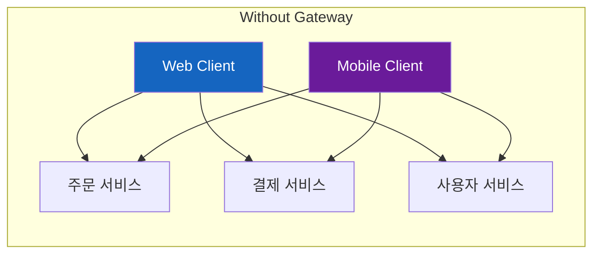

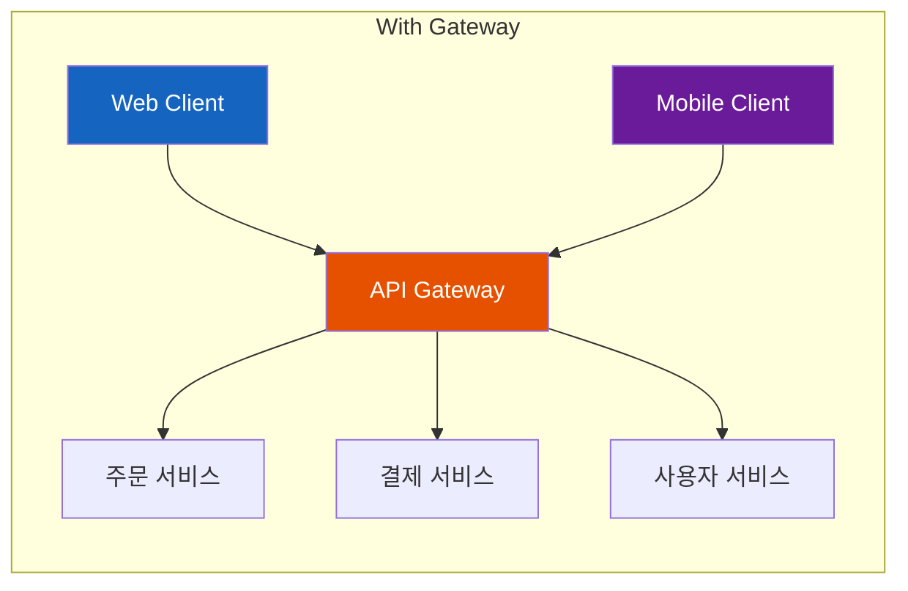

### 1.2 핵심 기능

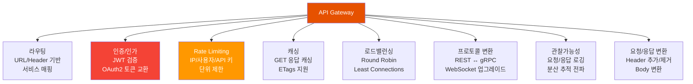

### 1.3 기능별 상세

#### 라우팅

| 라우팅 유형 | 설명 | 예시 |
|------------|------|------|
| **Path 기반** | URL 경로로 서비스 결정 | `/api/orders/**` -> Order Service |
| **Header 기반** | 특정 헤더 값으로 라우팅 | `X-Api-Version: v2` -> V2 Service |
| **Weight 기반** | 트래픽 비율로 분산 | 90% -> V1, 10% -> V2 (Canary) |
| **Query 기반** | 쿼리 파라미터로 분기 | `?region=us` -> US Service |

#### 인증 위임 (Authentication Offloading)

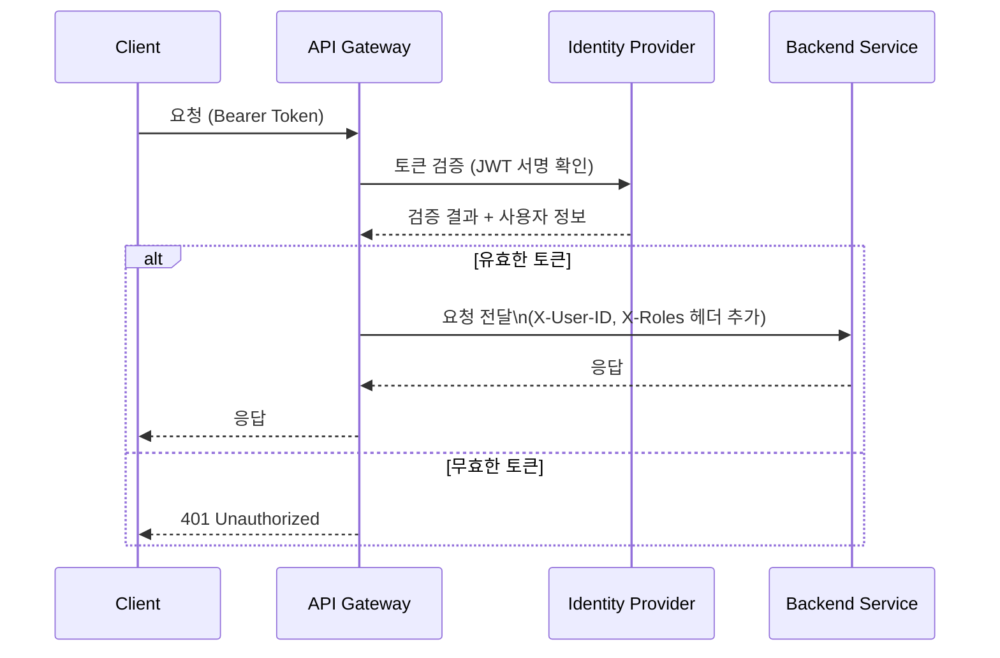

#### Rate Limiting 전략

| 알고리즘 | 특성 | 적합한 상황 |
|----------|------|------------|
| **Fixed Window** | 고정 시간 윈도우당 요청 수 제한 | 단순 구현, 경계 시점 burst 허용 가능 |
| **Sliding Window** | 이동 윈도우로 더 균일한 제한 | 정밀한 제어 필요 |
| **Token Bucket** | 버킷에 토큰 충전, 요청 시 소비 | burst 허용 + 평균 속도 제한 |
| **Leaky Bucket** | 고정 속도로 요청 처리 | 균일한 처리 속도 보장 |

**Python Rate Limiter 예시 (Token Bucket):**

```python
from __future__ import annotations

import time
from dataclasses import dataclass


@dataclass
class TokenBucket:
    """Token bucket rate limiter."""
    capacity: int
    refill_rate: float  # tokens per second
    tokens: float
    last_refill: float

    @classmethod
    def create(cls, capacity: int, refill_rate: float) -> TokenBucket:
        return cls(
            capacity=capacity,
            refill_rate=refill_rate,
            tokens=float(capacity),
            last_refill=time.monotonic(),
        )

    def allow_request(self) -> bool:
        """Check if request is allowed and consume a token."""
        now = time.monotonic()
        elapsed = now - self.last_refill
        self.tokens = min(self.capacity, self.tokens + elapsed * self.refill_rate)
        self.last_refill = now

        if self.tokens >= 1:
            self.tokens -= 1
            return True
        return False
```

**Go Rate Limiter 예시 (Token Bucket):**

```go
package ratelimit

import (
	"sync"
	"time"
)

type TokenBucket struct {
	capacity   float64
	refillRate float64 // tokens per second
	tokens     float64
	lastRefill time.Time
	mu         sync.Mutex
}

func NewTokenBucket(capacity int, refillRate float64) *TokenBucket {
	return &TokenBucket{
		capacity:   float64(capacity),
		refillRate: refillRate,
		tokens:     float64(capacity),
		lastRefill: time.Now(),
	}
}

func (tb *TokenBucket) AllowRequest() bool {
	tb.mu.Lock()
	defer tb.mu.Unlock()

	now := time.Now()
	elapsed := now.Sub(tb.lastRefill).Seconds()
	tb.tokens = min(tb.capacity, tb.tokens+elapsed*tb.refillRate)
	tb.lastRefill = now

	if tb.tokens >= 1 {
		tb.tokens--
		return true
	}
	return false
}
```

#### 캐싱 전략

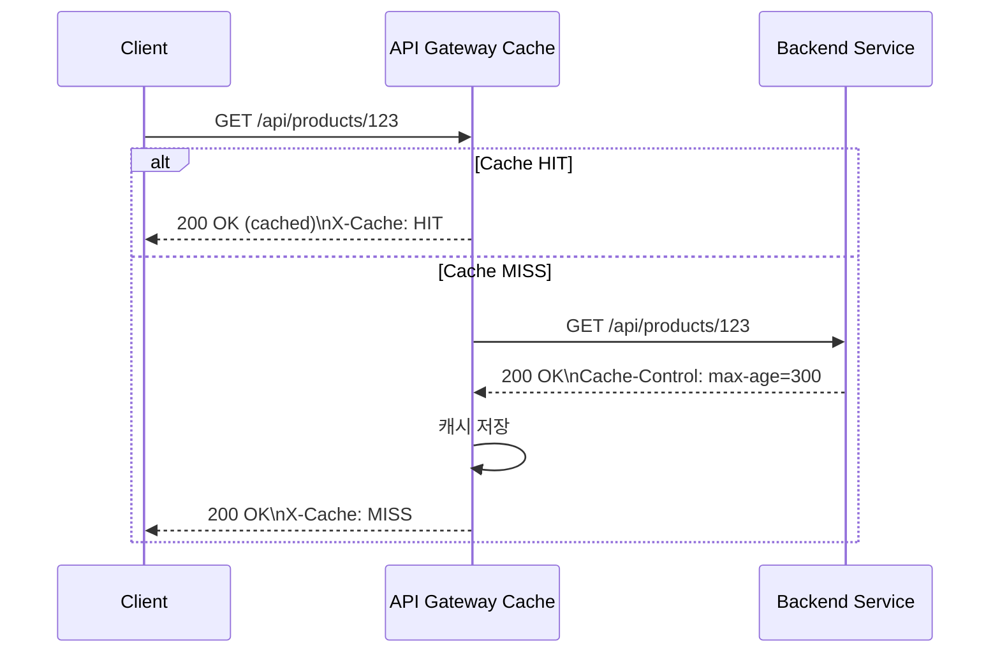

---

## 2. BFF (Backend For Frontend) 패턴

### 2.1 BFF가 필요한 이유

동일한 백엔드 API를 Web, Mobile, IoT 등 다양한 클라이언트가 사용할 때, 각 클라이언트의 요구사항이 다르다.

| 클라이언트 | 특성 | API 요구사항 |
|-----------|------|-------------|
| **Web (SPA)** | 고대역폭, 빠른 렌더링 | 풍부한 데이터, GraphQL 선호 |
| **Mobile (Native)** | 저대역폭, 배터리 제한 | 최소 데이터, 배치 API 선호 |
| **IoT Device** | 극히 제한된 리소스 | 바이너리 프로토콜, 경량 응답 |
| **Third-party** | 표준 준수 필요 | 안정적 REST API, 버전 관리 |

### 2.2 BFF 아키텍처

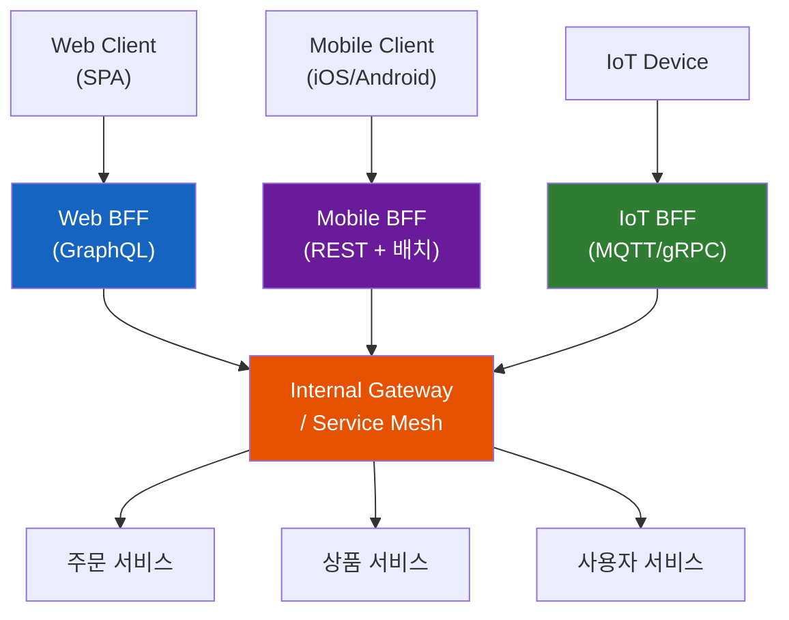

### 2.3 BFF 분리 기준

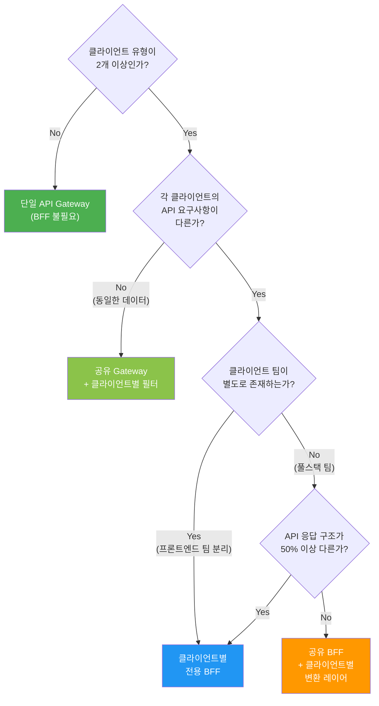

### 2.4 Web BFF vs Mobile BFF 비교

| 비교 기준 | Web BFF | Mobile BFF |
|-----------|---------|------------|
| **프로토콜** | GraphQL / REST | REST + 배치 엔드포인트 |
| **응답 크기** | 제한 없음 (고대역폭) | 최소화 (필드 선택 필수) |
| **페이지네이션** | Offset/Cursor 모두 가능 | Cursor 기반 (무한 스크롤) |
| **이미지 처리** | 원본 URL 제공 | 크기별 URL + WebP 변환 |
| **캐싱** | CDN + ETag | CDN + 로컬 캐시 힌트 |
| **인증** | Session/Cookie 기반 | OAuth2 + Refresh Token |
| **실시간** | WebSocket / SSE | Push Notification + 폴링 |
| **오프라인** | 미지원 (보통) | 동기화 API 필요 |
| **배포** | 프론트엔드 배포와 동기화 | 앱 버전별 하위 호환 필수 |

#### Kotlin BFF 예시 (Spring Cloud Gateway)

```kotlin
// Web BFF - GraphQL aggregation
@RestController
@RequestMapping("/web/api")
class WebBffController(
    private val orderClient: OrderServiceClient,
    private val productClient: ProductServiceClient,
    private val userClient: UserServiceClient,
) {
    /**
     * Web BFF aggregates multiple service calls into a single response.
     * Rich data suitable for desktop rendering.
     */
    @GetMapping("/dashboard")
    suspend fun getDashboard(@RequestHeader("X-User-ID") userId: String): DashboardResponse {
        // Parallel calls to multiple services
        return coroutineScope {
            val orders = async { orderClient.getRecentOrders(userId, limit = 20) }
            val profile = async { userClient.getProfile(userId) }
            val recommendations = async { productClient.getRecommendations(userId, limit = 10) }

            DashboardResponse(
                profile = profile.await(),
                recentOrders = orders.await(),
                recommendations = recommendations.await(),
            )
        }
    }
}

// Mobile BFF - minimal payload with batch support
@RestController
@RequestMapping("/mobile/api")
class MobileBffController(
    private val orderClient: OrderServiceClient,
    private val userClient: UserServiceClient,
) {
    /**
     * Mobile BFF returns minimal payload for bandwidth efficiency.
     * Uses cursor-based pagination for infinite scroll.
     */
    @GetMapping("/dashboard")
    suspend fun getDashboard(
        @RequestHeader("X-User-ID") userId: String,
        @RequestParam("fields", required = false) fields: Set<String>?,
    ): MobileDashboardResponse {
        return coroutineScope {
            val orders = async { orderClient.getRecentOrders(userId, limit = 5) }
            val profile = async { userClient.getProfileSummary(userId) }

            MobileDashboardResponse(
                profileSummary = profile.await(),
                recentOrders = orders.await().map { it.toCompact() },
            ).filterFields(fields)
        }
    }
}
```

#### Go BFF 예시

```go
package bff

import (
	"context"
	"encoding/json"
	"net/http"
	"sync"
)

// WebBFFHandler aggregates multiple services for web clients.
type WebBFFHandler struct {
	orderClient   OrderServiceClient
	productClient ProductServiceClient
	userClient    UserServiceClient
}

type DashboardResponse struct {
	Profile         *UserProfile      `json:"profile"`
	RecentOrders    []Order           `json:"recent_orders"`
	Recommendations []Product         `json:"recommendations"`
}

func (h *WebBFFHandler) GetDashboard(w http.ResponseWriter, r *http.Request) {
	userID := r.Header.Get("X-User-ID")
	ctx := r.Context()

	var (
		profile  *UserProfile
		orders   []Order
		products []Product
		wg       sync.WaitGroup
		mu       sync.Mutex
		errs     []error
	)

	wg.Add(3)
	go func() {
		defer wg.Done()
		p, err := h.userClient.GetProfile(ctx, userID)
		mu.Lock()
		defer mu.Unlock()
		if err != nil {
			errs = append(errs, err)
			return
		}
		profile = p
	}()
	go func() {
		defer wg.Done()
		o, err := h.orderClient.GetRecentOrders(ctx, userID, 20)
		mu.Lock()
		defer mu.Unlock()
		if err != nil {
			errs = append(errs, err)
			return
		}
		orders = o
	}()
	go func() {
		defer wg.Done()
		p, err := h.productClient.GetRecommendations(ctx, userID, 10)
		mu.Lock()
		defer mu.Unlock()
		if err != nil {
			errs = append(errs, err)
			return
		}
		products = p
	}()

	wg.Wait()
	if len(errs) > 0 {
		http.Error(w, "partial failure", http.StatusPartialContent)
		return
	}

	resp := DashboardResponse{
		Profile:         profile,
		RecentOrders:    orders,
		Recommendations: products,
	}
	w.Header().Set("Content-Type", "application/json")
	json.NewEncoder(w).Encode(resp)
}
```

---

## 3. Gateway vs Service Mesh 비교

### 3.1 레이어 비교

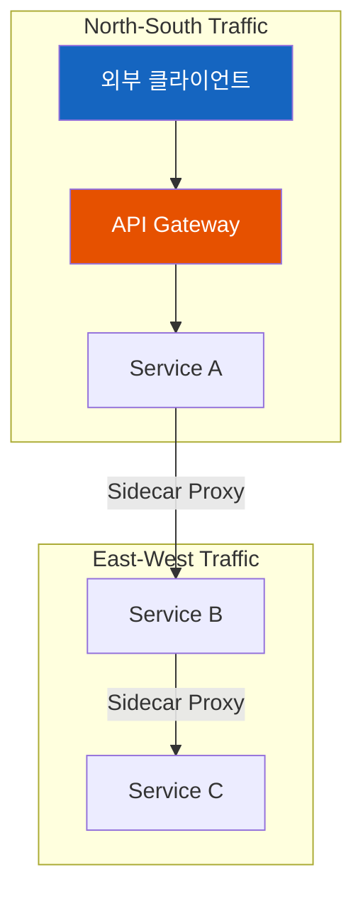

### 3.2 종합 비교표

| 비교 기준 | API Gateway | Service Mesh |
|-----------|-------------|-------------|
| **트래픽 방향** | North-South (외부 -> 내부) | East-West (내부 -> 내부) |
| **OSI 레이어** | L7 (Application) | L4/L7 |
| **배포 위치** | Edge (클러스터 진입점) | Sidecar (각 Pod 옆) |
| **인증** | 외부 클라이언트 인증 (JWT, API Key) | mTLS (서비스 간 상호 인증) |
| **Rate Limiting** | 외부 요청 제한 | 서비스 간 요청 제한 |
| **라우팅** | URL/Header 기반 서비스 라우팅 | 서비스 간 트래픽 분할 (Canary) |
| **프로토콜 변환** | REST <-> gRPC 변환 | 투명 프록시 (변환 없음) |
| **관찰가능성** | 외부 요청 로깅/추적 | 서비스 간 메트릭/추적 자동 수집 |
| **Circuit Breaker** | 외부 -> 서비스 단위 | 서비스 -> 서비스 단위 |
| **리소스 오버헤드** | 낮음 (단일 인스턴스/클러스터) | 높음 (모든 Pod에 사이드카) |
| **구현 복잡도** | 낮음 ~ 중간 | 높음 |
| **대표 도구** | Kong, Envoy, AWS API GW | Istio, Linkerd |

### 3.3 함께 사용하는 패턴

대부분의 프로덕션 환경에서는 Gateway와 Service Mesh를 **함께** 사용한다.

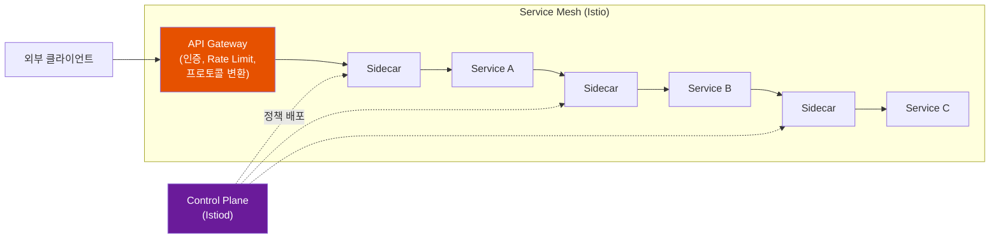

---

## 4. Gateway 도구 비교

### 4.1 종합 비교표

| 비교 기준 | Kong | Envoy | AWS API Gateway | Spring Cloud Gateway | Traefik |
|-----------|------|-------|----------------|---------------------|---------|
| **유형** | Full API Gateway | L7 Proxy | Managed Service | Library/Framework | Edge Router |
| **언어** | Lua (OpenResty) | C++ | Managed | Java/Kotlin | Go |
| **프로토콜** | REST, gRPC, WebSocket | REST, gRPC, HTTP/2, HTTP/3 | REST, WebSocket | REST, WebSocket | REST, gRPC, TCP |
| **플러그인 생태계** | 매우 풍부 | 필터 기반 | 제한적 | Spring 생태계 | 미들웨어 기반 |
| **K8s 통합** | Kong Ingress | Envoy Gateway, Istio | 별도 연동 필요 | Spring Cloud K8s | 네이티브 Ingress |
| **성능 (RPS)** | 높음 (~50K) | 매우 높음 (~100K+) | 관리형 (auto-scale) | 중간 (~20K) | 높음 (~40K) |
| **관리 UI** | Kong Manager (Enterprise) | 없음 (Kiali 연동) | AWS Console | 없음 | Dashboard 내장 |
| **인증** | JWT, OAuth2, LDAP | JWT, mTLS | IAM, Cognito, Lambda Auth | Spring Security | JWT, BasicAuth |
| **Rate Limiting** | 내장 플러그인 | 외부 서비스 연동 | 내장 (Throttling) | Spring Cloud | Rate Limit 미들웨어 |
| **라이선스** | Apache 2.0 / Enterprise | Apache 2.0 | 종량제 | Apache 2.0 | MIT |
| **적합한 상황** | 범용 API 관리 | 고성능/Service Mesh | AWS 네이티브 | Spring Boot 기반 | K8s Ingress, 간편 설정 |

### 4.2 선택 가이드

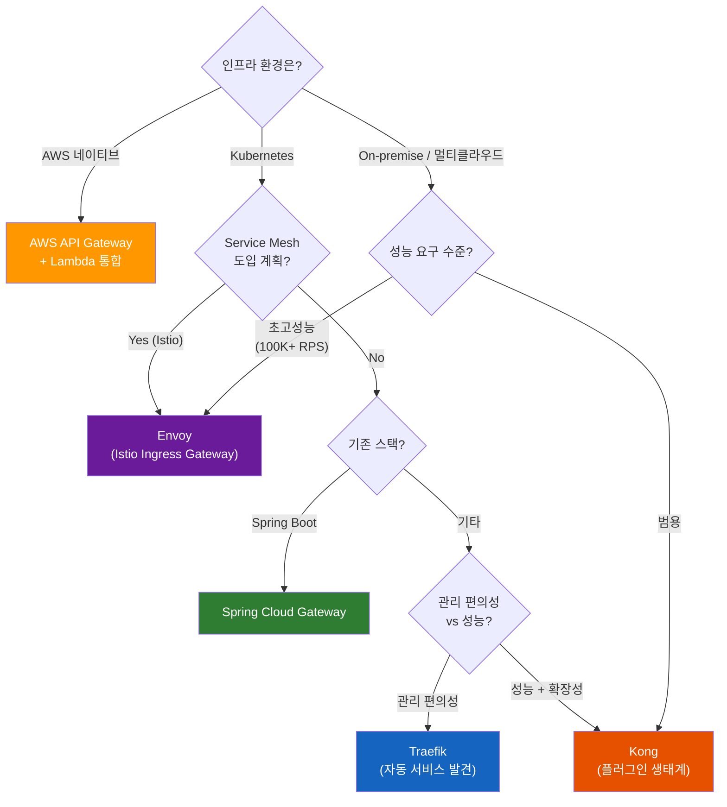

### 4.3 Kong 설정 예시

```yaml
# kong.yml - Declarative configuration
_format_version: "3.0"

services:
  - name: order-service
    url: http://order-svc.default.svc.cluster.local:8080
    routes:
      - name: order-route
        paths:
          - /api/v1/orders
        methods:
          - GET
          - POST
        strip_path: false
    plugins:
      - name: jwt
        config:
          claims_to_verify:
            - exp
      - name: rate-limiting
        config:
          minute: 100
          policy: redis
          redis_host: redis.default.svc.cluster.local
      - name: cors
        config:
          origins:
            - "https://app.example.com"
          methods:
            - GET
            - POST
            - PUT
            - DELETE
          headers:
            - Authorization
            - Content-Type
          max_age: 3600
      - name: request-transformer
        config:
          add:
            headers:
              - "X-Request-Start:$(now)"
```

### 4.4 Spring Cloud Gateway 설정 예시

```kotlin
// Spring Cloud Gateway with Kotlin DSL

@Configuration
class GatewayConfig {

    @Bean
    fun routeLocator(builder: RouteLocatorBuilder): RouteLocator {
        return builder.routes {
            route("order-service") {
                path("/api/v1/orders/**")
                filters {
                    stripPrefix(0)
                    addRequestHeader("X-Gateway", "spring-cloud")
                    circuitBreaker {
                        setName("orderCircuitBreaker")
                        setFallbackUri("forward:/fallback/orders")
                    }
                    retry {
                        setRetries(3)
                        setStatuses(HttpStatus.SERVICE_UNAVAILABLE)
                        setBackoff(Duration.ofMillis(100), Duration.ofSeconds(1), 2, true)
                    }
                    requestRateLimiter {
                        setRateLimiter(redisRateLimiter())
                        setKeyResolver(userKeyResolver())
                    }
                }
                uri("lb://order-service")
            }
            route("payment-service") {
                path("/api/v1/payments/**")
                filters {
                    circuitBreaker {
                        setName("paymentCircuitBreaker")
                        setFallbackUri("forward:/fallback/payments")
                    }
                }
                uri("lb://payment-service")
            }
        }
    }

    @Bean
    fun redisRateLimiter(): RedisRateLimiter {
        return RedisRateLimiter(10, 20) // replenishRate, burstCapacity
    }

    @Bean
    fun userKeyResolver(): KeyResolver {
        return KeyResolver { exchange ->
            Mono.just(exchange.request.headers.getFirst("X-User-ID") ?: "anonymous")
        }
    }
}
```

### 4.5 Traefik 설정 예시 (Kubernetes Ingress)

```yaml
# traefik-ingress.yaml
apiVersion: traefik.io/v1alpha1
kind: IngressRoute
metadata:
  name: api-gateway
spec:
  entryPoints:
    - websecure
  routes:
    - match: PathPrefix(`/api/v1/orders`)
      kind: Rule
      services:
        - name: order-service
          port: 8080
      middlewares:
        - name: rate-limit
        - name: jwt-auth
        - name: circuit-breaker

    - match: PathPrefix(`/api/v1/products`)
      kind: Rule
      services:
        - name: product-service
          port: 8080
          weight: 90
        - name: product-service-canary
          port: 8080
          weight: 10
  tls:
    secretName: api-tls-cert
---
apiVersion: traefik.io/v1alpha1
kind: Middleware
metadata:
  name: rate-limit
spec:
  rateLimit:
    average: 100
    burst: 200
    period: 1m
---
apiVersion: traefik.io/v1alpha1
kind: Middleware
metadata:
  name: circuit-breaker
spec:
  circuitBreaker:
    expression: "LatencyAtQuantileMS(50.0) > 1000 || NetworkErrorRatio() > 0.30"
```

---

## 5. Gateway 설정 모범 사례

### 5.1 타임아웃 설정

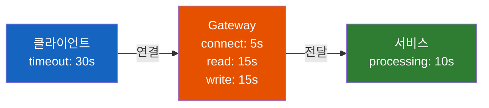

**타임아웃 계층 규칙:**

| 계층 | 타임아웃 | 규칙 |
|------|---------|------|
| 클라이언트 | 가장 길게 | 서비스 응답 + Gateway 오버헤드 포함 |
| Gateway | 중간 | 서비스 타임아웃 + 약간의 여유 |
| 서비스 | 가장 짧게 | 실제 처리 시간 |
| 데이터베이스 | 서비스보다 짧게 | 쿼리 타임아웃 |

**원칙:** `Client timeout > Gateway timeout > Service timeout > DB timeout`

### 5.2 서킷브레이커 설정

```python
from __future__ import annotations

from dataclasses import dataclass


@dataclass(frozen=True)
class CircuitBreakerConfig:
    """Gateway-level circuit breaker configuration."""
    failure_rate_threshold: float = 0.5       # 50% failure rate triggers OPEN
    slow_call_rate_threshold: float = 0.8     # 80% slow calls triggers OPEN
    slow_call_duration_ms: int = 3000         # Calls > 3s considered slow
    minimum_number_of_calls: int = 10         # Min calls before evaluation
    wait_duration_in_open_state_ms: int = 30000  # 30s before HALF_OPEN
    permitted_number_in_half_open: int = 5    # Test calls in HALF_OPEN
    sliding_window_size: int = 20             # Evaluation window
```

### 5.3 CORS 설정

| 헤더 | 값 | 설명 |
|------|---|------|
| `Access-Control-Allow-Origin` | 명시적 도메인만 (와일드카드 금지) | `https://app.example.com` |
| `Access-Control-Allow-Methods` | 필요한 메서드만 | `GET, POST, PUT, DELETE` |
| `Access-Control-Allow-Headers` | 필요한 헤더만 | `Authorization, Content-Type` |
| `Access-Control-Max-Age` | preflight 캐시 시간 | `3600` (1시간) |
| `Access-Control-Allow-Credentials` | 쿠키 전송 필요 시만 | `true` (주의: Origin 와일드카드 불가) |

### 5.4 인증 위임 구성

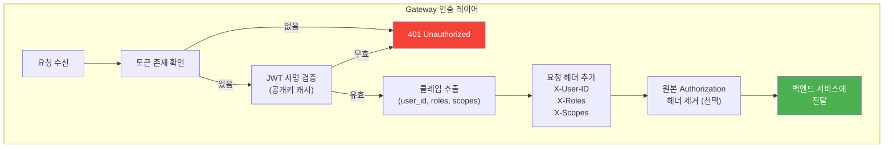

### 5.5 로깅 및 관찰가능성

```python
from __future__ import annotations

import time
import uuid
from dataclasses import dataclass


@dataclass(frozen=True)
class GatewayAccessLog:
    """Structured access log for gateway requests."""
    request_id: str
    trace_id: str
    method: str
    path: str
    status_code: int
    response_time_ms: float
    upstream_service: str
    upstream_response_time_ms: float
    client_ip: str
    user_id: str | None
    rate_limit_remaining: int | None
    cache_status: str  # HIT, MISS, BYPASS


# Gateway must propagate trace context headers:
TRACE_HEADERS = (
    "X-Request-ID",       # Gateway-generated unique ID
    "X-B3-TraceId",       # Zipkin/Jaeger trace ID
    "X-B3-SpanId",        # Current span ID
    "X-B3-ParentSpanId",  # Parent span ID
    "traceparent",        # W3C Trace Context
    "tracestate",         # W3C Trace State
)
```

---

## 6. Gateway 안티패턴

### 6.1 비즈니스 로직 포함

Gateway에 비즈니스 로직을 넣으면 **Fat Gateway**가 되어 모든 팀의 배포 병목이 된다.

| 안티패턴 | 문제 | 올바른 접근 |
|----------|------|------------|
| Gateway에서 데이터 조합/변환 | Gateway 변경 시 모든 서비스에 영향 | BFF 레이어로 분리 |
| Gateway에서 비즈니스 유효성 검사 | 도메인 로직이 Gateway에 누출 | 백엔드 서비스에서 검증 |
| Gateway에서 DB 직접 접근 | Gateway와 서비스의 데이터 소유권 충돌 | 서비스 API를 통해서만 접근 |
| Gateway에서 비동기 처리 | Gateway 복잡도 증가, 장애 범위 확대 | 메시지 큐를 통한 비동기 처리 |

```
// WRONG: Business logic in gateway
gateway.route("/api/orders")
    .filter { request ->
        // Business validation in gateway!
        val items = request.body.items
        if (items.any { it.quantity > MAX_ORDER_QUANTITY }) {
            return@filter Response(400, "Exceeds max order quantity")
        }
        // Data aggregation in gateway!
        val enriched = items.map { item ->
            val product = productService.getProduct(item.productId)
            item.copy(price = product.price)
        }
        request.copy(body = request.body.copy(items = enriched))
    }
```

```
// CORRECT: Gateway only handles cross-cutting concerns
gateway.route("/api/orders")
    .filter(jwtAuthFilter)
    .filter(rateLimitFilter)
    .filter(corsFilter)
    .uri("lb://order-service")

// Business logic stays in order-service
```

### 6.2 단일 장애점 (SPOF)

| 안티패턴 | 문제 | 올바른 접근 |
|----------|------|------------|
| 단일 Gateway 인스턴스 | Gateway 다운 시 전체 시스템 접근 불가 | 다중 인스턴스 + 로드밸런서 |
| 상태 저장 Gateway | 인스턴스 간 상태 동기화 필요 | 무상태 Gateway + 외부 저장소 (Redis) |
| Gateway에 모든 서비스 설정 집중 | 설정 변경 시 Gateway 재시작 필요 | 동적 설정 (DB/Config Server) |

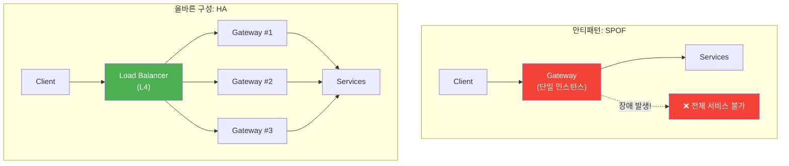

### 6.3 과도한 변환

| 안티패턴 | 문제 | 올바른 접근 |
|----------|------|------------|
| 모든 요청/응답을 변환 | Gateway CPU 병목, 지연 증가 | 필요한 변환만 최소화 |
| 복잡한 XSLT/JQ 변환 | 디버깅 어려움, 성능 저하 | BFF에서 변환 처리 |
| 프로토콜 다중 변환 | REST -> gRPC -> REST 이중 변환 | 통일된 내부 프로토콜 정책 수립 |

### 6.4 버전 관리 부재

| 안티패턴 | 문제 | 올바른 접근 |
|----------|------|------------|
| API 버전 없이 운영 | 하위 호환성 깨짐 시 클라이언트 전체 장애 | URL/Header 기반 버전 관리 |
| Gateway에서 버전 변환 | Gateway에 모든 버전 변환 로직 누적 | 서비스별 버전 관리, Gateway는 라우팅만 |

```yaml
# CORRECT: Version-based routing at gateway level
routes:
  - match: "PathPrefix(`/api/v1/orders`)"
    service: order-service-v1
  - match: "PathPrefix(`/api/v2/orders`)"
    service: order-service-v2
  - match: "Header(`Accept-Version`, `v2`)"
    service: order-service-v2
```

---

## 7. 체크리스트

### 7.1 Gateway 아키텍처 체크리스트

- [ ] Gateway가 횡단 관심사(인증, Rate Limiting, 로깅)만 처리하는가?
- [ ] 비즈니스 로직이 Gateway에 포함되어 있지 않은가?
- [ ] Gateway가 다중 인스턴스로 운영되어 SPOF가 아닌가?
- [ ] Gateway가 무상태(Stateless)인가?
- [ ] 클라이언트 유형별 BFF 분리가 필요한지 검토했는가?

### 7.2 보안 체크리스트

- [ ] JWT 검증이 Gateway에서 수행되는가?
- [ ] 내부 서비스는 외부에서 직접 접근 불가능한가?
- [ ] CORS 설정에 와일드카드(`*`) 도메인을 사용하지 않는가?
- [ ] Rate Limiting이 IP/사용자/API 키 단위로 설정되어 있는가?
- [ ] TLS 종료(TLS Termination)가 Gateway에서 처리되는가?
- [ ] 인증 실패 시 상세한 내부 정보가 노출되지 않는가?

### 7.3 성능 체크리스트

- [ ] 타임아웃이 계층별로 올바르게 설정되어 있는가? (Client > Gateway > Service)
- [ ] 서킷브레이커가 각 upstream 서비스별로 설정되어 있는가?
- [ ] GET 요청에 대한 캐싱 전략이 수립되어 있는가?
- [ ] 로드밸런싱 알고리즘이 적절한가?
- [ ] Connection pooling이 설정되어 있는가?
- [ ] 요청/응답 변환이 최소화되어 있는가?

### 7.4 관찰가능성 체크리스트

- [ ] 구조화된 액세스 로그가 기록되는가?
- [ ] 분산 추적 헤더(traceparent/X-B3)가 전파되는가?
- [ ] Gateway 메트릭(RPS, latency, error rate)이 수집되는가?
- [ ] Rate Limit 초과, 서킷브레이커 OPEN 시 알림이 설정되어 있는가?
- [ ] Health check 엔드포인트가 구성되어 있는가?

### 7.5 운영 체크리스트

- [ ] API 버전 관리 전략이 수립되어 있는가?
- [ ] Gateway 설정이 코드로 관리되는가 (IaC)?
- [ ] 설정 변경 시 무중단 배포가 가능한가?
- [ ] 장애 시 우회 경로(fallback)가 정의되어 있는가?
- [ ] 부하 테스트에서 Gateway 성능이 검증되었는가?

---

> **관련 문서:**
> - [마이크로서비스 아키텍처 가이드](./microservice-architecture-guide.md) -- 서비스 분해, 통신 개요
> - [서비스 간 통신 가이드](./service-communication-guide.md) -- REST, gRPC, Service Mesh 상세
> - [에러 처리 및 복원력 패턴 가이드](./error-handling-guide.md) -- Circuit Breaker, Retry, Timeout
> - [REST API 설계 가이드](./rest-api-design-guide.md) -- API 설계 표준
