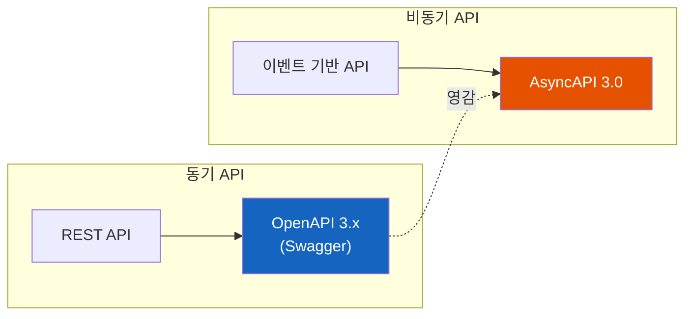
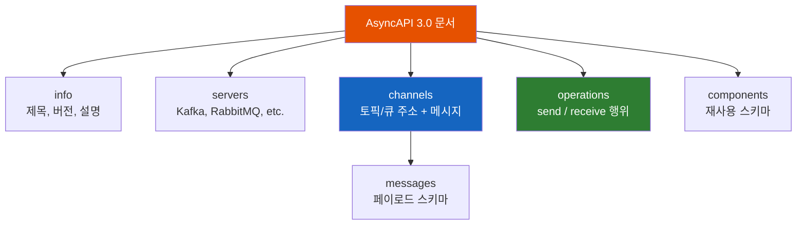
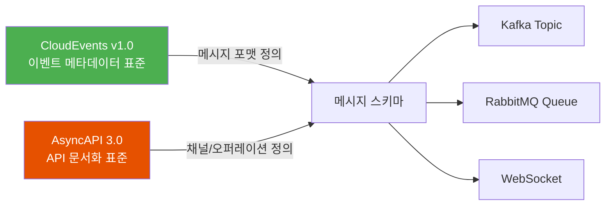
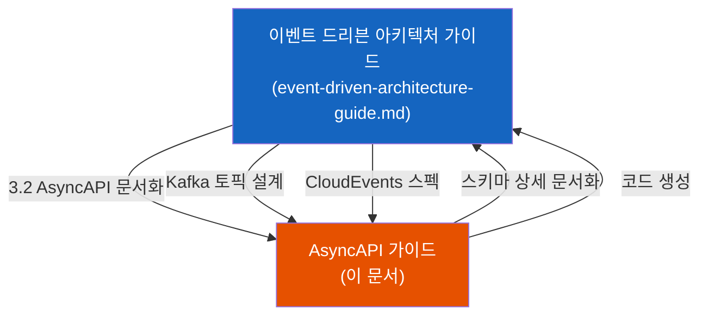

# AsyncAPI 가이드

> **작성일**: 2026-03-14
> **기반 표준**: AsyncAPI 3.0 Specification, CloudEvents v1.0
> **적용 수준**: 이벤트 드리븐 아키텍처(EDA) 프로젝트의 API 문서화 표준
> **연관 문서**: `docs/guides/event-driven-architecture-guide.md`

---

## 목차

1. [AsyncAPI 3.0 스펙 개요](#1-asyncapi-30-스펙-개요)
2. [CloudEvents와의 관계](#2-cloudevents와의-관계)
3. [이벤트 스키마 문서화 예시](#3-이벤트-스키마-문서화-예시)
4. [도구 안내](#4-도구-안내)
5. [기존 가이드와의 연계](#5-기존-가이드와의-연계)

---

## 1. AsyncAPI 3.0 스펙 개요

### 1.1 AsyncAPI란?

AsyncAPI는 이벤트 기반/비동기 API의 **OpenAPI에 해당하는 표준 스펙**이다. REST API가 OpenAPI(Swagger)로 문서화되듯, Kafka, RabbitMQ, WebSocket 등의 비동기 통신은 AsyncAPI로 문서화한다.



### 1.2 AsyncAPI 3.0 핵심 구조

AsyncAPI 3.0은 2.x 대비 구조가 크게 개선되었다. 주요 변경점은 **채널(channel)과 오퍼레이션(operation)의 분리**다.

| 구성 요소 | 설명 | 예시 |
|-----------|------|------|
| **info** | API 메타데이터 (제목, 버전, 설명) | `title: Order Service Events` |
| **servers** | 브로커 연결 정보 | `kafka://broker:9092` |
| **channels** | 메시지가 전달되는 주소(토픽, 큐 등) | `order.order.placed` |
| **operations** | 채널에서 수행하는 행위 (send/receive) | `publishOrderPlaced` |
| **messages** | 메시지 스키마 정의 | JSON Schema, Avro |
| **components** | 재사용 가능한 스키마/메시지 정의 | `$ref` 참조 |



### 1.3 AsyncAPI 3.0 vs 2.x 주요 변경점

| 항목 | AsyncAPI 2.x | AsyncAPI 3.0 |
|------|-------------|-------------|
| 채널-오퍼레이션 관계 | 채널 안에 `publish`/`subscribe` 포함 | 채널과 오퍼레이션 분리 |
| 오퍼레이션 방향 | `publish` = 앱이 발행, `subscribe` = 앱이 구독 (혼동) | `send` / `receive` (명확) |
| 메시지 정의 | 채널 내부에 인라인 | `components/messages`에서 `$ref` 참조 |
| Reply 패턴 | 미지원 | `operations.reply` 네이티브 지원 |
| 서버-채널 바인딩 | 암시적 | 명시적 연결 |

---

## 2. CloudEvents와의 관계

### 2.1 역할 분리

| 표준 | 역할 | 비유 |
|------|------|------|
| **CloudEvents** | 이벤트 **메타데이터 포맷** (id, type, source, time) | HTTP 헤더 표준 |
| **AsyncAPI** | 이벤트 **API 문서화** (채널, 스키마, 바인딩) | OpenAPI 스펙 |

두 표준은 **상호 보완적**이다. CloudEvents가 "이벤트의 봉투(envelope)"를 정의하고, AsyncAPI가 "그 봉투가 어떤 채널을 통해 어떤 형태로 전달되는지"를 문서화한다.



### 2.2 통합 사용 패턴

AsyncAPI 메시지 스키마에 CloudEvents 속성을 포함하는 것이 권장 패턴이다.

```yaml
# CloudEvents attributes in AsyncAPI message headers
components:
  messageTraits:
    cloudEventsHeaders:
      headers:
        type: object
        required:
          - ce_id
          - ce_type
          - ce_source
          - ce_specversion
        properties:
          ce_id:
            type: string
            format: uuid
            description: "CloudEvents unique event ID"
          ce_type:
            type: string
            description: "CloudEvents event type (reverse DNS)"
          ce_source:
            type: string
            format: uri
            description: "CloudEvents event source"
          ce_specversion:
            type: string
            enum: ["1.0"]
          ce_time:
            type: string
            format: date-time
            description: "RFC 3339 timestamp"
          ce_correlationid:
            type: string
            description: "Distributed tracing correlation ID"
```

---

## 3. 이벤트 스키마 문서화 예시

### 3.1 전체 AsyncAPI 3.0 문서 예시

```yaml
asyncapi: 3.0.0

info:
  title: 주문 서비스 이벤트 API
  version: 2.0.0
  description: |
    주문 서비스에서 발행하는 이벤트 API 명세.
    모든 이벤트는 CloudEvents v1.0 스펙을 따른다.
  contact:
    name: 주문팀
    email: team-order@example.com
  license:
    name: Apache 2.0

# -- 서버 (브로커) 정보 --
servers:
  production:
    host: kafka-prod.example.com:9092
    protocol: kafka
    description: Production Kafka cluster
    tags:
      - name: production
  staging:
    host: kafka-staging.example.com:9092
    protocol: kafka
    description: Staging Kafka cluster
    tags:
      - name: staging

# -- 채널 (토픽) 정의 --
channels:
  orderPlaced:
    address: order.order.placed
    description: 주문이 생성되었을 때 발행되는 이벤트
    messages:
      orderPlacedMessage:
        $ref: '#/components/messages/OrderPlacedMessage'
    bindings:
      kafka:
        partitions: 12
        replicas: 3
        topicConfiguration:
          retention.ms: 604800000
          cleanup.policy:
            - delete
          min.insync.replicas: 2

  orderCancelled:
    address: order.order.cancelled
    description: 주문이 취소되었을 때 발행되는 이벤트
    messages:
      orderCancelledMessage:
        $ref: '#/components/messages/OrderCancelledMessage'

# -- 오퍼레이션 정의 --
operations:
  publishOrderPlaced:
    action: send
    channel:
      $ref: '#/channels/orderPlaced'
    summary: 주문 생성 이벤트 발행
    description: |
      새 주문이 생성되면 이 오퍼레이션을 통해 이벤트가 발행된다.
      파티션 키: order_id (주문별 순서 보장)
    tags:
      - name: order
      - name: critical
    bindings:
      kafka:
        clientId: order-service
        groupId: order-service.publisher

  publishOrderCancelled:
    action: send
    channel:
      $ref: '#/channels/orderCancelled'
    summary: 주문 취소 이벤트 발행

  receiveOrderPlaced:
    action: receive
    channel:
      $ref: '#/channels/orderPlaced'
    summary: 주문 생성 이벤트 수신 (재고 서비스)
    bindings:
      kafka:
        groupId: inventory-service.stock-deduction

# -- 재사용 컴포넌트 --
components:
  messages:
    OrderPlacedMessage:
      name: OrderPlaced
      title: 주문 생성 이벤트
      summary: 새 주문이 생성되었음을 알리는 이벤트
      contentType: application/json
      traits:
        - $ref: '#/components/messageTraits/cloudEventsHeaders'
      payload:
        $ref: '#/components/schemas/OrderPlacedPayload'

    OrderCancelledMessage:
      name: OrderCancelled
      title: 주문 취소 이벤트
      summary: 주문이 취소되었음을 알리는 이벤트
      contentType: application/json
      traits:
        - $ref: '#/components/messageTraits/cloudEventsHeaders'
      payload:
        $ref: '#/components/schemas/OrderCancelledPayload'

  schemas:
    OrderPlacedPayload:
      type: object
      required:
        - order_id
        - user_id
        - items
        - total_amount
        - currency
      properties:
        order_id:
          type: string
          format: uuid
          description: 주문 고유 ID
          examples:
            - "order-12345-abcd"
        user_id:
          type: string
          description: 주문자 사용자 ID
        items:
          type: array
          description: 주문 상품 목록
          items:
            $ref: '#/components/schemas/OrderItem'
          minItems: 1
        total_amount:
          type: integer
          description: 총 금액 (원 단위)
          minimum: 0
          examples:
            - 59800
        currency:
          type: string
          enum:
            - KRW
            - USD
          description: 통화 코드 (ISO 4217)
        ordered_at:
          type: string
          format: date-time
          description: 주문 시각 (RFC 3339)

    OrderCancelledPayload:
      type: object
      required:
        - order_id
        - reason
      properties:
        order_id:
          type: string
          format: uuid
        reason:
          type: string
          description: 취소 사유
          enum:
            - customer_request
            - payment_failed
            - out_of_stock
            - fraud_detected
        cancelled_at:
          type: string
          format: date-time

    OrderItem:
      type: object
      required:
        - product_id
        - quantity
        - unit_price
      properties:
        product_id:
          type: string
        quantity:
          type: integer
          minimum: 1
        unit_price:
          type: integer
          minimum: 0

  messageTraits:
    cloudEventsHeaders:
      headers:
        type: object
        required:
          - ce_id
          - ce_type
          - ce_source
          - ce_specversion
        properties:
          ce_id:
            type: string
            format: uuid
          ce_type:
            type: string
            examples:
              - "com.mycompany.order.placed"
          ce_source:
            type: string
            format: uri
            examples:
              - "/order-service/v2"
          ce_specversion:
            type: string
            enum: ["1.0"]
          ce_time:
            type: string
            format: date-time
```

### 3.2 스키마 설계 규칙

| 규칙 | 설명 |
|------|------|
| **필수 필드 명시** | `required` 배열에 반드시 기재 |
| **열거형 제한** | 상태/유형 값은 `enum`으로 제한 |
| **포맷 지정** | `format: uuid`, `format: date-time` 등 명시 |
| **예시 포함** | `examples` 필드로 실제 값 예시 제공 |
| **설명 필수** | 모든 속성에 `description` 한글 기재 |
| **최소/최대 제약** | 숫자 필드에 `minimum`, `maximum` 설정 |
| **배열 제약** | `minItems`, `maxItems`로 배열 크기 제한 |

---

## 4. 도구 안내

### 4.1 AsyncAPI Studio

[AsyncAPI Studio](https://studio.asyncapi.com/)는 AsyncAPI 문서를 시각적으로 편집하고 미리 볼 수 있는 웹 기반 도구다.

| 기능 | 설명 |
|------|------|
| **시각 편집기** | YAML 편집 + 실시간 미리보기 |
| **스키마 검증** | AsyncAPI 3.0 스펙 준수 여부 자동 검증 |
| **문서 렌더링** | HTML 문서 자동 생성 |
| **GitHub 연동** | GitHub 저장소에서 직접 로드/저장 |

### 4.2 AsyncAPI CLI

```bash
# Install
npm install -g @asyncapi/cli

# Validate spec
asyncapi validate asyncapi.yaml

# Generate documentation (HTML)
asyncapi generate fromTemplate asyncapi.yaml @asyncapi/html-template -o docs/

# Generate code (TypeScript)
asyncapi generate fromTemplate asyncapi.yaml @asyncapi/typescript-nats-template

# Convert between versions
asyncapi convert asyncapi-v2.yaml --target-version=3.0.0
```

### 4.3 코드 생성

AsyncAPI 스펙에서 다양한 언어의 코드를 자동 생성할 수 있다.

| 템플릿 | 생성 대상 | 명령어 |
|--------|-----------|--------|
| `@asyncapi/html-template` | HTML 문서 | `asyncapi generate fromTemplate` |
| `@asyncapi/typescript-nats-template` | TypeScript NATS 클라이언트 | `asyncapi generate fromTemplate` |
| `@asyncapi/java-spring-template` | Spring Boot Kafka 컨슈머/프로듀서 | `asyncapi generate fromTemplate` |
| `@asyncapi/python-paho-template` | Python MQTT 클라이언트 | `asyncapi generate fromTemplate` |

### 4.4 CI 통합

```yaml
# .github/workflows/asyncapi-validate.yml
name: AsyncAPI Validation

on:
  pull_request:
    paths:
      - '**/*.asyncapi.yaml'
      - '**/asyncapi.yaml'

jobs:
  validate:
    runs-on: ubuntu-latest
    steps:
      - uses: actions/checkout@v4
      - name: Validate AsyncAPI specs
        run: |
          npm install -g @asyncapi/cli
          for spec in $(find . -name "*.asyncapi.yaml" -o -name "asyncapi.yaml"); do
            echo "Validating: $spec"
            asyncapi validate "$spec" || exit 1
          done
```

---

## 5. 기존 가이드와의 연계

### 5.1 이벤트 드리븐 아키텍처 가이드와의 관계



| 문서 | 다루는 내용 | 참조 시점 |
|------|-------------|-----------|
| **이벤트 드리븐 아키텍처 가이드** | Kafka 설계, CloudEvents, Event Sourcing, CQRS | 아키텍처 설계 시 |
| **이 문서 (AsyncAPI 가이드)** | 이벤트 스키마 문서화 상세, 도구, CI 통합 | API 명세 작성 시 |

### 5.2 연관 문서 목록

| 문서 | 경로 | 연관 내용 |
|------|------|-----------|
| 이벤트 드리븐 아키텍처 가이드 | `docs/guides/event-driven-architecture-guide.md` | Kafka, CloudEvents, CQRS |
| REST API 설계 가이드 | `docs/guides/rest-api-design-guide.md` | OpenAPI (동기 API 대응) |
| Contract Testing 가이드 | `docs/guides/contract-testing-guide.md` | 이벤트 스키마 계약 테스트 |
| 서비스 간 통신 가이드 | `docs/guides/service-communication-guide.md` | gRPC, 비동기 통신 |

---

## 참고 자료

| 자료 | 설명 |
|------|------|
| [AsyncAPI 3.0 Spec](https://www.asyncapi.com/docs/reference/specification/v3.0.0) | 공식 스펙 문서 |
| [AsyncAPI Studio](https://studio.asyncapi.com/) | 웹 기반 편집기 |
| [AsyncAPI CLI](https://www.asyncapi.com/docs/tools/cli) | CLI 도구 |
| [CloudEvents](https://cloudevents.io/) | 이벤트 메타데이터 표준 |
| [AsyncAPI Modelina](https://www.asyncapi.com/docs/tools/modelina) | 데이터 모델 코드 생성 |
