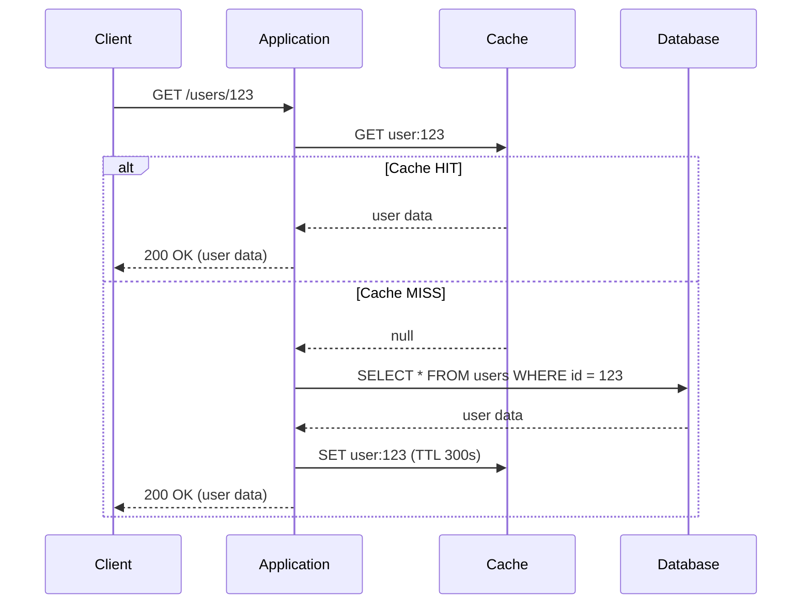
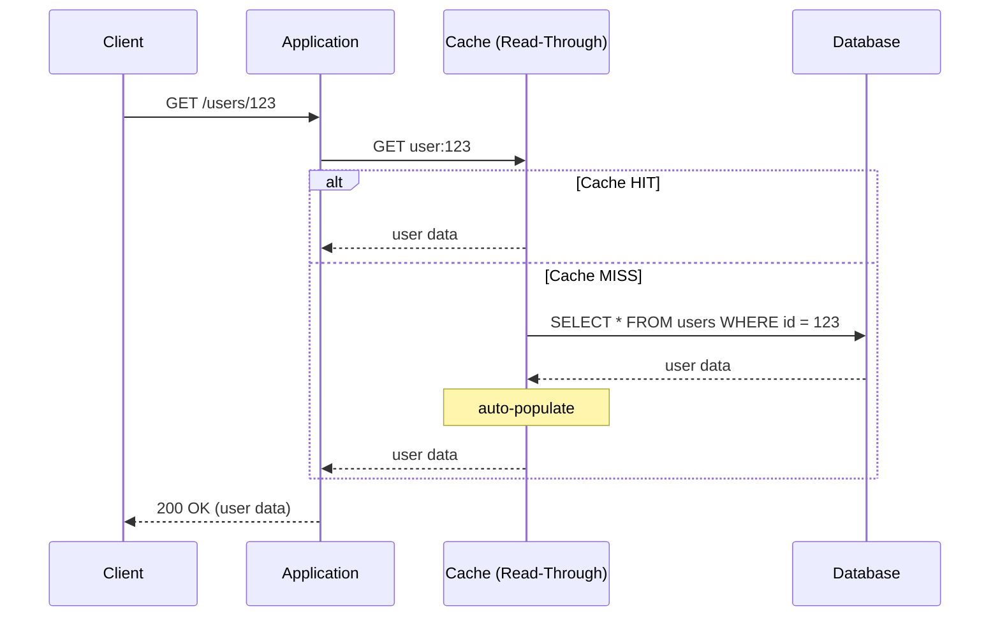
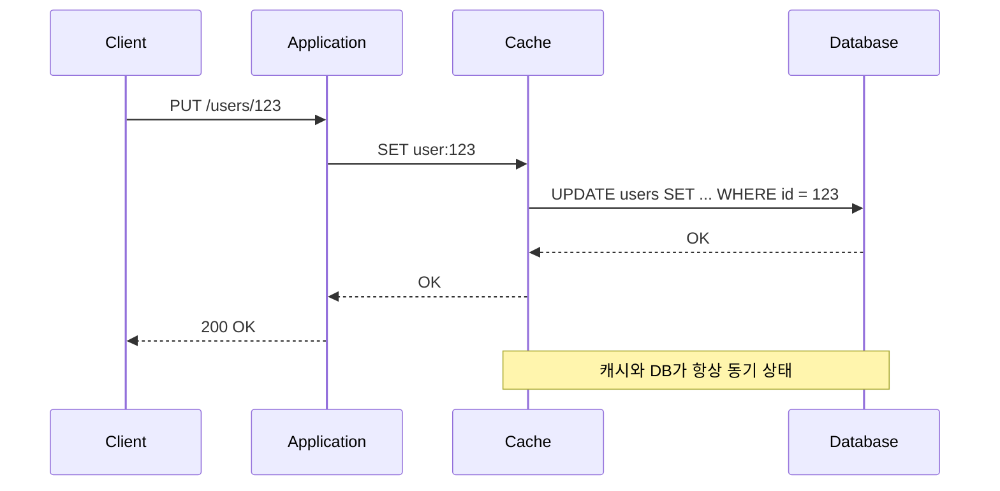
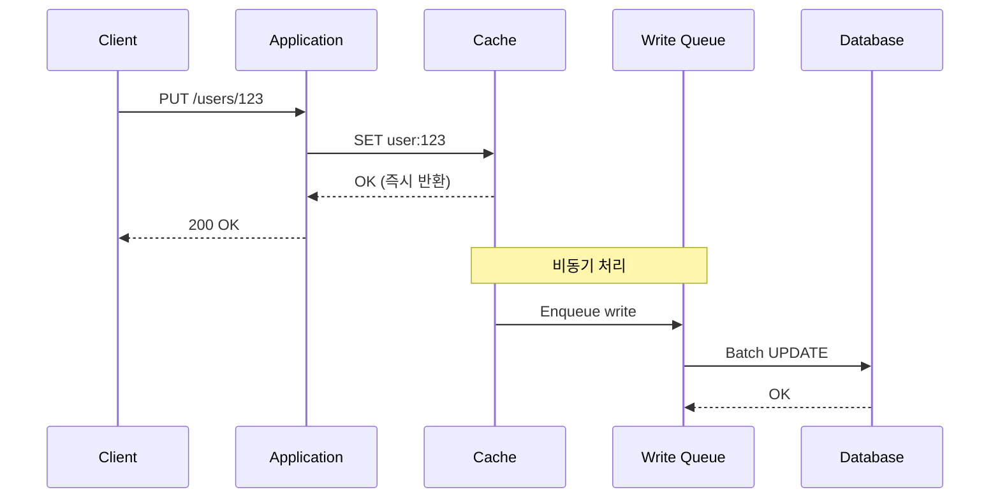
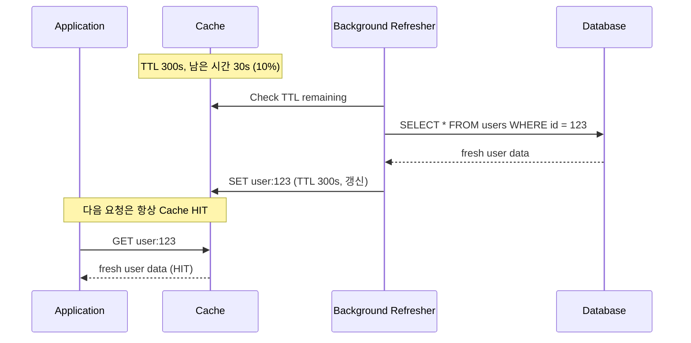
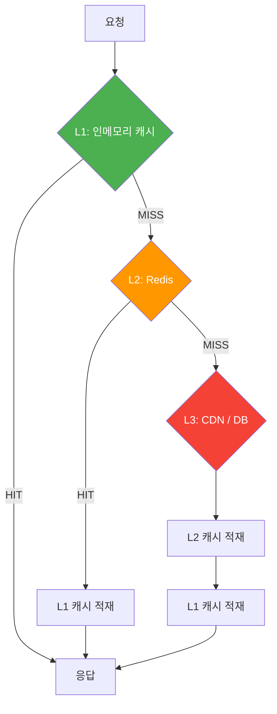

# 캐싱 전략 가이드

> **작성일**: 2026-03-12
> **기반 표준**: AWS ElastiCache Best Practices, Redis University, Meta Caching Infrastructure
> **적용 수준**: 빅테크 기준 팀 운영표준
> **대상 언어**: Python, Go, TypeScript

---

## 목차

1. [캐싱 패턴](#1-캐싱-패턴)
2. [TTL 전략](#2-ttl-전략)
3. [캐시 무효화](#3-캐시-무효화)
4. [Redis 패턴](#4-redis-패턴)
5. [멀티레이어 캐싱](#5-멀티레이어-캐싱)
6. [캐시 안티패턴](#6-캐시-안티패턴)
7. [캐싱 체크리스트](#7-캐싱-체크리스트)

---

## 1. 캐싱 패턴

### 1.1 Cache-Aside (Lazy Loading)

애플리케이션이 캐시를 직접 관리한다. 캐시 미스 시 데이터 소스에서 조회 후 캐시에 저장한다. 가장 일반적이고 안전한 패턴이다.



**Python 구현:**

```python
from __future__ import annotations

import json
from typing import Any

DEFAULT_TTL_SEC = 300


async def get_user_cache_aside(
    redis_client,
    db_session,
    user_id: str,
) -> dict[str, Any]:
    """Fetch user with Cache-Aside pattern.

    Check cache first, fall back to DB on miss, then populate cache.
    """
    cache_key = f"user:{user_id}"

    # Step 1: Check cache
    cached = await redis_client.get(cache_key)
    if cached is not None:
        return json.loads(cached)

    # Step 2: Cache miss -- fetch from DB
    user = await db_session.get(User, user_id)
    if user is None:
        return {}

    user_data = user.to_dict()

    # Step 3: Populate cache
    await redis_client.setex(cache_key, DEFAULT_TTL_SEC, json.dumps(user_data))

    return user_data
```

**장점:** 캐시 장애 시에도 DB에서 직접 조회 가능. 필요한 데이터만 캐싱.
**단점:** 첫 요청은 항상 느림 (cold start). 캐시와 DB 간 일시적 불일치 가능.

### 1.2 Read-Through

캐시 계층이 데이터 로딩을 자동으로 처리한다. 애플리케이션은 항상 캐시만 조회하고, 캐시가 미스 시 자체적으로 데이터 소스에서 로드한다.



**장점:** 애플리케이션 코드 단순화. 캐시 로직이 인프라 계층으로 분리.
**단점:** 캐시 계층에 로딩 로직 구현 필요. 사용 가능한 캐시 솔루션에 의존.

### 1.3 Write-Through

쓰기 시 캐시와 데이터 소스를 동시에 업데이트한다. 데이터 일관성이 중요한 경우 사용한다.



**장점:** 캐시와 DB 간 강한 일관성. 읽기 성능 보장.
**단점:** 쓰기 레이턴시 증가 (캐시 + DB 순차 쓰기). 한 번도 읽히지 않을 데이터도 캐싱.

### 1.4 Write-Behind (Write-Back)

쓰기를 캐시에만 즉시 반영하고, 데이터 소스 업데이트는 비동기로 지연 수행한다.



**장점:** 쓰기 레이턴시 최소화. 배치로 묶어 DB 부하 감소.
**단점:** 캐시 장애 시 데이터 유실 위험. 일시적 불일치 허용 필요.

### 1.5 Refresh-Ahead

TTL 만료 전에 백그라운드에서 캐시를 미리 갱신한다. 핫 데이터의 캐시 미스를 방지한다.



**장점:** 핫 데이터의 캐시 미스 제로. 사용자 경험 최적.
**단점:** 구현 복잡. 더 이상 접근하지 않는 데이터도 갱신할 수 있음.

### 1.6 패턴 비교표

| 패턴 | 일관성 | 쓰기 성능 | 읽기 성능 | 복잡도 | 적합한 상황 |
|------|--------|-----------|-----------|--------|-------------|
| Cache-Aside | 약 | -- | 보통 | 낮음 | 범용, 읽기 위주 |
| Read-Through | 약 | -- | 보통 | 중간 | 캐시 인프라 지원 시 |
| Write-Through | 강 | 느림 | 빠름 | 중간 | 일관성 중요 |
| Write-Behind | 약 | 빠름 | 빠름 | 높음 | 쓰기 집중, 유실 허용 |
| Refresh-Ahead | 강 | -- | 빠름 | 높음 | 핫 데이터, 지연 민감 |

---

## 2. TTL 전략

### 2.1 고정 TTL

모든 캐시 항목에 동일한 TTL을 적용한다. 단순하지만 데이터 특성을 반영하지 못한다.

| 데이터 유형 | 권장 TTL | 근거 |
|-------------|----------|------|
| 설정 데이터 (feature flags) | 60s | 변경 빈도 낮지만 빠른 반영 필요 |
| 사용자 프로필 | 300s (5분) | 자주 변경되지 않음 |
| 상품 목록 | 600s (10분) | 변경 시 이벤트 기반 무효화 병행 |
| 검색 결과 | 60s | 자주 변경, 약간의 지연 허용 |
| 세션 데이터 | 1800s (30분) | 사용자 활동 시 갱신 |
| 정적 자산 메타 | 86400s (24시간) | 거의 변경 안 됨 |

### 2.2 적응형 TTL (Adaptive TTL)

데이터의 변경 빈도에 따라 TTL을 동적으로 조절한다.

```python
from __future__ import annotations

import time

MIN_TTL_SEC = 30
MAX_TTL_SEC = 3600
DEFAULT_TTL_SEC = 300
DECAY_FACTOR = 0.5
GROWTH_FACTOR = 1.5


def calculate_adaptive_ttl(
    last_modified_ts: float,
    current_ts: float | None = None,
) -> int:
    """Calculate TTL based on data staleness.

    Recently modified data gets shorter TTL (likely to change again).
    Stable data gets longer TTL (unlikely to change soon).

    Args:
        last_modified_ts: Unix timestamp of last data modification.
        current_ts: Current time (defaults to now).

    Returns:
        TTL in seconds.
    """
    now = current_ts or time.time()
    age_seconds = now - last_modified_ts

    if age_seconds < 60:
        # Modified in last minute -- very volatile
        ttl = MIN_TTL_SEC
    elif age_seconds < 3600:
        # Modified in last hour -- moderately volatile
        ttl = int(DEFAULT_TTL_SEC * DECAY_FACTOR)
    elif age_seconds < 86400:
        # Modified in last day -- relatively stable
        ttl = int(DEFAULT_TTL_SEC * GROWTH_FACTOR)
    else:
        # Not modified in over a day -- very stable
        ttl = MAX_TTL_SEC

    return max(MIN_TTL_SEC, min(ttl, MAX_TTL_SEC))
```

### 2.3 Stale-While-Revalidate

만료된 캐시 데이터를 즉시 반환하면서 백그라운드에서 갱신한다. 사용자 체감 레이턴시를 최소화하는 전략이다.

```python
from __future__ import annotations

import asyncio
import json
import time
from dataclasses import dataclass


@dataclass(frozen=True)
class CachedItem:
    """Cache item with staleness tracking."""

    data: str
    created_at: float
    ttl: float
    stale_ttl: float  # additional time data can be served stale


STALE_BUFFER_SEC = 60  # serve stale for up to 60s while revalidating


async def get_with_stale_while_revalidate(
    redis_client,
    key: str,
    fetch_fn,
    ttl: int = 300,
    stale_ttl: int = STALE_BUFFER_SEC,
) -> dict | None:
    """Serve stale data while revalidating in background.

    Args:
        redis_client: Redis async client.
        key: Cache key.
        fetch_fn: Async function to fetch fresh data.
        ttl: Fresh TTL in seconds.
        stale_ttl: Additional seconds to serve stale data.

    Returns:
        Cached or fresh data.
    """
    raw = await redis_client.get(key)

    if raw is not None:
        item = json.loads(raw)
        age = time.time() - item["created_at"]

        if age <= ttl:
            # Fresh -- serve directly
            return item["data"]

        if age <= ttl + stale_ttl:
            # Stale but within grace period -- serve stale, refresh in background
            asyncio.create_task(_refresh_cache(redis_client, key, fetch_fn, ttl))
            return item["data"]

    # Expired or missing -- fetch synchronously
    data = await fetch_fn()
    await _set_cache(redis_client, key, data, ttl + stale_ttl)
    return data


async def _refresh_cache(redis_client, key: str, fetch_fn, ttl: int) -> None:
    """Background task to refresh cache."""
    data = await fetch_fn()
    await _set_cache(redis_client, key, data, ttl + STALE_BUFFER_SEC)


async def _set_cache(redis_client, key: str, data, ttl: int) -> None:
    """Store data in cache with metadata."""
    item = json.dumps({"data": data, "created_at": time.time()})
    await redis_client.setex(key, ttl, item)
```

---

## 3. 캐시 무효화

### 3.1 무효화 전략 비교

| 전략 | 일관성 | 복잡도 | 적합한 상황 |
|------|--------|--------|-------------|
| **Time-based** (TTL 만료) | 약 (TTL 내 불일치) | 낮음 | 일시적 불일치 허용 가능 |
| **Event-based** (변경 이벤트) | 강 | 높음 | 실시간 일관성 필요 |
| **Version-based** (버전 태그) | 강 | 중간 | 정적 자산, API 응답 |

### 3.2 Time-based 무효화

가장 단순하다. TTL 만료를 통해 자연적으로 무효화된다.

```
SET user:123 "{data}" EX 300  -- 300초 후 자동 삭제
```

**한계:** TTL 이내 데이터 변경 시 오래된 데이터 반환.

### 3.3 Event-based 무효화

데이터 변경 이벤트 발생 시 즉시 캐시를 무효화한다.

```python
from __future__ import annotations


async def update_user(
    db_session,
    redis_client,
    user_id: str,
    update_data: dict,
) -> None:
    """Update user with event-based cache invalidation."""
    # Step 1: Update database
    await db_session.execute(
        update(User).where(User.id == user_id).values(**update_data)
    )
    await db_session.commit()

    # Step 2: Invalidate cache (delete, not update)
    await redis_client.delete(f"user:{user_id}")

    # Step 3: Publish invalidation event for other services
    await redis_client.publish(
        "cache:invalidate",
        json.dumps({"type": "user", "id": user_id}),
    )
```

**Go 구현:**

```go
package cache

import (
    "context"
    "encoding/json"
    "fmt"

    "github.com/redis/go-redis/v9"
)

type InvalidationEvent struct {
    Type string `json:"type"`
    ID   string `json:"id"`
}

// InvalidateUser removes user from cache and publishes invalidation event.
func InvalidateUser(ctx context.Context, rdb *redis.Client, userID string) error {
    // Delete from cache
    if err := rdb.Del(ctx, fmt.Sprintf("user:%s", userID)).Err(); err != nil {
        return fmt.Errorf("deleting cache: %w", err)
    }

    // Publish event for other service instances
    event, _ := json.Marshal(InvalidationEvent{Type: "user", ID: userID})
    if err := rdb.Publish(ctx, "cache:invalidate", event).Err(); err != nil {
        return fmt.Errorf("publishing invalidation: %w", err)
    }

    return nil
}
```

**중요 원칙:** 캐시 무효화 시 "삭제 후 다음 조회 시 재적재" (Cache-Aside) 방식을 권장한다. "업데이트" 방식은 경쟁 조건(race condition)으로 오래된 데이터가 새 데이터를 덮어쓸 위험이 있다.

### 3.4 Version-based 무효화

캐시 키에 버전을 포함하여 데이터 변경 시 새 버전의 키를 사용한다.

```typescript
// Version-based cache key
const CACHE_VERSION = "v3"; // bump on schema change
const cacheKey = `products:list:${CACHE_VERSION}:${page}:${pageSize}`;

// Old version keys expire naturally via TTL
// New version starts with empty cache (cold start)

// For per-entity versioning:
async function getUserCacheKey(userId: string): Promise<string> {
  const version = await redis.get(`user:${userId}:version`);
  return `user:${userId}:${version ?? "v1"}`;
}

async function invalidateUserCache(userId: string): Promise<void> {
  // Increment version -- old cache key becomes orphaned and expires via TTL
  await redis.incr(`user:${userId}:version`);
}
```

---

## 4. Redis 패턴

### 4.1 분산 락 (Redlock)

여러 인스턴스에서 동일 리소스에 대한 동시 접근을 제어한다.

```python
from __future__ import annotations

import uuid
import time

LOCK_TTL_MS = 10_000  # 10 seconds
LOCK_RETRY_DELAY_MS = 200
LOCK_MAX_RETRIES = 3


async def acquire_lock(
    redis_client,
    resource: str,
    ttl_ms: int = LOCK_TTL_MS,
) -> str | None:
    """Acquire a distributed lock using SET NX PX.

    Args:
        redis_client: Redis async client.
        resource: Resource identifier to lock.
        ttl_ms: Lock TTL in milliseconds.

    Returns:
        Lock token if acquired, None otherwise.
    """
    token = str(uuid.uuid4())
    acquired = await redis_client.set(
        f"lock:{resource}",
        token,
        nx=True,  # only if not exists
        px=ttl_ms,  # TTL in ms
    )
    return token if acquired else None


async def release_lock(redis_client, resource: str, token: str) -> bool:
    """Release lock only if we still own it (compare-and-delete).

    Uses Lua script for atomicity.
    """
    lua_script = """
    if redis.call("GET", KEYS[1]) == ARGV[1] then
        return redis.call("DEL", KEYS[1])
    else
        return 0
    end
    """
    result = await redis_client.eval(lua_script, 1, f"lock:{resource}", token)
    return result == 1


# Usage pattern
async def process_with_lock(redis_client, resource: str) -> None:
    """Execute critical section with distributed lock."""
    token = await acquire_lock(redis_client, resource)
    if token is None:
        raise RuntimeError(f"Could not acquire lock for {resource}")

    try:
        # Critical section -- only one instance executes this
        await do_critical_work()
    finally:
        await release_lock(redis_client, resource, token)
```

### 4.2 Rate Limiting (Token Bucket)

```python
from __future__ import annotations

RATE_LIMIT_CAPACITY = 100  # max tokens
RATE_LIMIT_REFILL_RATE = 10  # tokens per second


async def check_rate_limit(
    redis_client,
    key: str,
    capacity: int = RATE_LIMIT_CAPACITY,
    refill_rate: int = RATE_LIMIT_REFILL_RATE,
) -> bool:
    """Token bucket rate limiter using Redis Lua script.

    Args:
        redis_client: Redis async client.
        key: Rate limit key (e.g., user ID, IP address).
        capacity: Maximum tokens in bucket.
        refill_rate: Tokens added per second.

    Returns:
        True if request is allowed, False if rate limited.
    """
    lua_script = """
    local key = KEYS[1]
    local capacity = tonumber(ARGV[1])
    local refill_rate = tonumber(ARGV[2])
    local now = tonumber(ARGV[3])

    local bucket = redis.call("HMGET", key, "tokens", "last_refill")
    local tokens = tonumber(bucket[1]) or capacity
    local last_refill = tonumber(bucket[2]) or now

    -- Refill tokens based on elapsed time
    local elapsed = now - last_refill
    tokens = math.min(capacity, tokens + (elapsed * refill_rate))

    -- Try to consume one token
    if tokens >= 1 then
        tokens = tokens - 1
        redis.call("HMSET", key, "tokens", tokens, "last_refill", now)
        redis.call("EXPIRE", key, math.ceil(capacity / refill_rate) * 2)
        return 1
    else
        redis.call("HMSET", key, "tokens", tokens, "last_refill", now)
        redis.call("EXPIRE", key, math.ceil(capacity / refill_rate) * 2)
        return 0
    end
    """
    import time

    result = await redis_client.eval(
        lua_script, 1, f"ratelimit:{key}",
        capacity, refill_rate, time.time(),
    )
    return result == 1
```

### 4.3 Session Store

```typescript
import { Redis } from "ioredis";

interface Session {
  readonly userId: string;
  readonly roles: readonly string[];
  readonly createdAt: string;
  readonly lastActivity: string;
}

const SESSION_TTL_SECONDS = 1800; // 30 minutes
const SESSION_PREFIX = "session:";

async function createSession(
  redis: Redis,
  sessionId: string,
  session: Session,
): Promise<void> {
  await redis.setex(
    `${SESSION_PREFIX}${sessionId}`,
    SESSION_TTL_SECONDS,
    JSON.stringify(session),
  );
}

async function getSession(
  redis: Redis,
  sessionId: string,
): Promise<Session | null> {
  const raw = await redis.get(`${SESSION_PREFIX}${sessionId}`);
  if (raw === null) return null;

  // Extend TTL on access (sliding expiration)
  await redis.expire(`${SESSION_PREFIX}${sessionId}`, SESSION_TTL_SECONDS);

  return JSON.parse(raw) as Session;
}

async function destroySession(
  redis: Redis,
  sessionId: string,
): Promise<void> {
  await redis.del(`${SESSION_PREFIX}${sessionId}`);
}
```

### 4.4 Sorted Set 리더보드

```go
package leaderboard

import (
    "context"
    "fmt"
    "strconv"

    "github.com/redis/go-redis/v9"
)

const LeaderboardKey = "leaderboard:global"

// UpdateScore sets or updates a player's score.
func UpdateScore(ctx context.Context, rdb *redis.Client, playerID string, score float64) error {
    return rdb.ZAdd(ctx, LeaderboardKey, redis.Z{
        Score:  score,
        Member: playerID,
    }).Err()
}

// IncrementScore atomically increments a player's score.
func IncrementScore(ctx context.Context, rdb *redis.Client, playerID string, delta float64) error {
    return rdb.ZIncrBy(ctx, LeaderboardKey, delta, playerID).Err()
}

// GetRank returns a player's rank (0-based, highest score = rank 0).
func GetRank(ctx context.Context, rdb *redis.Client, playerID string) (int64, error) {
    rank, err := rdb.ZRevRank(ctx, LeaderboardKey, playerID).Result()
    if err != nil {
        return 0, fmt.Errorf("getting rank: %w", err)
    }
    return rank, nil
}

// TopN returns the top N players with scores.
func TopN(ctx context.Context, rdb *redis.Client, n int64) ([]PlayerScore, error) {
    results, err := rdb.ZRevRangeWithScores(ctx, LeaderboardKey, 0, n-1).Result()
    if err != nil {
        return nil, fmt.Errorf("fetching top %d: %w", n, err)
    }

    players := make([]PlayerScore, 0, len(results))
    for rank, z := range results {
        players = append(players, PlayerScore{
            Rank:     int64(rank) + 1,
            PlayerID: z.Member.(string),
            Score:    z.Score,
        })
    }
    return players, nil
}

type PlayerScore struct {
    Rank     int64   `json:"rank"`
    PlayerID string  `json:"player_id"`
    Score    float64 `json:"score"`
}
```

---

## 5. 멀티레이어 캐싱

### 5.1 L1 / L2 / L3 캐시 계층



| 계층 | 저장소 | 레이턴시 | 용량 | TTL | 용도 |
|------|--------|----------|------|-----|------|
| **L1** | 프로세스 메모리 | < 1ms | 수백 MB | 30-60s | 핫 데이터, 설정 |
| **L2** | Redis / Memcached | 1-5ms | 수십 GB | 5-30분 | 공유 캐시, 세션 |
| **L3** | CDN | 5-50ms | 수 TB | 1-24시간 | 정적 자산, API 응답 |

### 5.2 Python 멀티레이어 캐시 구현

```python
from __future__ import annotations

import json
import time
from functools import lru_cache
from typing import Any

L1_TTL_SEC = 30
L2_TTL_SEC = 300


class MultiLayerCache:
    """Two-layer cache: L1 (in-memory) + L2 (Redis)."""

    def __init__(self, redis_client) -> None:
        self._redis = redis_client
        self._l1: dict[str, tuple[Any, float]] = {}  # key -> (value, expire_at)

    async def get(self, key: str) -> Any | None:
        """Look up key in L1, then L2."""
        # L1: in-memory check
        if key in self._l1:
            value, expire_at = self._l1[key]
            if time.time() < expire_at:
                return value
            del self._l1[key]

        # L2: Redis check
        raw = await self._redis.get(key)
        if raw is not None:
            value = json.loads(raw)
            # Promote to L1
            self._l1[key] = (value, time.time() + L1_TTL_SEC)
            return value

        return None

    async def set(self, key: str, value: Any, l2_ttl: int = L2_TTL_SEC) -> None:
        """Store in both L1 and L2."""
        # L1
        self._l1[key] = (value, time.time() + L1_TTL_SEC)
        # L2
        await self._redis.setex(key, l2_ttl, json.dumps(value))

    async def invalidate(self, key: str) -> None:
        """Remove from all layers."""
        self._l1.pop(key, None)
        await self._redis.delete(key)

    def l1_stats(self) -> dict[str, int]:
        """Return L1 cache statistics."""
        now = time.time()
        valid = sum(1 for _, (_, exp) in self._l1.items() if now < exp)
        return {"total": len(self._l1), "valid": valid, "expired": len(self._l1) - valid}
```

### 5.3 TypeScript 멀티레이어 캐시

```typescript
import { LRUCache } from "lru-cache";
import { Redis } from "ioredis";

interface CacheEntry<T> {
  readonly data: T;
  readonly cachedAt: number;
}

const L1_MAX_ENTRIES = 1000;
const L1_TTL_MS = 30_000; // 30 seconds
const L2_TTL_SECONDS = 300; // 5 minutes

class MultiLayerCache {
  private readonly l1: LRUCache<string, CacheEntry<unknown>>;
  private readonly l2: Redis;

  constructor(redis: Redis) {
    this.l1 = new LRUCache<string, CacheEntry<unknown>>({
      max: L1_MAX_ENTRIES,
      ttl: L1_TTL_MS,
    });
    this.l2 = redis;
  }

  async get<T>(key: string): Promise<T | null> {
    // L1
    const l1Entry = this.l1.get(key) as CacheEntry<T> | undefined;
    if (l1Entry) return l1Entry.data;

    // L2
    const raw = await this.l2.get(key);
    if (raw !== null) {
      const parsed = JSON.parse(raw) as T;
      // Promote to L1
      this.l1.set(key, { data: parsed, cachedAt: Date.now() });
      return parsed;
    }

    return null;
  }

  async set<T>(key: string, value: T): Promise<void> {
    const entry: CacheEntry<T> = { data: value, cachedAt: Date.now() };
    this.l1.set(key, entry);
    await this.l2.setex(key, L2_TTL_SECONDS, JSON.stringify(value));
  }

  async invalidate(key: string): Promise<void> {
    this.l1.delete(key);
    await this.l2.del(key);
  }
}
```

---

## 6. 캐시 안티패턴

### 6.1 Cache Stampede (Thundering Herd)

캐시 만료 직후 대량의 동시 요청이 데이터 소스를 직접 때리는 현상.

```
문제:
  TTL 만료 → 100개 요청이 동시에 Cache MISS
  → 100개의 동일 DB 쿼리 실행 → DB 과부하

해결: Distributed Lock + Single Flight
  TTL 만료 → 100개 요청 중 1개만 DB 조회 + 캐시 갱신
  → 나머지 99개는 갱신된 캐시 사용
```

**Go singleflight 패턴:**

```go
package cache

import (
    "context"
    "encoding/json"
    "fmt"

    "golang.org/x/sync/singleflight"
)

var requestGroup singleflight.Group

// GetWithSingleFlight prevents cache stampede by deduplicating concurrent requests.
func GetWithSingleFlight(ctx context.Context, rdb *redis.Client, key string, fetchFn func() (any, error)) (any, error) {
    // Check cache first
    cached, err := rdb.Get(ctx, key).Result()
    if err == nil {
        var result any
        _ = json.Unmarshal([]byte(cached), &result)
        return result, nil
    }

    // Deduplicate concurrent cache misses -- only one goroutine fetches
    result, err, _ := requestGroup.Do(key, func() (any, error) {
        // Double-check cache (another goroutine may have filled it)
        cached, err := rdb.Get(ctx, key).Result()
        if err == nil {
            var result any
            _ = json.Unmarshal([]byte(cached), &result)
            return result, nil
        }

        // Fetch from source
        data, err := fetchFn()
        if err != nil {
            return nil, err
        }

        // Populate cache
        raw, _ := json.Marshal(data)
        rdb.SetEx(ctx, key, raw, 5*time.Minute)

        return data, nil
    })

    return result, err
}
```

### 6.2 Hot Key 문제

단일 캐시 키에 트래픽이 집중되어 Redis 노드 하나에 과부하가 발생하는 현상.

**해결 전략:**

```
1. 키 분산 (Key Sharding):
   원래: product:popular_item
   분산: product:popular_item:shard:{0-9}
   읽기 시 랜덤 샤드 선택

2. L1 캐시 활용:
   핫 키를 인메모리에 캐싱하여 Redis 접근 감소

3. 레플리카 읽기:
   Redis 레플리카에서 읽기 분산
```

```python
from __future__ import annotations

import random

HOT_KEY_SHARD_COUNT = 10


async def get_hot_key(redis_client, base_key: str):
    """Read from a random shard to distribute hot key load."""
    shard = random.randint(0, HOT_KEY_SHARD_COUNT - 1)  # noqa: S311
    return await redis_client.get(f"{base_key}:shard:{shard}")


async def set_hot_key(redis_client, base_key: str, value: str, ttl: int) -> None:
    """Write to all shards to ensure any shard read returns data."""
    pipe = redis_client.pipeline()
    for shard in range(HOT_KEY_SHARD_COUNT):
        pipe.setex(f"{base_key}:shard:{shard}", ttl, value)
    await pipe.execute()
```

### 6.3 과도한 캐싱

모든 데이터를 무분별하게 캐싱하면 메모리 낭비, 일관성 관리 복잡, 디버깅 어려움이 발생한다.

| 안티패턴 | 문제 | 대안 |
|----------|------|------|
| 쓰기 직후 바로 읽히지 않는 데이터 캐싱 | 메모리 낭비 | Cache-Aside로 필요 시 적재 |
| TTL 없는 캐시 | 메모리 무한 증가 | 반드시 TTL 설정 |
| 대용량 객체 전체 캐싱 | 직렬화/역직렬화 비용 | 필요한 필드만 캐싱 |
| 개인화된 데이터 과도한 캐싱 | 캐시 히트율 저하 | 공통 부분만 캐싱, 개인화는 조합 |
| DB 조회가 이미 충분히 빠른 데이터 캐싱 | 복잡도만 증가 | 인덱스 최적화로 충분 |

---

## 7. 캐싱 체크리스트

### 7.1 캐싱 의사결정 트리

```mermaid
flowchart TD
    START[데이터를 캐싱해야 하는가?] --> Q1{읽기 빈도가\n쓰기 빈도보다\n10배 이상 높은가?}
    Q1 -->|No| SKIP[캐싱 불필요\n→ DB 인덱스 최적화]
    Q1 -->|Yes| Q2{데이터 소스\n조회 비용이\n높은가?}
    Q2 -->|No - <10ms| SKIP2[캐싱 불필요\n→ 이미 충분히 빠름]
    Q2 -->|Yes - >50ms| Q3{일시적 불일치를\n허용할 수 있는가?}
    Q3 -->|No - 실시간 필수| Q4{이벤트 기반\n무효화 가능한가?}
    Q4 -->|Yes| WT[Write-Through\n+ Event Invalidation]
    Q4 -->|No| SKIP3[캐싱 부적합\n→ DB 읽기 레플리카]
    Q3 -->|Yes| Q5{데이터 크기?}
    Q5 -->|작음 - <1KB| L1[L1 인메모리\n+ L2 Redis]
    Q5 -->|중간 - 1KB~1MB| L2_ONLY[L2 Redis\n(Cache-Aside)]
    Q5 -->|큼 - >1MB| CDN[L3 CDN\n+ 객체 스토리지]

    style SKIP fill:#9E9E9E,color:#fff
    style SKIP2 fill:#9E9E9E,color:#fff
    style SKIP3 fill:#9E9E9E,color:#fff
    style WT fill:#4CAF50,color:#fff
    style L1 fill:#2196F3,color:#fff
    style L2_ONLY fill:#FF9800,color:#fff
    style CDN fill:#9C27B0,color:#fff
```

### 7.2 코드 리뷰 시 확인 항목

**캐시 설계:**

- [ ] 캐싱 대상 데이터가 읽기 >> 쓰기 패턴인가
- [ ] 적절한 캐싱 패턴을 선택했는가 (Cache-Aside, Read-Through 등)
- [ ] 멀티레이어가 필요한 경우 L1/L2 역할이 명확한가
- [ ] 캐시 키가 충돌 없이 고유한가 (네임스페이스 포함)

**TTL 및 무효화:**

- [ ] 모든 캐시 항목에 TTL이 설정되어 있는가
- [ ] TTL이 데이터 특성에 맞게 설정되었는가
- [ ] 데이터 변경 시 캐시 무효화 전략이 존재하는가
- [ ] 무효화는 "삭제" 방식인가 ("업데이트" 방식이 아닌가)

**안정성:**

- [ ] 캐시 장애 시 DB로 폴백하는가 (캐시 의존성 없는 설계)
- [ ] Cache Stampede 방지 장치가 있는가 (singleflight, lock)
- [ ] Hot Key 대응 전략이 있는가
- [ ] 캐시 메모리 사용량 모니터링이 설정되어 있는가

**보안:**

- [ ] 민감 데이터(PII, 비밀번호)가 캐시에 저장되지 않는가
- [ ] 캐시 키에 사용자 ID 등 접근 제어 정보가 포함되어 있는가
- [ ] 다른 사용자의 캐시 데이터에 접근할 수 없는가

### 7.3 캐시 메트릭 모니터링

| 메트릭 | 알람 기준 | 의미 |
|--------|-----------|------|
| **Hit Rate** | < 80% | 캐시가 효과적으로 동작하지 않음 |
| **Miss Rate** | > 20% | TTL 과소 설정 또는 워킹셋 초과 |
| **Eviction Rate** | 증가 추세 | 메모리 부족, 용량 확장 필요 |
| **Memory Usage** | > 80% | 용량 확장 또는 TTL 단축 필요 |
| **Connection Count** | > pool 80% | 연결 풀 확장 필요 |
| **Latency (P99)** | > 5ms | Redis 성능 문제 또는 네트워크 이슈 |

---

## 참고 자료

- [AWS ElastiCache Best Practices](https://docs.aws.amazon.com/AmazonElastiCache/latest/red-ug/BestPractices.html)
- [Redis University -- Caching Patterns](https://university.redis.com/)
- [Martin Fowler -- TwoHardThings (Cache Invalidation)](https://martinfowler.com/bliki/TwoHardThings.html)
- [Meta -- Scaling Memcache at Facebook](https://research.facebook.com/publications/scaling-memcache-at-facebook/)
- [Redlock -- Distributed Lock Algorithm](https://redis.io/docs/manual/patterns/distributed-locks/)
