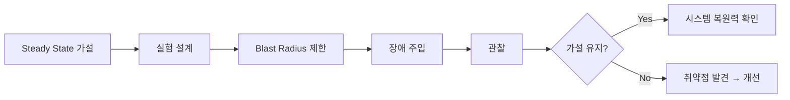
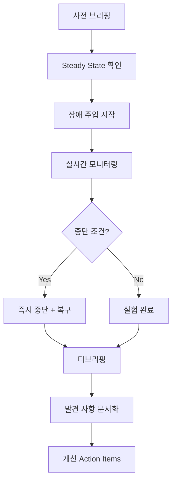

# Chaos Engineering 가이드

> "정기적으로 장애를 주입한다는 사실을 아는 것만으로 엔지니어들이 복원력 중심 설계를 하게 된다." — Netflix

---

## 1. Chaos Engineering 원칙

1. **정상 상태(Steady State)에 대한 가설을 세운다**
2. **실제 환경과 유사한 이벤트를 주입한다**
3. **프로덕션에서 실험한다** (가능한 경우)
4. **자동화하여 지속적으로 실행한다**
5. **폭발 반경(Blast Radius)을 최소화한다**



---

## 2. 장애 주입 유형

| 유형 | 예시 | 도구 |
|------|------|------|
| **서비스 중단** | 컨테이너/Pod 종료 | Chaos Monkey, Litmus |
| **네트워크 장애** | 지연, 패킷 손실, DNS 장애 | tc, Toxiproxy, Istio Fault Injection |
| **리소스 고갈** | CPU/메모리/디스크 포화 | stress-ng, Litmus |
| **의존성 장애** | 외부 API 타임아웃, DB 연결 끊김 | Toxiproxy, WireMock |
| **시간 변조** | 시계 왜곡, 리프 세컨드 | libfaketime |
| **데이터 오염** | 잘못된 응답, 스키마 변경 | WireMock, 커스텀 |

---

## 3. GameDay 운영

### 3.1 준비

```markdown
# GameDay 계획서

## 기본 정보
- 날짜: YYYY-MM-DD HH:MM
- 대상 서비스: 결제 서비스
- 참가자: @backend-team, @sre-team
- 진행자: @game-day-lead

## Steady State 가설
"결제 서비스의 DB 연결이 50% 끊어져도 P95 레이턴시 < 1s, 에러율 < 5% 유지"

## 실험 내용
1. DB 커넥션 풀의 50%를 강제 종료
2. 5분간 모니터링
3. 자동 복구 확인

## Blast Radius
- 영향 범위: 스테이징 환경 only
- 롤백 방법: 실험 중단 → 커넥션 풀 재시작
- 중단 조건: 에러율 > 10% 또는 P99 > 5s

## 모니터링 대시보드
- [Grafana 링크]
- [PagerDuty 링크]
```

### 3.2 실행



### 3.3 빈도

| 환경 | 빈도 | 수준 |
|------|------|------|
| 개발 | 매일 (자동) | 서비스 종료, 네트워크 지연 |
| 스테이징 | 주 1회 | 복합 장애 시나리오 |
| 프로덕션 | 월 1회 | 단일 장애, 제한된 범위 |
| GameDay | 분기 1회 | 대규모 복합 장애 |

---

## 4. 도구

| 도구 | 환경 | 특징 |
|------|------|------|
| **Litmus** | Kubernetes | CNCF 인큐베이팅, ChaosHub 실험 카탈로그 |
| **Chaos Monkey** | 클라우드 | Netflix 오리지널, 무작위 인스턴스 종료 |
| **Toxiproxy** | 네트워크 | Shopify, TCP 프록시 기반 |
| **Gremlin** | SaaS | 엔터프라이즈, UI 기반 관리 |

---

## 5. 체크리스트

### 실험 전
- [ ] Steady State 가설 정의
- [ ] Blast Radius 제한 설정
- [ ] 롤백/중단 절차 확인
- [ ] 모니터링 대시보드 준비
- [ ] 참가자 전원 브리핑

### 실험 후
- [ ] 가설 검증 결과 기록
- [ ] 발견된 취약점 문서화
- [ ] 개선 Action Items 이슈 등록
- [ ] 다음 실험 계획 수립
