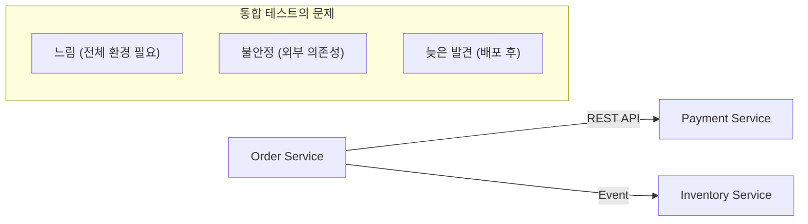
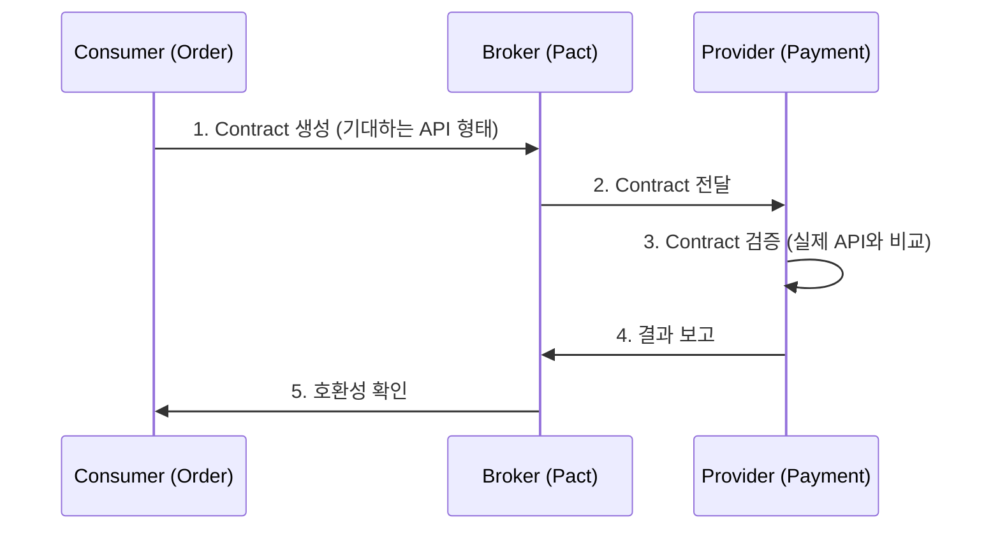

# Contract Testing 가이드

> 마이크로서비스 간 API 계약을 자동으로 검증하여 통합 실패를 방지하는 테스트 전략.

---

## 1. Contract Testing이란

### 문제: 통합 테스트의 한계



### 해결: Consumer-Driven Contract Testing



**핵심 원칙**: Consumer가 "나는 이런 요청을 보내고 이런 응답을 기대한다"를 정의하면, Provider가 그 계약을 충족하는지 자동 검증한다.

---

## 2. 적용 시점

| 조건 | Contract Testing 필요 |
|------|----------------------|
| 서비스 2개 이상이 API로 통신 | O |
| 팀 간 독립 배포 | O |
| API 변경 빈도가 높음 | O |
| 서비스 1개, 모놀리스 | X |
| 외부 서드파티 API (제어 불가) | X (Provider 측 검증 불가) |

---

## 3. Pact 도입 가이드

### 3.1 Consumer 측 (Python 예시)

```python
# tests/contract/test_payment_consumer.py
import pytest
from pact import Consumer, Provider

pact = Consumer("OrderService").has_pact_with(
    Provider("PaymentService"),
    pact_dir="./pacts",
)

def test_create_payment():
    expected_body = {
        "id": "pay_123",
        "status": "completed",
        "amount": 10000,
    }

    (pact
     .given("a valid order exists")
     .upon_receiving("a request to create payment")
     .with_request("POST", "/api/payments", body={
         "order_id": "ord_456",
         "amount": 10000,
         "currency": "KRW",
     })
     .will_respond_with(201, body=expected_body))

    with pact:
        # Call the actual client code
        result = payment_client.create_payment(
            order_id="ord_456", amount=10000, currency="KRW"
        )
        assert result.status == "completed"
```

### 3.2 Provider 측 (Kotlin 예시)

```kotlin
// src/test/kotlin/PaymentProviderPactTest.kt
@Provider("PaymentService")
@PactBroker(url = "\${PACT_BROKER_URL}")
@SpringBootTest(webEnvironment = SpringBootTest.WebEnvironment.RANDOM_PORT)
class PaymentProviderPactTest {

    @TestTemplate
    @ExtendWith(PactVerificationInvocationContextProvider::class)
    fun verifyPact(context: PactVerificationContext) {
        context.verifyInteraction()
    }

    @State("a valid order exists")
    fun setupValidOrder() {
        // Arrange test data for this state
        orderRepository.save(Order(id = "ord_456", amount = 10000))
    }
}
```

### 3.3 CI/CD 통합

```yaml
# .github/workflows/contract-test.yml
name: Contract Tests
on: [push, pull_request]

jobs:
  consumer-contract:
    runs-on: ubuntu-latest
    steps:
      - uses: actions/checkout@v4
      - name: Run consumer contract tests
        run: pytest tests/contract/ -v
      - name: Publish pacts to broker
        run: |
          pact-broker publish ./pacts \
            --consumer-app-version=${{ github.sha }} \
            --branch=${{ github.ref_name }} \
            --broker-base-url=${{ secrets.PACT_BROKER_URL }}

  can-i-deploy:
    needs: consumer-contract
    runs-on: ubuntu-latest
    steps:
      - name: Can I Deploy?
        run: |
          pact-broker can-i-deploy \
            --pacticipant=OrderService \
            --version=${{ github.sha }} \
            --to-environment=production
```

---

## 4. 이벤트 기반 Contract Testing

Kafka/RabbitMQ 이벤트에도 Contract Testing을 적용한다.

```python
# Consumer: "나는 이런 이벤트를 기대한다"
(pact
 .given("an order is completed")
 .upon_receiving("an OrderCompleted event")
 .with_content({
     "event_type": "order.completed",
     "data": {
         "order_id": "ord_456",
         "total": 10000,
         "items": [{"product_id": "prod_1", "quantity": 2}],
     }
 }))
```

---

## 5. 스펙 비교로 깨짐 막기 — oasdiff · buf breaking

Pact 는 "소비자가 실제로 쓰는 부분"을 검증한다. 그보다 싼 첫 방어선은 **PR 의 스펙 파일을 기준 브랜치의 같은 파일과 비교**하는 것이다.
소비자 테스트가 없어도, 응답 필드 삭제처럼 누구든 깨뜨리는 변경은 스펙 차이만으로 알 수 있다.

| 계약 | 도구 | 판정 |
|---|---|---|
| OpenAPI (REST) | `oasdiff breaking <기준> <PR> --fail-on ERR` | ERR 등급(응답의 **필수** 필드 삭제 · 필수 요청 필드 추가 · 경로·메서드 삭제 · 타입 변경 등)이면 exit 1 |
| Protobuf (gRPC) | `buf breaking <모듈> --against .git#ref=<기준 SHA>,subdir=<모듈>` | `buf.yaml` 의 `breaking.use`(기본 `FILE`) 규칙 위반이면 exit 100 |

CI 템플릿: `common/ci-templates/ci-api-contract.yml`(full 레벨 권장 — 여러 팀·외부 클라이언트가 API 를 쓸 때). 실행 결과 판정: `tests/enforcement-api-contract.bats`.

```bash
cp ~/.dev-standards/common/ci-templates/ci-api-contract.yml .github/workflows/api-contract.yml
# env 의 OPENAPI_SPECS(공백으로 여러 개) · PROTO_DIR 를 프로젝트 경로로 바꾸고, 안 쓰는 잡은 지운다
```

로컬에서 PR 전에 같은 검사를 돌리려면:

```bash
oasdiff breaking origin/main:openapi.yaml openapi.yaml --fail-on ERR   # 기준 쪽은 git 에서 읽는다($ref 파일 포함)
buf breaking proto --against ".git#ref=$(git rev-parse origin/main),subdir=proto"
```

### 위반 패턴과 수정법

| 위반 | 도구 출력 | 수정법 |
|---|---|---|
| 응답의 필수 필드 `amount` 삭제 | `error [response-required-property-removed] … removed the required property 'amount'` | 필드를 남기고 `deprecated: true` 로 표시해 공지 → 공지한 날짜가 지난 뒤 삭제(아래 주의점: 기다리는 기간은 리뷰가 지킨다) |
| 요청에 필수 필드 추가 | `error [new-required-request-property]` | 선택 필드로 추가하고 서버에서 기본값 처리 |
| proto 필드 삭제 | `Previously present field "2" with name "amount" on message "Order" was deleted.` | `reserved 2; reserved "amount";` 로 번호·이름을 막고, 삭제는 새 패키지(`orders.v2`)에서 |
| proto 필드 번호·타입 변경 | `FIELD_SAME_TYPE` 류 | 새 번호로 새 필드를 추가하고 옛 필드는 deprecated |

### 주의점
- **oasdiff 가 깨짐으로 보지 않는 삭제**: 응답의 **선택** 필드 삭제(INFO 등급)와 `deprecated: true` 로 표시해 둔 필드 삭제는 통과한다(bats 특성 테스트로 고정). 그 필드를 읽던 클라이언트는 깨질 수 있으므로, deprecated 표시 PR 과 삭제 PR 사이의 공지 기간은 리뷰에서 지킨다
- `OPENAPI_SPECS` 는 공백으로 나눈 **명시 경로**만 받는다 — 경로에 공백을 쓸 수 없고, 글롭(`specs/*.yaml`)은 PR 트리에서만 펼쳐져 지워진 스펙을 놓치므로 거부한다. PR 에서 스펙 파일을 지우면 실패한다
- buf: `PROTO_DIR` 에 `buf.yaml` 이 있거나, 루트 `buf.yaml` 이 v2 workspace(`modules:`)로 그 폴더를 가리켜야 한다(루트에 v1 `buf.yaml` 만 있으면 `contained by module at path "."` 로 실패). 모듈이 여러 개면 protobuf 잡을 모듈마다 복사한다
- **기준 브랜치에 없는 스펙**(처음 추가하는 PR)은 비교할 대상이 없어 알림(`::notice::`)만 남기고 통과한다. 스펙 파일 **이름을 바꾸거나** `OPENAPI_SPECS`·`PROTO_DIR` 값을 바꾸는 PR 도 새 스펙으로 보여 깨짐이 있어도 통과하므로 리뷰에서 직접 확인한다
- 지금 트리에 `OPENAPI_SPECS` 경로나 `PROTO_DIR` 의 `.proto` 가 없으면 **실패**한다 — 경로 오타로 검사가 조용히 꺼지지 않게 하려는 의도다
- 의도한 깨짐은 검사를 끄지 말고 새 버전 경로(`/v2/…`)·새 패키지로 추가한다(`common/rules/api-contracts.md`)
- 체크아웃은 `fetch-depth: 0` 이어야 한다 — 얕은 클론에는 기준 브랜치가 없다
- `--fail-on ERR` 를 빼면 oasdiff 는 깨짐을 출력만 하고 exit 0 이다(bats 반증 테스트)
- 이 검사는 **스펙 파일**만 본다. 코드가 스펙과 다르게 응답하는 것은 Pact·스키마 검증 테스트(위 3절)가 잡는다

---

## 6. Contract Testing 안티패턴

| 안티패턴 | 문제 | 해결 |
|----------|------|------|
| 과도하게 구체적인 계약 | Provider 변경 시 불필요한 실패 | 필요한 필드만 검증 (Matchers 활용) |
| Provider 상태 미정의 | 테스트 불안정 | `@State` / `given()` 필수 |
| Broker 없이 파일 공유 | 버전 관리 혼란 | Pact Broker 사용 |
| Consumer/Provider 동시 변경 | 계약 위반 감지 불가 | can-i-deploy 체크 |

---

## 7. 체크리스트

- [ ] `ci-api-contract.yml` 을 복사하고 `OPENAPI_SPECS`·`PROTO_DIR` 을 실제 경로로 (안 쓰는 잡은 삭제)
- [ ] 깨지는 변경은 deprecated → 새 버전 경로·패키지로 (proto 는 `reserved`)
- [ ] Consumer 측 Contract Test 작성
- [ ] Provider 측 검증 테스트 작성
- [ ] Pact Broker 설정 (또는 S3 기반)
- [ ] CI에 contract test 통합
- [ ] `can-i-deploy` 배포 전 검증 추가
- [ ] 이벤트 기반 서비스에도 Contract 적용
- [ ] Matchers 활용하여 유연한 계약 정의
