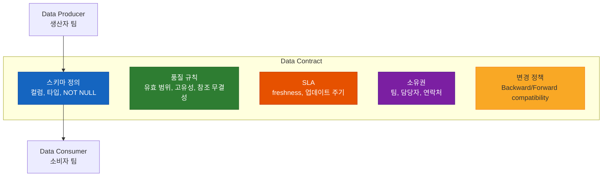
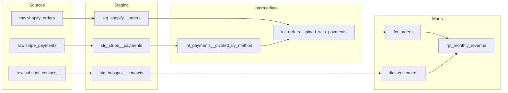

# dbt + Data Contract 가이드

> **작성일**: 2026-03-14
> **목적**: 데이터 팀 간 계약 기반 협업을 위한 Data Contract 개념, dbt 모델 네이밍 컨벤션, 데이터 품질 테스트 가이드

---

## 목차

1. [Data Contract 개념](#1-data-contract-개념)
2. [dbt 모델 네이밍 컨벤션](#2-dbt-모델-네이밍-컨벤션)
3. [Data Contract 정의 및 구현](#3-data-contract-정의-및-구현)
4. [sqlfluff + dbt 통합](#4-sqlfluff--dbt-통합)
5. [데이터 품질 테스트](#5-데이터-품질-테스트)
6. [CI/CD 파이프라인](#6-cicd-파이프라인)
7. [모범 사례](#7-모범-사례)

---

## 1. Data Contract 개념

Data Contract는 데이터 생산자(Producer)와 소비자(Consumer) 사이의 명시적 합의이다. API가 백엔드와 프론트엔드 사이의 계약이듯, Data Contract는 데이터 팀 간의 API 역할을 한다.

### 왜 필요한가

| 문제 | Data Contract 없이 | Data Contract 있으면 |
|------|---------------------|----------------------|
| 스키마 변경 | 다운스트림이 예고 없이 깨진다 | 변경 전 계약 위반 여부를 CI에서 확인 |
| 데이터 품질 | "이 컬럼 NULL이 왜 있지?" | 생산자가 NOT NULL을 계약으로 보장 |
| 소유권 | "이 테이블 누가 관리하지?" | 계약에 소유자, SLA가 명시됨 |
| 호환성 | 컬럼명/타입 변경 시 혼란 | Backward compatibility 강제 |

### Data Contract 구성 요소



---

## 2. dbt 모델 네이밍 컨벤션

### 3-Layer 구조

dbt 프로젝트는 데이터를 단계적으로 정제하는 3계층 구조를 따른다.



### 네이밍 규칙

| 계층 | 접두사 | 패턴 | 예시 |
|------|--------|------|------|
| **Staging** | `stg_` | `stg_{source}__{entity}` | `stg_stripe__payments` |
| **Intermediate** | `int_` | `int_{entity}__{verb}` | `int_payments__pivoted_by_method` |
| **Fact** | `fct_` | `fct_{event/action}` | `fct_orders` |
| **Dimension** | `dim_` | `dim_{entity}` | `dim_customers` |
| **Report** | `rpt_` | `rpt_{description}` | `rpt_monthly_revenue` |
| **Metric** | `mtc_` | `mtc_{metric_name}` | `mtc_customer_lifetime_value` |

### 각 계층의 역할

| 계층 | 목적 | 허용 변환 | 소비자 |
|------|------|-----------|--------|
| **Staging** | 원본 데이터 1:1 클린업 | 타입 캐스팅, 컬럼명 통일, 기초 필터링 | Intermediate 계층만 |
| **Intermediate** | 비즈니스 로직 중간 결과 | 조인, 피봇, 집계, 윈도우 함수 | Mart 계층만 |
| **Mart** | 최종 소비 가능 데이터 | 비즈니스 메트릭 계산, 리포트용 가공 | BI, 분석가, 앱 |

### 컬럼 네이밍 규칙

| 규칙 | 예시 |
|------|------|
| snake_case 필수 | `customer_id`, `created_at` |
| 부울: `is_`, `has_` 접두사 | `is_active`, `has_subscription` |
| 날짜/시간: `_at`, `_date` 접미사 | `created_at`, `order_date` |
| 금액: `_amount` 접미사 | `total_amount`, `discount_amount` |
| 수량: `_count` 접미사 | `order_count`, `item_count` |
| ID: `_id` 접미사 | `customer_id`, `order_id` |

---

## 3. Data Contract 정의 및 구현

### YAML 기반 Data Contract

```yaml
# contracts/fct_orders.yml
apiVersion: v1
kind: DataContract
metadata:
  name: fct_orders
  version: 2.1.0
  owner:
    team: commerce-data
    slack: "#commerce-data-support"
  description: "Fact table for all completed orders"

schema:
  type: object
  properties:
    order_id:
      type: string
      description: "Unique order identifier"
      constraints:
        - not_null
        - unique
    customer_id:
      type: string
      description: "FK to dim_customers"
      constraints:
        - not_null
        - relationships:
            to: dim_customers
            field: customer_id
    order_date:
      type: date
      description: "Date the order was placed"
      constraints:
        - not_null
    total_amount:
      type: decimal
      description: "Total order value in USD"
      constraints:
        - not_null
        - accepted_values: ">= 0"
    status:
      type: string
      description: "Order status"
      constraints:
        - not_null
        - accepted_values: ["completed", "refunded", "partial_refund"]

sla:
  freshness: "1 hour"
  update_frequency: "every 15 minutes"
  availability: 99.9%

quality:
  tests:
    - unique: [order_id]
    - not_null: [order_id, customer_id, order_date, total_amount]
    - accepted_values:
        column: status
        values: ["completed", "refunded", "partial_refund"]
    - relationships:
        column: customer_id
        to: ref('dim_customers')
        field: customer_id

compatibility:
  policy: backward    # New columns OK, removing/renaming columns is BREAKING
```

### dbt schema.yml에 Contract 반영

```yaml
# models/marts/schema.yml
version: 2

models:
  - name: fct_orders
    description: "Fact table for all completed orders"
    config:
      contract:
        enforced: true    # dbt 1.5+ contract enforcement
    columns:
      - name: order_id
        data_type: varchar
        description: "Unique order identifier"
        constraints:
          - type: not_null
          - type: primary_key
        tests:
          - unique
          - not_null

      - name: customer_id
        data_type: varchar
        description: "FK to dim_customers"
        constraints:
          - type: not_null
        tests:
          - not_null
          - relationships:
              to: ref('dim_customers')
              field: customer_id

      - name: total_amount
        data_type: numeric(12,2)
        description: "Total order value in USD"
        constraints:
          - type: not_null
        tests:
          - not_null
          - dbt_utils.accepted_range:
              min_value: 0
```

---

## 4. sqlfluff + dbt 통합

sqlfluff는 SQL 린터/포매터로, dbt의 Jinja 템플릿 구문을 이해한다.

### 설치 및 설정

```bash
pip install sqlfluff sqlfluff-templater-dbt
```

### .sqlfluff 설정

```ini
[sqlfluff]
templater = dbt
dialect = bigquery
max_line_length = 120
indent_unit = space

[sqlfluff:templater:dbt]
project_dir = ./
profiles_dir = ~/.dbt/

[sqlfluff:indentation]
indent_unit = space
tab_space_size = 4
indented_joins = false
indented_ctes = true
indented_using_on = true

[sqlfluff:rules:capitalisation.keywords]
capitalisation_policy = upper

[sqlfluff:rules:capitalisation.identifiers]
capitalisation_policy = lower

[sqlfluff:rules:capitalisation.functions]
capitalisation_policy = upper

[sqlfluff:rules:aliasing.table]
aliasing = explicit

[sqlfluff:rules:aliasing.column]
aliasing = explicit

[sqlfluff:rules:aliasing.length]
min_alias_length = 3
```

### CI에서 sqlfluff 실행

```yaml
# .github/workflows/dbt-quality.yml (sqlfluff 단계)
- name: Lint SQL (sqlfluff)
  run: |
    sqlfluff lint models/ --format github-annotation
```

### SQL 스타일 예시

```sql
-- GOOD: sqlfluff-compliant style
WITH

order_items AS (
    SELECT
        oi.order_id,
        oi.product_id,
        oi.quantity,
        oi.unit_price,
        oi.quantity * oi.unit_price AS line_total
    FROM {{ ref('stg_shopify__order_items') }} AS oi
    WHERE oi.is_deleted = FALSE
),

aggregated AS (
    SELECT
        order_id,
        COUNT(*) AS item_count,
        SUM(line_total) AS subtotal
    FROM order_items
    GROUP BY order_id
)

SELECT
    ord.order_id,
    ord.customer_id,
    ord.order_date,
    agg.item_count,
    agg.subtotal,
    ord.discount_amount,
    agg.subtotal - ord.discount_amount AS total_amount
FROM {{ ref('stg_shopify__orders') }} AS ord
LEFT JOIN aggregated AS agg
    ON ord.order_id = agg.order_id
```

---

## 5. 데이터 품질 테스트

### 5.1 dbt 내장 테스트

```yaml
# models/marts/schema.yml
models:
  - name: fct_orders
    columns:
      - name: order_id
        tests:
          - unique               # No duplicate values
          - not_null             # No NULL values
      - name: status
        tests:
          - accepted_values:     # Only allowed values
              values: ["completed", "refunded", "partial_refund"]
      - name: customer_id
        tests:
          - relationships:       # Referential integrity
              to: ref('dim_customers')
              field: customer_id
```

### 5.2 dbt-utils 확장 테스트

```yaml
# dbt_packages.yml
packages:
  - package: dbt-labs/dbt_utils
    version: "1.3.0"
  - package: calogica/dbt_expectations
    version: "0.10.4"
```

```yaml
# models/marts/schema.yml (advanced tests)
models:
  - name: fct_orders
    tests:
      # Row count should not drop below threshold
      - dbt_utils.recency:
          datepart: hour
          field: created_at
          interval: 2

    columns:
      - name: total_amount
        tests:
          - dbt_utils.accepted_range:
              min_value: 0
              max_value: 1000000

      - name: order_date
        tests:
          - dbt_expectations.expect_column_values_to_be_between:
              min_value: "'2020-01-01'"
              max_value: "CURRENT_DATE()"
```

### 5.3 Great Expectations 통합

Great Expectations는 더 정교한 데이터 검증이 필요할 때 사용한다.

```python
from __future__ import annotations

import great_expectations as gx

context = gx.get_context()

# Define expectations
suite = context.add_expectation_suite("fct_orders_suite")

# Schema expectations
suite.add_expectation(
    gx.expectations.ExpectColumnToExist(column="order_id")
)
suite.add_expectation(
    gx.expectations.ExpectColumnValuesToNotBeNull(column="order_id")
)
suite.add_expectation(
    gx.expectations.ExpectColumnValuesToBeUnique(column="order_id")
)

# Value expectations
suite.add_expectation(
    gx.expectations.ExpectColumnValuesToBeBetween(
        column="total_amount",
        min_value=0,
        max_value=1_000_000,
    )
)

# Distribution expectations
suite.add_expectation(
    gx.expectations.ExpectColumnMedianToBeBetween(
        column="total_amount",
        min_value=10,
        max_value=500,
    )
)
```

### 도구 비교

| 항목 | dbt Test | dbt-utils/expectations | Great Expectations |
|------|----------|------------------------|--------------------|
| **설정 형식** | YAML | YAML | Python |
| **학습 곡선** | 낮음 | 낮음 | 중간 |
| **테스트 범위** | 기본 제약조건 | 확장 패턴 | 분포, 통계, 커스텀 |
| **CI 통합** | `dbt test` | `dbt test` | 별도 파이프라인 |
| **권장 사용** | 모든 모델 기본 | Mart 계층 | 핵심 비즈니스 데이터 |

---

## 6. CI/CD 파이프라인

```yaml
# .github/workflows/dbt-quality.yml
name: dbt Quality Gate

on:
  pull_request:
    paths:
      - 'models/**'
      - 'macros/**'
      - 'tests/**'
      - 'dbt_project.yml'

jobs:
  dbt-quality:
    runs-on: ubuntu-latest
    steps:
      - uses: actions/checkout@v4

      - name: Set up Python
        uses: actions/setup-python@v5
        with:
          python-version: '3.12'

      - name: Install dependencies
        run: pip install dbt-bigquery sqlfluff sqlfluff-templater-dbt

      - name: Lint SQL
        run: sqlfluff lint models/ --format github-annotation

      - name: dbt deps
        run: dbt deps

      - name: dbt compile
        run: dbt compile

      - name: dbt test (schema + data)
        run: dbt test --select state:modified+

      - name: Contract validation
        run: |
          dbt run --select state:modified+ --defer --state ./prod-manifest/
          dbt test --select state:modified+
```

---

## 7. 모범 사례

### Data Contract 운영 원칙

1. **Contract는 코드로 관리한다**: YAML 파일을 Git 저장소에서 버전 관리한다
2. **Breaking change는 버전 업으로**: 컬럼 삭제/타입 변경은 major 버전 업데이트
3. **소비자에게 미리 알린다**: 계약 변경 시 최소 1 스프린트 전에 공지
4. **freshness SLA를 설정한다**: `dbt source freshness`로 데이터 최신성을 자동 검증
5. **모든 Mart 모델에 contract를 적용한다**: `config: contract: enforced: true`

### dbt 프로젝트 구조

```
dbt_project/
├── models/
│   ├── staging/
│   │   ├── stripe/
│   │   │   ├── _stripe__sources.yml    # Source definitions
│   │   │   ├── _stripe__models.yml     # Model docs + tests
│   │   │   ├── stg_stripe__payments.sql
│   │   │   └── stg_stripe__customers.sql
│   │   └── shopify/
│   │       └── ...
│   ├── intermediate/
│   │   ├── _int__models.yml
│   │   └── int_payments__pivoted_by_method.sql
│   └── marts/
│       ├── _marts__models.yml          # Contracts + tests
│       ├── fct_orders.sql
│       ├── dim_customers.sql
│       └── rpt_monthly_revenue.sql
├── contracts/                           # Data Contract definitions
│   ├── fct_orders.yml
│   └── dim_customers.yml
├── tests/                               # Custom data tests
│   └── assert_total_amount_positive.sql
├── macros/
├── .sqlfluff
├── dbt_project.yml
└── packages.yml
```

### 안티패턴

| 안티패턴 | 문제 | 올바른 방법 |
|----------|------|-------------|
| Staging에서 비즈니스 로직 | 책임 혼재, 재사용 불가 | Intermediate 또는 Mart에서 처리 |
| Mart를 직접 소스에서 조인 | Staging 계층 우회 | 항상 Staging을 거쳐 정제된 데이터 사용 |
| 테스트 없는 Mart 모델 | 잘못된 데이터가 BI에 노출 | 최소 unique + not_null 테스트 필수 |
| 컬럼명 불일치 | `userId` vs `user_id` 혼재 | snake_case 통일, sqlfluff로 강제 |
| 하드코딩 날짜 필터 | `WHERE date > '2024-01-01'` | Jinja 변수 또는 `dbt_utils.date_spine` 사용 |

---

## 참고 자료

| 리소스 | URL |
|--------|-----|
| dbt 공식 문서 | <https://docs.getdbt.com/> |
| dbt Model Contracts | <https://docs.getdbt.com/docs/collaborate/govern/model-contracts> |
| sqlfluff | <https://sqlfluff.com/> |
| Great Expectations | <https://greatexpectations.io/> |
| Data Contract 개념 | <https://datacontract.com/> |
| dbt-utils | <https://hub.getdbt.com/dbt-labs/dbt_utils/> |
