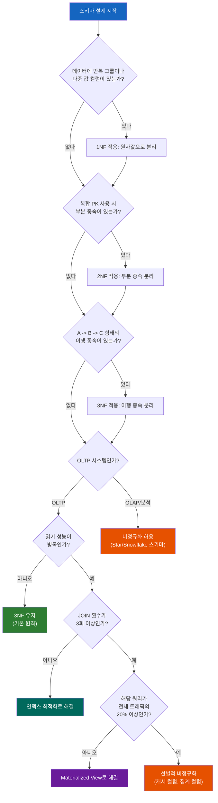
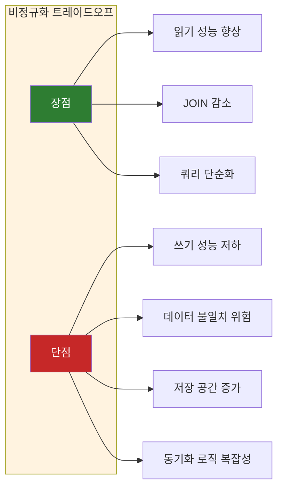
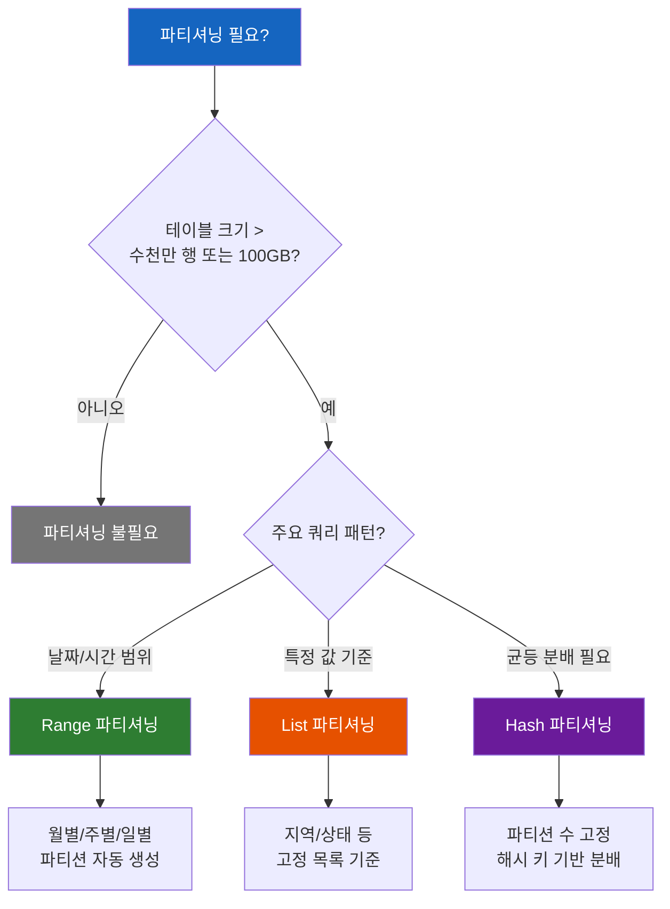
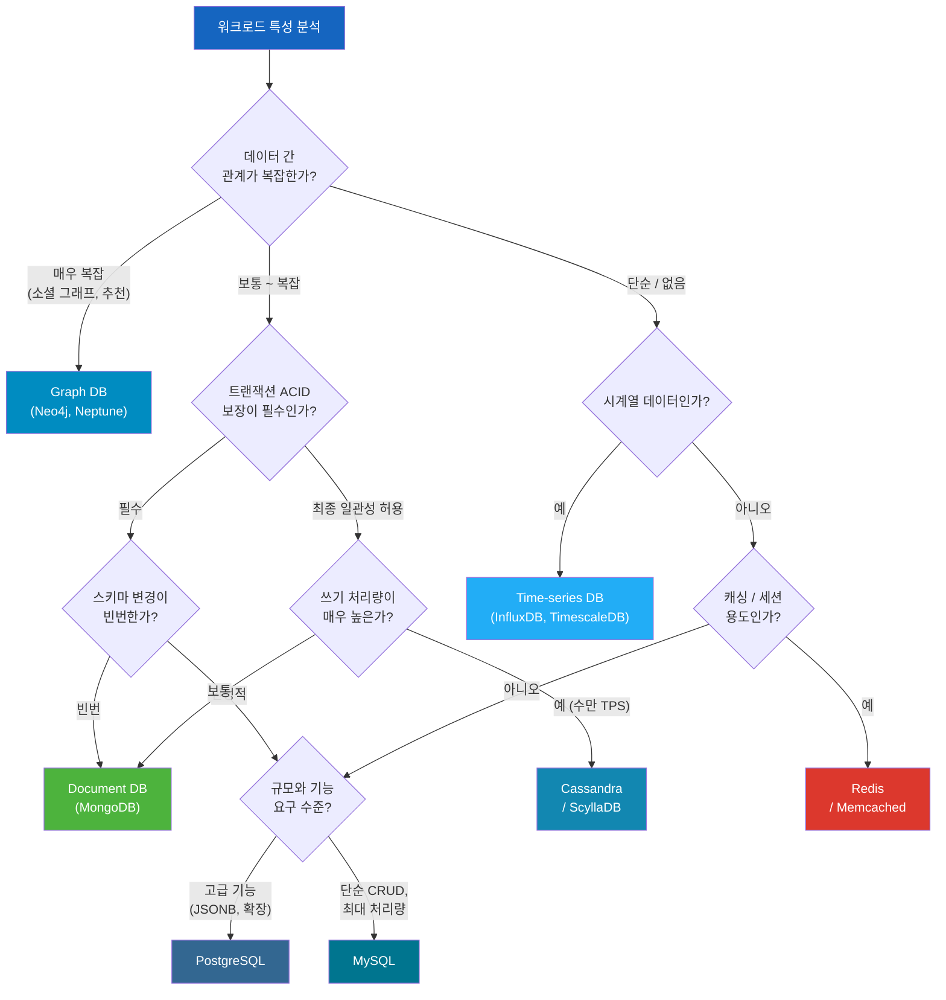
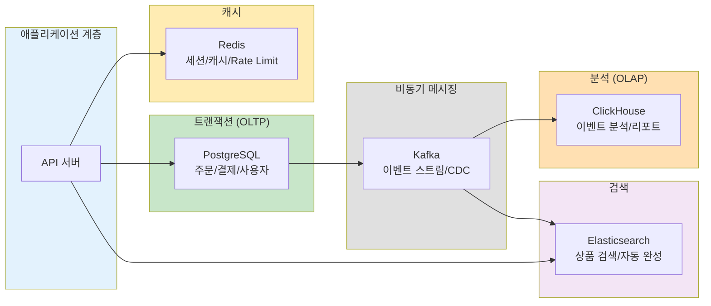
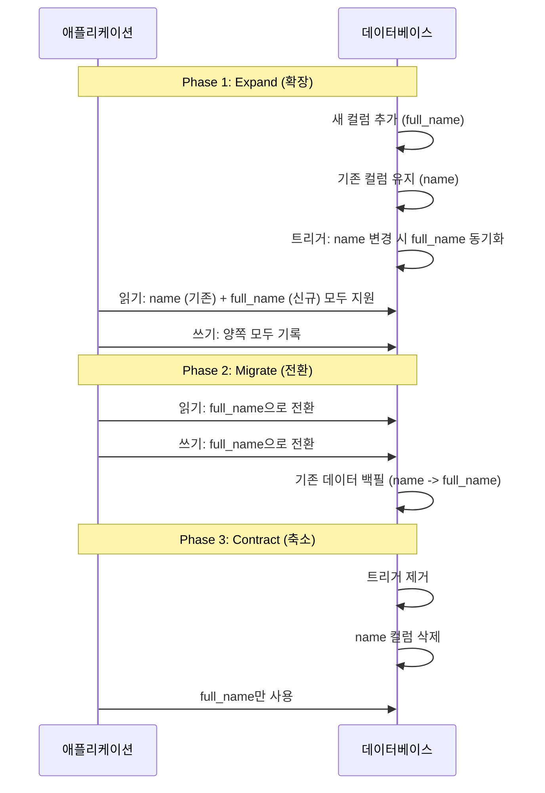
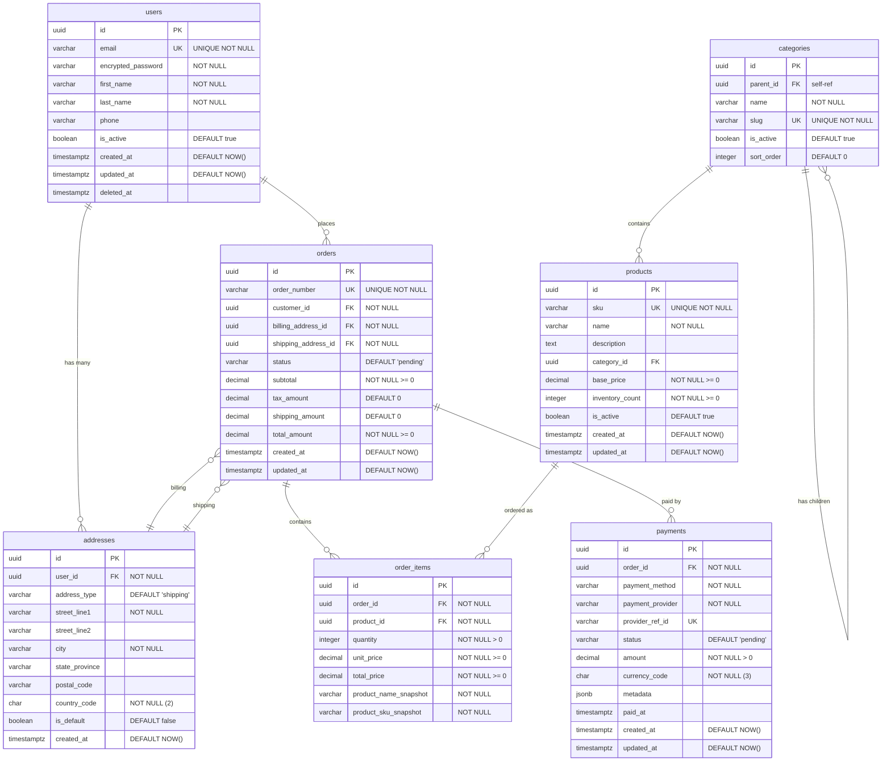

# 데이터 모델링 가이드

> **작성일**: 2026-03-12
> **기반 표준**: PostgreSQL Documentation, Google Spanner Best Practices, Stripe Database Design, AWS Database Migration Service
> **적용 수준**: 빅테크 기준 팀 운영표준
> **연계 문서**: `common/rules/sql.md` (SQL Rules)

---

## 목차

1. [정규화 기준](#1-정규화-기준)
2. [비정규화 전략](#2-비정규화-전략)
3. [인덱스 전략](#3-인덱스-전략)
4. [파티셔닝](#4-파티셔닝)
5. [DB 선택 가이드](#5-db-선택-가이드)
6. [스키마 설계 규칙](#6-스키마-설계-규칙)
7. [마이그레이션 전략](#7-마이그레이션-전략)
8. [ER 다이어그램 -- 주문 시스템](#8-er-다이어그램----주문-시스템)
9. [설계 체크리스트](#9-설계-체크리스트)

---

## 1. 정규화 기준

### 1.1 정규형 요약

| 정규형 | 핵심 조건 | 위반 예시 | 실무 판단 |
|--------|-----------|-----------|-----------|
| **1NF** | 모든 컬럼이 원자값, 반복 그룹 없음 | `tags = "java,go,python"` | 무조건 준수 (위반 시 쿼리 불가) |
| **2NF** | 1NF + 부분 함수 종속 제거 | 복합 PK `(order_id, product_id)` 에서 `product_name`이 `product_id`에만 종속 | 복합 PK 사용 시 반드시 점검 |
| **3NF** | 2NF + 이행 함수 종속 제거 | `orders.customer_name` (customer_id -> customer_name) | 대부분의 OLTP 테이블 기준 |
| **BCNF** | 모든 결정자가 후보키 | 비후보키가 다른 속성을 결정 | 복잡한 도메인에서 선별 적용 |

### 1.2 정규형 상세

**1NF (제1정규형) -- 원자값 보장:**

```sql
-- WRONG: 1NF 위반 -- 하나의 컬럼에 다중 값
CREATE TABLE products (
    id UUID PRIMARY KEY,
    name VARCHAR(255),
    tags VARCHAR(500)  -- "electronics,sale,featured"
);

-- CORRECT: 별도 테이블로 분리
CREATE TABLE products (
    id UUID PRIMARY KEY,
    name VARCHAR(255) NOT NULL
);

CREATE TABLE product_tags (
    product_id UUID NOT NULL REFERENCES products(id) ON DELETE CASCADE,
    tag VARCHAR(100) NOT NULL,
    PRIMARY KEY (product_id, tag)
);
```

**2NF (제2정규형) -- 부분 종속 제거:**

```sql
-- WRONG: 2NF 위반 -- product_name은 product_id에만 종속
CREATE TABLE order_items (
    order_id UUID,
    product_id UUID,
    product_name VARCHAR(255),  -- product_id -> product_name (부분 종속)
    quantity INTEGER,
    PRIMARY KEY (order_id, product_id)
);

-- CORRECT: 상품 정보는 products 테이블에서 참조
CREATE TABLE order_items (
    order_id UUID REFERENCES orders(id),
    product_id UUID REFERENCES products(id),
    quantity INTEGER NOT NULL CHECK (quantity > 0),
    unit_price DECIMAL(10, 2) NOT NULL,  -- 주문 시점 가격 스냅샷은 허용
    PRIMARY KEY (order_id, product_id)
);
```

> **주의**: `unit_price`는 주문 시점의 가격 스냅샷이므로 비정규화가 아니라 비즈니스 요구사항이다.
> 시점에 따라 값이 달라지는 속성은 스냅샷으로 저장하는 것이 정규화 원칙과 충돌하지 않는다.

**3NF (제3정규형) -- 이행 종속 제거:**

```sql
-- WRONG: 3NF 위반 -- city -> state (이행 종속)
CREATE TABLE customers (
    id UUID PRIMARY KEY,
    name VARCHAR(255),
    city VARCHAR(100),
    state VARCHAR(100),  -- city가 결정하는 값
    zip_code VARCHAR(20)
);

-- CORRECT: 지역 정보를 별도 테이블로 분리
CREATE TABLE zip_codes (
    zip_code VARCHAR(20) PRIMARY KEY,
    city VARCHAR(100) NOT NULL,
    state VARCHAR(100) NOT NULL
);

CREATE TABLE customers (
    id UUID PRIMARY KEY,
    name VARCHAR(255) NOT NULL,
    zip_code VARCHAR(20) REFERENCES zip_codes(zip_code)
);
```

**BCNF (보이스-코드 정규형):**

```sql
-- BCNF 위반 예시: 교수가 과목을 결정하지만, 후보키가 아님
-- (student_id, subject) -> professor
-- professor -> subject (비후보키가 결정자)

-- CORRECT: 분리
CREATE TABLE professor_subjects (
    professor_id UUID REFERENCES professors(id),
    subject_id UUID REFERENCES subjects(id),
    PRIMARY KEY (professor_id, subject_id)
);

CREATE TABLE enrollments (
    student_id UUID REFERENCES students(id),
    professor_id UUID REFERENCES professors(id),
    subject_id UUID REFERENCES subjects(id),
    PRIMARY KEY (student_id, professor_id, subject_id),
    FOREIGN KEY (professor_id, subject_id)
        REFERENCES professor_subjects(professor_id, subject_id)
);
```

### 1.3 정규화 vs 비정규화 의사결정 트리



### 1.4 실무 정규화 원칙

| 원칙 | 설명 |
|------|------|
| **OLTP는 3NF가 기본** | 데이터 정합성이 최우선, 성능은 인덱스/캐시로 해결 |
| **OLAP은 비정규화가 기본** | Star Schema, Snowflake Schema 적극 활용 |
| **측정 후 비정규화** | 추측이 아닌 실제 쿼리 성능 측정 결과로 판단 |
| **비정규화 시 동기화 전략 필수** | 트리거, 이벤트, 배치 중 하나로 정합성 보장 |

---

## 2. 비정규화 전략

### 2.1 비정규화 유형별 비교

| 전략 | 사용 시점 | 장점 | 단점 | 정합성 보장 |
|------|-----------|------|------|-------------|
| **캐시 컬럼** | 자주 조회되는 집계 값 | JOIN 제거, 즉시 조회 | 갱신 비용, 불일치 가능 | 트리거 / 이벤트 |
| **집계 테이블** | 대시보드, 리포트 | 실시간 집계 불필요 | 저장 공간, 갱신 지연 | 배치 / CDC |
| **Materialized View** | 복잡한 JOIN 결과 캐싱 | 투명한 비정규화 | 리프레시 비용 | `REFRESH` 스케줄 |
| **이력 스냅샷** | 시점별 데이터 보존 | 감사 추적 | 저장 공간 증가 | INSERT-only |
| **중복 저장** | 서비스 간 데이터 독립성 | 서비스 자율성 | 불일치 위험 | 이벤트 소싱 / CDC |

### 2.2 캐시 컬럼

자주 조회되는 집계 값을 부모 테이블에 캐싱한다.

```sql
-- orders 테이블에 아이템 수와 총액을 캐시
ALTER TABLE orders
    ADD COLUMN item_count INTEGER NOT NULL DEFAULT 0,
    ADD COLUMN cached_total DECIMAL(10, 2) NOT NULL DEFAULT 0;

-- 트리거로 정합성 보장
CREATE OR REPLACE FUNCTION update_order_cache()
RETURNS TRIGGER AS $$
BEGIN
    UPDATE orders
    SET
        item_count = (
            SELECT COUNT(*) FROM order_items WHERE order_id = NEW.order_id
        ),
        cached_total = (
            SELECT COALESCE(SUM(unit_price * quantity), 0)
            FROM order_items
            WHERE order_id = NEW.order_id
        ),
        updated_at = NOW()
    WHERE id = NEW.order_id;
    RETURN NEW;
END;
$$ LANGUAGE plpgsql;

CREATE TRIGGER trg_order_items_cache
    AFTER INSERT OR UPDATE OR DELETE ON order_items
    FOR EACH ROW EXECUTE FUNCTION update_order_cache();
```

### 2.3 집계 테이블

실시간 연산 대신 사전 집계된 결과를 별도 테이블에 저장한다.

```sql
-- 일별 매출 집계 테이블
CREATE TABLE daily_sales_summary (
    summary_date DATE NOT NULL,
    product_id UUID NOT NULL REFERENCES products(id),
    total_quantity INTEGER NOT NULL DEFAULT 0,
    total_revenue DECIMAL(12, 2) NOT NULL DEFAULT 0,
    order_count INTEGER NOT NULL DEFAULT 0,
    avg_order_value DECIMAL(10, 2) NOT NULL DEFAULT 0,
    created_at TIMESTAMP WITH TIME ZONE DEFAULT NOW(),
    updated_at TIMESTAMP WITH TIME ZONE DEFAULT NOW(),
    PRIMARY KEY (summary_date, product_id)
);

-- 집계 갱신 (배치 또는 스케줄)
INSERT INTO daily_sales_summary (
    summary_date, product_id, total_quantity, total_revenue, order_count, avg_order_value
)
SELECT
    DATE(o.created_at) AS summary_date,
    oi.product_id,
    SUM(oi.quantity),
    SUM(oi.unit_price * oi.quantity),
    COUNT(DISTINCT o.id),
    SUM(oi.unit_price * oi.quantity) / NULLIF(COUNT(DISTINCT o.id), 0)
FROM orders o
    INNER JOIN order_items oi ON oi.order_id = o.id
WHERE DATE(o.created_at) = CURRENT_DATE - INTERVAL '1 day'
GROUP BY DATE(o.created_at), oi.product_id
ON CONFLICT (summary_date, product_id) DO UPDATE SET
    total_quantity = EXCLUDED.total_quantity,
    total_revenue = EXCLUDED.total_revenue,
    order_count = EXCLUDED.order_count,
    avg_order_value = EXCLUDED.avg_order_value,
    updated_at = NOW();
```

### 2.4 Materialized View

```sql
-- 상품별 리뷰 통계 Materialized View
CREATE MATERIALIZED VIEW mv_product_review_stats AS
SELECT
    p.id AS product_id,
    p.name AS product_name,
    COUNT(r.id) AS review_count,
    ROUND(AVG(r.rating), 2) AS avg_rating,
    COUNT(r.id) FILTER (WHERE r.rating >= 4) AS positive_count,
    COUNT(r.id) FILTER (WHERE r.rating <= 2) AS negative_count,
    MAX(r.created_at) AS latest_review_at
FROM products p
    LEFT JOIN reviews r ON r.product_id = p.id
GROUP BY p.id, p.name
WITH DATA;

-- 고유 인덱스 (CONCURRENTLY 리프레시에 필요)
CREATE UNIQUE INDEX uq_mv_product_review_stats_product_id
    ON mv_product_review_stats (product_id);

-- CONCURRENTLY: 테이블 잠금 없이 리프레시
REFRESH MATERIALIZED VIEW CONCURRENTLY mv_product_review_stats;
```

**Materialized View 리프레시 전략:**

| 전략 | 주기 | 적합한 경우 |
|------|------|-------------|
| **pg_cron 스케줄** | 1분 ~ 1시간 | 대시보드, 리포트 |
| **트리거 기반** | 즉시 | 소량 갱신, 실시간 필요 |
| **이벤트 기반 (CDC)** | 준실시간 | 마이크로서비스 환경 |
| **수동** | 필요 시 | 배치 작업 완료 후 |

### 2.5 비정규화 트레이드오프 결정



**비정규화 도입 기준:**

1. 쿼리 응답 시간이 SLO를 초과하고, 인덱스만으로 해결 불가
2. 해당 쿼리가 전체 트래픽의 상당 비중을 차지 (상위 20%)
3. 데이터 갱신 빈도가 조회 빈도 대비 현저히 낮음 (읽기:쓰기 >= 10:1)
4. 정합성 보장 메커니즘(트리거, CDC, 이벤트)이 구현 가능

---

## 3. 인덱스 전략

### 3.1 인덱스 유형 비교

| 유형 | 구조 | 적합한 연산 | 부적합한 경우 | PostgreSQL 기본 |
|------|------|-------------|---------------|----------------|
| **B-Tree** | 균형 이진 트리 | `=`, `<`, `>`, `BETWEEN`, `ORDER BY`, `LIKE 'prefix%'` | 전문 검색, 배열, 공간 | 기본값 |
| **Hash** | 해시 테이블 | `=` 동등 비교만 | 범위 검색, 정렬 | `USING hash` |
| **GiST** | 일반화된 탐색 트리 | 공간(PostGIS), 범위, 전문 검색 | 단순 동등 비교 | `USING gist` |
| **GIN** | 역 인덱스 | 배열, JSONB, 전문 검색(tsvector) | 빈번한 갱신 | `USING gin` |
| **BRIN** | 블록 범위 인덱스 | 물리적 정렬된 대용량 데이터 (시계열) | 무작위 분포 데이터 | `USING brin` |

### 3.2 인덱스 유형별 사용 예시

```sql
-- B-Tree (기본): 대부분의 조회 패턴
CREATE INDEX ix_orders_customer_id ON orders (customer_id);
CREATE INDEX ix_orders_created_at ON orders (created_at DESC);

-- Hash: 정확한 동등 비교만 필요한 경우
CREATE INDEX ix_sessions_token ON sessions USING hash (session_token);

-- GIN: JSONB 컬럼 검색
CREATE INDEX ix_products_metadata ON products USING gin (metadata jsonb_path_ops);

-- GIN: 전문 검색
CREATE INDEX ix_products_search ON products USING gin (
    to_tsvector('korean', name || ' ' || COALESCE(description, ''))
);

-- GiST: 범위 타입 (예약 시스템 겹침 방지)
CREATE INDEX ix_reservations_period ON reservations USING gist (
    tstzrange(start_at, end_at)
);

-- BRIN: 시계열 대용량 데이터 (물리적 순서와 논리적 순서가 일치)
CREATE INDEX ix_events_created_at ON events USING brin (created_at)
    WITH (pages_per_range = 128);
```

### 3.3 복합 인덱스 컬럼 순서

복합 인덱스의 컬럼 순서는 쿼리 성능에 결정적 영향을 미친다.

**원칙: 선택도가 높은(Cardinality가 높은) 컬럼을 앞에 배치하되, WHERE 조건의 동등 조건(`=`)을 범위 조건(`<`, `>`, `BETWEEN`)보다 앞에 둔다.**

```sql
-- 쿼리 패턴 분석
-- WHERE status = 'active' AND created_at > '2026-01-01' AND customer_id = ?

-- WRONG: 범위 조건이 앞에 오면 이후 컬럼을 활용하지 못함
CREATE INDEX ix_bad ON orders (created_at, status, customer_id);

-- CORRECT: 동등 조건 -> 동등 조건 -> 범위 조건
CREATE INDEX ix_good ON orders (status, customer_id, created_at);
```

**복합 인덱스 순서 결정 규칙:**

```
1. 동등 조건(=) 컬럼을 앞에 배치
2. 동등 조건 중 선택도(카디널리티)가 높은 컬럼을 앞에 배치
3. 범위 조건(<, >, BETWEEN) 컬럼은 마지막에 배치
4. ORDER BY 컬럼은 범위 조건 다음에 배치
```

### 3.4 Partial Index (부분 인덱스)

전체 데이터가 아닌 조건을 만족하는 행만 인덱싱한다. 인덱스 크기를 줄이고 갱신 비용을 절감한다.

```sql
-- 활성 주문만 인덱싱 (전체 주문의 10%만 활성)
CREATE INDEX ix_orders_active
    ON orders (customer_id, created_at)
    WHERE status NOT IN ('cancelled', 'refunded', 'delivered');

-- 미결제 주문만 인덱싱
CREATE INDEX ix_orders_unpaid
    ON orders (created_at)
    WHERE payment_status = 'pending';

-- NULL이 아닌 경우만 (선택적 필드)
CREATE INDEX ix_users_phone
    ON users (phone)
    WHERE phone IS NOT NULL;
```

### 3.5 커버링 인덱스 (Index-Only Scan)

쿼리에 필요한 모든 컬럼이 인덱스에 포함되면 테이블 접근 없이 인덱스만으로 결과를 반환한다.

```sql
-- 쿼리: SELECT email, name FROM users WHERE status = 'active' ORDER BY created_at
-- 커버링 인덱스: 테이블 힙 접근 제거
CREATE INDEX ix_users_active_covering
    ON users (status, created_at)
    INCLUDE (email, name);

-- INCLUDE 컬럼은 인덱스 탐색에 사용되지 않지만, 결과 반환에 포함
-- B-Tree 리프 노드에만 저장되므로 인덱스 탐색 성능에 영향 없음
```

### 3.6 인덱스를 만들지 않는 경우

| 상황 | 이유 |
|------|------|
| **테이블 행 수가 수천 건 이하** | Full Scan이 인덱스 조회보다 빠름 |
| **선택도가 매우 낮은 컬럼** (`boolean`, `status` 등 단독) | 인덱스 효과 미미, 오히려 오버헤드 |
| **갱신이 극도로 빈번한 컬럼** | 인덱스 유지 비용이 조회 이득 초과 |
| **거의 조회되지 않는 컬럼** | 저장 공간 낭비 |
| **이미 다른 인덱스에 포함된 컬럼** | `(a, b)` 인덱스는 `(a)` 조회도 커버 |
| **대량 INSERT 배치 작업 중** | 인덱스를 DROP 후 배치 완료 후 재생성이 빠름 |

### 3.7 인덱스 모니터링

```sql
-- 사용되지 않는 인덱스 탐지
SELECT
    schemaname,
    tablename,
    indexname,
    idx_scan AS index_scans,
    pg_size_pretty(pg_relation_size(indexrelid)) AS index_size
FROM pg_stat_user_indexes
WHERE idx_scan = 0
    AND indexrelid NOT IN (
        SELECT conindid FROM pg_constraint WHERE contype IN ('p', 'u')
    )
ORDER BY pg_relation_size(indexrelid) DESC;

-- 인덱스 대비 테이블 크기 비율 (인덱스 비대화 탐지)
SELECT
    t.relname AS table_name,
    pg_size_pretty(pg_table_size(t.oid)) AS table_size,
    pg_size_pretty(pg_indexes_size(t.oid)) AS indexes_size,
    ROUND(
        pg_indexes_size(t.oid)::NUMERIC / NULLIF(pg_table_size(t.oid), 0) * 100, 1
    ) AS index_ratio_pct
FROM pg_class t
    INNER JOIN pg_namespace n ON n.oid = t.relnamespace
WHERE t.relkind = 'r'
    AND n.nspname = 'public'
ORDER BY pg_indexes_size(t.oid) DESC;
```

---

## 4. 파티셔닝

### 4.1 파티셔닝 유형 비교

| 유형 | 분배 기준 | 적합한 경우 | 예시 |
|------|-----------|-------------|------|
| **Range** | 연속 범위 | 시계열, 날짜 기반 | 월별 주문, 연별 로그 |
| **List** | 명시적 값 목록 | 지역, 카테고리, 상태 | 국가별 고객, 상태별 주문 |
| **Hash** | 해시 함수 결과 | 균등 분배 필요 | 사용자 ID 기반 분산 |



### 4.2 Range 파티셔닝 -- 시계열 데이터

```sql
-- 주문 테이블: 월별 Range 파티셔닝
CREATE TABLE orders (
    id UUID NOT NULL DEFAULT gen_random_uuid(),
    order_number VARCHAR(50) NOT NULL,
    customer_id UUID NOT NULL,
    status VARCHAR(20) NOT NULL DEFAULT 'pending',
    total_amount DECIMAL(10, 2) NOT NULL,
    created_at TIMESTAMP WITH TIME ZONE NOT NULL DEFAULT NOW(),
    PRIMARY KEY (id, created_at)
) PARTITION BY RANGE (created_at);

-- 월별 파티션 생성
CREATE TABLE orders_2026_01 PARTITION OF orders
    FOR VALUES FROM ('2026-01-01') TO ('2026-02-01');
CREATE TABLE orders_2026_02 PARTITION OF orders
    FOR VALUES FROM ('2026-02-01') TO ('2026-03-01');
CREATE TABLE orders_2026_03 PARTITION OF orders
    FOR VALUES FROM ('2026-03-01') TO ('2026-04-01');

-- DEFAULT 파티션: 범위에 해당하지 않는 데이터 수용
CREATE TABLE orders_default PARTITION OF orders DEFAULT;

-- 파티션별 인덱스 (자동 상속)
CREATE INDEX ix_orders_customer_id ON orders (customer_id);
CREATE INDEX ix_orders_status ON orders (status) WHERE status = 'pending';
```

**파티션 자동 생성 (pg_cron 또는 pg_partman):**

```sql
-- pg_partman 활용: 자동 월별 파티션 생성 + 오래된 파티션 삭제
SELECT partman.create_parent(
    p_parent_table := 'public.orders',
    p_control := 'created_at',
    p_type := 'native',
    p_interval := '1 month',
    p_premake := 3  -- 3개월 선행 생성
);

-- 보존 기간 설정 (24개월)
UPDATE partman.part_config
SET retention = '24 months',
    retention_keep_table = false
WHERE parent_table = 'public.orders';
```

### 4.3 List 파티셔닝

```sql
-- 지역별 고객 데이터 분리
CREATE TABLE customers (
    id UUID NOT NULL DEFAULT gen_random_uuid(),
    email VARCHAR(255) NOT NULL,
    name VARCHAR(255) NOT NULL,
    region VARCHAR(10) NOT NULL,
    created_at TIMESTAMP WITH TIME ZONE DEFAULT NOW(),
    PRIMARY KEY (id, region)
) PARTITION BY LIST (region);

CREATE TABLE customers_kr PARTITION OF customers
    FOR VALUES IN ('KR');
CREATE TABLE customers_us PARTITION OF customers
    FOR VALUES IN ('US');
CREATE TABLE customers_eu PARTITION OF customers
    FOR VALUES IN ('DE', 'FR', 'GB', 'NL', 'IT');
CREATE TABLE customers_apac PARTITION OF customers
    FOR VALUES IN ('JP', 'CN', 'SG', 'AU');
CREATE TABLE customers_other PARTITION OF customers DEFAULT;
```

### 4.4 Hash 파티셔닝

```sql
-- 사용자 활동 로그: 균등 분배
CREATE TABLE user_activities (
    id UUID NOT NULL DEFAULT gen_random_uuid(),
    user_id UUID NOT NULL,
    activity_type VARCHAR(50) NOT NULL,
    payload JSONB,
    created_at TIMESTAMP WITH TIME ZONE DEFAULT NOW(),
    PRIMARY KEY (id, user_id)
) PARTITION BY HASH (user_id);

-- 8개 해시 파티션 생성
CREATE TABLE user_activities_p0 PARTITION OF user_activities
    FOR VALUES WITH (MODULUS 8, REMAINDER 0);
CREATE TABLE user_activities_p1 PARTITION OF user_activities
    FOR VALUES WITH (MODULUS 8, REMAINDER 1);
-- ... p2 ~ p6 동일 패턴
CREATE TABLE user_activities_p7 PARTITION OF user_activities
    FOR VALUES WITH (MODULUS 8, REMAINDER 7);
```

### 4.5 시계열 데이터 파티셔닝 전략

| 데이터 특성 | 파티션 주기 | 보존 기간 | 압축 전략 |
|-------------|-------------|-----------|-----------|
| **고빈도 이벤트** (초당 수천 건) | 일별 | 30일 hot + 1년 cold | 7일 이후 압축 |
| **트랜잭션 로그** | 월별 | 2년 온라인 + 5년 아카이브 | 분기별 VACUUM |
| **메트릭/모니터링** | 주별 | 90일 | 즉시 집계 후 raw 삭제 |
| **감사 로그** | 월별 | 7년 (규제) | 1년 이후 cold storage |

```sql
-- 시계열 데이터 라이프사이클 관리
-- 1단계: Hot 데이터 (최근 30일) -- SSD 테이블스페이스
ALTER TABLE events_2026_03
    SET TABLESPACE fast_ssd;

-- 2단계: Warm 데이터 (30일 ~ 1년) -- HDD 테이블스페이스
ALTER TABLE events_2025_06
    SET TABLESPACE standard_hdd;

-- 3단계: Cold 데이터 (1년 이상) -- 분리 후 아카이브
-- 파티션을 독립 테이블로 분리
ALTER TABLE events DETACH PARTITION events_2024_01;

-- 압축 후 아카이브 (pg_dump으로 백업 후 DROP)
-- pg_dump -t events_2024_01 -Fc > /archive/events_2024_01.dump
-- DROP TABLE events_2024_01;
```

---

## 5. DB 선택 가이드

### 5.1 데이터베이스 유형별 비교

| 특성 | PostgreSQL | MySQL | MongoDB | Cassandra | Neo4j | InfluxDB |
|------|------------|-------|---------|-----------|-------|----------|
| **유형** | RDBMS | RDBMS | Document | Wide-column | Graph | Time-series |
| **데이터 모델** | 관계형 테이블 | 관계형 테이블 | JSON 문서 | 파티션 + 클러스터링 키 | 노드 + 엣지 | 측정값 + 태그 |
| **스키마** | 엄격 (DDL) | 엄격 (DDL) | 유연 (Schemaless) | 엄격 (CQL) | 유연 (라벨) | 자동 스키마 |
| **일관성** | 강한 (ACID) | 강한 (ACID) | 튜너블 | 튜너블 (AP) | ACID | 최종 일관성 |
| **확장성** | 수직 + 읽기 복제 | 수직 + 읽기 복제 | 수평 (샤딩) | 수평 (링 토폴로지) | 수직 (Fabric) | 수평 (클러스터) |
| **최대 강점** | 확장성, 표준 SQL | 성능, 생태계 | 유연한 스키마 | 쓰기 성능, 가용성 | 관계 탐색 | 시계열 최적화 |
| **약점** | 수평 확장 어려움 | JSON 지원 부족 | JOIN 불가 | 읽기 유연성 부족 | 대량 스캔 느림 | 범용 쿼리 불가 |

### 5.2 워크로드별 선택 기준



### 5.3 구체적 시나리오별 추천

| 시나리오 | 1순위 | 2순위 | 근거 |
|----------|-------|-------|------|
| **이커머스 주문/결제** | PostgreSQL | MySQL | ACID 필수, 복잡한 관계, 보고서 |
| **사용자 프로필/콘텐츠** | MongoDB | PostgreSQL(JSONB) | 유연한 스키마, 빠른 반복 개발 |
| **실시간 채팅/메시지** | Cassandra | ScyllaDB | 높은 쓰기 처리량, 시간순 조회 |
| **소셜 네트워크 관계** | Neo4j | PostgreSQL(재귀) | 깊은 관계 탐색 최적화 |
| **IoT 센서 데이터** | InfluxDB | TimescaleDB | 시계열 최적화, 자동 다운샘플링 |
| **세션/캐시** | Redis | Memcached | 인메모리, 밀리초 응답 |
| **검색 엔진** | Elasticsearch | PostgreSQL(FTS) | 전문 검색, 패싯, 자동 완성 |
| **이벤트 소싱** | PostgreSQL | EventStoreDB | 순서 보장, 트랜잭션, 스냅샷 |
| **설정/Feature Flag** | Redis | etcd | 빠른 읽기, Pub/Sub 전파 |

### 5.4 폴리글랏 퍼시스턴스 (Polyglot Persistence)

단일 시스템에서 여러 데이터베이스를 목적에 맞게 조합하는 전략이다.



**원칙:**

1. **주 데이터 저장소는 하나** (Single Source of Truth) -- 보통 RDBMS
2. **파생 저장소는 이벤트/CDC로 동기화** -- Kafka, Debezium 활용
3. **각 저장소의 장점만 활용** -- 검색은 ES, 캐시는 Redis, 분석은 OLAP
4. **장애 시 주 저장소만으로 서비스 가능**해야 함 (Graceful Degradation)

---

## 6. 스키마 설계 규칙

### 6.1 네이밍 컨벤션

`common/rules/sql.md`의 규칙을 확장하여 구체적 가이드를 제공한다.

| 요소 | 규칙 | 올바른 예시 | 잘못된 예시 |
|------|------|-------------|-------------|
| **테이블** | lowercase, plural, snake_case | `order_items` | `OrderItem`, `order_item` |
| **컬럼** | lowercase, snake_case | `created_at` | `CreatedAt`, `createdAt` |
| **PK** | `id` (서로게이트) | `orders.id` | `orders.order_id` |
| **FK** | `{참조테이블_단수}_id` | `orders.customer_id` | `orders.cust`, `orders.custID` |
| **FK 제약** | `fk_{테이블}_{컬럼}_{참조테이블}` | `fk_orders_customer_id_customers` | `fk1`, `orders_ibfk_1` |
| **인덱스** | `ix_{테이블}_{컬럼들}` | `ix_orders_status_created_at` | `idx1`, `orders_index` |
| **유니크** | `uq_{테이블}_{컬럼들}` | `uq_users_email` | `unique_email` |
| **체크** | `ck_{테이블}_{설명}` | `ck_orders_total_positive` | `check1` |
| **Enum 타입** | `{명사}_type` 또는 `{명사}_status` | `order_status` | `status`, `OrderStatusEnum` |
| **Boolean** | `is_`, `has_`, `can_` 접두사 | `is_active`, `has_verified` | `active`, `verified` |
| **시간** | `_at` 접미사 (TIMESTAMPTZ) | `created_at`, `deleted_at` | `create_date`, `creation_time` |

### 6.2 PK/FK 규칙

```sql
-- PK: UUID v7 권장 (시간순 정렬 가능, 분산 환경 충돌 없음)
CREATE TABLE users (
    id UUID PRIMARY KEY DEFAULT gen_random_uuid(),
    -- gen_random_uuid()는 v4. 프로덕션에서는 uuid_generate_v7() 확장 권장
    email VARCHAR(255) UNIQUE NOT NULL,
    created_at TIMESTAMP WITH TIME ZONE NOT NULL DEFAULT NOW()
);

-- FK: 반드시 ON DELETE / ON UPDATE 동작 명시
CREATE TABLE orders (
    id UUID PRIMARY KEY DEFAULT gen_random_uuid(),
    customer_id UUID NOT NULL
        REFERENCES users(id)
        ON DELETE RESTRICT    -- 고객 삭제 방지 (주문 존재 시)
        ON UPDATE CASCADE,    -- 고객 ID 변경 시 자동 반영
    created_at TIMESTAMP WITH TIME ZONE NOT NULL DEFAULT NOW()
);

-- FK 컬럼에는 반드시 인덱스 생성 (PostgreSQL은 자동 생성하지 않음)
CREATE INDEX ix_orders_customer_id ON orders (customer_id);
```

**ON DELETE 전략:**

| 동작 | 의미 | 사용 시점 |
|------|------|-----------|
| `RESTRICT` | 자식 존재 시 삭제 불가 | 중요 참조 (주문 -> 고객) |
| `CASCADE` | 부모 삭제 시 자식도 삭제 | 종속 데이터 (주문 -> 주문항목) |
| `SET NULL` | 부모 삭제 시 FK를 NULL로 | 선택적 참조 (게시글 -> 카테고리) |
| `SET DEFAULT` | 부모 삭제 시 기본값으로 | 대체 값이 있는 경우 |

### 6.3 타입 선택 가이드

| 용도 | 권장 타입 | 비권장 타입 | 이유 |
|------|-----------|-------------|------|
| **식별자** | `UUID` | `SERIAL`, `BIGSERIAL` | 분산 환경, URL 노출 안전 |
| **금액** | `DECIMAL(p, s)` | `FLOAT`, `DOUBLE` | 부동소수점 오차 방지 |
| **시간** | `TIMESTAMPTZ` | `TIMESTAMP`, `DATE` (시간 필요 시) | 타임존 명확히 처리 |
| **상태** | `VARCHAR` + CHECK 또는 Enum | `INTEGER` 코드 | 가독성, 의미 명확성 |
| **긴 텍스트** | `TEXT` | `VARCHAR(MAX)` | PostgreSQL에서 성능 동일 |
| **구조화 데이터** | `JSONB` | `JSON`, `TEXT` | 인덱싱, 쿼리 가능 |
| **이진 데이터** | 외부 스토리지 URL | `BYTEA` | DB 크기 비대화 방지 |
| **불리언** | `BOOLEAN` | `INTEGER (0/1)`, `CHAR(1)` | 명확한 의미 |
| **IP 주소** | `INET` | `VARCHAR` | 유효성 검증, 범위 검색 |

### 6.4 소프트 삭제 패턴

```sql
-- Soft delete: deleted_at 패턴 (is_deleted 불리언보다 권장)
ALTER TABLE users ADD COLUMN deleted_at TIMESTAMP WITH TIME ZONE;

-- 활성 데이터만 조회하는 Partial Index
CREATE INDEX ix_users_email_active
    ON users (email)
    WHERE deleted_at IS NULL;

-- 뷰로 활성 데이터 추상화
CREATE VIEW active_users AS
SELECT * FROM users WHERE deleted_at IS NULL;

-- 삭제 실행
UPDATE users SET deleted_at = NOW() WHERE id = :user_id;

-- 복구
UPDATE users SET deleted_at = NULL WHERE id = :user_id;
```

**`deleted_at` vs `is_deleted` 비교:**

| 기준 | `deleted_at TIMESTAMPTZ` | `is_deleted BOOLEAN` |
|------|--------------------------|----------------------|
| 삭제 시점 추적 | 가능 | 불가 |
| 인덱스 효율 | `WHERE deleted_at IS NULL` | `WHERE NOT is_deleted` |
| 감사 추적 | 시점 포함 | 별도 감사 테이블 필요 |
| **권장** | 대부분의 경우 | 극히 단순한 경우만 |

### 6.5 공통 컬럼 규칙

모든 테이블에 포함해야 하는 공통 컬럼:

```sql
CREATE TABLE example_table (
    -- PK
    id UUID PRIMARY KEY DEFAULT gen_random_uuid(),

    -- 비즈니스 컬럼들
    -- ...

    -- 감사 컬럼 (필수)
    created_at TIMESTAMP WITH TIME ZONE NOT NULL DEFAULT NOW(),
    updated_at TIMESTAMP WITH TIME ZONE NOT NULL DEFAULT NOW(),

    -- 소프트 삭제 (선택)
    deleted_at TIMESTAMP WITH TIME ZONE
);

-- updated_at 자동 갱신 트리거
CREATE OR REPLACE FUNCTION set_updated_at()
RETURNS TRIGGER AS $$
BEGIN
    NEW.updated_at = NOW();
    RETURN NEW;
END;
$$ LANGUAGE plpgsql;

CREATE TRIGGER trg_example_table_updated_at
    BEFORE UPDATE ON example_table
    FOR EACH ROW EXECUTE FUNCTION set_updated_at();
```

---

## 7. 마이그레이션 전략

### 7.1 마이그레이션 원칙

| 원칙 | 설명 |
|------|------|
| **Forward-only** | 배포된 마이그레이션은 수정하지 않는다. 롤백은 새로운 마이그레이션으로 수행한다 |
| **멱등성** | 같은 마이그레이션을 여러 번 실행해도 결과가 동일해야 한다 |
| **하위 호환** | 새 스키마는 이전 버전 애플리케이션과 호환되어야 한다 |
| **데이터/스키마 분리** | 스키마 변경과 데이터 마이그레이션은 별도 파일로 관리한다 |
| **잠금 시간 최소화** | `ACCESS EXCLUSIVE LOCK`이 필요한 작업은 최소 시간으로 제한한다 |

### 7.2 마이그레이션 파일 규칙

```
migrations/
  V001__create_users_table.sql
  V002__create_orders_table.sql
  V003__add_phone_to_users.sql
  V004__backfill_phone_from_profiles.sql    -- 데이터 마이그레이션
  V005__drop_profiles_phone_column.sql
```

- 파일명: `V{순번}__{설명}.sql` (언더스코어 2개)
- 순번: 3자리 이상 (V001, V002, ...)
- 설명: snake_case, 동작을 명확히 표현

### 7.3 Expand-Contract 패턴

컬럼 이름 변경, 타입 변경 등 하위 호환이 깨지는 변경에 사용한다. 3단계에 걸쳐 무중단으로 변경한다.



**구현 예시: 컬럼 이름 변경 (name -> full_name)**

```sql
-- Phase 1: Expand (V010)
ALTER TABLE users ADD COLUMN full_name VARCHAR(255);

-- 동기화 트리거
CREATE OR REPLACE FUNCTION sync_user_name()
RETURNS TRIGGER AS $$
BEGIN
    IF NEW.full_name IS NULL AND NEW.name IS NOT NULL THEN
        NEW.full_name = NEW.name;
    END IF;
    IF NEW.name IS NULL AND NEW.full_name IS NOT NULL THEN
        NEW.name = NEW.full_name;
    END IF;
    RETURN NEW;
END;
$$ LANGUAGE plpgsql;

CREATE TRIGGER trg_sync_user_name
    BEFORE INSERT OR UPDATE ON users
    FOR EACH ROW EXECUTE FUNCTION sync_user_name();

-- Phase 2: Migrate (V011) -- 기존 데이터 백필
UPDATE users SET full_name = name WHERE full_name IS NULL;

-- NOT NULL 제약 추가 (백필 완료 후)
ALTER TABLE users ALTER COLUMN full_name SET NOT NULL;

-- Phase 3: Contract (V012) -- 애플리케이션 전환 완료 후
DROP TRIGGER trg_sync_user_name ON users;
DROP FUNCTION sync_user_name();
ALTER TABLE users DROP COLUMN name;
```

### 7.4 Zero-Downtime DDL 가이드

PostgreSQL에서 일부 DDL 작업은 테이블에 `ACCESS EXCLUSIVE LOCK`을 획득하여 모든 읽기/쓰기를 차단한다.

| 작업 | 잠금 수준 | 무중단 가능 | 주의사항 |
|------|-----------|-------------|----------|
| `ADD COLUMN` (DEFAULT 없음) | `ACCESS EXCLUSIVE` (짧음) | 가능 | 메타데이터 변경만 |
| `ADD COLUMN DEFAULT x` (PG 11+) | `ACCESS EXCLUSIVE` (짧음) | 가능 | PG 11부터 물리적 rewrite 없음 |
| `ADD COLUMN DEFAULT x` (PG 10-) | `ACCESS EXCLUSIVE` (긴) | **불가** | 전체 테이블 rewrite |
| `DROP COLUMN` | `ACCESS EXCLUSIVE` (짧음) | 가능 | 물리적 삭제 지연 (VACUUM 시) |
| `ALTER COLUMN TYPE` | `ACCESS EXCLUSIVE` (긴) | **불가** | 전체 테이블 rewrite |
| `ADD NOT NULL` (CHECK 없음) | `ACCESS EXCLUSIVE` (긴) | **불가** | 전체 테이블 스캔 |
| `ADD NOT NULL` + `NOT VALID` | `ACCESS EXCLUSIVE` (짧음) | 가능 | 이후 `VALIDATE` 별도 실행 |
| `CREATE INDEX` | `SHARE` | **불가** | 쓰기 차단 |
| `CREATE INDEX CONCURRENTLY` | 없음 | 가능 | 2배 느리지만 잠금 없음 |
| `DROP INDEX` | `ACCESS EXCLUSIVE` | 가능 (짧음) | 즉시 완료 |
| `DROP INDEX CONCURRENTLY` | 없음 | 가능 | 잠금 없이 제거 |

**안전한 NOT NULL 추가 패턴:**

```sql
-- WRONG: 전체 테이블 스캔으로 긴 잠금
ALTER TABLE users ALTER COLUMN email SET NOT NULL;

-- CORRECT: 2단계로 분리
-- Step 1: CHECK 제약 추가 (NOT VALID로 기존 데이터 검증 건너뛰기)
ALTER TABLE users
    ADD CONSTRAINT ck_users_email_not_null
    CHECK (email IS NOT NULL) NOT VALID;

-- Step 2: 별도 트랜잭션에서 기존 데이터 검증 (SHARE UPDATE EXCLUSIVE 잠금)
ALTER TABLE users
    VALIDATE CONSTRAINT ck_users_email_not_null;

-- PostgreSQL 12+: CHECK가 검증 완료되면 NOT NULL과 동등하게 취급
```

**안전한 인덱스 생성:**

```sql
-- WRONG: 쓰기 차단
CREATE INDEX ix_orders_status ON orders (status);

-- CORRECT: 무중단
CREATE INDEX CONCURRENTLY ix_orders_status ON orders (status);

-- 주의: CONCURRENTLY는 트랜잭션 내에서 실행 불가
-- 실패 시 INVALID 상태로 남을 수 있으므로 확인 필요
SELECT indexname, indisvalid
FROM pg_indexes
    INNER JOIN pg_index ON pg_index.indexrelid = (
        SELECT oid FROM pg_class WHERE relname = 'ix_orders_status'
    )
WHERE indexname = 'ix_orders_status';
```

### 7.5 마이그레이션 검증 체크리스트

| 단계 | 검증 항목 |
|------|-----------|
| **작성 시** | Forward-only 원칙 준수, 멱등성 확인, 잠금 시간 분석 |
| **리뷰 시** | DBA 승인, 대용량 테이블 영향도 분석, 롤백 계획 존재 |
| **실행 전** | 스테이징 환경 실행 완료, 실행 시간 측정, 디스크 여유 확인 |
| **실행 후** | 스키마 검증, 애플리케이션 호환성, 쿼리 성능 영향 확인 |

---

## 8. ER 다이어그램 -- 주문 시스템

### 8.1 엔티티 관계도



### 8.2 DDL 구현

```sql
-- Enum 타입 정의
CREATE TYPE address_type AS ENUM ('shipping', 'billing', 'both');
CREATE TYPE order_status AS ENUM (
    'pending', 'confirmed', 'processing', 'shipped',
    'delivered', 'cancelled', 'refunded'
);
CREATE TYPE payment_status AS ENUM (
    'pending', 'processing', 'completed', 'failed', 'refunded'
);

-- Users
CREATE TABLE users (
    id UUID PRIMARY KEY DEFAULT gen_random_uuid(),
    email VARCHAR(255) UNIQUE NOT NULL,
    encrypted_password VARCHAR(255) NOT NULL,
    first_name VARCHAR(100) NOT NULL,
    last_name VARCHAR(100) NOT NULL,
    phone VARCHAR(20),
    is_active BOOLEAN NOT NULL DEFAULT true,
    created_at TIMESTAMPTZ NOT NULL DEFAULT NOW(),
    updated_at TIMESTAMPTZ NOT NULL DEFAULT NOW(),
    deleted_at TIMESTAMPTZ,
    CONSTRAINT ck_users_valid_email
        CHECK (email ~* '^[A-Za-z0-9._%+-]+@[A-Za-z0-9.-]+\.[A-Za-z]{2,}$')
);

-- Addresses
CREATE TABLE addresses (
    id UUID PRIMARY KEY DEFAULT gen_random_uuid(),
    user_id UUID NOT NULL REFERENCES users(id) ON DELETE CASCADE,
    address_type address_type NOT NULL DEFAULT 'shipping',
    street_line1 VARCHAR(255) NOT NULL,
    street_line2 VARCHAR(255),
    city VARCHAR(100) NOT NULL,
    state_province VARCHAR(100),
    postal_code VARCHAR(20),
    country_code CHAR(2) NOT NULL,
    is_default BOOLEAN NOT NULL DEFAULT false,
    created_at TIMESTAMPTZ NOT NULL DEFAULT NOW()
);

-- Categories (self-referencing)
CREATE TABLE categories (
    id UUID PRIMARY KEY DEFAULT gen_random_uuid(),
    parent_id UUID REFERENCES categories(id) ON DELETE SET NULL,
    name VARCHAR(255) NOT NULL,
    slug VARCHAR(255) UNIQUE NOT NULL,
    is_active BOOLEAN NOT NULL DEFAULT true,
    sort_order INTEGER NOT NULL DEFAULT 0,
    CONSTRAINT ck_categories_no_self_ref CHECK (id != parent_id)
);

-- Products
CREATE TABLE products (
    id UUID PRIMARY KEY DEFAULT gen_random_uuid(),
    sku VARCHAR(100) UNIQUE NOT NULL,
    name VARCHAR(255) NOT NULL,
    description TEXT,
    category_id UUID REFERENCES categories(id) ON DELETE SET NULL,
    base_price DECIMAL(10, 2) NOT NULL,
    inventory_count INTEGER NOT NULL DEFAULT 0,
    is_active BOOLEAN NOT NULL DEFAULT true,
    created_at TIMESTAMPTZ NOT NULL DEFAULT NOW(),
    updated_at TIMESTAMPTZ NOT NULL DEFAULT NOW(),
    CONSTRAINT ck_products_price_positive CHECK (base_price >= 0),
    CONSTRAINT ck_products_inventory_non_negative CHECK (inventory_count >= 0)
);

-- Orders
CREATE TABLE orders (
    id UUID PRIMARY KEY DEFAULT gen_random_uuid(),
    order_number VARCHAR(50) UNIQUE NOT NULL,
    customer_id UUID NOT NULL REFERENCES users(id) ON DELETE RESTRICT,
    billing_address_id UUID NOT NULL REFERENCES addresses(id) ON DELETE RESTRICT,
    shipping_address_id UUID NOT NULL REFERENCES addresses(id) ON DELETE RESTRICT,
    status order_status NOT NULL DEFAULT 'pending',
    subtotal DECIMAL(10, 2) NOT NULL,
    tax_amount DECIMAL(10, 2) NOT NULL DEFAULT 0,
    shipping_amount DECIMAL(10, 2) NOT NULL DEFAULT 0,
    total_amount DECIMAL(10, 2) NOT NULL,
    created_at TIMESTAMPTZ NOT NULL DEFAULT NOW(),
    updated_at TIMESTAMPTZ NOT NULL DEFAULT NOW(),
    CONSTRAINT ck_orders_amounts_non_negative
        CHECK (subtotal >= 0 AND tax_amount >= 0 AND shipping_amount >= 0 AND total_amount >= 0),
    CONSTRAINT ck_orders_total_consistency
        CHECK (total_amount = subtotal + tax_amount + shipping_amount)
);

-- Order Items
CREATE TABLE order_items (
    id UUID PRIMARY KEY DEFAULT gen_random_uuid(),
    order_id UUID NOT NULL REFERENCES orders(id) ON DELETE CASCADE,
    product_id UUID NOT NULL REFERENCES products(id) ON DELETE RESTRICT,
    quantity INTEGER NOT NULL,
    unit_price DECIMAL(10, 2) NOT NULL,
    total_price DECIMAL(10, 2) NOT NULL,
    product_name_snapshot VARCHAR(255) NOT NULL,
    product_sku_snapshot VARCHAR(100) NOT NULL,
    CONSTRAINT ck_order_items_quantity_positive CHECK (quantity > 0),
    CONSTRAINT ck_order_items_prices_non_negative CHECK (unit_price >= 0 AND total_price >= 0),
    CONSTRAINT ck_order_items_total_consistency CHECK (total_price = quantity * unit_price)
);

-- Payments
CREATE TABLE payments (
    id UUID PRIMARY KEY DEFAULT gen_random_uuid(),
    order_id UUID NOT NULL REFERENCES orders(id) ON DELETE RESTRICT,
    payment_method VARCHAR(50) NOT NULL,
    payment_provider VARCHAR(100) NOT NULL,
    provider_ref_id VARCHAR(255) UNIQUE,
    status payment_status NOT NULL DEFAULT 'pending',
    amount DECIMAL(10, 2) NOT NULL,
    currency_code CHAR(3) NOT NULL DEFAULT 'KRW',
    metadata JSONB,
    paid_at TIMESTAMPTZ,
    created_at TIMESTAMPTZ NOT NULL DEFAULT NOW(),
    updated_at TIMESTAMPTZ NOT NULL DEFAULT NOW(),
    CONSTRAINT ck_payments_amount_positive CHECK (amount > 0)
);

-- Indexes (FK columns + frequent query patterns)
CREATE INDEX ix_addresses_user_id ON addresses (user_id);
CREATE INDEX ix_products_category_id ON products (category_id);
CREATE INDEX ix_products_sku ON products (sku);
CREATE INDEX ix_orders_customer_id ON orders (customer_id);
CREATE INDEX ix_orders_status ON orders (status) WHERE status IN ('pending', 'confirmed', 'processing');
CREATE INDEX ix_orders_created_at ON orders (created_at DESC);
CREATE INDEX ix_order_items_order_id ON order_items (order_id);
CREATE INDEX ix_order_items_product_id ON order_items (product_id);
CREATE INDEX ix_payments_order_id ON payments (order_id);
CREATE INDEX ix_payments_provider_ref ON payments (provider_ref_id) WHERE provider_ref_id IS NOT NULL;
CREATE INDEX ix_users_email_active ON users (email) WHERE deleted_at IS NULL;
```

---

## 9. 설계 체크리스트

### 9.1 스키마 설계

- [ ] 모든 테이블에 UUID PK 존재
- [ ] `created_at`, `updated_at` 공통 컬럼 포함
- [ ] 소프트 삭제 필요 시 `deleted_at` 사용 (`is_deleted` 아님)
- [ ] 네이밍 컨벤션 준수 (snake_case, plural, 약어 금지)
- [ ] FK에 ON DELETE / ON UPDATE 동작 명시
- [ ] 금액은 `DECIMAL`, 시간은 `TIMESTAMPTZ`, 상태는 `VARCHAR` + CHECK 또는 Enum
- [ ] 바이너리 데이터는 외부 스토리지 URL로 저장
- [ ] JSONB 컬럼은 스키마 문서화 필수 (어떤 키가 들어가는지)
- [ ] 정규화 수준 의식적 결정 (3NF 기본, 비정규화 시 근거 문서화)

### 9.2 인덱스

- [ ] 모든 FK 컬럼에 인덱스 생성
- [ ] `WHERE`, `JOIN`, `ORDER BY`에 사용되는 컬럼 인덱싱
- [ ] 복합 인덱스 컬럼 순서: 동등 조건 -> 범위 조건 -> 정렬
- [ ] 선택도 낮은 단독 컬럼 인덱스 지양 (boolean, status 등)
- [ ] Partial Index 활용 검토 (활성 데이터만 인덱싱)
- [ ] 커버링 인덱스 검토 (고빈도 쿼리에 INCLUDE 활용)
- [ ] 미사용 인덱스 주기적 점검 및 제거
- [ ] 인덱스 크기가 테이블 대비 100% 초과 시 검토

### 9.3 마이그레이션

- [ ] Forward-only 원칙 준수 (배포된 파일 수정 금지)
- [ ] 파일명 규칙: `V{순번}__{설명}.sql`
- [ ] 스키마 변경과 데이터 마이그레이션 파일 분리
- [ ] 대용량 테이블 DDL은 Zero-Downtime 패턴 적용
- [ ] `CREATE INDEX CONCURRENTLY` 사용
- [ ] NOT NULL 추가 시 `CHECK NOT VALID` + `VALIDATE` 2단계
- [ ] 컬럼 변경 시 Expand-Contract 패턴 적용
- [ ] 스테이징 환경에서 실행 시간 사전 측정

### 9.4 보안

- [ ] 민감 데이터 컬럼 암호화 (pgcrypto 등)
- [ ] 애플리케이션 DB 유저는 최소 권한 (GRANT SELECT, INSERT, UPDATE만)
- [ ] `DROP TABLE` / `TRUNCATE` 권한 제거
- [ ] PII(개인정보) 컬럼 식별 및 마스킹 정책 수립
- [ ] Row Level Security (RLS) 적용 검토 (멀티테넌트)
- [ ] 감사 로그 테이블 존재 (who, when, what)
- [ ] SQL Injection 방지: 파라미터 바인딩만 사용
- [ ] 백업/복원 절차 문서화 및 주기적 검증

### 9.5 성능

- [ ] `EXPLAIN ANALYZE`로 주요 쿼리 실행 계획 검증
- [ ] N+1 쿼리 패턴 방지 (ORM 사용 시 특히 주의)
- [ ] 대시보드/리포트용 쿼리는 읽기 복제본 또는 Materialized View 사용
- [ ] Connection Pool 설정 최적화 (PgBouncer 등)
- [ ] 대량 INSERT는 `COPY` 또는 배치 INSERT 사용
- [ ] 파티셔닝 필요성 검토 (수천만 행 이상)
- [ ] 적절한 `VACUUM` / `ANALYZE` 스케줄 설정

---

> **참고**: 이 가이드는 `common/rules/sql.md`의 규칙을 확장한 것이다. 기본 SQL 규칙(파라미터 바인딩, SELECT * 금지, FK 인덱스 등)은 해당 문서를 기준으로 한다.
