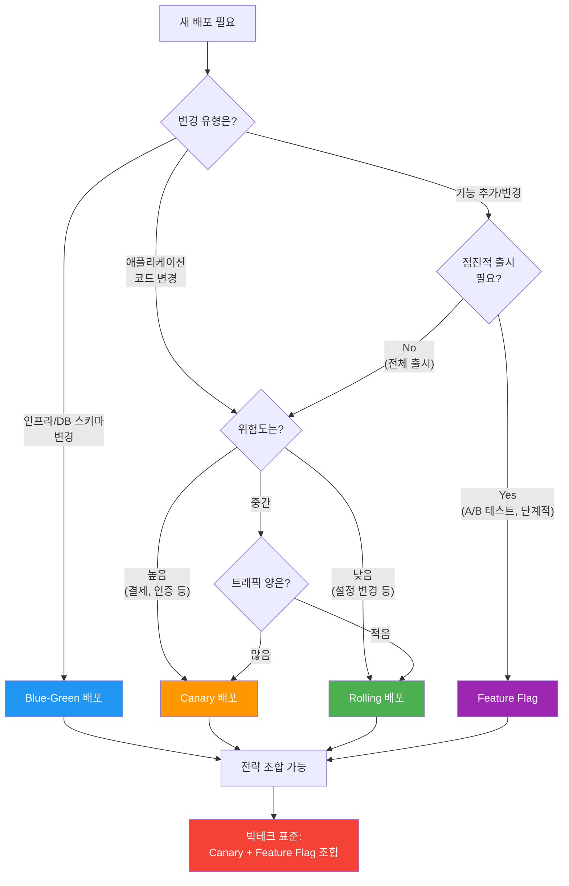
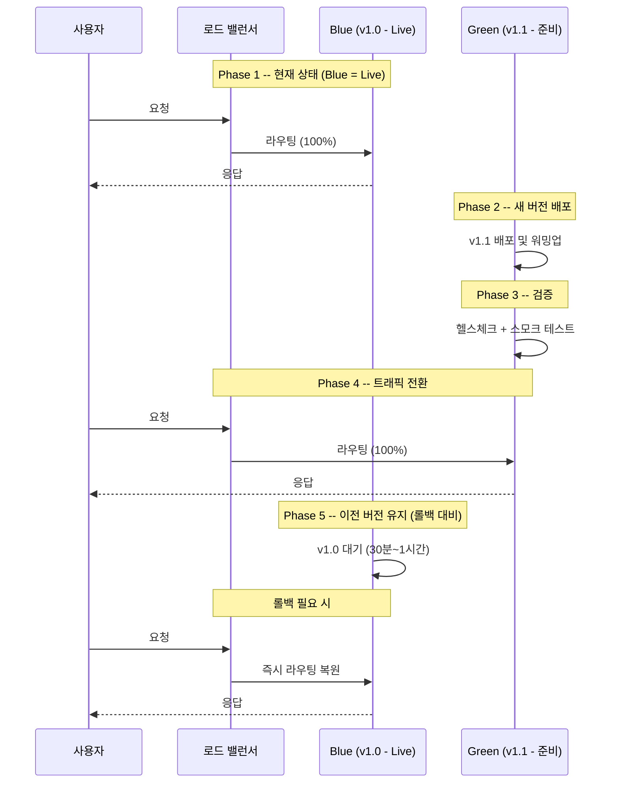
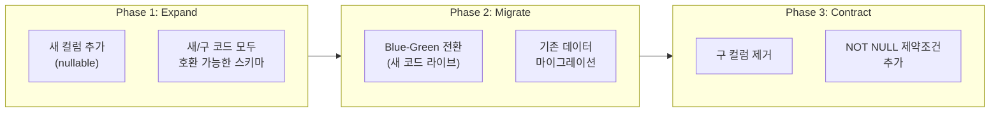
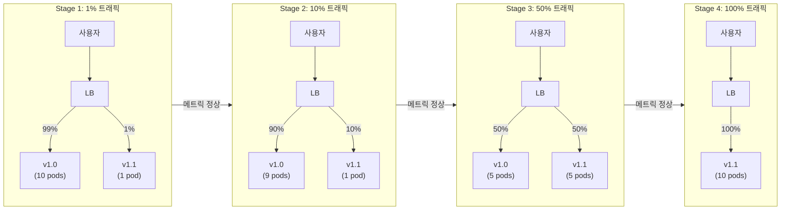
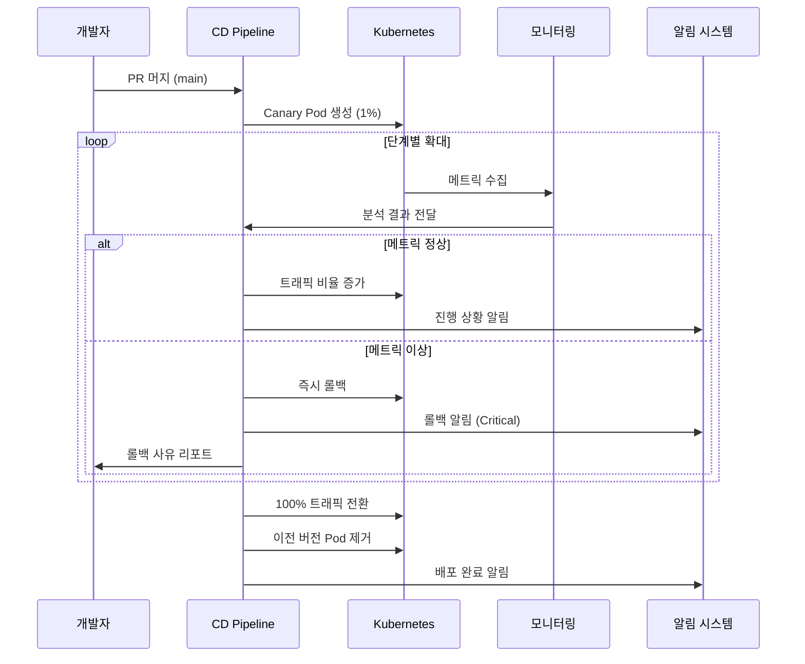
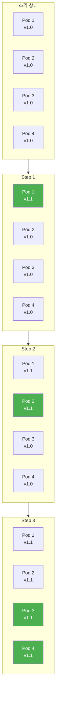
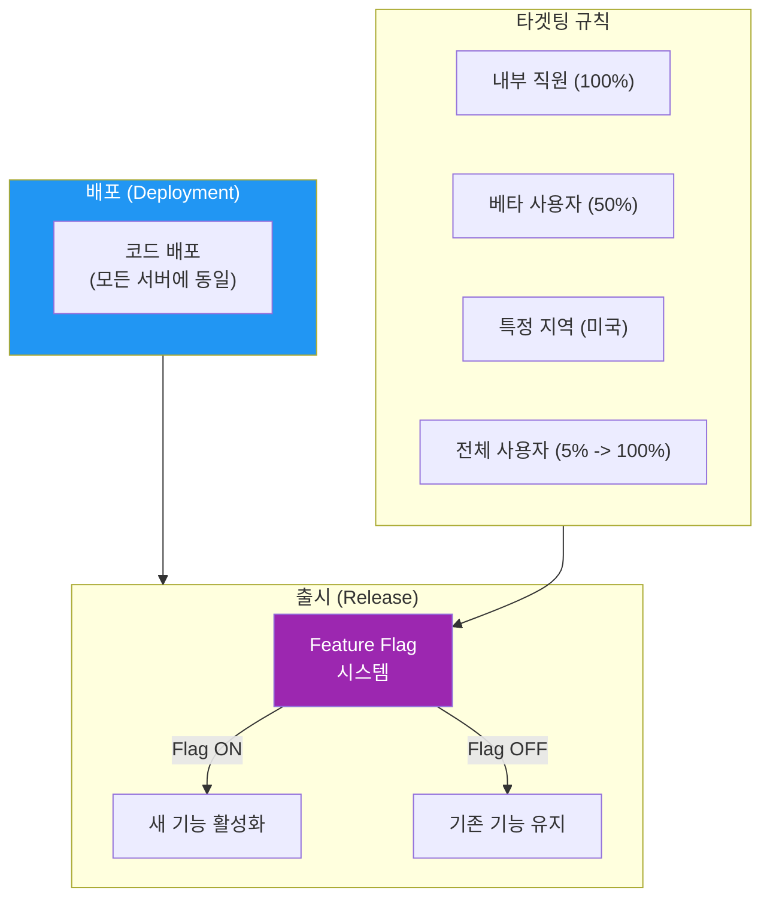
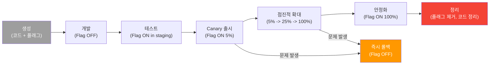
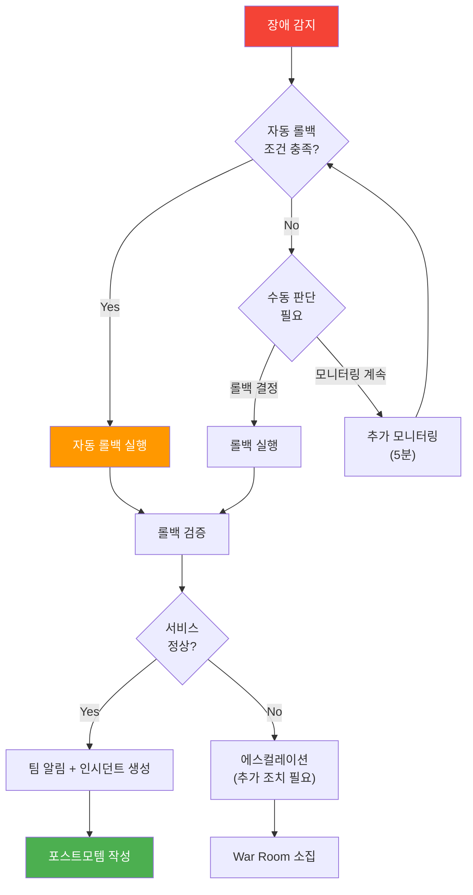
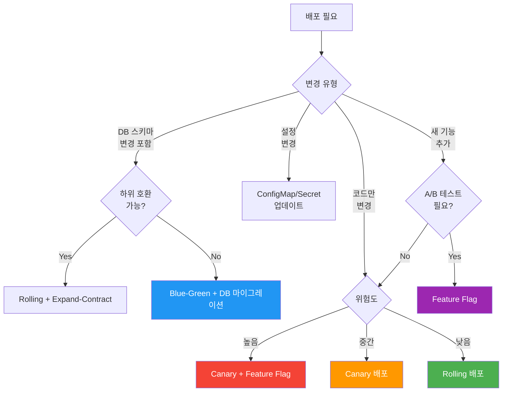

# 배포 전략 가이드

> **작성일**: 2026-03-12
> **기반 표준**: Google SRE, Stripe Engineering, Kubernetes Best Practices
> **적용 수준**: 빅테크 기준 팀 운영표준
> **참고**: [빅테크 코드품질 갭분석 리포트 섹션 4.7](../reports/2026-03-12_빅테크-코드품질-갭분석-리포트.md)

---

## 목차

1. [배포 전략 비교 개요](#1-배포-전략-비교-개요)
2. [Blue-Green 배포](#2-blue-green-배포)
3. [Canary 배포](#3-canary-배포)
4. [Rolling 배포](#4-rolling-배포)
5. [Feature Flag 기반 배포](#5-feature-flag-기반-배포)
6. [롤백 절차](#6-롤백-절차)
7. [배포 체크리스트](#7-배포-체크리스트)
8. [Kubernetes 배포 매니페스트 예시](#8-kubernetes-배포-매니페스트-예시)
9. [GitHub Actions 배포 워크플로우](#9-github-actions-배포-워크플로우)
10. [전략별 의사결정 가이드](#10-전략별-의사결정-가이드)

---

## 1. 배포 전략 비교 개요

### 1.1 전략 비교표

| 항목 | Blue-Green | Canary | Rolling | Feature Flag |
|------|-----------|--------|---------|-------------|
| **원리** | 두 환경을 번갈아 사용 | 소수 트래픽에 먼저 배포 | 인스턴스를 순차 교체 | 코드는 배포, 기능은 토글로 제어 |
| **롤백 속도** | 즉시 (DNS/LB 전환) | 빠름 (트래픽 전환) | 느림 (순차 롤백) | 즉시 (플래그 OFF) |
| **인프라 비용** | 높음 (2배 리소스) | 중간 (추가 인스턴스) | 낮음 (기존 리소스) | 낮음 (코드 레벨) |
| **트래픽 제어** | 전체 전환 | 비율 조절 가능 | 불가 | 사용자/그룹 단위 |
| **검증 정밀도** | 낮음 | 높음 (실 트래픽) | 중간 | 매우 높음 |
| **복잡도** | 중간 | 높음 | 낮음 | 높음 (코드 관리) |
| **적합한 상황** | 인프라/DB 마이그레이션 | 위험한 기능 변경 | 일반적 업데이트 | 점진적 기능 출시 |
| **무중단 보장** | O | O | O (설정 필요) | O |
| **A/B 테스트** | X | 제한적 | X | O |

### 1.2 전략 선택 가이드



### 1.3 빅테크 배포 패턴

| 기업 | 주요 전략 | 특징 |
|------|----------|------|
| **Stripe** | Canary + Feature Flag | 하루 수백 번 배포, 99.999% 가용성 유지 |
| **Google** | Canary + Rolling | GKE 기반 점진적 롤아웃 |
| **Netflix** | Red-Black (Blue-Green 변형) + Feature Flag | Spinnaker 파이프라인 자동화 |
| **Meta** | Feature Flag + Canary | Gatekeeper 시스템으로 기능 단위 배포 |

---

## 2. Blue-Green 배포

### 2.1 원리

두 개의 동일한 프로덕션 환경(Blue, Green)을 운영한다. 하나는 현재 라이브(Blue), 다른 하나는 새 버전 준비(Green). 검증 완료 후 트래픽을 한 번에 전환한다.



### 2.2 구현 방법

#### DNS 기반 전환

```yaml
# Route 53 weighted routing
blue_record:
  name: "api.example.com"
  type: A
  set_identifier: "blue"
  weight: 100  # --> 0 when switching
  alias:
    dns_name: "blue-alb-123.us-east-1.elb.amazonaws.com"

green_record:
  name: "api.example.com"
  type: A
  set_identifier: "green"
  weight: 0    # --> 100 when switching
  alias:
    dns_name: "green-alb-456.us-east-1.elb.amazonaws.com"
```

#### Load Balancer Target Group 전환

```bash
#!/bin/bash
# Blue-Green switch via ALB target group

BLUE_TG="arn:aws:elasticloadbalancing:...:targetgroup/blue/..."
GREEN_TG="arn:aws:elasticloadbalancing:...:targetgroup/green/..."
LISTENER_ARN="arn:aws:elasticloadbalancing:...:listener/..."

# Switch traffic from Blue to Green
aws elbv2 modify-listener \
  --listener-arn "$LISTENER_ARN" \
  --default-actions Type=forward,TargetGroupArn="$GREEN_TG"

echo "Traffic switched to Green environment"
```

### 2.3 롤백 절차

| 단계 | 작업 | 소요 시간 |
|------|------|----------|
| 1 | 장애 감지 (모니터링 알림) | 자동 |
| 2 | 롤백 결정 (온콜 엔지니어) | 1~5분 |
| 3 | LB/DNS 이전 환경으로 전환 | 즉시 (~30초) |
| 4 | 이전 환경 헬스체크 확인 | 1분 |
| 5 | 사용자 영향 해소 확인 | 1~5분 |
| **총 소요** | | **3~12분** |

### 2.4 장단점

**장점**:
- 롤백이 즉시 가능 (LB 전환만으로 복원)
- 새 환경을 충분히 검증한 후 전환 가능
- 다운타임 제로 보장

**단점**:
- 인프라 비용 2배 (두 환경 동시 운영)
- 데이터베이스 스키마 변경 시 추가 전략 필요 (Expand-Contract 패턴)
- 세션 상태 관리 주의 필요 (Sticky Session 사용 시)

### 2.5 DB 마이그레이션 전략 (Expand-Contract)

Blue-Green 배포 시 DB 스키마가 변경되는 경우, 양쪽 버전이 동시에 동작할 수 있도록 Expand-Contract 패턴을 사용한다.



---

## 3. Canary 배포

### 3.1 원리

새 버전을 소수의 인스턴스에만 배포하고, 전체 트래픽의 일부만 새 버전으로 라우팅한다. 모니터링을 통해 문제가 없으면 점진적으로 트래픽 비율을 높인다.



### 3.2 트래픽 비율 조절 단계

| 단계 | 트래픽 비율 | 대기 시간 | 모니터링 항목 | 자동 롤백 조건 |
|------|-----------|----------|-------------|--------------|
| 1 | **1%** | 10분 | 에러율, 레이턴시 | 에러율 > 5% 또는 P99 > 2초 |
| 2 | **5%** | 15분 | 에러율, 레이턴시, 로그 | 에러율 > 2% 또는 P95 > 1초 |
| 3 | **10%** | 20분 | 에러율, 레이턴시, 비즈니스 메트릭 | 에러율 > 1% 또는 P95 > 500ms |
| 4 | **25%** | 30분 | 전체 Golden Signals | SLO 위반 |
| 5 | **50%** | 30분 | 전체 Golden Signals + 비즈니스 KPI | SLO 위반 |
| 6 | **100%** | - | 정상 모니터링 | - |

### 3.3 자동 롤백 기준

```yaml
canary_analysis:
  # Metric-based rollback triggers
  metrics:
    - name: error_rate
      query: |
        sum(rate(http_requests_total{status_class="5xx",version="canary"}[5m]))
        / sum(rate(http_requests_total{version="canary"}[5m]))
      threshold:
        max: 0.01  # 1% error rate
      comparison: "worse_than_baseline"
      margin: 1.5  # 150% of baseline

    - name: latency_p95
      query: |
        histogram_quantile(0.95,
          sum(rate(http_request_duration_seconds_bucket{version="canary"}[5m])) by (le)
        )
      threshold:
        max: 0.5  # 500ms
      comparison: "worse_than_baseline"
      margin: 1.3  # 130% of baseline

    - name: saturation
      query: |
        avg(rate(process_cpu_seconds_total{version="canary"}[5m]))
      threshold:
        max: 0.8  # 80% CPU
      comparison: "absolute"

  # Rollback decision
  rollback_policy:
    consecutive_failures: 3  # 3 consecutive checks must fail
    check_interval: "60s"
    action: "automatic_rollback"
    notification:
      - "#deploy-alerts (Slack)"
      - "PagerDuty (oncall)"
```

### 3.4 모니터링 지표

**필수 모니터링 대상**:

| 카테고리 | 지표 | Canary vs Baseline 비교 |
|----------|------|----------------------|
| **에러** | 5xx 에러율 | Canary 에러율이 Baseline의 1.5배 미만 |
| **레이턴시** | P50, P95, P99 | Canary 레이턴시가 Baseline의 1.3배 미만 |
| **리소스** | CPU, 메모리 사용률 | Canary 리소스가 Baseline의 1.5배 미만 |
| **비즈니스** | 전환율, 주문 성공률 | Canary 성공률이 Baseline의 0.95배 이상 |
| **로그** | ERROR 레벨 로그 빈도 | 비정상 패턴 없음 |

### 3.5 Canary 배포 시각화



---

## 4. Rolling 배포

### 4.1 원리

기존 인스턴스를 순차적으로 새 버전으로 교체한다. Kubernetes의 기본 배포 전략이다.



### 4.2 maxSurge / maxUnavailable 설정

| 파라미터 | 설명 | 기본값 | 권장값 |
|----------|------|--------|--------|
| **maxSurge** | 목표 Pod 수 대비 초과 허용 수 | 25% | 25% (또는 1) |
| **maxUnavailable** | 동시에 비활성화 허용 Pod 수 | 25% | 0 (무중단 보장) |

**설정 시나리오별 동작**:

```yaml
# Scenario 1: Zero-downtime (conservative)
# replicas=4, maxSurge=1, maxUnavailable=0
# --> 항상 4개 이상의 Pod가 서비스 중
# --> 1개씩 추가 생성 후 기존 1개 제거 (총 5개 최대)
strategy:
  type: RollingUpdate
  rollingUpdate:
    maxSurge: 1
    maxUnavailable: 0

# Scenario 2: Fast rollout (aggressive)
# replicas=4, maxSurge=2, maxUnavailable=1
# --> 동시에 2개 추가, 1개 제거 가능
# --> 최소 3개, 최대 6개 Pod
strategy:
  type: RollingUpdate
  rollingUpdate:
    maxSurge: 2
    maxUnavailable: 1

# Scenario 3: Resource-constrained
# replicas=4, maxSurge=0, maxUnavailable=1
# --> 추가 리소스 없이, 1개씩 제거 후 생성
# --> 순간 3개만 서비스 (일부 성능 저하 허용)
strategy:
  type: RollingUpdate
  rollingUpdate:
    maxSurge: 0
    maxUnavailable: 1
```

### 4.3 무중단 업데이트를 위한 필수 설정

```yaml
spec:
  # 1. Readiness probe: 트래픽 수신 준비 확인
  readinessProbe:
    httpGet:
      path: /readyz
      port: 8080
    initialDelaySeconds: 5
    periodSeconds: 5
    failureThreshold: 3

  # 2. Liveness probe: 컨테이너 생존 확인
  livenessProbe:
    httpGet:
      path: /healthz
      port: 8080
    initialDelaySeconds: 15
    periodSeconds: 10
    failureThreshold: 3

  # 3. Startup probe: 느린 시작 앱 보호
  startupProbe:
    httpGet:
      path: /healthz
      port: 8080
    failureThreshold: 30
    periodSeconds: 10

  # 4. preStop hook: 기존 요청 완료 대기
  lifecycle:
    preStop:
      exec:
        command: ["/bin/sh", "-c", "sleep 15"]

  # 5. terminationGracePeriodSeconds: 정리 시간
  terminationGracePeriodSeconds: 30

  # 6. minReadySeconds: Ready 후 추가 대기
  minReadySeconds: 10
```

### 4.4 Rolling 배포의 한계와 대안

| 한계 | 설명 | 대안 |
|------|------|------|
| 롤백 느림 | 다시 순차적으로 이전 버전 배포 | Blue-Green으로 즉시 롤백 |
| 버전 혼재 | 업데이트 중 v1.0과 v1.1이 동시 서비스 | Feature Flag로 기능 분리 |
| DB 호환성 | 두 버전이 같은 DB를 사용해야 함 | Expand-Contract 마이그레이션 |

---

## 5. Feature Flag 기반 배포

### 5.1 원리

코드는 모든 서버에 동일하게 배포하되, 기능의 활성화/비활성화를 Feature Flag로 제어한다. 배포(Deployment)와 출시(Release)를 분리한다.



### 5.2 토글 유형

| 유형 | 수명 | 소유자 | 예시 | 제거 시점 |
|------|------|--------|------|----------|
| **Release Toggle** | 수일~수주 | 개발팀 | 미완성 기능 숨기기 | 기능 출시 완료 후 즉시 |
| **Experiment Toggle** | 수주~수개월 | 프로덕트팀 | A/B 테스트 | 실험 종료 후 |
| **Ops Toggle** | 영구 | 운영팀 | 서킷 브레이커, 성능 제어 | 제거하지 않음 |
| **Permission Toggle** | 영구 | 비즈니스팀 | 프리미엄 기능 | 비즈니스 결정 시 |

### 5.3 Feature Flag 생명주기



### 5.4 LaunchDarkly / Unleash 패턴

#### 코드 구현 패턴

```python
from __future__ import annotations

from dataclasses import dataclass
from typing import Any


@dataclass(frozen=True)
class FeatureContext:
    """Immutable context for feature flag evaluation."""
    user_id: str
    email: str
    plan: str
    region: str
    attributes: dict[str, Any] = None


# Pattern 1: Simple boolean toggle
def get_search_results(query: str, context: FeatureContext) -> list[dict]:
    if feature_flags.is_enabled("new-search-algorithm", context):
        return new_search_engine.search(query)
    return legacy_search_engine.search(query)


# Pattern 2: Multivariate flag (A/B/C testing)
def get_pricing_page(context: FeatureContext) -> str:
    variant = feature_flags.get_variation("pricing-page-experiment", context)
    match variant:
        case "control":
            return render_pricing_v1()
        case "variant_a":
            return render_pricing_v2_simple()
        case "variant_b":
            return render_pricing_v2_detailed()
        case _:
            return render_pricing_v1()  # default fallback


# Pattern 3: Percentage rollout
# Configured in LaunchDarkly/Unleash UI:
# - 0%: OFF for all
# - 5%: ON for 5% of users (consistent hashing by user_id)
# - 100%: ON for all
```

```kotlin
// Kotlin/Spring Boot pattern
@Service
class OrderService(
    private val featureFlags: FeatureFlagClient,
    private val legacyProcessor: LegacyOrderProcessor,
    private val newProcessor: NewOrderProcessor,
) {
    fun processOrder(order: Order, context: FeatureContext): OrderResult {
        val processor = if (featureFlags.isEnabled("new-order-pipeline", context)) {
            newProcessor
        } else {
            legacyProcessor
        }
        return processor.process(order)
    }
}
```

### 5.5 Feature Flag 위생 관리

**기술 부채 방지 규칙**:

| 규칙 | 설명 |
|------|------|
| **만료 기한 필수** | Release Toggle은 생성 시 만료 기한 설정 (최대 30일) |
| **소유자 지정** | 모든 플래그에 담당 팀/개인 지정 |
| **정리 알림** | 만료 기한 7일 전 자동 알림 |
| **코드 리뷰** | 플래그 추가/제거 시 반드시 코드 리뷰 |
| **최대 플래그 수** | 서비스당 활성 플래그 30개 이내 |
| **분기 정리** | 분기마다 미사용 플래그 일괄 정리 스프린트 |

```yaml
# Feature flag metadata (stored alongside code or in flag service)
feature_flags:
  - key: "new-checkout-flow"
    type: "release"
    owner: "checkout-team"
    created: "2026-03-01"
    expires: "2026-03-31"
    description: "Redesigned checkout flow with fewer steps"
    jira_ticket: "CHECKOUT-1234"
    cleanup_branch: "cleanup/remove-new-checkout-flag"
    rollout_plan:
      - date: "2026-03-10"
        percentage: 5
      - date: "2026-03-15"
        percentage: 25
      - date: "2026-03-20"
        percentage: 50
      - date: "2026-03-25"
        percentage: 100
```

---

## 6. 롤백 절차

### 6.1 자동 vs 수동 롤백

| 항목 | 자동 롤백 | 수동 롤백 |
|------|----------|----------|
| **트리거** | 메트릭 기반 조건 충족 | 온콜 엔지니어 판단 |
| **속도** | 즉시 (1~3분) | 5~15분 (판단 시간 포함) |
| **적용 대상** | Canary, Feature Flag | Blue-Green, Rolling |
| **위험** | 오탐지로 불필요한 롤백 | 판단 지연으로 영향 확대 |
| **권장** | 명확한 메트릭 기반 판단 가능 시 | 복합 장애, 비즈니스 메트릭 이상 시 |

### 6.2 롤백 트리거 조건

```yaml
rollback_triggers:
  # Automatic rollback conditions
  automatic:
    - name: "high_error_rate"
      condition: "5xx error rate > 5% for 3 minutes"
      severity: "critical"

    - name: "latency_spike"
      condition: "P99 latency > 5s for 5 minutes"
      severity: "critical"

    - name: "health_check_failure"
      condition: "readiness probe fails for 2+ pods"
      severity: "critical"

    - name: "crash_loop"
      condition: "CrashLoopBackOff in 3+ pods"
      severity: "critical"

  # Manual rollback triggers (human judgment required)
  manual:
    - name: "business_metric_drop"
      condition: "Conversion rate drops > 10%"
      decision_maker: "Product + Engineering Lead"

    - name: "data_corruption"
      condition: "Inconsistent data detected"
      decision_maker: "On-call Engineer + DB Admin"

    - name: "security_vulnerability"
      condition: "Active exploit detected"
      decision_maker: "Security Team"
```

### 6.3 롤백 프로세스



### 6.4 전략별 롤백 명령어

```bash
# Blue-Green: LB target group switch
aws elbv2 modify-listener \
  --listener-arn "$LISTENER_ARN" \
  --default-actions Type=forward,TargetGroupArn="$PREVIOUS_TG_ARN"

# Canary (Kubernetes): Delete canary deployment
kubectl delete deployment order-api-canary -n production

# Rolling (Kubernetes): Undo rollout
kubectl rollout undo deployment/order-api -n production
# To specific revision:
kubectl rollout undo deployment/order-api --to-revision=3 -n production

# Feature Flag: Disable flag
# Via LaunchDarkly CLI:
ldcli flags update --project default --flag new-checkout-flow --off

# Helm: Rollback to previous release
helm rollback order-api 0 -n production  # 0 = previous revision
```

---

## 7. 배포 체크리스트

### 7.1 Pre-deploy 체크리스트 (배포 전)

| # | 항목 | 책임자 | 검증 방법 |
|---|------|--------|----------|
| 1 | 모든 CI 테스트 통과 (단위, 통합, E2E) | 자동 | GitHub Actions 상태 확인 |
| 2 | 코드 리뷰 승인 완료 (최소 1명) | 리뷰어 | PR 승인 상태 |
| 3 | 스테이징 환경에서 QA 검증 완료 | QA 엔지니어 | 테스트 리포트 |
| 4 | DB 마이그레이션 하위 호환성 확인 | DBA/개발자 | Expand-Contract 패턴 검증 |
| 5 | Feature Flag 설정 확인 (필요 시) | 개발자 | 플래그 서비스 UI |
| 6 | 롤백 계획 수립 및 문서화 | 개발자 | 배포 티켓에 기재 |
| 7 | 모니터링 알림 정상 동작 확인 | SRE/DevOps | 테스트 알림 발송 |
| 8 | 의존 서비스 상태 확인 | 개발자 | 상태 페이지, 헬스체크 |
| 9 | 배포 시간대 확인 (피크 시간 회피) | 개발자 | 트래픽 대시보드 |
| 10 | 변경 사항 릴리스 노트 작성 | 개발자 | CHANGELOG.md 업데이트 |

### 7.2 Post-deploy 체크리스트 (배포 후)

| # | 항목 | 책임자 | 검증 방법 |
|---|------|--------|----------|
| 1 | 헬스체크 엔드포인트 정상 응답 | 자동 | `/healthz`, `/readyz` 확인 |
| 2 | 에러율 기준선 이내 확인 (5분간) | 자동/SRE | Grafana 대시보드 |
| 3 | 레이턴시 기준선 이내 확인 (5분간) | 자동/SRE | Grafana 대시보드 |
| 4 | 주요 API 엔드포인트 스모크 테스트 | 자동 | 스모크 테스트 스크립트 |
| 5 | 로그에 비정상 에러 패턴 없음 확인 | 개발자 | Kibana/CloudWatch Logs |
| 6 | DB 커넥션 풀 정상 확인 | DBA | 모니터링 대시보드 |
| 7 | 외부 연동 서비스 정상 동작 확인 | 개발자 | 통합 테스트 또는 수동 확인 |
| 8 | Canary 메트릭 baseline 비교 (해당 시) | 자동 | Canary 분석 도구 |
| 9 | 사용자 대면 기능 수동 확인 | QA/개발자 | 실 서비스 브라우저 테스트 |
| 10 | 배포 완료 알림 및 릴리스 노트 공유 | 개발자 | Slack #releases 채널 |

### 7.3 배포 금지 조건

다음 조건에서는 배포를 **중단**한다.

```yaml
deployment_blockers:
  - "진행 중인 인시던트가 있을 때"
  - "Error Budget이 소진된 상태일 때 (보안 패치 제외)"
  - "의존 서비스에 장애가 발생했을 때"
  - "피크 트래픽 시간대 (서비스별 정의)"
  - "온콜 엔지니어가 부재일 때"
  - "금요일 오후 (금요일 배포 금지 정책 적용 시)"
  - "DB 마이그레이션 하위 호환성 미검증 시"
```

---

## 8. Kubernetes 배포 매니페스트 예시

### 8.1 Canary 배포 (Stable + Canary Deployment)

```yaml
# stable-deployment.yaml
apiVersion: apps/v1
kind: Deployment
metadata:
  name: order-api-stable
  namespace: production
  labels:
    app: order-api
    version: stable
    track: stable
spec:
  replicas: 9  # 90% of total capacity
  selector:
    matchLabels:
      app: order-api
      track: stable
  template:
    metadata:
      labels:
        app: order-api
        track: stable
        version: "v1.0.3"
    spec:
      containers:
        - name: order-api
          image: registry.example.com/order-api:v1.0.3
          ports:
            - containerPort: 8080
          resources:
            requests:
              cpu: "250m"
              memory: "512Mi"
            limits:
              cpu: "500m"
              memory: "1Gi"
          readinessProbe:
            httpGet:
              path: /readyz
              port: 8080
            initialDelaySeconds: 5
            periodSeconds: 5
          livenessProbe:
            httpGet:
              path: /healthz
              port: 8080
            initialDelaySeconds: 15
            periodSeconds: 10
          lifecycle:
            preStop:
              exec:
                command: ["/bin/sh", "-c", "sleep 15"]
      terminationGracePeriodSeconds: 30
---
# canary-deployment.yaml
apiVersion: apps/v1
kind: Deployment
metadata:
  name: order-api-canary
  namespace: production
  labels:
    app: order-api
    version: canary
    track: canary
spec:
  replicas: 1  # 10% of total capacity
  selector:
    matchLabels:
      app: order-api
      track: canary
  template:
    metadata:
      labels:
        app: order-api
        track: canary
        version: "v1.1.0"
    spec:
      containers:
        - name: order-api
          image: registry.example.com/order-api:v1.1.0
          ports:
            - containerPort: 8080
          resources:
            requests:
              cpu: "250m"
              memory: "512Mi"
            limits:
              cpu: "500m"
              memory: "1Gi"
          readinessProbe:
            httpGet:
              path: /readyz
              port: 8080
            initialDelaySeconds: 5
            periodSeconds: 5
          livenessProbe:
            httpGet:
              path: /healthz
              port: 8080
            initialDelaySeconds: 15
            periodSeconds: 10
          lifecycle:
            preStop:
              exec:
                command: ["/bin/sh", "-c", "sleep 15"]
      terminationGracePeriodSeconds: 30
---
# service.yaml (routes to both stable and canary via shared label)
apiVersion: v1
kind: Service
metadata:
  name: order-api
  namespace: production
spec:
  selector:
    app: order-api  # matches both stable and canary pods
  ports:
    - port: 80
      targetPort: 8080
  type: ClusterIP
```

### 8.2 Blue-Green 배포 (Service Selector Switch)

```yaml
# blue-deployment.yaml
apiVersion: apps/v1
kind: Deployment
metadata:
  name: order-api-blue
  namespace: production
  labels:
    app: order-api
    slot: blue
spec:
  replicas: 4
  selector:
    matchLabels:
      app: order-api
      slot: blue
  template:
    metadata:
      labels:
        app: order-api
        slot: blue
        version: "v1.0.3"
    spec:
      containers:
        - name: order-api
          image: registry.example.com/order-api:v1.0.3
          ports:
            - containerPort: 8080
          resources:
            requests:
              cpu: "250m"
              memory: "512Mi"
            limits:
              cpu: "500m"
              memory: "1Gi"
          readinessProbe:
            httpGet:
              path: /readyz
              port: 8080
            initialDelaySeconds: 5
            periodSeconds: 5
          livenessProbe:
            httpGet:
              path: /healthz
              port: 8080
            initialDelaySeconds: 15
            periodSeconds: 10
---
# green-deployment.yaml
apiVersion: apps/v1
kind: Deployment
metadata:
  name: order-api-green
  namespace: production
  labels:
    app: order-api
    slot: green
spec:
  replicas: 4
  selector:
    matchLabels:
      app: order-api
      slot: green
  template:
    metadata:
      labels:
        app: order-api
        slot: green
        version: "v1.1.0"
    spec:
      containers:
        - name: order-api
          image: registry.example.com/order-api:v1.1.0
          ports:
            - containerPort: 8080
          resources:
            requests:
              cpu: "250m"
              memory: "512Mi"
            limits:
              cpu: "500m"
              memory: "1Gi"
          readinessProbe:
            httpGet:
              path: /readyz
              port: 8080
            initialDelaySeconds: 5
            periodSeconds: 5
          livenessProbe:
            httpGet:
              path: /healthz
              port: 8080
            initialDelaySeconds: 15
            periodSeconds: 10
---
# service.yaml -- switch by changing selector.slot
apiVersion: v1
kind: Service
metadata:
  name: order-api
  namespace: production
spec:
  selector:
    app: order-api
    slot: blue  # <-- change to "green" to switch
  ports:
    - port: 80
      targetPort: 8080
  type: ClusterIP
```

**Blue-Green 전환 명령어**:

```bash
# Switch from blue to green
kubectl patch service order-api -n production \
  -p '{"spec":{"selector":{"slot":"green"}}}'

# Rollback to blue
kubectl patch service order-api -n production \
  -p '{"spec":{"selector":{"slot":"blue"}}}'
```

### 8.3 Istio 기반 Canary (트래픽 비율 제어)

```yaml
# Istio VirtualService for fine-grained traffic splitting
apiVersion: networking.istio.io/v1beta1
kind: VirtualService
metadata:
  name: order-api
  namespace: production
spec:
  hosts:
    - order-api
  http:
    - route:
        - destination:
            host: order-api
            subset: stable
          weight: 95
        - destination:
            host: order-api
            subset: canary
          weight: 5
---
apiVersion: networking.istio.io/v1beta1
kind: DestinationRule
metadata:
  name: order-api
  namespace: production
spec:
  host: order-api
  subsets:
    - name: stable
      labels:
        track: stable
    - name: canary
      labels:
        track: canary
```

---

## 9. GitHub Actions 배포 워크플로우

### 9.1 Canary 배포 파이프라인

```yaml
# .github/workflows/deploy-canary.yml
name: Canary Deployment

on:
  push:
    branches: [main]

concurrency:
  group: deploy-production
  cancel-in-progress: false

env:
  REGISTRY: registry.example.com
  IMAGE_NAME: order-api
  K8S_NAMESPACE: production

jobs:
  build-and-test:
    runs-on: ubuntu-latest
    steps:
      - uses: actions/checkout@v4

      - name: Run tests
        run: |
          make test
          make lint

      - name: Build and push image
        run: |
          docker build -t ${{ env.REGISTRY }}/${{ env.IMAGE_NAME }}:${{ github.sha }} .
          docker push ${{ env.REGISTRY }}/${{ env.IMAGE_NAME }}:${{ github.sha }}

  deploy-canary:
    needs: build-and-test
    runs-on: ubuntu-latest
    environment: production-canary
    steps:
      - uses: actions/checkout@v4

      - name: Configure kubectl
        uses: azure/k8s-set-context@v4
        with:
          kubeconfig: ${{ secrets.KUBE_CONFIG }}

      - name: Deploy canary (10% traffic)
        run: |
          kubectl set image deployment/order-api-canary \
            order-api=${{ env.REGISTRY }}/${{ env.IMAGE_NAME }}:${{ github.sha }} \
            -n ${{ env.K8S_NAMESPACE }}

          kubectl rollout status deployment/order-api-canary \
            -n ${{ env.K8S_NAMESPACE }} \
            --timeout=300s

      - name: Wait and analyze canary metrics
        run: |
          echo "Waiting 10 minutes for canary analysis..."
          sleep 600

          # Query Prometheus for canary vs stable comparison
          CANARY_ERROR_RATE=$(curl -s "$PROMETHEUS_URL/api/v1/query" \
            --data-urlencode 'query=sum(rate(http_requests_total{status_class="5xx",track="canary"}[10m])) / sum(rate(http_requests_total{track="canary"}[10m]))' \
            | jq -r '.data.result[0].value[1]')

          STABLE_ERROR_RATE=$(curl -s "$PROMETHEUS_URL/api/v1/query" \
            --data-urlencode 'query=sum(rate(http_requests_total{status_class="5xx",track="stable"}[10m])) / sum(rate(http_requests_total{track="stable"}[10m]))' \
            | jq -r '.data.result[0].value[1]')

          echo "Canary error rate: $CANARY_ERROR_RATE"
          echo "Stable error rate: $STABLE_ERROR_RATE"

          # Fail if canary error rate is 1.5x worse than stable
          if (( $(echo "$CANARY_ERROR_RATE > $STABLE_ERROR_RATE * 1.5" | bc -l) )); then
            echo "Canary error rate too high. Rolling back."
            exit 1
          fi

      - name: Rollback canary on failure
        if: failure()
        run: |
          kubectl rollout undo deployment/order-api-canary \
            -n ${{ env.K8S_NAMESPACE }}

          # Notify team
          curl -X POST "${{ secrets.SLACK_WEBHOOK }}" \
            -H 'Content-Type: application/json' \
            -d '{"text":"Canary deployment failed and rolled back. Commit: ${{ github.sha }}"}'

  promote-to-stable:
    needs: deploy-canary
    runs-on: ubuntu-latest
    environment: production-stable
    steps:
      - name: Configure kubectl
        uses: azure/k8s-set-context@v4
        with:
          kubeconfig: ${{ secrets.KUBE_CONFIG }}

      - name: Promote canary to stable
        run: |
          # Update stable deployment with new image
          kubectl set image deployment/order-api-stable \
            order-api=${{ env.REGISTRY }}/${{ env.IMAGE_NAME }}:${{ github.sha }} \
            -n ${{ env.K8S_NAMESPACE }}

          kubectl rollout status deployment/order-api-stable \
            -n ${{ env.K8S_NAMESPACE }} \
            --timeout=600s

      - name: Notify deployment complete
        run: |
          curl -X POST "${{ secrets.SLACK_WEBHOOK }}" \
            -H 'Content-Type: application/json' \
            -d '{"text":"Production deployment complete. Image: ${{ github.sha }}"}'
```

### 9.2 Blue-Green 배포 파이프라인

```yaml
# .github/workflows/deploy-blue-green.yml
name: Blue-Green Deployment

on:
  workflow_dispatch:
    inputs:
      version:
        description: 'Version tag to deploy'
        required: true

env:
  REGISTRY: registry.example.com
  IMAGE_NAME: order-api
  K8S_NAMESPACE: production

jobs:
  deploy:
    runs-on: ubuntu-latest
    environment: production
    steps:
      - uses: actions/checkout@v4

      - name: Configure kubectl
        uses: azure/k8s-set-context@v4
        with:
          kubeconfig: ${{ secrets.KUBE_CONFIG }}

      - name: Determine current and target slots
        id: slots
        run: |
          CURRENT_SLOT=$(kubectl get service order-api -n ${{ env.K8S_NAMESPACE }} \
            -o jsonpath='{.spec.selector.slot}')

          if [ "$CURRENT_SLOT" = "blue" ]; then
            TARGET_SLOT="green"
          else
            TARGET_SLOT="blue"
          fi

          echo "current=$CURRENT_SLOT" >> "$GITHUB_OUTPUT"
          echo "target=$TARGET_SLOT" >> "$GITHUB_OUTPUT"
          echo "Current: $CURRENT_SLOT, Target: $TARGET_SLOT"

      - name: Deploy to target slot
        run: |
          TARGET=${{ steps.slots.outputs.target }}

          kubectl set image deployment/order-api-$TARGET \
            order-api=${{ env.REGISTRY }}/${{ env.IMAGE_NAME }}:${{ inputs.version }} \
            -n ${{ env.K8S_NAMESPACE }}

          kubectl rollout status deployment/order-api-$TARGET \
            -n ${{ env.K8S_NAMESPACE }} \
            --timeout=300s

      - name: Run smoke tests against target
        run: |
          TARGET=${{ steps.slots.outputs.target }}

          # Port-forward to target slot for smoke testing
          kubectl port-forward service/order-api-$TARGET-internal 8081:80 \
            -n ${{ env.K8S_NAMESPACE }} &
          sleep 5

          # Run smoke tests
          curl -f http://localhost:8081/healthz
          curl -f http://localhost:8081/readyz
          curl -f http://localhost:8081/api/v1/status

          echo "Smoke tests passed"

      - name: Switch traffic to target slot
        run: |
          TARGET=${{ steps.slots.outputs.target }}

          kubectl patch service order-api -n ${{ env.K8S_NAMESPACE }} \
            -p "{\"spec\":{\"selector\":{\"slot\":\"$TARGET\"}}}"

          echo "Traffic switched to $TARGET"

      - name: Verify after switch
        run: |
          echo "Waiting 5 minutes for verification..."
          sleep 300

          # Check error rate after switch
          ERROR_RATE=$(curl -s "$PROMETHEUS_URL/api/v1/query" \
            --data-urlencode 'query=sum(rate(http_requests_total{status_class="5xx"}[5m])) / sum(rate(http_requests_total[5m]))' \
            | jq -r '.data.result[0].value[1]')

          echo "Post-switch error rate: $ERROR_RATE"

          if (( $(echo "$ERROR_RATE > 0.01" | bc -l) )); then
            echo "Error rate too high after switch. Reverting."
            CURRENT=${{ steps.slots.outputs.current }}
            kubectl patch service order-api -n ${{ env.K8S_NAMESPACE }} \
              -p "{\"spec\":{\"selector\":{\"slot\":\"$CURRENT\"}}}"
            exit 1
          fi

      - name: Notify deployment complete
        if: success()
        run: |
          curl -X POST "${{ secrets.SLACK_WEBHOOK }}" \
            -H 'Content-Type: application/json' \
            -d "{\"text\":\"Blue-Green deployment complete. Version: ${{ inputs.version }}, Slot: ${{ steps.slots.outputs.target }}\"}"

      - name: Notify deployment failed
        if: failure()
        run: |
          curl -X POST "${{ secrets.SLACK_WEBHOOK }}" \
            -H 'Content-Type: application/json' \
            -d "{\"text\":\"Blue-Green deployment FAILED and reverted. Version: ${{ inputs.version }}\"}"
```

---

## 10. 전략별 의사결정 가이드

### 10.1 종합 의사결정 매트릭스



### 10.2 전략 조합 패턴 (빅테크 표준)

**Pattern 1: Canary + Feature Flag (권장)**

```
1. 코드를 Feature Flag OFF 상태로 배포 (Rolling/Canary)
2. 내부 직원 대상으로 Feature Flag ON
3. 베타 사용자 5% -> 25% -> 50% -> 100% 점진적 확대
4. 문제 발생 시 Feature Flag OFF (즉시 롤백)
5. 안정화 후 Feature Flag 코드 제거
```

**Pattern 2: Blue-Green + Canary**

```
1. Green 환경에 새 버전 배포
2. Green 환경으로 1% 트래픽 Canary 전송
3. Canary 검증 통과 시 전체 트래픽 Green으로 전환
4. 문제 발생 시 Blue로 즉시 복원
```

**Pattern 3: Feature Flag + Rolling (일반적)**

```
1. Feature Flag OFF 상태로 Rolling 배포
2. 배포 완료 후 Feature Flag로 점진적 활성화
3. 배포 리스크는 최소화, 기능 리스크만 관리
```

### 10.3 배포 성숙도 모델

| Level | 설명 | 전략 | 자동화 수준 |
|-------|------|------|-----------|
| **L1** | 수동 배포 | 수동 서버 접속 배포 | 없음 |
| **L2** | CI/CD 기본 | Rolling 배포 자동화 | CI: 자동, CD: 반자동 |
| **L3** | 안전한 배포 | Canary + 자동 롤백 | CI/CD: 자동 |
| **L4** | 빅테크 수준 | Canary + Feature Flag + 자동 분석 | 완전 자동 |
| **L5** | 최적화 | 위 모든 것 + 자동 SLO 기반 배포 판단 | AI 기반 자동화 |

---

## 참고 자료

- [Google SRE Book - Release Engineering](https://sre.google/sre-book/release-engineering/)
- [Kubernetes - Deployment Strategies](https://kubernetes.io/docs/concepts/workloads/controllers/deployment/#strategy)
- [CircleCI - Canary vs Blue-Green Deployment](https://circleci.com/blog/canary-vs-blue-green-downtime/)
- [Martin Fowler - Feature Toggles](https://martinfowler.com/articles/feature-toggles.html)
- [Stripe Blog - Deployment Engineering](https://stripe.com/blog/engineering)
- [Netflix Technology Blog - Deployment at Scale](https://netflixtechblog.com/)
- [Istio - Traffic Management](https://istio.io/latest/docs/concepts/traffic-management/)
- [Argo Rollouts - Progressive Delivery](https://argoproj.github.io/argo-rollouts/)
