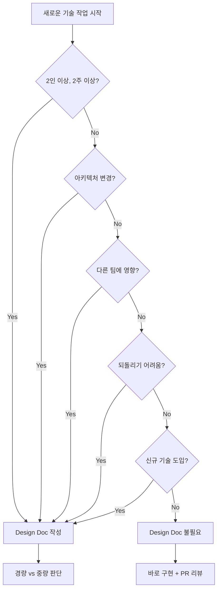
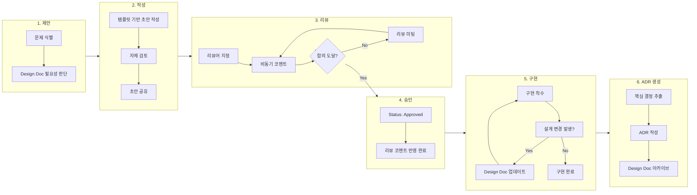
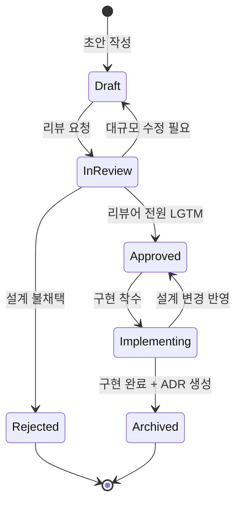

# Design Doc / RFC 프로세스 가이드

> 대규모 기술 변경 전 합의를 형성하기 위한 Design Doc 작성 및 리뷰 프로세스 정의.
> 참고: [갭 분석 리포트 - 섹션 4.8](../reports/2026-03-12_빅테크-코드품질-갭분석-리포트.md)

---

## 목차

1. [Design Doc이란 무엇인가](#1-design-doc이란-무엇인가)
2. [Design Doc이 필요한 시점](#2-design-doc이-필요한-시점)
3. [작성 프로세스](#3-작성-프로세스)
4. [리뷰 절차](#4-리뷰-절차)
5. [빅테크 사례](#5-빅테크-사례)
6. [템플릿 사용법](#6-템플릿-사용법)
7. [FAQ](#7-faq)

---

## 1. Design Doc이란 무엇인가

Design Doc(설계 문서)은 **코드를 작성하기 전에** 기술적 접근 방식을 설명하고, 팀의 합의를 얻기 위해 작성하는 문서다. Google에서는 이를 "비교적 비공식적인 문서로, 트레이드오프에 초점을 맞춘다"고 정의한다.

핵심 목적은 세 가지다:

1. **사전 설계 검증** -- 구현 전에 설계의 문제점을 발견한다
2. **합의 형성** -- 이해관계자들이 동일한 방향을 바라보게 한다
3. **지식 보존** -- 분산된 대화를 내구적인 지식으로 변환한다

### 1.1 Design Doc vs ADR

Design Doc과 ADR(Architecture Decision Record)은 상호 보완적이다. 동일한 문서가 아니며, 생명주기와 목적이 다르다.

| 구분 | Design Doc | ADR |
|------|-----------|-----|
| **시점** | 구현 **전** (사전 설계) | 결정 **후** (사후 기록) |
| **목적** | 설계 탐색, 대안 비교, 합의 형성 | 결정 기록, 맥락 보존 |
| **분량** | 3-20페이지 (상세) | 1-2페이지 (간결) |
| **수명** | 구현 완료 후 아카이브 | 영구 보존 (Supersede 시까지) |
| **상태 변화** | Draft -> In Review -> Approved -> Implemented -> Archived | Proposed -> Accepted / Rejected |
| **트레이드오프** | 상세한 대안 분석 | 선택된 결정과 결과 |
| **독자** | 리뷰어, 구현팀 | 미래의 팀원 |

**흐름:**

```
Design Doc (왜 이 설계인가?) --> 구현 --> ADR (무엇을 결정했는가?)
```

Design Doc에서 탐색한 대안과 결론이 ADR의 Context/Decision 섹션으로 압축된다. Design Doc은 "사고 과정"을, ADR은 "최종 결론"을 기록한다.

### 1.2 용어 정리

| 용어 | 설명 |
|------|------|
| **Design Doc** | 기술 설계 문서. Google, Uber 등에서 사용하는 명칭 |
| **RFC (Request for Comments)** | 의견 요청 문서. Spotify, Airbnb 등에서 사용하는 명칭 |
| **Tech Spec** | 기술 명세서. Stripe, Amazon 등에서 사용하는 명칭 |

이 가이드에서는 **Design Doc**을 공식 명칭으로 사용한다. RFC와 Tech Spec은 조직 문화에 따른 변형이며 본질은 동일하다.

---

## 2. Design Doc이 필요한 시점

### 2.1 판단 기준표

다음 기준 중 **2개 이상** 해당하면 Design Doc을 작성한다.

| 기준 | 설명 | 예시 |
|------|------|------|
| **작업 규모** | 2인 이상이 2주 이상 소요되는 작업 | 인증 시스템 전환, 검색 엔진 도입 |
| **아키텍처 변경** | 시스템 경계, 데이터 흐름, 의존성 구조 변경 | 모놀리스 분리, DB 마이그레이션 |
| **외부 영향** | 다른 팀/서비스에 영향을 미치는 변경 | API 변경, 공유 라이브러리 수정 |
| **되돌리기 어려움** | 한번 적용하면 롤백이 비용이 큰 결정 | 데이터 스키마 변경, 프레임워크 교체 |
| **신규 기술** | 팀에서 처음 도입하는 기술/패턴 | 이벤트 소싱 도입, GraphQL 전환 |
| **보안/규정** | 보안 모델 또는 규정 준수에 영향 | 인증/인가 변경, PII 처리 방식 |

### 2.2 Design Doc이 필요 없는 경우

- 버그 수정, 단순 리팩터링
- 기존 패턴을 따르는 CRUD 추가
- 이미 합의된 표준을 적용하는 작업
- 1인이 1주 이내에 완료 가능한 작업
- 문서화, 테스트 추가 등 비파괴적 변경

### 2.3 판단 플로차트



---

## 3. 작성 프로세스

### 3.1 전체 프로세스 흐름



### 3.2 단계별 상세

#### Step 1: 제안 (1일)

- 문제를 식별하고 Design Doc 필요성을 판단한다 (섹션 2 기준표 참조)
- 작성자(Author)와 핵심 리뷰어(Reviewers)를 지정한다
- 리뷰어 선정 기준: 해당 도메인 전문가 + 영향받는 팀 대표 + 시니어 엔지니어

#### Step 2: 작성 (2-5일)

- [Design Doc 템플릿](../../common/templates/DESIGN_DOC_TEMPLATE.md)을 기반으로 초안을 작성한다
- 모든 섹션을 채우되, Open Questions를 적극 활용한다
- 자체 검토 후 `Status: Draft`로 공유한다

**작성 팁:**
- Goals/Non-Goals를 반드시 분리한다. Non-Goals가 범위를 명확히 한다
- Alternatives Considered에 최소 2개 대안을 포함한다
- 다이어그램은 Mermaid를 사용하여 코드로 관리한다
- 불확실한 부분은 솔직히 Open Questions에 기록한다

#### Step 3: 리뷰 (3-7일)

- `Status: In Review`로 변경하고 리뷰어에게 알린다
- 비동기 코멘트 기반 리뷰를 우선 진행한다
- 합의가 어려운 경우 리뷰 미팅을 소집한다
- 리뷰 상세는 [섹션 4](#4-리뷰-절차) 참조

#### Step 4: 승인 (1일)

- 모든 블로킹 코멘트가 해결되면 `Status: Approved`로 변경한다
- 승인 기준: 지정된 리뷰어 전원의 LGTM (Looks Good To Me)

#### Step 5: 구현 (수일-수주)

- 승인된 Design Doc에 따라 구현을 진행한다
- 구현 중 설계 변경이 필요하면 Design Doc을 업데이트하고 관련 리뷰어에게 알린다
- 사소한 변경: Design Doc에 인라인 업데이트
- 중대한 변경: 리뷰 프로세스를 다시 진행

#### Step 6: ADR 생성 (구현 완료 후)

- Design Doc의 핵심 결정을 [ADR 템플릿](../../common/templates/ADR_TEMPLATE.md) 형식으로 압축한다
- Design Doc의 Status를 `Archived`로 변경하고 ADR 링크를 추가한다
- ADR은 `docs/adr/NNNN-제목.md`에 저장한다

### 3.3 상태 전이



| Status | 의미 |
|--------|------|
| `Draft` | 작성 중. 리뷰 전 |
| `In Review` | 리뷰어 검토 중 |
| `Approved` | 승인 완료. 구현 가능 |
| `Rejected` | 불채택. 사유 기록 필수 |
| `Implementing` | 구현 진행 중 |
| `Archived` | 완료. ADR로 전환됨 |

---

## 4. 리뷰 절차

### 4.1 경량 리뷰 vs 중량 리뷰

Design Doc의 규모와 영향에 따라 리뷰 수준을 결정한다.

| 구분 | 경량 리뷰 (Lightweight) | 중량 리뷰 (Heavyweight) |
|------|----------------------|----------------------|
| **적용 기준** | 단일 팀 내 변경, 영향 범위 작음 | 다수 팀 영향, 아키텍처 근본 변경 |
| **리뷰어 수** | 2-3명 | 5명 이상 |
| **리뷰 방식** | 비동기 코멘트 only | 비동기 + 리뷰 미팅 |
| **리뷰 기간** | 3일 이내 | 5-7일 |
| **승인 기준** | 리뷰어 과반수 LGTM | 전원 LGTM |
| **예시** | 캐싱 레이어 추가, 내부 API 변경 | DB 마이그레이션, 서비스 분리 |

### 4.2 리뷰어 역할

| 역할 | 책임 | 인원 |
|------|------|------|
| **Author** | Design Doc 작성 및 업데이트, 코멘트 응답 | 1명 |
| **Primary Reviewer** | 전체 설계 검증, 최종 승인 판단 | 1-2명 |
| **Domain Reviewer** | 특정 도메인 전문성 기반 검토 (보안, DB, 인프라) | 필요시 |
| **Stakeholder Reviewer** | 영향받는 팀의 관점에서 검토 | 영향 팀별 1명 |

### 4.3 리뷰 체크리스트

리뷰어는 다음 항목을 검토한다.

**설계 적절성:**
- [ ] 문제 정의가 명확한가?
- [ ] Goals/Non-Goals가 적절히 분리되어 있는가?
- [ ] 제안된 설계가 문제를 해결하는가?
- [ ] 확장성(10x growth)을 고려했는가?

**대안 분석:**
- [ ] 충분한 대안을 검토했는가? (최소 2개)
- [ ] 각 대안의 트레이드오프가 명확한가?
- [ ] 선택 근거가 합리적인가?

**운영 고려:**
- [ ] 보안 영향을 평가했는가?
- [ ] 성능 영향을 예측했는가?
- [ ] 모니터링/관측 가능성 계획이 있는가?
- [ ] 마이그레이션/롤백 전략이 있는가?

**실현 가능성:**
- [ ] 타임라인이 현실적인가?
- [ ] 의존성이 식별되어 있는가?
- [ ] Open Questions에 대한 해결 계획이 있는가?

### 4.4 코멘트 분류

ADR 코드 리뷰와 동일하게, 코멘트에 접두사를 사용하여 의도를 명확히 한다.

| 접두사 | 의미 | 블로킹 여부 |
|--------|------|------------|
| `[BLOCKING]` | 이 이슈가 해결되지 않으면 승인 불가 | Yes |
| `[SUGGESTION]` | 개선 제안이지만 필수는 아님 | No |
| `[QUESTION]` | 이해를 위한 질문 | No (답변 필요) |
| `[NIT]` | 사소한 수정 (문구, 다이어그램 등) | No |
| `[CONCERN]` | 우려 사항. 논의 필요 | 상황에 따라 |

### 4.5 리뷰 미팅 가이드

비동기 리뷰로 합의가 어려울 때 미팅을 소집한다.

- **시간**: 60분 이하
- **참석**: Author + Primary Reviewer + 쟁점 관련 Reviewer
- **준비**: 미해결 BLOCKING 코멘트 목록을 사전 공유
- **진행**: 각 쟁점별 5분 토론 후 결정. 결정은 Design Doc에 즉시 반영
- **결과**: 미팅 노트를 Design Doc의 Open Questions 섹션에 기록

---

## 5. 빅테크 사례

### 5.1 Google -- Design Docs

Google의 Design Doc은 업계에서 가장 잘 알려진 사전 설계 문서 체계다.

**특징:**
- "코딩 전에 작성하는 비교적 비공식적인 문서"로 정의
- 모든 중요한 엔지니어링 변경에 Design Doc 작성이 문화적 규범
- Google Docs에 작성하여 코멘트 기반 비동기 리뷰 진행
- 필수 섹션: Context/Scope, Goals/Non-Goals, Actual Design, Alternatives Considered, Cross-Cutting Concerns
- 승인은 명시적인 프로세스보다 "관련자들의 합의" 중심

**핵심 원칙:**
- Design Doc의 목적은 "올바른 답을 찾는 것"이 아니라 "나쁜 답을 빨리 배제하는 것"
- 트레이드오프 분석이 가장 중요한 섹션
- Non-Goals가 Goals만큼 중요. 범위를 제한하여 논의를 집중시킨다

**참고**: [Design Docs at Google (Industrial Empathy)](https://www.industrialempathy.com/posts/design-docs-at-google/)

### 5.2 Spotify -- Design Proposal (DIBB + RFC)

Spotify는 자율적인 Squad 조직에서 기술 합의를 형성하기 위해 RFC 프로세스를 운영한다.

**특징:**
- DIBB 프레임워크(Data, Insight, Belief, Bet)와 결합하여 기술 결정의 비즈니스 근거를 명확히 함
- Guild(기술 커뮤니티) 단위로 RFC를 리뷰
- Squad 간 영향이 있는 변경에 RFC 필수
- GitHub PR 기반으로 RFC를 관리하여 코드와 동일한 리뷰 워크플로우 사용

**핵심 원칙:**
- "RFC는 분산된 대화를 내구적인 지식으로 변환한다"
- 자율성이 높은 조직일수록 사전 합의 문서가 중요

### 5.3 Uber -- RFC + Design Doc 이원 체계

Uber는 2,200+ 마이크로서비스를 운영하면서 RFC와 Design Doc을 구분하여 사용한다.

**특징:**
- **RFC**: 조직 전체에 영향을 미치는 표준/정책 변경 (예: 새로운 인증 프로토콜 도입)
- **Design Doc**: 특정 서비스/기능의 기술 설계 (예: 결제 서비스 리팩터링)
- DOMA(Domain-Oriented Microservice Architecture)에서 도메인 경계를 넘는 변경에 RFC 필수
- 내부 도구를 사용하여 Design Doc 라이프사이클 관리

**핵심 원칙:**
- 영향 범위에 따라 문서 수준을 달리한다
- 도메인 경계가 Design Doc/RFC의 필요성을 결정하는 핵심 기준

### 5.4 사례 비교 요약

| 항목 | Google | Spotify | Uber |
|------|--------|---------|------|
| **명칭** | Design Doc | Design Proposal / RFC | RFC + Design Doc |
| **작성 도구** | Google Docs | GitHub PR | 내부 도구 |
| **리뷰 방식** | 코멘트 기반 | PR 리뷰 | 지정 리뷰어 |
| **적용 범위** | 모든 중요 변경 | Squad 간 영향 | 도메인 경계 초월 |
| **승인 방식** | 합의 중심 | Guild 리뷰 | 명시적 승인 |
| **ADR 연계** | 별도 운영 | RFC가 ADR 역할 겸함 | Design Doc -> ADR |

---

## 6. 템플릿 사용법

### 6.1 템플릿 위치

```
common/templates/DESIGN_DOC_TEMPLATE.md
```

### 6.2 사용 절차

1. 템플릿을 `docs/design-docs/` 디렉토리에 복사한다
2. 파일명 규칙: `YYYY-MM-DD_제목.md` (예: `2026-03-12_인증-시스템-마이그레이션.md`)
3. 메타데이터(Title, Author, Reviewers, Status, Date)를 채운다
4. 각 섹션을 작성한다. 해당 없는 섹션은 "N/A - [사유]"로 표기한다
5. Git에 커밋하고 PR로 리뷰를 진행한다

### 6.3 디렉토리 구조

```
docs/
├── design-docs/             # Design Doc 저장소
│   ├── 2026-03-12_인증-시스템-마이그레이션.md
│   └── 2026-03-20_검색-엔진-도입.md
├── adr/                     # ADR 저장소 (Design Doc 완료 후 생성)
│   ├── 0001-JWT-인증-채택.md
│   └── 0002-Elasticsearch-도입.md
└── guides/
    └── design-doc-process.md  # 이 가이드
```

### 6.4 섹션별 가이드

| 섹션 | 필수 여부 | 작성 팁 |
|------|-----------|---------|
| Title / Metadata | 필수 | Status는 반드시 최신 상태 유지 |
| Context & Problem | 필수 | "왜 지금 이 변경이 필요한가"에 집중 |
| Goals & Non-Goals | 필수 | Non-Goals로 범위를 적극적으로 제한 |
| Proposed Design | 필수 | 핵심 섹션. Mermaid 다이어그램 적극 활용 |
| System Architecture | 필수 | 컴포넌트 간 관계와 데이터 흐름 시각화 |
| Data Model | 선택 | DB 스키마 변경 시 필수 |
| API Design | 선택 | 외부/내부 API 변경 시 필수 |
| Alternatives Considered | 필수 | 최소 2개 대안. 비교표 포함 |
| Cross-Cutting Concerns | 필수 | 보안, 성능, 모니터링, 테스트 각각 다룸 |
| Migration Plan | 선택 | 기존 시스템 변경 시 필수 |
| Open Questions | 필수 | 불확실한 부분을 솔직히 기록 |
| Timeline | 필수 | 마일스톤 단위로 분할 |

### 6.5 좋은 Design Doc의 특징

| 특징 | 설명 |
|------|------|
| **트레이드오프에 집중** | 정답이 아닌, 각 선택지의 장단점을 명확히 제시 |
| **적절한 분량** | 3-15페이지. 읽는 데 30분 이내 |
| **시각적** | Mermaid 다이어그램, 표, 코드 스니펫 활용 |
| **솔직함** | 모르는 것을 Open Questions에 명시 |
| **구체적** | "성능 개선"이 아닌 "P99 레이턴시 200ms -> 50ms" |
| **갱신됨** | 구현 중 변경 사항이 반영됨 |

---

## 7. FAQ

### Q: Design Doc은 몇 페이지가 적절한가?

A: 3-15페이지. 읽는 사람이 30분 내에 핵심을 파악할 수 있어야 한다. 분량이 길어지면 범위를 좁히거나 부록으로 분리한다.

### Q: Design Doc을 어디에 작성하는가?

A: Git 저장소의 `docs/design-docs/` 디렉토리에 Markdown으로 작성한다. PR 기반 리뷰 워크플로우와 통합되고, 코드와 함께 버전 관리된다.

### Q: Design Doc이 거절(Rejected)되면 어떻게 하는가?

A: 거절 사유를 Design Doc에 기록하고 Status를 Rejected로 변경한다. 새로운 접근 방식으로 다시 작성하거나, 문제 자체가 해결 불필요로 판단될 수 있다. 거절된 Design Doc도 삭제하지 않는다. 미래에 동일한 문제를 검토할 때 참고 자료가 된다.

### Q: 구현 중에 설계가 바뀌면?

A: Design Doc을 업데이트한다. 사소한 변경은 인라인 수정으로 충분하다. 핵심 설계가 바뀌면 리뷰어에게 알리고 관련 섹션의 리뷰를 다시 받는다.

### Q: 소규모 팀(2-3명)에서도 필요한가?

A: 팀 규모가 작아도 "미래의 팀원"을 위한 문서는 필요하다. 경량 리뷰로 진행하면 오버헤드를 최소화할 수 있다. 중요한 것은 문서 분량이 아니라 사고 과정을 기록하는 것이다.

### Q: ADR만 쓰면 안 되는가?

A: ADR은 결정의 기록이지, 설계 탐색 도구가 아니다. Design Doc 없이 ADR만 작성하면 "왜 이 대안을 선택했는가"의 깊은 맥락이 유실된다. Design Doc이 사고 과정을, ADR이 결론을 담당하는 것이 이상적이다.

---

## 참고 자료

- [Design Docs at Google (Industrial Empathy)](https://www.industrialempathy.com/posts/design-docs-at-google/)
- [Software Engineering RFC and Design Doc Examples (Pragmatic Engineer)](https://newsletter.pragmaticengineer.com/p/software-engineering-rfc-and-design)
- [ADR 템플릿](../../common/templates/ADR_TEMPLATE.md)
- [Design Doc 템플릿](../../common/templates/DESIGN_DOC_TEMPLATE.md)
- [빅테크 코드 품질 갭 분석 리포트](../reports/2026-03-12_빅테크-코드품질-갭분석-리포트.md)
