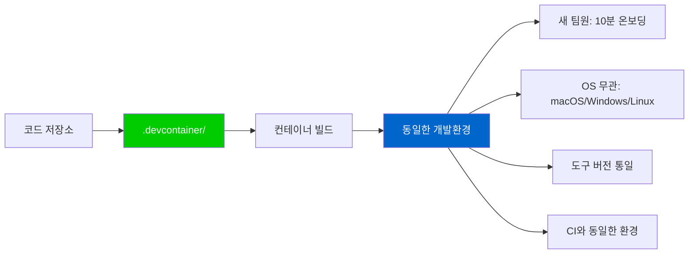
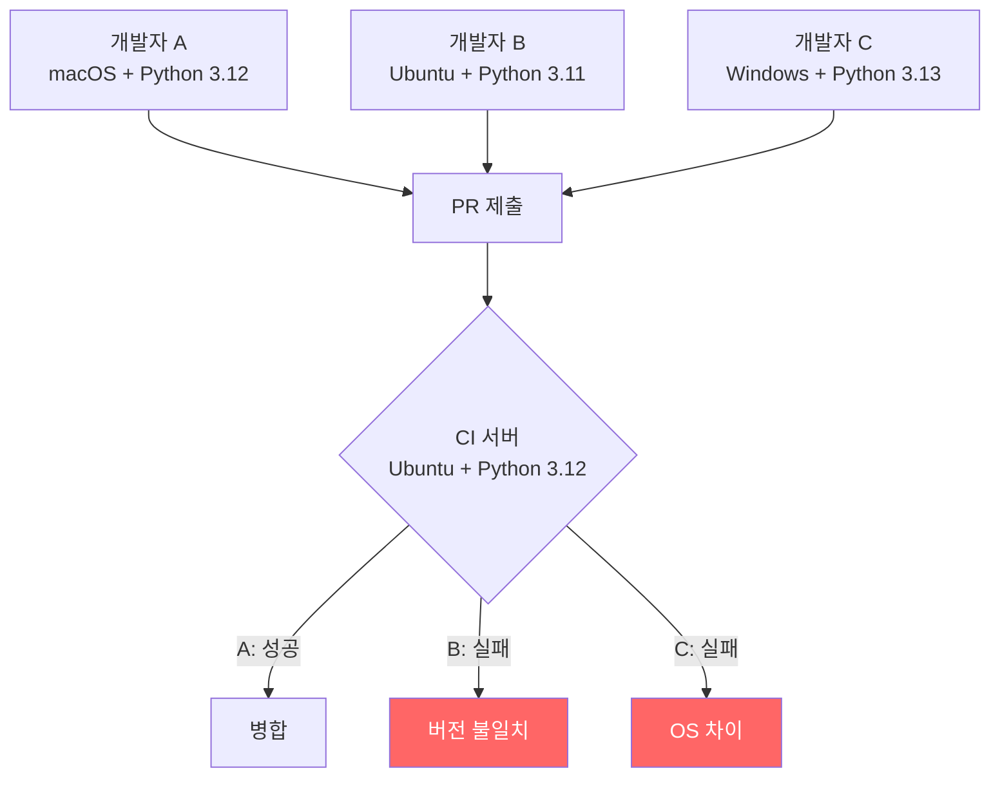
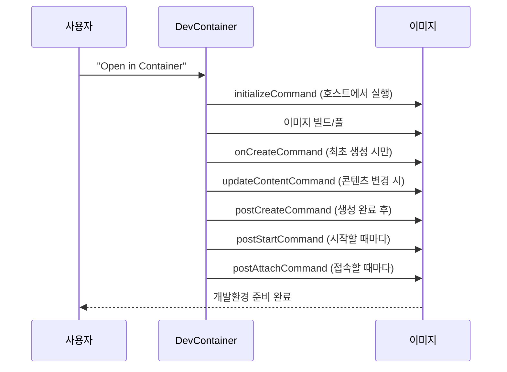
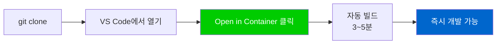

# DevContainer 가이드

> **작성일**: 2026-03-14
> **대상**: 전 언어/플랫폼 공통
> **기반 표준**: Dev Containers Specification 0.204+, OCI Runtime Specification
> **적용 수준**: 팀 개발환경 표준화

---

## 목차

1. [DevContainer 개요](#1-devcontainer-개요)
2. [왜 DevContainer가 필요한가](#2-왜-devcontainer가-필요한가)
3. [IDE/플랫폼 지원 현황](#3-ide플랫폼-지원-현황)
4. [구조와 설정](#4-구조와-설정)
5. [팀 환경 통일 전략](#5-팀-환경-통일-전략)
6. [온보딩 단축](#6-온보딩-단축)
7. [고급 설정](#7-고급-설정)
8. [언어별 템플릿 가이드](#8-언어별-템플릿-가이드)
9. [트러블슈팅](#9-트러블슈팅)
10. [체크리스트](#10-체크리스트)

---

## 1. DevContainer 개요

### 1.1 정의

DevContainer(Development Container)는 Docker 컨테이너를 개발 환경으로 사용하는 표준이다.
`.devcontainer/devcontainer.json` 파일 하나로 IDE, 확장 프로그램, 런타임, 도구, 설정을
코드로 정의하고, 팀 전체가 동일한 개발 환경에서 작업할 수 있게 한다.

### 1.2 핵심 가치



| 전통적 방식 | DevContainer 방식 |
|-------------|------------------|
| README에 설치 가이드 10페이지 | `git clone` + "Open in Container" |
| "내 컴퓨터에서는 되는데..." | 모든 환경에서 동일 동작 |
| Python 3.11/3.12/3.13 혼재 | 정확히 하나의 버전 |
| 신규 입사자 환경 설정 1~3일 | 10분 이내 |
| CI와 로컬 환경 불일치 | 동일 베이스 이미지 공유 가능 |

---

## 2. 왜 DevContainer가 필요한가

### 2.1 문제 상황

#### "Works on My Machine" 문제



#### 온보딩 비용

신규 팀원이 프로젝트에 기여하기까지 걸리는 시간:
- 언어 런타임 설치: 30분~1시간
- 데이터베이스/Redis/메시지 큐 설치: 1~2시간
- IDE 설정/확장 프로그램/린터/포매터 설정: 1~2시간
- 환경 변수/시크릿 설정: 30분~1시간
- "잘 안 돼요" 디버깅: 0~8시간(!)

**합계: 최소 반나절, 최대 2~3일**

### 2.2 DevContainer가 해결하는 것

| 문제 | 해결 방법 |
|------|-----------|
| 런타임 버전 불일치 | 컨테이너 이미지에 고정 |
| OS별 동작 차이 | Linux 컨테이너로 통일 |
| IDE 설정 차이 | `customizations` 섹션으로 통일 |
| 도구 설치 누락 | `postCreateCommand`로 자동 설치 |
| 의존 서비스 부재 | Docker Compose로 동시 실행 |
| CI/로컬 불일치 | 동일 베이스 이미지 사용 |

---

## 3. IDE/플랫폼 지원 현황

### 3.1 지원 IDE 및 서비스

| IDE/서비스 | 지원 수준 | 비고 |
|-----------|-----------|------|
| **VS Code** | 완전 지원 | Dev Containers 확장 설치 필요 |
| **GitHub Codespaces** | 완전 지원 | 클라우드 기반, devcontainer.json 자동 인식 |
| **JetBrains (IntelliJ, PyCharm 등)** | 지원 | 2024.1+ Remote Development Gateway |
| **VS Code Insiders** | 완전 지원 | 최신 기능 우선 적용 |
| **DevPod** | 완전 지원 | 오픈소스 Codespaces 대안 |
| **Codeanywhere** | 지원 | 클라우드 IDE |
| **Gitpod** | 호환 | `.gitpod.yml` 별도 지원, devcontainer 호환 모드 |

### 3.2 사전 요구 사항

| 요구 사항 | VS Code (로컬) | Codespaces | JetBrains |
|-----------|---------------|------------|-----------|
| Docker Desktop | 필수 | 불필요 | 필수 |
| 확장/플러그인 | Dev Containers | 내장 | Gateway |
| RAM 권장 | 8GB+ | N/A (클라우드) | 16GB+ |
| 디스크 | 10GB+ 여유 | N/A | 10GB+ 여유 |

---

## 4. 구조와 설정

### 4.1 기본 디렉토리 구조

```
project/
├── .devcontainer/
│   ├── devcontainer.json     # 핵심 설정 파일
│   ├── Dockerfile            # (선택) 커스텀 이미지
│   └── docker-compose.yml    # (선택) 다중 서비스
├── src/
├── tests/
└── ...
```

### 4.2 devcontainer.json 구조

```jsonc
{
  // 컨테이너 이름
  "name": "My Project Dev",

  // === 이미지 지정 (3가지 방법 중 택 1) ===

  // 방법 1: 사전 빌드된 이미지 직접 사용
  "image": "mcr.microsoft.com/devcontainers/python:3-3.12-bookworm",

  // 방법 2: Dockerfile로 커스텀 빌드
  // "build": {
  //   "dockerfile": "Dockerfile",
  //   "context": "..",
  //   "args": { "PYTHON_VERSION": "3.12" }
  // },

  // 방법 3: Docker Compose
  // "dockerComposeFile": "docker-compose.yml",
  // "service": "app",
  // "workspaceFolder": "/workspace",

  // === Features (추가 도구 설치) ===
  "features": {
    "ghcr.io/devcontainers/features/common-utils:2": {
      "installZsh": true,
      "configureZshAsDefaultShell": true
    },
    "ghcr.io/devcontainers/features/docker-in-docker:2": {},
    "ghcr.io/devcontainers/features/git:1": {},
    "ghcr.io/devcontainers/features/github-cli:1": {}
  },

  // === IDE 설정 ===
  "customizations": {
    "vscode": {
      "extensions": [
        "ms-python.python",
        "charliermarsh.ruff"
      ],
      "settings": {
        "editor.formatOnSave": true
      }
    }
  },

  // === 포트 포워딩 ===
  "forwardPorts": [8000, 5432, 6379],
  "portsAttributes": {
    "8000": { "label": "App", "onAutoForward": "notify" },
    "5432": { "label": "PostgreSQL", "onAutoForward": "silent" },
    "6379": { "label": "Redis", "onAutoForward": "silent" }
  },

  // === 라이프사이클 명령 ===
  "postCreateCommand": "pip install -e '.[dev]'",
  "postStartCommand": "echo 'Dev container ready!'",
  "postAttachCommand": "git fetch --all",

  // === 환경 변수 ===
  "containerEnv": {
    "PYTHONDONTWRITEBYTECODE": "1",
    "PYTHONUNBUFFERED": "1"
  },

  // === 마운트 ===
  "mounts": [
    "source=${localWorkspaceFolder}/.env,target=/workspace/.env,type=bind,consistency=cached"
  ],

  // === 권한 ===
  "remoteUser": "vscode"
}
```

### 4.3 라이프사이클 명령 실행 순서



| 명령 | 실행 시점 | 용도 |
|------|-----------|------|
| `initializeCommand` | 컨테이너 생성 전 (호스트) | 사전 조건 확인, 서브모듈 초기화 |
| `onCreateCommand` | 컨테이너 최초 생성 시 | 의존성 설치, DB 마이그레이션 |
| `updateContentCommand` | 콘텐츠 변경 감지 시 | 의존성 재설치 |
| `postCreateCommand` | 생성 완료 후 | 개발 도구 설치, 환경 설정 |
| `postStartCommand` | 컨테이너 시작할 때마다 | 서비스 시작, 캐시 워밍 |
| `postAttachCommand` | IDE가 접속할 때마다 | git fetch, 상태 확인 |

### 4.4 Docker Compose 연동

데이터베이스, 캐시, 메시지 큐 등 의존 서비스가 필요한 경우:

```yaml
# .devcontainer/docker-compose.yml
services:
  app:
    build:
      context: ..
      dockerfile: .devcontainer/Dockerfile
    volumes:
      - ..:/workspace:cached
    command: sleep infinity
    depends_on:
      db:
        condition: service_healthy
      redis:
        condition: service_started

  db:
    image: postgres:16-alpine
    environment:
      POSTGRES_USER: dev
      POSTGRES_PASSWORD: dev
      POSTGRES_DB: myapp_dev
    ports:
      - "5432:5432"
    volumes:
      - pgdata:/var/lib/postgresql/data
    healthcheck:
      test: ["CMD-SHELL", "pg_isready -U dev"]
      interval: 5s
      timeout: 3s
      retries: 5

  redis:
    image: redis:7-alpine
    ports:
      - "6379:6379"

volumes:
  pgdata:
```

```jsonc
// .devcontainer/devcontainer.json (Docker Compose 모드)
{
  "name": "My Project Dev",
  "dockerComposeFile": "docker-compose.yml",
  "service": "app",
  "workspaceFolder": "/workspace",
  "forwardPorts": [8000, 5432, 6379],
  "postCreateCommand": "pip install -e '.[dev]'"
}
```

---

## 5. 팀 환경 통일 전략

### 5.1 확장 프로그램 표준화

팀원 전원이 동일한 확장 프로그램을 사용하도록 강제한다.

```jsonc
"customizations": {
  "vscode": {
    "extensions": [
      // === 필수 (린터/포매터) ===
      "charliermarsh.ruff",           // Python linter + formatter
      "ms-python.python",             // Python 기본
      "ms-python.mypy-type-checker",  // 타입 검사

      // === 코드 품질 ===
      "SonarSource.sonarlint-vscode", // SonarLint
      "usernamehw.errorlens",         // 인라인 에러 표시

      // === Git ===
      "eamodio.gitlens",              // Git blame, history
      "mhutchie.git-graph",          // Git 그래프 시각화

      // === 생산성 ===
      "EditorConfig.EditorConfig",    // .editorconfig 지원
      "redhat.vscode-yaml",           // YAML 지원
      "ms-azuretools.vscode-docker"   // Docker 지원
    ]
  }
}
```

### 5.2 에디터 설정 통일

```jsonc
"customizations": {
  "vscode": {
    "settings": {
      // 포매터
      "editor.formatOnSave": true,
      "editor.defaultFormatter": "charliermarsh.ruff",
      "[python]": {
        "editor.defaultFormatter": "charliermarsh.ruff",
        "editor.codeActionsOnSave": {
          "source.fixAll": "explicit",
          "source.organizeImports": "explicit"
        }
      },

      // 린터
      "python.analysis.typeCheckingMode": "basic",

      // 파일
      "files.trimTrailingWhitespace": true,
      "files.insertFinalNewline": true,
      "files.trimFinalNewlines": true,

      // 터미널
      "terminal.integrated.defaultProfile.linux": "zsh",

      // Git
      "git.autofetch": true,
      "git.confirmSync": false
    }
  }
}
```

### 5.3 JetBrains 설정

```jsonc
"customizations": {
  "jetbrains": {
    "backend": "IntelliJ",
    "plugins": [
      "com.intellij.plugins.watcher",
      "org.jetbrains.kotlin"
    ]
  }
}
```

### 5.4 포트 포워딩 전략

```jsonc
"forwardPorts": [8000, 3000, 5432, 6379, 5672, 15672],
"portsAttributes": {
  "8000": {
    "label": "Backend API",
    "onAutoForward": "notify",
    "protocol": "http"
  },
  "3000": {
    "label": "Frontend Dev Server",
    "onAutoForward": "openBrowser"
  },
  "5432": {
    "label": "PostgreSQL",
    "onAutoForward": "silent"
  },
  "6379": {
    "label": "Redis",
    "onAutoForward": "silent"
  },
  "5672": {
    "label": "RabbitMQ",
    "onAutoForward": "silent"
  },
  "15672": {
    "label": "RabbitMQ Management",
    "onAutoForward": "notify",
    "protocol": "http"
  }
}
```

---

## 6. 온보딩 단축

### 6.1 이상적인 온보딩 플로우



**총 소요 시간: 약 10분** (네트워크 속도에 따라 변동)

### 6.2 GitHub Codespaces 활용

클라우드 기반으로 Docker 설치 없이 브라우저에서 바로 개발 가능하다.

```jsonc
// .devcontainer/devcontainer.json — Codespaces 최적화
{
  "name": "My Project (Codespaces)",
  "image": "mcr.microsoft.com/devcontainers/python:3-3.12-bookworm",

  // Codespaces 머신 크기 지정
  "hostRequirements": {
    "cpus": 4,
    "memory": "8gb",
    "storage": "32gb"
  },

  // Prebuilds 활용 (빌드 시간 단축)
  "postCreateCommand": "pip install -e '.[dev]' && pre-commit install",

  // 시크릿은 Codespaces 설정에서 주입
  "secrets": {
    "DATABASE_URL": {
      "description": "PostgreSQL connection string"
    },
    "API_KEY": {
      "description": "External API key for development"
    }
  }
}
```

**Codespaces Prebuilds**:
- 저장소 설정 > Codespaces > Prebuilds 활성화
- push 이벤트 시 미리 컨테이너를 빌드하여 생성 시간을 1~2분으로 단축

### 6.3 DevPod (오픈소스 대안)

DevPod은 Codespaces와 동일한 경험을 셀프호스팅으로 제공한다.

```bash
# 설치
brew install loft-sh/tap/devpod

# 로컬 Docker로 실행
devpod up github.com/myorg/myproject

# 클라우드 프로바이더로 실행
devpod provider add aws
devpod up github.com/myorg/myproject --provider aws
```

---

## 7. 고급 설정

### 7.1 Dev Container Features

Features는 재사용 가능한 도구 설치 모듈이다. Dockerfile을 수정하지 않고 도구를 추가할 수 있다.

```jsonc
"features": {
  // 공식 Features
  "ghcr.io/devcontainers/features/common-utils:2": {
    "installZsh": true,
    "configureZshAsDefaultShell": true,
    "installOhMyZsh": true
  },
  "ghcr.io/devcontainers/features/docker-in-docker:2": {
    "dockerDashComposeVersion": "v2"
  },
  "ghcr.io/devcontainers/features/node:1": {
    "version": "24"
  },
  "ghcr.io/devcontainers/features/aws-cli:1": {},
  "ghcr.io/devcontainers/features/kubectl-helm-minikube:1": {
    "helm": "latest",
    "minikube": "none"
  },

  // 커뮤니티 Features
  "ghcr.io/devcontainers-extra/features/cosign:1": {},
  "ghcr.io/devcontainers-extra/features/starship:1": {}
}
```

### 7.2 멀티 스테이지 Dockerfile

개발 환경과 프로덕션 이미지를 하나의 Dockerfile로 관리한다.

```dockerfile
# .devcontainer/Dockerfile
FROM python:3.12-slim-bookworm AS base

# Common setup
RUN apt-get update && apt-get install -y --no-install-recommends \
    git curl ca-certificates \
    && rm -rf /var/lib/apt/lists/*

FROM base AS development

# Development-only tools
RUN apt-get update && apt-get install -y --no-install-recommends \
    build-essential postgresql-client redis-tools \
    && rm -rf /var/lib/apt/lists/*

# Create non-root user
ARG USERNAME=vscode
ARG USER_UID=1000
ARG USER_GID=$USER_UID
RUN groupadd --gid $USER_GID $USERNAME \
    && useradd --uid $USER_UID --gid $USER_GID -m $USERNAME

USER $USERNAME
WORKDIR /workspace
```

```jsonc
// devcontainer.json
{
  "build": {
    "dockerfile": "Dockerfile",
    "context": "..",
    "target": "development"
  }
}
```

### 7.3 볼륨 마운트 최적화

```jsonc
{
  "mounts": [
    // pip 캐시 영속화 (재빌드 시 다운로드 시간 절약)
    "source=pip-cache,target=/home/vscode/.cache/pip,type=volume",
    // npm 캐시
    "source=npm-cache,target=/home/vscode/.npm,type=volume",
    // Go 모듈 캐시
    "source=go-mod-cache,target=/home/vscode/go/pkg/mod,type=volume",
    // SSH 키 공유 (호스트 -> 컨테이너)
    "source=${localEnv:HOME}/.ssh,target=/home/vscode/.ssh,type=bind,readonly"
  ]
}
```

### 7.4 환경별 Override

`.devcontainer/` 아래에 여러 설정을 두고 상황에 맞게 선택할 수 있다.

```
.devcontainer/
├── devcontainer.json             # 기본 설정
├── full-stack/
│   ├── devcontainer.json         # DB + Redis + 앱
│   └── docker-compose.yml
└── lightweight/
    └── devcontainer.json         # 앱만 (빠른 시작)
```

---

## 8. 언어별 템플릿 가이드

이 프로젝트에서 제공하는 언어별 DevContainer 템플릿이다.

| 언어 | 경로 | 베이스 이미지 |
|------|------|--------------|
| Python | `common/devcontainer-templates/python/` | `python:3-3.12-bookworm` |
| TypeScript | `common/devcontainer-templates/typescript/` | `typescript-node:5-24-bookworm` |
| Go | `common/devcontainer-templates/go/` | `go:2-1.26-bookworm` |
| Kotlin | `common/devcontainer-templates/kotlin/` | `java:3-25-bookworm` |
| Rust | `common/devcontainer-templates/rust/` | `rust:2-1-bookworm` |

### 사용법

```bash
# 프로젝트에 DevContainer 템플릿 복사
cp -r common/devcontainer-templates/python/.devcontainer /path/to/your/project/

# VS Code에서 열기
code /path/to/your/project/
# -> F1 -> "Dev Containers: Reopen in Container"
```

### 템플릿 포함 내용

각 템플릿에는 다음이 포함되어 있다:
- 해당 언어의 안정적인 베이스 이미지
- 린터/포매터 확장 프로그램 (해당 프로젝트 표준에 맞춤)
- `postCreateCommand`로 개발 도구 자동 설치
- 일반적인 개발 포트 포워딩
- Git, Docker, GitHub CLI 등 공통 도구

---

## 9. 트러블슈팅

### 9.1 자주 발생하는 문제

| 문제 | 원인 | 해결 |
|------|------|------|
| 컨테이너 빌드 실패 | Dockerfile 문법 오류 | `docker build` 로 직접 빌드하여 에러 확인 |
| 포트 충돌 | 호스트에서 동일 포트 사용 중 | `forwardPorts` 변경 또는 호스트 서비스 중지 |
| 느린 파일 시스템 | macOS에서 bind mount 성능 | `:cached` 마운트 옵션 사용 |
| 권한 오류 | 컨테이너 내 UID 불일치 | `remoteUser` 설정 확인 |
| Git SSH 인증 실패 | SSH 에이전트 미전달 | `ssh-agent` 자동 전달 설정 확인 |
| 디스크 부족 | Docker 이미지/볼륨 누적 | `docker system prune` 실행 |

### 9.2 macOS 파일 시스템 성능

macOS에서 Docker bind mount는 느릴 수 있다. 해결책:

```jsonc
{
  // Named volume으로 의존성 캐시 분리
  "mounts": [
    "source=node_modules,target=/workspace/node_modules,type=volume"
  ],
  // 또는 workspace를 named volume으로 사용
  "workspaceMount": "source=myproject-workspace,target=/workspace,type=volume",
  "workspaceFolder": "/workspace"
}
```

### 9.3 디버깅 명령어

```bash
# DevContainer 로그 확인 (VS Code)
# F1 -> "Dev Containers: Show Container Log"

# Docker 컨테이너 상태 확인
docker ps -a --filter label=devcontainer.local_folder

# 컨테이너 내부 직접 접속
docker exec -it <container-id> /bin/bash

# 이미지/볼륨 정리
docker system prune -a --volumes
```

---

## 10. 체크리스트

### DevContainer 도입 체크리스트

- [ ] `.devcontainer/devcontainer.json` 파일 생성
- [ ] 베이스 이미지 선정 (공식 또는 커스텀)
- [ ] 필수 확장 프로그램 목록 작성
- [ ] `postCreateCommand`로 개발 도구 자동 설치
- [ ] 포트 포워딩 설정
- [ ] 의존 서비스(DB, Redis 등) Docker Compose 설정
- [ ] 팀원 전원 테스트 (macOS, Windows, Linux)
- [ ] GitHub Codespaces에서 동작 확인
- [ ] 온보딩 가이드에 DevContainer 사용법 추가
- [ ] CI와 동일한 베이스 이미지 사용 여부 확인

### 운영 체크리스트

- [ ] 베이스 이미지 자동 업데이트 설정 (Renovate/Dependabot)
- [ ] Prebuilds 활성화 (Codespaces 사용 시)
- [ ] `.devcontainer/` 변경 시 CODEOWNERS 리뷰 필수
- [ ] DevContainer 변경 PR에서 빌드 테스트 자동화
- [ ] 의존 서비스 이미지 버전 고정 (latest 금지)

---

## 부록

### A. 참고 자료

| 자료 | URL |
|------|-----|
| Dev Containers Specification | https://containers.dev |
| VS Code Dev Containers 문서 | https://code.visualstudio.com/docs/devcontainers |
| Dev Container Features | https://containers.dev/features |
| GitHub Codespaces 문서 | https://docs.github.com/codespaces |
| DevPod | https://devpod.sh |

### B. 관련 프로젝트 내 문서

| 문서 | 경로 |
|------|------|
| Python DevContainer | `common/devcontainer-templates/python/.devcontainer/devcontainer.json` |
| TypeScript DevContainer | `common/devcontainer-templates/typescript/.devcontainer/devcontainer.json` |
| Go DevContainer | `common/devcontainer-templates/go/.devcontainer/devcontainer.json` |
| Kotlin DevContainer | `common/devcontainer-templates/kotlin/.devcontainer/devcontainer.json` |
| Rust DevContainer | `common/devcontainer-templates/rust/.devcontainer/devcontainer.json` |
| 온보딩 가이드 | `docs/guides/onboarding-guide.md` |
