# 분산 트랜잭션 가이드

> **작성일**: 2026-03-12
> **기반 표준**: Microservices Patterns (Chris Richardson), Uber Cadence/Temporal, Netflix Data Mesh, AWS Saga Implementation
> **적용 수준**: 빅테크 기준 팀 운영표준
> **적용 언어**: Python, Kotlin, Go

---

## 목차

1. [분산 트랜잭션 개요](#1-분산-트랜잭션-개요)
2. [Saga 패턴](#2-saga-패턴)
3. [Outbox 패턴](#3-outbox-패턴)
4. [2PC vs Saga 비교](#4-2pc-vs-saga-비교)
5. [보상 트랜잭션](#5-보상-트랜잭션)
6. [분산 트랜잭션 안티패턴](#6-분산-트랜잭션-안티패턴)
7. [체크리스트](#7-체크리스트)

---

## 1. 분산 트랜잭션 개요

### 1.1 문제 정의

마이크로서비스 환경에서 하나의 비즈니스 작업이 여러 서비스에 걸쳐 수행될 때, 전통적인 ACID 트랜잭션으로는 일관성을 보장할 수 없다. 각 서비스가 독립된 데이터베이스를 소유하기 때문이다.

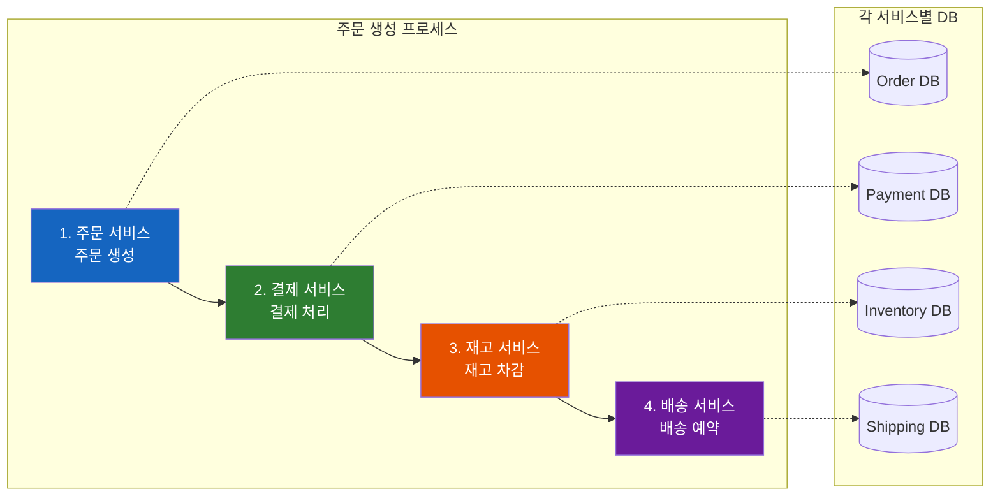

### 1.2 분산 트랜잭션 전략 선택 기준

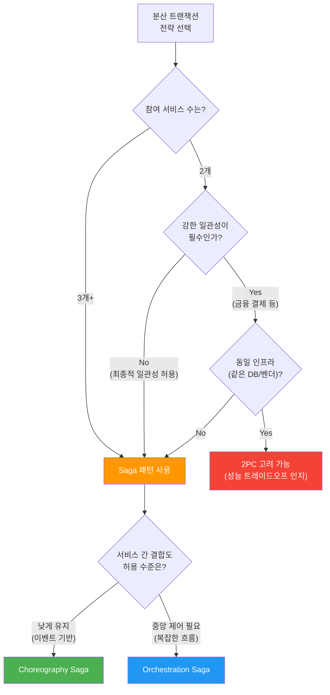

### 1.3 핵심 개념 요약

| 개념 | 설명 | 일관성 모델 |
|------|------|------------|
| **2PC (Two-Phase Commit)** | Coordinator가 모든 참여자에게 prepare/commit 요청 | 강한 일관성 (ACID) |
| **Saga** | 로컬 트랜잭션 체인 + 보상 트랜잭션 | 최종적 일관성 (BASE) |
| **Outbox** | DB 트랜잭션 + 이벤트를 하나의 로컬 트랜잭션으로 보장 | 최종적 일관성 |
| **TCC (Try-Confirm-Cancel)** | 예약 -> 확인/취소 2단계 | 최종적 일관성 |

---

## 2. Saga 패턴

### 2.1 Choreography vs Orchestration 비교

| 비교 기준 | Choreography | Orchestration |
|-----------|-------------|---------------|
| **제어 방식** | 분산 -- 각 서비스가 이벤트를 발행/구독 | 중앙 -- Orchestrator가 흐름 제어 |
| **결합도** | 낮음 (이벤트 기반) | 중간 (Orchestrator가 모든 서비스를 알아야 함) |
| **가시성** | 낮음 -- 전체 흐름 파악 어려움 | 높음 -- Orchestrator에서 한눈에 파악 |
| **복잡도 증가** | 참여 서비스 3개 초과 시 급격히 증가 | 서비스 수 증가해도 선형 증가 |
| **장애 추적** | 어려움 -- 분산 추적 필수 | 쉬움 -- Orchestrator 로그 확인 |
| **단일 장애점** | 없음 | Orchestrator가 SPOF 가능 |
| **적합한 상황** | 단순 흐름 (2-3 서비스), 느슨한 결합 중시 | 복잡한 흐름 (4+ 서비스), 비즈니스 로직 가시성 중시 |
| **대표 사례** | Shopify 이벤트 아키텍처 | Uber Cadence, Netflix Conductor |

### 2.2 Choreography Saga

각 서비스가 자신의 로컬 트랜잭션을 완료한 후 이벤트를 발행하고, 다음 서비스가 해당 이벤트를 구독하여 연쇄적으로 실행된다.

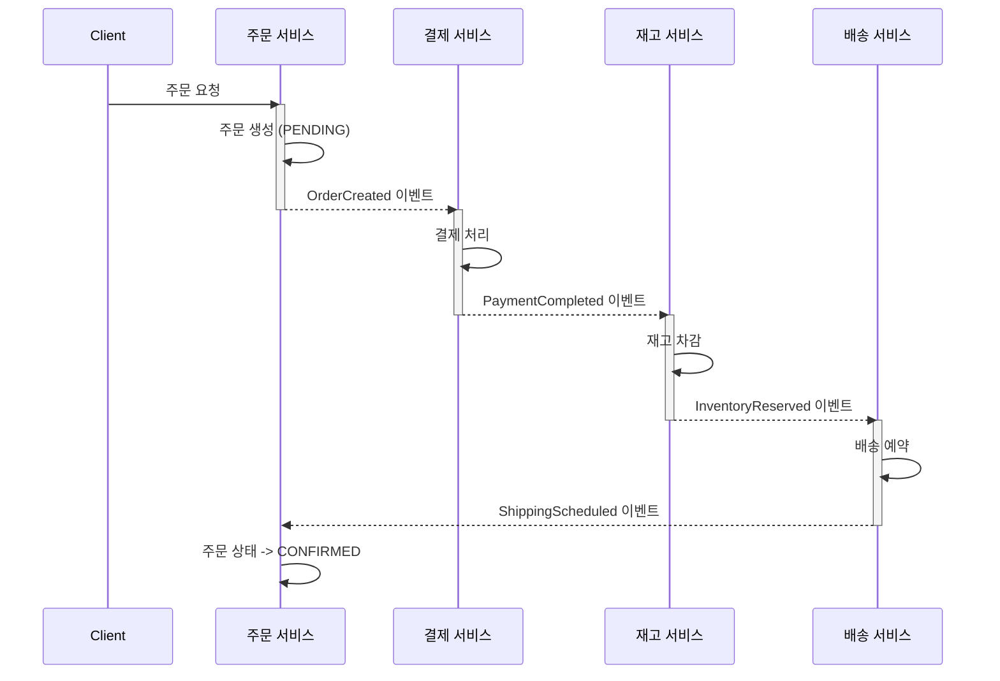

**Choreography 실패 시 보상 흐름:**

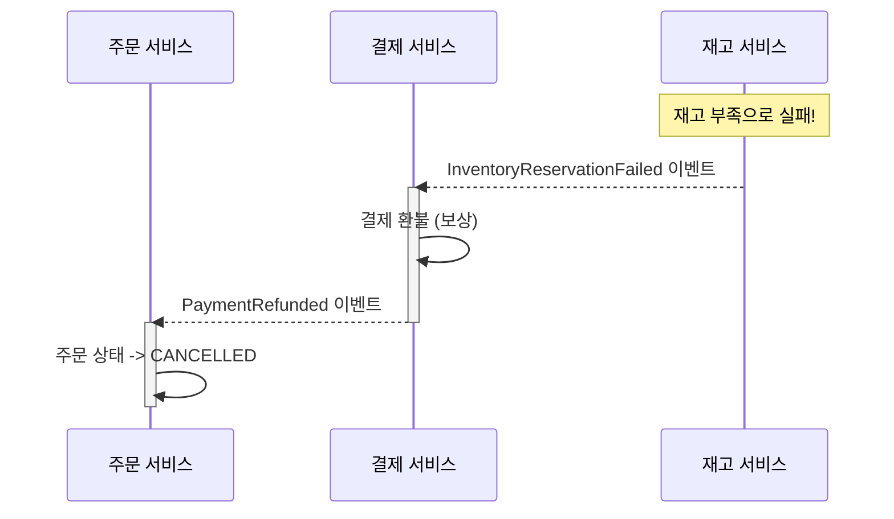

#### Python 코드 예시 (Choreography)

```python
from __future__ import annotations

import uuid
from dataclasses import dataclass, field
from enum import Enum, auto
from typing import Any

from aiokafka import AIOKafkaProducer, AIOKafkaConsumer


class OrderStatus(Enum):
    PENDING = auto()
    CONFIRMED = auto()
    CANCELLED = auto()


@dataclass(frozen=True)
class OrderCreatedEvent:
    order_id: str
    customer_id: str
    items: tuple[dict[str, Any], ...]
    total_amount: float
    event_type: str = "order.created"


class OrderService:
    """Choreography Saga - Order service publishes events."""

    def __init__(self, producer: AIOKafkaProducer, repository: OrderRepository) -> None:
        self._producer = producer
        self._repository = repository

    async def create_order(self, command: CreateOrderCommand) -> str:
        order_id = str(uuid.uuid4())

        # Step 1: Local transaction -- create order with PENDING status
        order = Order(
            order_id=order_id,
            customer_id=command.customer_id,
            items=command.items,
            status=OrderStatus.PENDING,
        )
        await self._repository.save(order)

        # Step 2: Publish event for next saga step
        event = OrderCreatedEvent(
            order_id=order_id,
            customer_id=command.customer_id,
            items=tuple(command.items),
            total_amount=command.total_amount,
        )
        await self._producer.send(
            topic="order-events",
            value=serialize_event(event),
            key=order_id.encode(),
        )
        return order_id

    async def handle_payment_refunded(self, event: dict[str, Any]) -> None:
        """Compensating action: cancel order when payment is refunded."""
        order = await self._repository.find_by_id(event["order_id"])
        cancelled_order = order.with_status(OrderStatus.CANCELLED)
        await self._repository.save(cancelled_order)
```

#### Kotlin 코드 예시 (Choreography)

```kotlin
// Choreography Saga - Order service with Spring Kafka
data class OrderCreatedEvent(
    val orderId: String,
    val customerId: String,
    val items: List<OrderItem>,
    val totalAmount: BigDecimal,
    val eventType: String = "order.created"
)

@Service
class OrderService(
    private val kafkaTemplate: KafkaTemplate<String, String>,
    private val orderRepository: OrderRepository,
    private val objectMapper: ObjectMapper,
) {
    @Transactional
    suspend fun createOrder(command: CreateOrderCommand): String {
        val orderId = UUID.randomUUID().toString()

        // Step 1: Local transaction
        val order = Order(
            orderId = orderId,
            customerId = command.customerId,
            items = command.items,
            status = OrderStatus.PENDING,
        )
        orderRepository.save(order)

        // Step 2: Publish event
        val event = OrderCreatedEvent(
            orderId = orderId,
            customerId = command.customerId,
            items = command.items,
            totalAmount = command.totalAmount,
        )
        kafkaTemplate.send(
            "order-events",
            orderId,
            objectMapper.writeValueAsString(event),
        )
        return orderId
    }

    @KafkaListener(topics = ["payment-events"], groupId = "order-service")
    fun handlePaymentRefunded(message: String) {
        val event = objectMapper.readValue(message, PaymentRefundedEvent::class.java)
        val order = orderRepository.findById(event.orderId)
            ?: throw OrderNotFoundException(event.orderId)
        orderRepository.save(order.copy(status = OrderStatus.CANCELLED))
    }
}
```

#### Go 코드 예시 (Choreography)

```go
package saga

import (
	"context"
	"encoding/json"
	"fmt"

	"github.com/google/uuid"
	"github.com/segmentio/kafka-go"
)

type OrderStatus string

const (
	OrderStatusPending   OrderStatus = "PENDING"
	OrderStatusConfirmed OrderStatus = "CONFIRMED"
	OrderStatusCancelled OrderStatus = "CANCELLED"
)

type OrderCreatedEvent struct {
	OrderID     string  `json:"order_id"`
	CustomerID  string  `json:"customer_id"`
	Items       []Item  `json:"items"`
	TotalAmount float64 `json:"total_amount"`
	EventType   string  `json:"event_type"`
}

type OrderService struct {
	writer     *kafka.Writer
	repository OrderRepository
}

func NewOrderService(writer *kafka.Writer, repo OrderRepository) *OrderService {
	return &OrderService{writer: writer, repository: repo}
}

func (s *OrderService) CreateOrder(ctx context.Context, cmd CreateOrderCommand) (string, error) {
	orderID := uuid.New().String()

	// Step 1: Local transaction
	order := Order{
		OrderID:    orderID,
		CustomerID: cmd.CustomerID,
		Items:      cmd.Items,
		Status:     OrderStatusPending,
	}
	if err := s.repository.Save(ctx, order); err != nil {
		return "", fmt.Errorf("failed to save order: %w", err)
	}

	// Step 2: Publish event
	event := OrderCreatedEvent{
		OrderID:     orderID,
		CustomerID:  cmd.CustomerID,
		Items:       cmd.Items,
		TotalAmount: cmd.TotalAmount,
		EventType:   "order.created",
	}
	payload, err := json.Marshal(event)
	if err != nil {
		return "", fmt.Errorf("failed to marshal event: %w", err)
	}

	err = s.writer.WriteMessages(ctx, kafka.Message{
		Key:   []byte(orderID),
		Value: payload,
		Topic: "order-events",
	})
	if err != nil {
		return "", fmt.Errorf("failed to publish event: %w", err)
	}
	return orderID, nil
}

func (s *OrderService) HandlePaymentRefunded(ctx context.Context, event PaymentRefundedEvent) error {
	order, err := s.repository.FindByID(ctx, event.OrderID)
	if err != nil {
		return fmt.Errorf("order not found: %w", err)
	}
	order.Status = OrderStatusCancelled
	return s.repository.Save(ctx, order)
}
```

### 2.3 Orchestration Saga

중앙 Orchestrator가 전체 Saga 흐름을 제어한다. 각 서비스는 Orchestrator의 명령을 수행하고 결과를 응답한다.

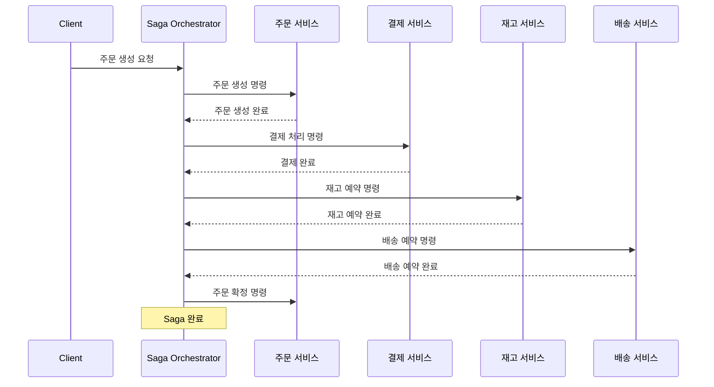

**Orchestration 실패 시 보상 흐름:**

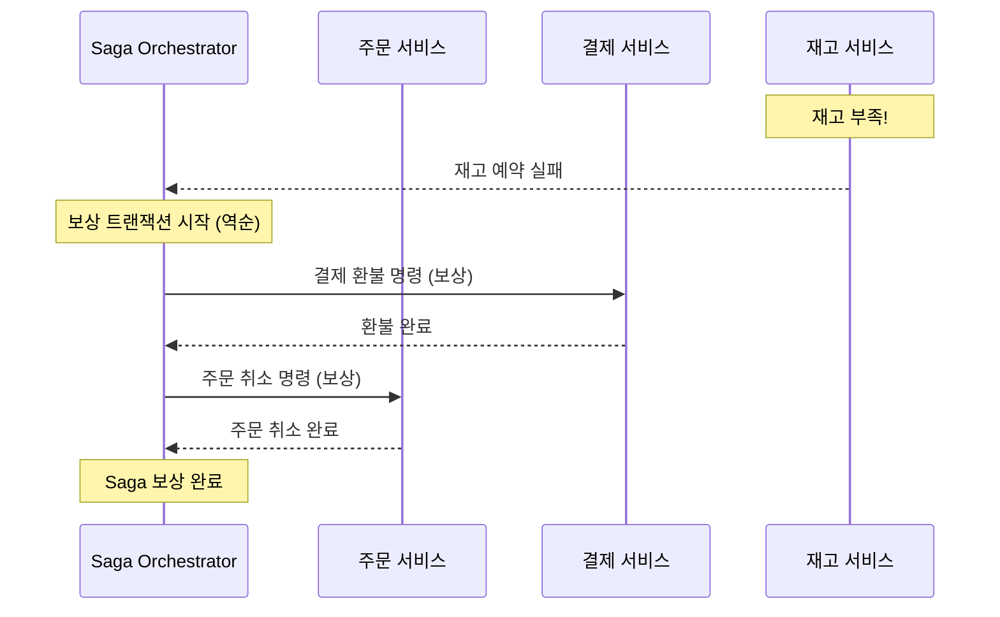

#### Python 코드 예시 (Orchestration)

```python
from __future__ import annotations

from dataclasses import dataclass
from enum import Enum, auto
from typing import Any, Protocol


class SagaState(Enum):
    STARTED = auto()
    PAYMENT_PENDING = auto()
    PAYMENT_COMPLETED = auto()
    INVENTORY_PENDING = auto()
    INVENTORY_RESERVED = auto()
    SHIPPING_PENDING = auto()
    COMPLETED = auto()
    COMPENSATING = auto()
    FAILED = auto()


class SagaStep(Protocol):
    """Each saga step must define execute and compensate."""

    async def execute(self, context: dict[str, Any]) -> dict[str, Any]: ...
    async def compensate(self, context: dict[str, Any]) -> None: ...


@dataclass(frozen=True)
class SagaDefinition:
    """Immutable saga definition with ordered steps."""
    name: str
    steps: tuple[SagaStep, ...]


class SagaOrchestrator:
    """Central orchestrator that manages saga execution and compensation."""

    def __init__(
        self,
        saga_definition: SagaDefinition,
        state_store: SagaStateStore,
    ) -> None:
        self._definition = saga_definition
        self._state_store = state_store

    async def execute(self, saga_id: str, initial_context: dict[str, Any]) -> dict[str, Any]:
        context = {**initial_context, "saga_id": saga_id}
        completed_steps: list[SagaStep] = []

        await self._state_store.save(saga_id, SagaState.STARTED, context)

        for step in self._definition.steps:
            try:
                result = await step.execute(context)
                context = {**context, **result}
                completed_steps.append(step)
            except Exception as err:
                # Compensation: reverse order
                await self._compensate(saga_id, completed_steps, context)
                raise SagaExecutionError(
                    f"Step {type(step).__name__} failed: {err}"
                ) from err

        await self._state_store.save(saga_id, SagaState.COMPLETED, context)
        return context

    async def _compensate(
        self,
        saga_id: str,
        completed_steps: list[SagaStep],
        context: dict[str, Any],
    ) -> None:
        await self._state_store.save(saga_id, SagaState.COMPENSATING, context)

        for step in reversed(completed_steps):
            try:
                await step.compensate(context)
            except Exception as comp_err:
                # Log compensation failure for manual intervention
                await self._state_store.save_compensation_failure(
                    saga_id, type(step).__name__, str(comp_err)
                )

        await self._state_store.save(saga_id, SagaState.FAILED, context)


# --- Concrete step implementations ---

class PaymentStep:
    """Payment processing step in the order saga."""

    def __init__(self, payment_client: PaymentServiceClient) -> None:
        self._client = payment_client

    async def execute(self, context: dict[str, Any]) -> dict[str, Any]:
        result = await self._client.process_payment(
            order_id=context["order_id"],
            amount=context["total_amount"],
        )
        return {"payment_id": result.payment_id}

    async def compensate(self, context: dict[str, Any]) -> None:
        await self._client.refund_payment(
            payment_id=context["payment_id"],
        )


class InventoryStep:
    """Inventory reservation step in the order saga."""

    def __init__(self, inventory_client: InventoryServiceClient) -> None:
        self._client = inventory_client

    async def execute(self, context: dict[str, Any]) -> dict[str, Any]:
        reservation_id = await self._client.reserve_items(
            order_id=context["order_id"],
            items=context["items"],
        )
        return {"reservation_id": reservation_id}

    async def compensate(self, context: dict[str, Any]) -> None:
        await self._client.release_reservation(
            reservation_id=context["reservation_id"],
        )


# --- Usage ---

async def create_order_saga() -> SagaOrchestrator:
    saga_def = SagaDefinition(
        name="create-order",
        steps=(
            PaymentStep(payment_client),
            InventoryStep(inventory_client),
            ShippingStep(shipping_client),
        ),
    )
    return SagaOrchestrator(saga_def, state_store)
```

#### Kotlin 코드 예시 (Orchestration)

```kotlin
// Saga Orchestrator with Spring + Coroutines

enum class SagaState {
    STARTED, COMPENSATING, COMPLETED, FAILED
}

interface SagaStep {
    suspend fun execute(context: MutableMap<String, Any>): Map<String, Any>
    suspend fun compensate(context: Map<String, Any>)
}

data class SagaDefinition(
    val name: String,
    val steps: List<SagaStep>,
)

@Service
class SagaOrchestrator(
    private val stateStore: SagaStateStore,
) {
    private val logger = LoggerFactory.getLogger(javaClass)

    suspend fun execute(
        sagaId: String,
        definition: SagaDefinition,
        initialContext: Map<String, Any>,
    ): Map<String, Any> {
        val context = initialContext.toMutableMap().apply { put("saga_id", sagaId) }
        val completedSteps = mutableListOf<SagaStep>()

        stateStore.save(sagaId, SagaState.STARTED, context)

        for (step in definition.steps) {
            try {
                val result = step.execute(context)
                context.putAll(result)
                completedSteps.add(step)
            } catch (e: Exception) {
                logger.error("Saga step ${step::class.simpleName} failed", e)
                compensate(sagaId, completedSteps, context)
                throw SagaExecutionException("Step ${step::class.simpleName} failed", e)
            }
        }

        stateStore.save(sagaId, SagaState.COMPLETED, context)
        return context
    }

    private suspend fun compensate(
        sagaId: String,
        completedSteps: List<SagaStep>,
        context: Map<String, Any>,
    ) {
        stateStore.save(sagaId, SagaState.COMPENSATING, context)
        for (step in completedSteps.reversed()) {
            try {
                step.compensate(context)
            } catch (e: Exception) {
                logger.error("Compensation failed for ${step::class.simpleName}", e)
                stateStore.saveCompensationFailure(sagaId, step::class.simpleName!!, e.message!!)
            }
        }
        stateStore.save(sagaId, SagaState.FAILED, context)
    }
}

// Concrete step
class PaymentStep(
    private val paymentClient: PaymentServiceClient,
) : SagaStep {

    override suspend fun execute(context: MutableMap<String, Any>): Map<String, Any> {
        val result = paymentClient.processPayment(
            orderId = context["order_id"] as String,
            amount = context["total_amount"] as BigDecimal,
        )
        return mapOf("payment_id" to result.paymentId)
    }

    override suspend fun compensate(context: Map<String, Any>) {
        paymentClient.refundPayment(paymentId = context["payment_id"] as String)
    }
}
```

#### Go 코드 예시 (Orchestration)

```go
package saga

import (
	"context"
	"fmt"
	"log/slog"
)

type SagaState string

const (
	SagaStarted      SagaState = "STARTED"
	SagaCompensating SagaState = "COMPENSATING"
	SagaCompleted    SagaState = "COMPLETED"
	SagaFailed       SagaState = "FAILED"
)

// Step defines the interface for each saga step.
type Step interface {
	Execute(ctx context.Context, sagaCtx map[string]any) (map[string]any, error)
	Compensate(ctx context.Context, sagaCtx map[string]any) error
	Name() string
}

type Definition struct {
	Name  string
	Steps []Step
}

type Orchestrator struct {
	stateStore StateStore
	logger     *slog.Logger
}

func NewOrchestrator(store StateStore, logger *slog.Logger) *Orchestrator {
	return &Orchestrator{stateStore: store, logger: logger}
}

func (o *Orchestrator) Execute(
	ctx context.Context,
	sagaID string,
	def Definition,
	initialCtx map[string]any,
) (map[string]any, error) {
	sagaCtx := make(map[string]any)
	for k, v := range initialCtx {
		sagaCtx[k] = v
	}
	sagaCtx["saga_id"] = sagaID

	_ = o.stateStore.Save(ctx, sagaID, SagaStarted, sagaCtx)

	var completedSteps []Step
	for _, step := range def.Steps {
		result, err := step.Execute(ctx, sagaCtx)
		if err != nil {
			o.logger.Error("saga step failed",
				"step", step.Name(), "saga_id", sagaID, "error", err)
			o.compensate(ctx, sagaID, completedSteps, sagaCtx)
			return nil, fmt.Errorf("step %s failed: %w", step.Name(), err)
		}
		for k, v := range result {
			sagaCtx[k] = v
		}
		completedSteps = append(completedSteps, step)
	}

	_ = o.stateStore.Save(ctx, sagaID, SagaCompleted, sagaCtx)
	return sagaCtx, nil
}

func (o *Orchestrator) compensate(
	ctx context.Context,
	sagaID string,
	completedSteps []Step,
	sagaCtx map[string]any,
) {
	_ = o.stateStore.Save(ctx, sagaID, SagaCompensating, sagaCtx)

	for i := len(completedSteps) - 1; i >= 0; i-- {
		step := completedSteps[i]
		if err := step.Compensate(ctx, sagaCtx); err != nil {
			o.logger.Error("compensation failed",
				"step", step.Name(), "saga_id", sagaID, "error", err)
		}
	}
	_ = o.stateStore.Save(ctx, sagaID, SagaFailed, sagaCtx)
}
```

### 2.4 Saga 상태 관리

Saga의 현재 상태를 영속화해야 Orchestrator 재시작 시 복구할 수 있다.

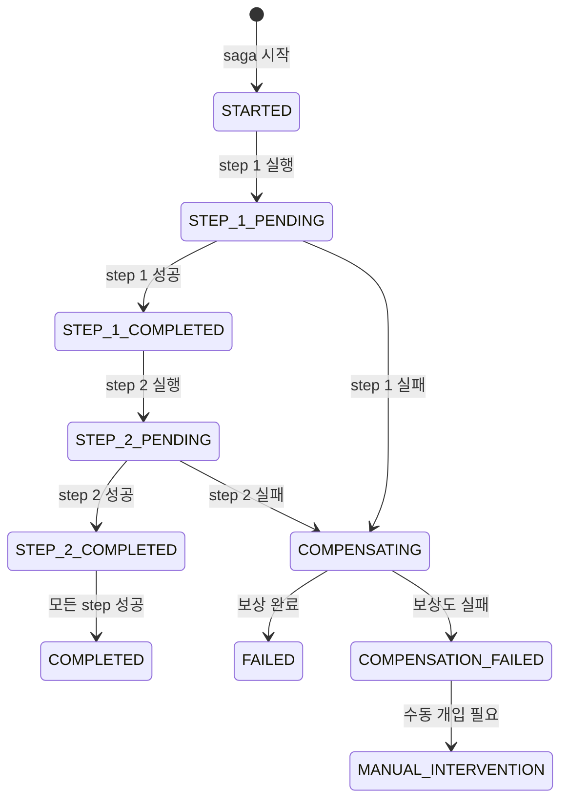

**Saga 상태 저장 스키마:**

```sql
CREATE TABLE saga_instances (
    saga_id       UUID PRIMARY KEY,
    saga_type     VARCHAR(100)  NOT NULL,
    current_state VARCHAR(50)   NOT NULL,
    context_data  JSONB         NOT NULL DEFAULT '{}',
    current_step  INT           NOT NULL DEFAULT 0,
    created_at    TIMESTAMPTZ   NOT NULL DEFAULT NOW(),
    updated_at    TIMESTAMPTZ   NOT NULL DEFAULT NOW(),
    version       INT           NOT NULL DEFAULT 1  -- Optimistic locking
);

CREATE TABLE saga_step_log (
    id            BIGSERIAL PRIMARY KEY,
    saga_id       UUID          NOT NULL REFERENCES saga_instances(saga_id),
    step_name     VARCHAR(100)  NOT NULL,
    step_type     VARCHAR(20)   NOT NULL,  -- 'EXECUTE' or 'COMPENSATE'
    status        VARCHAR(20)   NOT NULL,  -- 'PENDING', 'SUCCESS', 'FAILED'
    request_data  JSONB,
    response_data JSONB,
    error_message TEXT,
    executed_at   TIMESTAMPTZ   NOT NULL DEFAULT NOW()
);

CREATE INDEX idx_saga_step_log_saga_id ON saga_step_log(saga_id);
CREATE INDEX idx_saga_instances_state ON saga_instances(current_state)
    WHERE current_state IN ('COMPENSATING', 'COMPENSATION_FAILED');
```

---

## 3. Outbox 패턴

### 3.1 문제: 이중 쓰기(Dual Write) 문제

DB에 데이터를 저장하고 메시지 브로커에 이벤트를 발행하는 두 작업은 원자적으로 수행할 수 없다. 둘 중 하나가 실패하면 데이터 불일치가 발생한다.

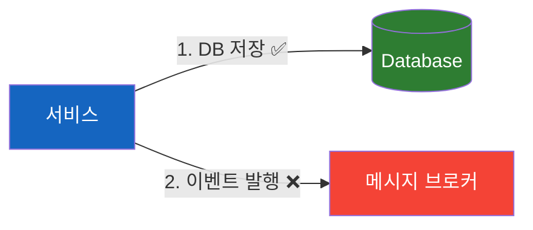

**위 상황**: DB에는 데이터가 저장되었지만, 이벤트는 발행되지 않아 다른 서비스가 변경을 감지하지 못한다.

### 3.2 해결: Transactional Outbox

비즈니스 데이터와 발행할 이벤트를 **같은 DB 트랜잭션**으로 저장한다. 별도 프로세스가 Outbox 테이블을 읽어 브로커에 발행한다.

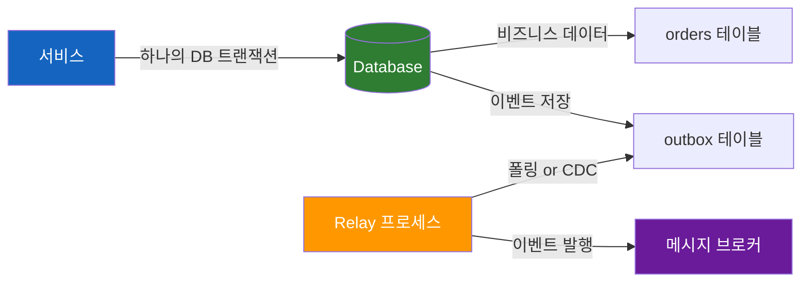

### 3.3 Outbox 테이블 스키마

```sql
CREATE TABLE outbox_events (
    id              UUID PRIMARY KEY DEFAULT gen_random_uuid(),
    aggregate_type  VARCHAR(100)  NOT NULL,  -- e.g., 'Order', 'Payment'
    aggregate_id    VARCHAR(100)  NOT NULL,  -- e.g., order_id
    event_type      VARCHAR(200)  NOT NULL,  -- e.g., 'order.created'
    payload         JSONB         NOT NULL,
    metadata        JSONB         NOT NULL DEFAULT '{}',
    created_at      TIMESTAMPTZ   NOT NULL DEFAULT NOW(),
    published_at    TIMESTAMPTZ,             -- NULL until published
    retry_count     INT           NOT NULL DEFAULT 0,
    status          VARCHAR(20)   NOT NULL DEFAULT 'PENDING'
                    CHECK (status IN ('PENDING', 'PUBLISHED', 'FAILED'))
);

-- Relay 프로세스가 미발행 이벤트를 효율적으로 조회
CREATE INDEX idx_outbox_pending
    ON outbox_events(created_at)
    WHERE status = 'PENDING';

-- 집계 타입별 조회 (CDC 파티셔닝)
CREATE INDEX idx_outbox_aggregate
    ON outbox_events(aggregate_type, aggregate_id);
```

### 3.4 Polling Publisher vs CDC (Debezium) 비교

| 비교 기준 | Polling Publisher | CDC (Debezium) |
|-----------|------------------|----------------|
| **동작 방식** | 주기적으로 Outbox 테이블 SELECT | DB WAL/Binlog 캡처 |
| **지연 시간** | 폴링 간격에 의존 (수 초) | 거의 실시간 (밀리초) |
| **DB 부하** | 폴링 쿼리 부하 | WAL 읽기 (부하 적음) |
| **구현 복잡도** | 낮음 (간단한 배치 잡) | 중간 (Debezium 인프라 필요) |
| **운영 복잡도** | 낮음 | 높음 (Kafka Connect, 스키마 변경 관리) |
| **스케일링** | 파티셔닝으로 분산 가능 | 커넥터당 하나의 DB 인스턴스 |
| **순서 보장** | created_at 기준 정렬 | WAL 순서 보장 |
| **적합한 상황** | 초기 도입, 트래픽 적은 서비스 | 고트래픽, 실시간성 필수 |

#### Polling Publisher 구현

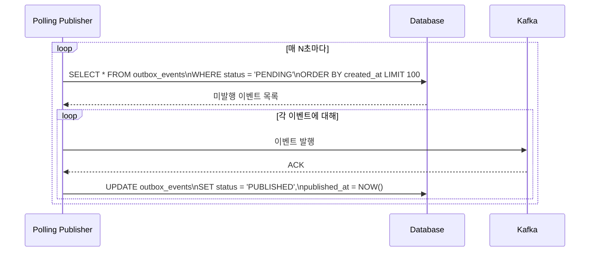

**Python Polling Publisher 예시:**

```python
from __future__ import annotations

import asyncio
from dataclasses import dataclass
from datetime import datetime

import asyncpg
from aiokafka import AIOKafkaProducer


POLL_INTERVAL_SECONDS = 2
BATCH_SIZE = 100
MAX_RETRY_COUNT = 5


@dataclass(frozen=True)
class OutboxEvent:
    id: str
    aggregate_type: str
    aggregate_id: str
    event_type: str
    payload: str
    retry_count: int


class PollingPublisher:
    """Polls the outbox table and publishes events to Kafka."""

    def __init__(self, pool: asyncpg.Pool, producer: AIOKafkaProducer) -> None:
        self._pool = pool
        self._producer = producer

    async def run(self) -> None:
        while True:
            published = await self._poll_and_publish()
            if published == 0:
                await asyncio.sleep(POLL_INTERVAL_SECONDS)

    async def _poll_and_publish(self) -> int:
        async with self._pool.acquire() as conn:
            rows = await conn.fetch(
                """
                SELECT id, aggregate_type, aggregate_id, event_type, payload, retry_count
                FROM outbox_events
                WHERE status = 'PENDING' AND retry_count < $1
                ORDER BY created_at
                LIMIT $2
                FOR UPDATE SKIP LOCKED
                """,
                MAX_RETRY_COUNT,
                BATCH_SIZE,
            )

            for row in rows:
                event = OutboxEvent(**dict(row))
                topic = f"{event.aggregate_type.lower()}-events"
                try:
                    await self._producer.send(
                        topic=topic,
                        value=event.payload.encode(),
                        key=event.aggregate_id.encode(),
                    )
                    await conn.execute(
                        """
                        UPDATE outbox_events
                        SET status = 'PUBLISHED', published_at = NOW()
                        WHERE id = $1
                        """,
                        event.id,
                    )
                except Exception:
                    await conn.execute(
                        """
                        UPDATE outbox_events
                        SET retry_count = retry_count + 1
                        WHERE id = $1
                        """,
                        event.id,
                    )
            return len(rows)
```

**Go Polling Publisher 예시:**

```go
package outbox

import (
	"context"
	"database/sql"
	"log/slog"
	"time"

	"github.com/segmentio/kafka-go"
)

const (
	pollInterval = 2 * time.Second
	batchSize    = 100
	maxRetries   = 5
)

type PollingPublisher struct {
	db     *sql.DB
	writer *kafka.Writer
	logger *slog.Logger
}

func NewPollingPublisher(db *sql.DB, writer *kafka.Writer, logger *slog.Logger) *PollingPublisher {
	return &PollingPublisher{db: db, writer: writer, logger: logger}
}

func (p *PollingPublisher) Run(ctx context.Context) error {
	for {
		select {
		case <-ctx.Done():
			return ctx.Err()
		default:
			published, err := p.pollAndPublish(ctx)
			if err != nil {
				p.logger.Error("poll and publish failed", "error", err)
			}
			if published == 0 {
				time.Sleep(pollInterval)
			}
		}
	}
}

func (p *PollingPublisher) pollAndPublish(ctx context.Context) (int, error) {
	tx, err := p.db.BeginTx(ctx, nil)
	if err != nil {
		return 0, err
	}
	defer tx.Rollback()

	rows, err := tx.QueryContext(ctx, `
		SELECT id, aggregate_type, aggregate_id, event_type, payload, retry_count
		FROM outbox_events
		WHERE status = 'PENDING' AND retry_count < $1
		ORDER BY created_at
		LIMIT $2
		FOR UPDATE SKIP LOCKED`, maxRetries, batchSize)
	if err != nil {
		return 0, err
	}
	defer rows.Close()

	count := 0
	for rows.Next() {
		var (
			id, aggType, aggID, eventType, payload string
			retryCount                              int
		)
		if err := rows.Scan(&id, &aggType, &aggID, &eventType, &payload, &retryCount); err != nil {
			return count, err
		}

		topic := aggType + "-events"
		err := p.writer.WriteMessages(ctx, kafka.Message{
			Topic: topic,
			Key:   []byte(aggID),
			Value: []byte(payload),
		})
		if err != nil {
			_, _ = tx.ExecContext(ctx,
				`UPDATE outbox_events SET retry_count = retry_count + 1 WHERE id = $1`, id)
			continue
		}

		_, _ = tx.ExecContext(ctx,
			`UPDATE outbox_events SET status = 'PUBLISHED', published_at = NOW() WHERE id = $1`, id)
		count++
	}

	return count, tx.Commit()
}
```

#### CDC (Debezium) 구성

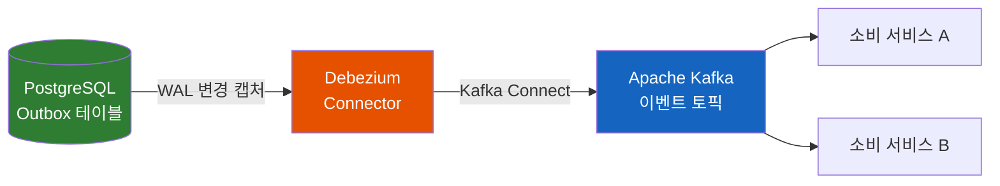

**Debezium Connector 설정 (JSON):**

```json
{
    "name": "outbox-connector",
    "config": {
        "connector.class": "io.debezium.connector.postgresql.PostgresConnector",
        "database.hostname": "${DB_HOST}",
        "database.port": "5432",
        "database.user": "${DB_USER}",
        "database.password": "${DB_PASSWORD}",
        "database.dbname": "order_service",
        "table.include.list": "public.outbox_events",
        "transforms": "outbox",
        "transforms.outbox.type": "io.debezium.transforms.outbox.EventRouter",
        "transforms.outbox.table.field.event.key": "aggregate_id",
        "transforms.outbox.table.field.event.type": "event_type",
        "transforms.outbox.table.field.event.payload": "payload",
        "transforms.outbox.route.by.field": "aggregate_type",
        "transforms.outbox.route.topic.replacement": "${routedByValue}-events",
        "tombstones.on.delete": "false",
        "slot.name": "outbox_slot",
        "plugin.name": "pgoutput"
    }
}
```

### 3.5 Outbox + Saga 통합

Outbox 패턴은 Saga의 각 단계에서 이벤트 발행 신뢰성을 보장하는 데 필수적이다.

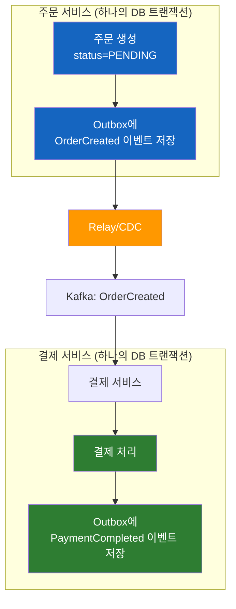

---

## 4. 2PC vs Saga 비교

### 4.1 Two-Phase Commit (2PC) 개요

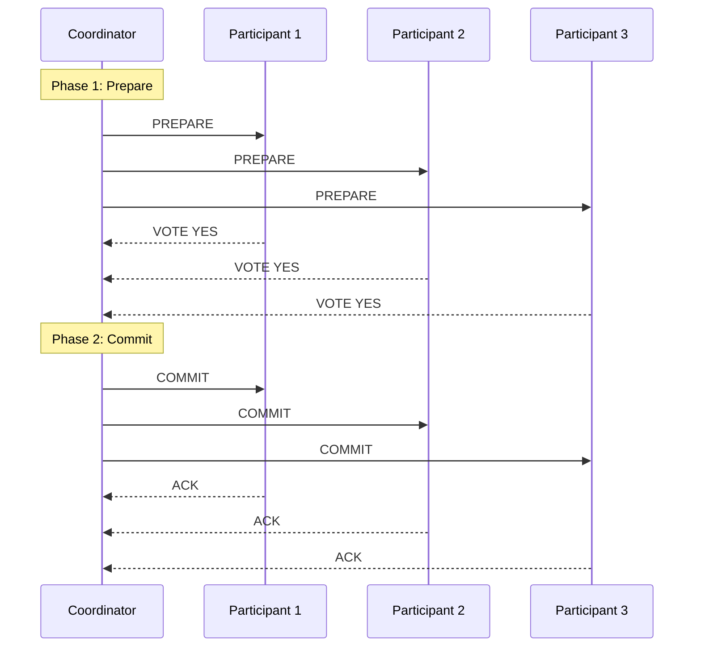

### 4.2 종합 비교표

| 비교 기준 | 2PC | Saga (Choreography) | Saga (Orchestration) |
|-----------|-----|---------------------|---------------------|
| **일관성 모델** | 강한 일관성 (ACID) | 최종적 일관성 (BASE) | 최종적 일관성 (BASE) |
| **가용성** | 낮음 (blocking protocol) | 높음 | 높음 |
| **성능** | 낮음 (lock 유지) | 높음 (비동기) | 중간 |
| **격리 수준** | 직렬화 가능 | 없음 (dirty read 가능) | Semantic lock으로 부분 보장 |
| **실패 복구** | Coordinator 로그 기반 | 보상 트랜잭션 | 보상 트랜잭션 |
| **확장성** | 낮음 (참여자 수에 비례) | 높음 | 높음 |
| **구현 복잡도** | 중간 (프로토콜 고정) | 높음 (분산 이벤트 추적) | 중간 (중앙 로직) |
| **서비스 간 결합** | 높음 (동기적) | 낮음 | 중간 |
| **네트워크 파티션** | blocking 발생 | 부분 진행 가능 | 부분 진행 가능 |
| **적합한 환경** | 동일 DB 벤더, 강한 일관성 필수 | 느슨한 결합, 3개 이하 서비스 | 복잡한 워크플로, 가시성 중요 |

### 4.3 언제 무엇을 선택하는가

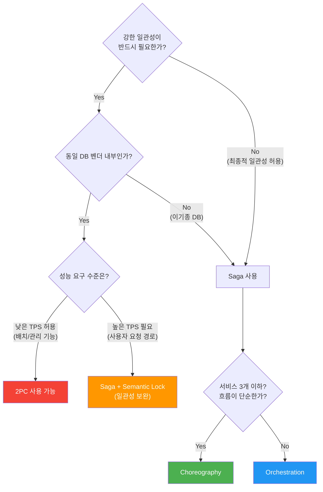

### 4.4 Saga의 격리성 문제와 대응책

Saga는 ACID의 Isolation을 보장하지 않는다. 이를 보완하기 위한 전략이 필요하다.

| 이상 현상 | 설명 | 대응책 |
|-----------|------|--------|
| **Lost Update** | Saga 실행 중 다른 트랜잭션이 데이터를 덮어씀 | Semantic Lock (상태 필드 활용) |
| **Dirty Read** | 보상되기 전 데이터를 다른 Saga가 읽음 | 상태 기반 읽기 (PENDING 상태 필터) |
| **Non-repeatable Read** | Saga 실행 중 데이터가 변경됨 | Version 기반 Optimistic Lock |
| **Phantom Read** | Saga 실행 중 새 데이터가 생성됨 | Reread 패턴 (재확인 단계 추가) |

**Semantic Lock 예시:**

```python
from __future__ import annotations

from enum import Enum, auto


class OrderLockStatus(Enum):
    """Semantic lock states for saga isolation."""
    AVAILABLE = auto()     # No saga in progress
    CREATING = auto()      # Create saga running
    CANCELLING = auto()    # Cancel saga running


async def reserve_order(order_id: str, repository: OrderRepository) -> None:
    """Acquire semantic lock before saga step."""
    order = await repository.find_by_id(order_id)
    if order.lock_status != OrderLockStatus.AVAILABLE:
        raise OrderLockedException(
            f"Order {order_id} is locked by another saga: {order.lock_status}"
        )
    updated = order.with_lock_status(OrderLockStatus.CREATING)
    await repository.save(updated)
```

---

## 5. 보상 트랜잭션

### 5.1 설계 원칙

보상 트랜잭션은 Saga 실패 시 이미 완료된 단계의 효과를 "의미적으로" 취소하는 작업이다. 물리적 롤백이 아닌 **비즈니스 수준의 역연산**이다.

**핵심 원칙:**

| 원칙 | 설명 | 예시 |
|------|------|------|
| **멱등성** | 동일 보상을 여러 번 수행해도 결과 동일 | 이미 환불된 결제에 대해 재환불 시도 시 무시 |
| **교환 가능성** | 실행/보상 순서가 바뀌어도 최종 상태 일관 | 이벤트 순서 뒤바뀜에 대비 |
| **재시도 안전성** | 보상 실패 시 재시도 가능해야 함 | 고유 ID 기반 중복 검사 |
| **비즈니스 의미** | 물리적 DELETE가 아닌 논리적 취소 | 주문 삭제 대신 CANCELLED 상태로 변경 |

### 5.2 보상 vs 되돌림

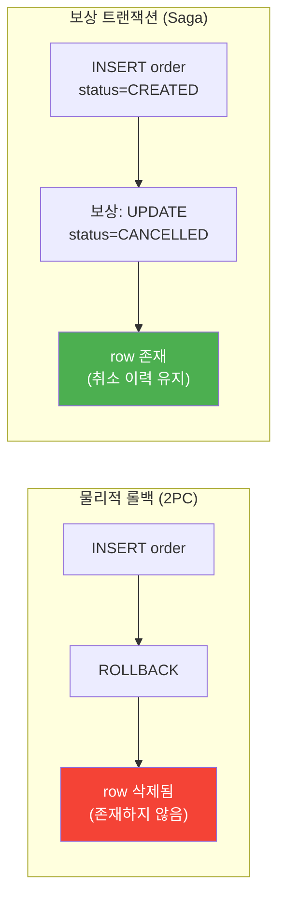

### 5.3 실패 시나리오별 대응

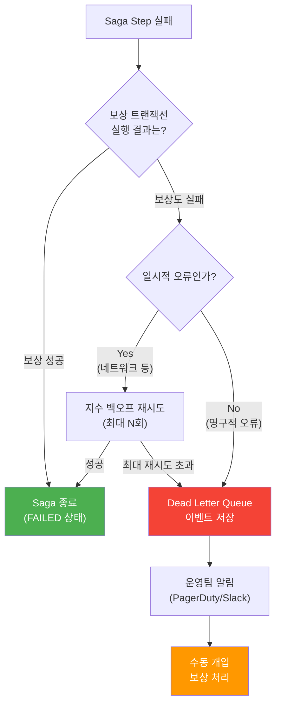

### 5.4 재시도 vs 보상 의사결정 트리

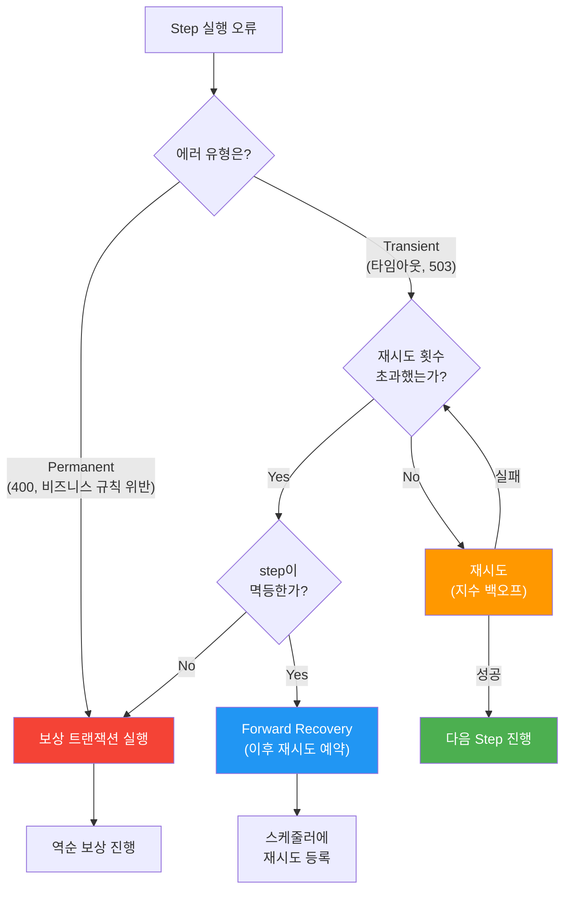

### 5.5 보상 트랜잭션 구현 패턴

#### Python

```python
from __future__ import annotations

import asyncio
from dataclasses import dataclass
from typing import Any


INITIAL_BACKOFF_SECONDS = 1.0
MAX_BACKOFF_SECONDS = 60.0
BACKOFF_MULTIPLIER = 2.0
MAX_RETRIES = 5


@dataclass(frozen=True)
class CompensationResult:
    step_name: str
    success: bool
    attempts: int
    error: str | None = None


async def execute_compensation_with_retry(
    step_name: str,
    compensation_fn: Any,
    context: dict[str, Any],
) -> CompensationResult:
    """Execute compensation with exponential backoff retry."""
    backoff = INITIAL_BACKOFF_SECONDS

    for attempt in range(1, MAX_RETRIES + 1):
        try:
            await compensation_fn(context)
            return CompensationResult(
                step_name=step_name,
                success=True,
                attempts=attempt,
            )
        except TransientError:
            if attempt < MAX_RETRIES:
                await asyncio.sleep(backoff)
                backoff = min(backoff * BACKOFF_MULTIPLIER, MAX_BACKOFF_SECONDS)
            continue
        except PermanentError as err:
            return CompensationResult(
                step_name=step_name,
                success=False,
                attempts=attempt,
                error=str(err),
            )

    return CompensationResult(
        step_name=step_name,
        success=False,
        attempts=MAX_RETRIES,
        error="Max retries exceeded",
    )
```

#### Kotlin

```kotlin
data class CompensationResult(
    val stepName: String,
    val success: Boolean,
    val attempts: Int,
    val error: String? = null,
)

suspend fun executeCompensationWithRetry(
    stepName: String,
    compensationFn: suspend (Map<String, Any>) -> Unit,
    context: Map<String, Any>,
    maxRetries: Int = 5,
    initialBackoffMs: Long = 1000,
): CompensationResult {
    var backoff = initialBackoffMs

    for (attempt in 1..maxRetries) {
        try {
            compensationFn(context)
            return CompensationResult(stepName, success = true, attempts = attempt)
        } catch (e: TransientException) {
            if (attempt < maxRetries) {
                delay(backoff)
                backoff = (backoff * 2).coerceAtMost(60_000L)
            }
        } catch (e: PermanentException) {
            return CompensationResult(stepName, success = false, attempts = attempt, error = e.message)
        }
    }
    return CompensationResult(stepName, success = false, attempts = maxRetries, error = "Max retries exceeded")
}
```

#### Go

```go
package compensation

import (
	"context"
	"errors"
	"math"
	"time"
)

const (
	maxRetries     = 5
	initialBackoff = 1 * time.Second
	maxBackoff     = 60 * time.Second
)

type Result struct {
	StepName string
	Success  bool
	Attempts int
	Error    string
}

func ExecuteWithRetry(
	ctx context.Context,
	stepName string,
	compensateFn func(ctx context.Context) error,
) Result {
	backoff := initialBackoff

	for attempt := 1; attempt <= maxRetries; attempt++ {
		err := compensateFn(ctx)
		if err == nil {
			return Result{StepName: stepName, Success: true, Attempts: attempt}
		}

		var permanent *PermanentError
		if errors.As(err, &permanent) {
			return Result{StepName: stepName, Success: false, Attempts: attempt, Error: err.Error()}
		}

		if attempt < maxRetries {
			select {
			case <-ctx.Done():
				return Result{StepName: stepName, Success: false, Attempts: attempt, Error: ctx.Err().Error()}
			case <-time.After(backoff):
			}
			backoff = time.Duration(math.Min(
				float64(backoff)*2,
                float64(maxBackoff),
			))
		}
	}
	return Result{StepName: stepName, Success: false, Attempts: maxRetries, Error: "max retries exceeded"}
}
```

---

## 6. 분산 트랜잭션 안티패턴

### 6.1 글로벌 2PC 남용

| 안티패턴 | 문제점 | 올바른 접근 |
|----------|--------|------------|
| 모든 서비스 간 트랜잭션에 2PC 사용 | 성능 저하, 가용성 하락, 확장 불가 | Saga 패턴으로 최종적 일관성 채택 |
| 이기종 DB에 분산 XA 트랜잭션 | 벤더 락인, 복잡한 장애 복구 | Outbox + Saga 조합 |
| 마이크로서비스 간 동기 2PC | 참여 서비스 하나라도 다운되면 전체 차단 | 비동기 Saga로 전환 |

```mermaid
flowchart LR
    subgraph "안티패턴: 글로벌 2PC"
        C1["Coordinator"] -->|"PREPARE"| S1["서비스 A\n(lock 대기)"]
        C1 -->|"PREPARE"| S2["서비스 B\n(lock 대기)"]
        C1 -->|"PREPARE"| S3["서비스 C\n(응답 없음 ❌)"]
        S3 -.->|"timeout"| C1
        Note over C1,S3: 전체 트랜잭션 blocking!
    end

    style S3 fill:#F44336,color:#fff
```

### 6.2 보상 트랜잭션 누락

보상 트랜잭션을 정의하지 않은 Saga step은 **시한폭탄**이다.

```
// WRONG: 보상 없는 saga step
class NotificationStep:
    async def execute(self, context):
        await send_email(context["user_email"])
    # compensate 메서드 없음!
    # 이메일은 이미 발송됨 -- 어떻게 보상하는가?
```

**대응 원칙:**

1. **모든 Saga step은 반드시 보상 로직을 정의한다** -- 보상이 불가능한 작업(이메일 발송, SMS 등)은 Saga의 마지막 단계에 배치하여 보상 필요성을 최소화한다.
2. **보상 불가 step은 "Pivot Transaction"으로 표시한다** -- Pivot 이전 step은 보상 가능, Pivot 이후 step은 재시도로 완료를 보장한다.

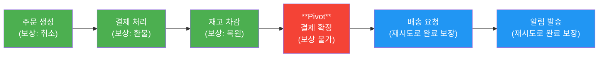

### 6.3 순서 의존 문제

이벤트가 발행된 순서대로 도착한다고 가정하면 안 된다.

| 안티패턴 | 문제 상황 | 올바른 접근 |
|----------|----------|------------|
| 이벤트 순서 가정 | PaymentCompleted가 OrderCreated보다 먼저 도착 | 이벤트에 논리적 순서 번호 포함 + 순서 외 이벤트 버퍼링 |
| 단일 토픽 순서 의존 | 파티션이 다르면 순서 보장 불가 | 동일 aggregate_id를 키로 사용하여 같은 파티션 보장 |
| 보상 순서 무시 | 보상 트랜잭션을 임의 순서로 실행 | 반드시 역순(LIFO)으로 보상 |

### 6.4 멱등성 미구현

동일 이벤트가 중복 전달될 수 있다. 멱등성 없이 처리하면 데이터 불일치가 발생한다.

```python
from __future__ import annotations

# WRONG: Not idempotent -- duplicate event causes double deduction
async def handle_payment(event: PaymentEvent) -> None:
    await deduct_balance(event.user_id, event.amount)


# CORRECT: Idempotent with event ID tracking
async def handle_payment(event: PaymentEvent, repo: EventLogRepository) -> None:
    if await repo.is_processed(event.event_id):
        return  # Already processed, skip

    await deduct_balance(event.user_id, event.amount)
    await repo.mark_processed(event.event_id)
```

### 6.5 타임아웃 미설정

Saga step에 타임아웃을 설정하지 않으면 무한 대기가 발생할 수 있다.

```python
from __future__ import annotations

import asyncio

STEP_TIMEOUT_SECONDS = 30


async def execute_step_with_timeout(step: SagaStep, context: dict) -> dict:
    """Every saga step must have a timeout."""
    try:
        return await asyncio.wait_for(
            step.execute(context),
            timeout=STEP_TIMEOUT_SECONDS,
        )
    except asyncio.TimeoutError as err:
        raise StepTimeoutError(
            f"Step {type(step).__name__} timed out after {STEP_TIMEOUT_SECONDS}s"
        ) from err
```

---

## 7. 체크리스트

### 7.1 Saga 설계 체크리스트

- [ ] 모든 Saga step에 보상 트랜잭션이 정의되어 있는가?
- [ ] 보상 불가 step은 Pivot 이후에 배치되어 있는가?
- [ ] Choreography/Orchestration 선택 근거가 명확한가?
- [ ] Saga 상태가 영속 저장소에 기록되는가?
- [ ] Orchestrator 재시작 시 미완료 Saga 복구 로직이 있는가?
- [ ] 각 step에 타임아웃이 설정되어 있는가?
- [ ] Semantic Lock으로 격리성 문제를 보완하고 있는가?

### 7.2 Outbox 패턴 체크리스트

- [ ] 비즈니스 데이터와 Outbox 레코드가 같은 DB 트랜잭션에서 저장되는가?
- [ ] Relay 프로세스(Polling/CDC)가 고가용성으로 운영되는가?
- [ ] 이벤트 발행 후 Outbox 레코드 상태가 업데이트되는가?
- [ ] 실패한 이벤트에 대한 재시도 메커니즘이 있는가?
- [ ] 최대 재시도 초과 시 Dead Letter Queue로 이동하는가?
- [ ] Outbox 테이블에 적절한 인덱스가 설정되어 있는가?
- [ ] 오래된 PUBLISHED 레코드 정리(cleanup) 배치가 있는가?

### 7.3 보상 트랜잭션 체크리스트

- [ ] 모든 보상 로직이 멱등하게 구현되어 있는가?
- [ ] 보상 실패 시 재시도 전략(지수 백오프)이 적용되어 있는가?
- [ ] 보상 최종 실패 시 Dead Letter Queue + 알림이 설정되어 있는가?
- [ ] 보상 실행 이력이 로그/DB에 기록되는가?
- [ ] 수동 개입 프로세스가 문서화되어 있는가?

### 7.4 운영 체크리스트

- [ ] 분산 추적(Distributed Tracing)이 모든 Saga step에 적용되어 있는가?
- [ ] Saga 완료/실패/보상 메트릭이 모니터링되고 있는가?
- [ ] 미완료 Saga 감지 알림이 설정되어 있는가?
- [ ] Saga 타임아웃 값이 SLA에 맞게 설정되어 있는가?
- [ ] 부하 테스트에서 동시 Saga 실행 시나리오를 검증했는가?

---

> **관련 문서:**
> - [이벤트 드리븐 아키텍처 가이드](./event-driven-architecture-guide.md) -- Kafka, Event Sourcing, CQRS
> - [에러 처리 및 복원력 패턴 가이드](./error-handling-guide.md) -- Circuit Breaker, Retry, Timeout
> - [마이크로서비스 아키텍처 가이드](./microservice-architecture-guide.md) -- 서비스 분해, 데이터 소유권
