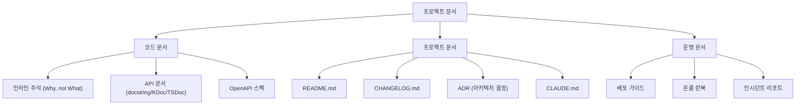

# 문서화 표준 가이드

> 코드, API, 아키텍처 결정을 체계적으로 문서화하는 표준.

---

## 1. 문서 체계 개요



---

## 2. 코드 문서화

### 2.1 인라인 주석 원칙

| 규칙 | 예시 |
|------|------|
| **Why, not What** | `// Retry 3 times because external API has intermittent failures` |
| 자명한 코드에 주석 금지 | ~~`// increment counter` `counter++`~~ |
| TODO 금지 (프로덕션) | TODO는 이슈 트래커로 → `Fixes #123` |
| 주석 처리 코드 삭제 | Git이 이력을 보관 |

### 2.2 API 문서화 규칙

모든 public 함수/클래스에 문서화 필수. 언어별 형식은 [코딩 스타일 가이드](coding-style-guide.md) 섹션 4 참조.

**작성 규칙:**
- 첫 줄: 한 문장 요약 (명령형)
- Args/Params: 타입이 아닌 **의미**를 설명
- Returns: 반환값의 의미와 조건
- Raises/Throws: 발생 가능한 예외와 조건
- Examples: 복잡한 함수에 사용 예시 포함

### 2.3 주석 언어

- **코드 주석**: 영문 (국제 표준)
- **비즈니스 로직 설명**: 한글 허용 (도메인 용어가 한글인 경우)
- **README, 가이드 문서**: 한글

---

## 3. API 문서 (OpenAPI)

### 3.1 OpenAPI 3.1 작성 규칙

| 항목 | 필수 여부 | 규칙 |
|------|-----------|------|
| `summary` | 필수 | 모든 endpoint에 한 줄 요약 |
| `operationId` | 필수 | 고유하고 의미 있는 이름 |
| `tags` | 필수 | 도메인/리소스별 그룹핑 |
| `description` | 권장 | 모든 응답 코드에 설명 |
| `example` | 권장 | 요청/응답 예시 데이터 |
| `$ref` 재사용 | 필수 | 공통 스키마는 `components/schemas`에 정의 |

### 3.2 응답 코드 표준

| 코드 | 의미 | 사용 시점 |
|------|------|-----------|
| 200 | OK | 조회 성공 |
| 201 | Created | 리소스 생성 성공 |
| 204 | No Content | 삭제 성공 |
| 400 | Bad Request | 입력 검증 실패 |
| 401 | Unauthorized | 인증 필요 |
| 403 | Forbidden | 권한 없음 |
| 404 | Not Found | 리소스 없음 |
| 409 | Conflict | 중복 리소스 |
| 422 | Unprocessable | 비즈니스 규칙 위반 |
| 429 | Too Many Requests | Rate limit 초과 |
| 500 | Internal Server Error | 서버 오류 |

### 3.3 에러 응답 형식

```json
{
  "error": {
    "code": "USER_NOT_FOUND",
    "message": "User with ID 123 not found",
    "details": []
  }
}
```

### 3.4 API 문서 도구

| 도구 | 용도 |
|------|------|
| **Swagger UI** | 대화형 API 테스트 |
| **Redoc** | 가독성 높은 정적 문서 |
| **Spectral** | OpenAPI 스펙 린팅 |

---

## 4. 프로젝트 문서

### 4.1 README.md

표준 구조는 [README 템플릿](../../common/templates/README_TEMPLATE.md) 참조.

**필수 섹션:**
- 프로젝트 설명 (1-2문장)
- 빠른 시작 (설치 → 실행까지 5분 이내)
- 프로젝트 구조
- 개발 가이드 (린트, 테스트, 포맷)

### 4.2 CHANGELOG.md

[Keep a Changelog](https://keepachangelog.com) 형식을 따른다.

```markdown
# Changelog

## [1.2.0] - 2026-03-11

### Added
- 사용자 인증 기능 (JWT 기반)

### Changed
- API 응답 포맷을 페이지네이션으로 변경

### Fixed
- 동시 결제 시 재고 경합 조건 해결

### Removed
- Legacy v1 API endpoint 제거
```

**규칙:**
- 카테고리: Added, Changed, Deprecated, Removed, Fixed, Security
- 최신 버전이 상단
- 시맨틱 버전 + 날짜

### 4.3 Design Doc (설계 문서)

대규모 기술 변경 전 합의를 형성하기 위한 사전 설계 문서.
프로세스 가이드는 [Design Doc / RFC 프로세스 가이드](design-doc-process.md), 템플릿은 [Design Doc 템플릿](../../common/templates/DESIGN_DOC_TEMPLATE.md) 참조.

**Design Doc 작성이 필요한 시점** (다음 중 2개 이상 해당):
- 2인 이상이 2주 이상 소요되는 작업
- 시스템 경계, 데이터 흐름, 의존성 구조 변경
- 다른 팀/서비스에 영향을 미치는 변경
- 롤백 비용이 큰 결정
- 팀에서 처음 도입하는 기술/패턴

**Design Doc과 ADR의 관계:**
- Design Doc: 구현 **전** 설계 탐색 및 합의 (3-20페이지)
- ADR: 결정 **후** 기록 및 보존 (1-2페이지)
- Design Doc 완료 후 핵심 결정을 ADR로 압축하여 기록

### 4.4 ADR (Architecture Decision Record)

형식은 [ADR 템플릿](../../common/templates/ADR_TEMPLATE.md) 참조.

**ADR 작성이 필요한 시점:**
- 새로운 기술/프레임워크 도입
- 아키텍처 패턴 변경 (모놀리스 → 마이크로서비스 등)
- 데이터 스토어 선택/변경
- 인증/보안 방식 결정
- 주요 라이브러리/도구 교체

### 4.5 CLAUDE.md

Claude Code가 참조하는 프로젝트 컨텍스트 문서.

**포함 내용:**
- 프로젝트 개요 (1-2문장)
- 기술 스택
- 주요 빌드/테스트/실행 커맨드
- 하드 리밋 (함수 길이, 복잡도 등)
- 금지 패턴

**규칙:** 200줄 이하. "이걸 빼면 Claude가 실수하는가?" 기준으로 유지.

---

## 5. 운영 문서

### 5.1 온콜 런북

프로덕션 장애 시 참조하는 문서. 각 서비스별 작성.

```markdown
# [서비스명] 온콜 런북

## 서비스 개요
- 역할: (간략 설명)
- 담당팀: (팀명)
- 의존 서비스: (목록)

## 알림 대응

### [알림명]: [임계값 초과]
- **심각도**: P1 / P2 / P3
- **원인**: (가능한 원인 목록)
- **확인 방법**:
  ```bash
  # 상태 확인 커맨드
  ```
- **복구 방법**:
  1. 단계 1
  2. 단계 2
- **에스컬레이션**: (담당자/채널)
```

### 5.2 인시던트 리포트

장애 발생 후 작성하는 사후 분석(Post-mortem) 문서.

```markdown
# 인시던트 리포트: [제목]

## 요약
- **발생 시간**: YYYY-MM-DD HH:MM ~ HH:MM (KST)
- **영향 범위**: (영향 받은 사용자/서비스)
- **심각도**: P1 / P2 / P3

## 타임라인
| 시간 | 이벤트 |
|------|--------|
| HH:MM | 알림 발생 |
| HH:MM | 원인 파악 |
| HH:MM | 복구 완료 |

## 근본 원인

## 재발 방지 대책
| 항목 | 담당 | 기한 |
|------|------|------|
| 대책 1 | @담당자 | YYYY-MM-DD |
```

---

## 6. 문서 품질 체크리스트

| 항목 | 기준 |
|------|------|
| 최신성 | 코드 변경 시 관련 문서도 함께 업데이트 |
| 정확성 | 코드 예시가 실제 동작하는 코드인지 확인 |
| 접근성 | 신규 팀원이 30분 내 개발 환경 구축 가능 |
| 구조화 | 목차/제목/표/다이어그램으로 스캔 가능 |
| 단일 정본 | 동일 정보가 여러 곳에 중복되지 않음 (링크 활용) |
