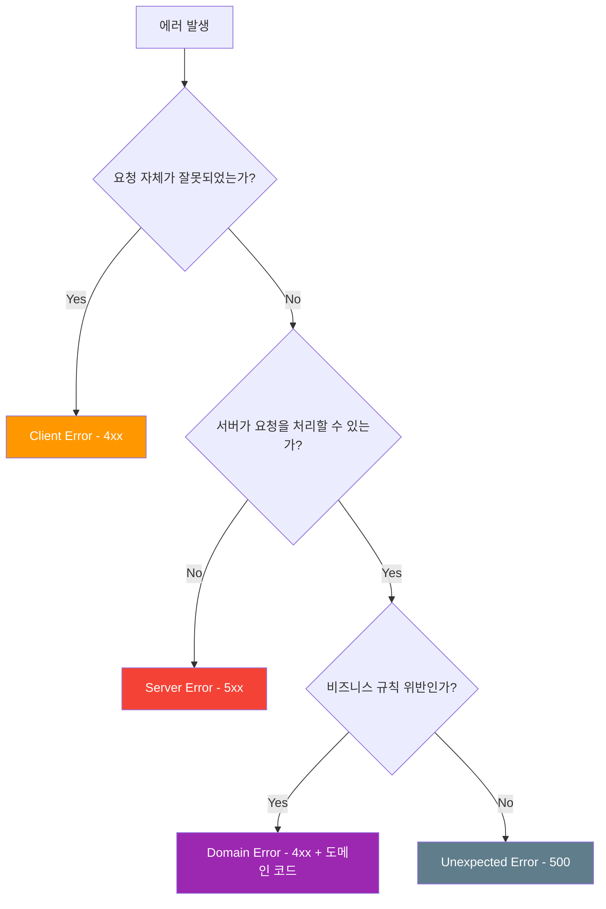
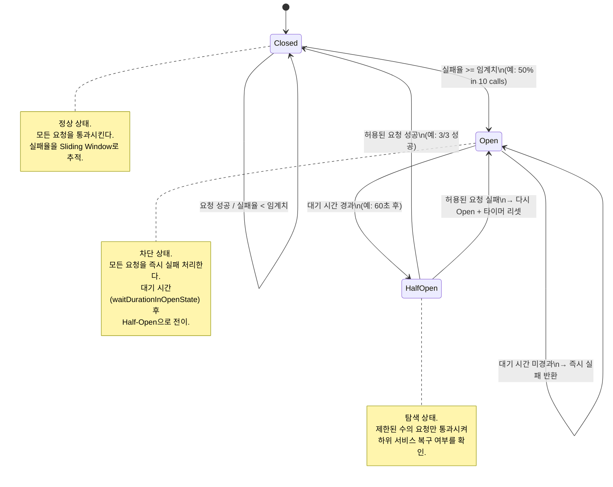
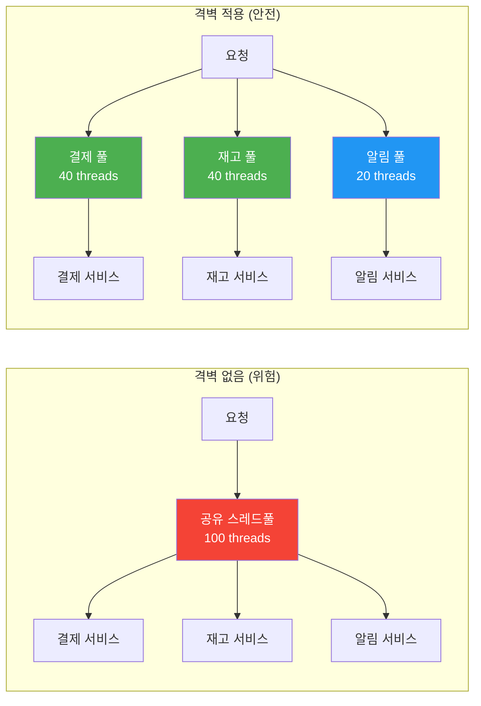
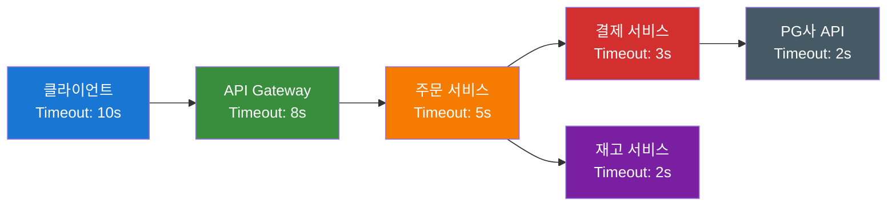
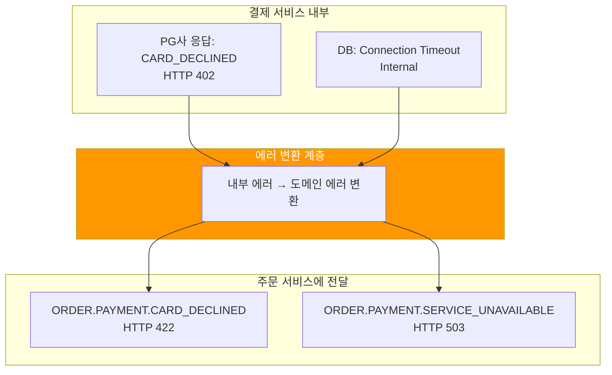

# 에러 처리 및 복원력 패턴 가이드

> **작성일**: 2026-03-12
> **기반 표준**: Microsoft Azure Well-Architected Framework, AWS Error Handling Best Practices, Google SRE Book
> **적용 수준**: 빅테크 기준 팀 운영표준
> **대상 언어**: Python, Kotlin, Go, TypeScript

---

## 목차

1. [에러 분류 체계](#1-에러-분류-체계)
2. [재시도 전략](#2-재시도-전략)
3. [Circuit Breaker 패턴](#3-circuit-breaker-패턴)
4. [Bulkhead 패턴](#4-bulkhead-패턴)
5. [Timeout 전략](#5-timeout-전략)
6. [에러 전파 규칙](#6-에러-전파-규칙)
7. [에러 응답 표준](#7-에러-응답-표준)
8. [언어별 에러 처리 패턴](#8-언어별-에러-처리-패턴)

---

## 1. 에러 분류 체계

### 1.1 일시적(Transient) vs 영구적(Permanent) 에러

모든 에러는 먼저 **재시도 가능 여부**에 따라 분류한다.

| 분류 | 특성 | 예시 | 전략 |
|------|------|------|------|
| **Transient** | 일시적, 재시도 시 해결 가능 | 네트워크 타임아웃, 503 Service Unavailable, DB 커넥션 일시 부족 | 재시도 + Circuit Breaker |
| **Permanent** | 재시도해도 해결 불가 | 400 Bad Request, 인증 실패, 비즈니스 규칙 위반 | 즉시 실패 반환, 사용자 안내 |

**판별 기준:**

```
HTTP 4xx (401, 403 제외) → Permanent (클라이언트 입력 오류)
HTTP 401/403             → Permanent (인증/인가 — 토큰 갱신 후 1회 재시도 가능)
HTTP 408, 429            → Transient (타임아웃, 속도 제한)
HTTP 5xx                 → Transient (서버 측 일시 장애 가정)
네트워크 연결 오류        → Transient
DNS 해석 실패            → 상황에 따라 판별 (보통 Transient)
```

### 1.2 Client 에러 vs Server 에러



### 1.3 도메인 에러 코드 네임스페이스 체계

도메인 에러 코드는 **서비스.도메인.에러종류** 3계층으로 구성한다.

```
{SERVICE}.{DOMAIN}.{ERROR_TYPE}

예:
  ORDER.PAYMENT.INSUFFICIENT_BALANCE
  ORDER.PAYMENT.CARD_EXPIRED
  USER.AUTH.TOKEN_EXPIRED
  USER.PROFILE.DUPLICATE_EMAIL
  INVENTORY.STOCK.OUT_OF_STOCK
```

**네임스페이스 등록 규칙:**

| 계층 | 관리 주체 | 등록 방법 |
|------|-----------|-----------|
| SERVICE | 플랫폼팀 | 중앙 레지스트리 등록 필수 |
| DOMAIN | 서비스 소유팀 | 서비스 내 자유 정의 |
| ERROR_TYPE | 서비스 소유팀 | UPPER_SNAKE_CASE, 동사_명사 형태 권장 |

**코드 정의 예시 (Python):**

```python
from __future__ import annotations

from enum import StrEnum


class OrderErrorCode(StrEnum):
    """Order service domain error codes."""

    PAYMENT_INSUFFICIENT_BALANCE = "ORDER.PAYMENT.INSUFFICIENT_BALANCE"
    PAYMENT_CARD_EXPIRED = "ORDER.PAYMENT.CARD_EXPIRED"
    ITEM_OUT_OF_STOCK = "ORDER.INVENTORY.OUT_OF_STOCK"
    SHIPPING_ADDRESS_INVALID = "ORDER.SHIPPING.ADDRESS_INVALID"
```

**코드 정의 예시 (Go):**

```go
package errors

// OrderErrorCode defines domain error codes for the order service.
type OrderErrorCode string

const (
    ErrPaymentInsufficientBalance OrderErrorCode = "ORDER.PAYMENT.INSUFFICIENT_BALANCE"
    ErrPaymentCardExpired         OrderErrorCode = "ORDER.PAYMENT.CARD_EXPIRED"
    ErrItemOutOfStock             OrderErrorCode = "ORDER.INVENTORY.OUT_OF_STOCK"
)
```

---

## 2. 재시도 전략

### 2.1 Exponential Backoff with Jitter

재시도 간격은 **지수적으로 증가**하되, **무작위 지터(jitter)**를 추가하여 동시 재시도(thundering herd)를 방지한다.

```
delay = min(base_delay * 2^attempt + random(0, jitter_max), max_delay)
```

| 파라미터 | 권장값 | 설명 |
|----------|--------|------|
| `base_delay` | 100ms | 첫 번째 재시도 기본 대기 |
| `max_delay` | 30s | 최대 대기 시간 |
| `max_retries` | 3 | 최대 재시도 횟수 |
| `jitter_max` | `base_delay * 0.5` | 지터 범위 |

**Python 구현:**

```python
from __future__ import annotations

import asyncio
import random
from collections.abc import Awaitable, Callable
from typing import TypeVar

T = TypeVar("T")

MAX_RETRIES = 3
BASE_DELAY_SEC = 0.1
MAX_DELAY_SEC = 30.0
JITTER_FACTOR = 0.5


async def retry_with_backoff(
    func: Callable[[], Awaitable[T]],
    *,
    max_retries: int = MAX_RETRIES,
    base_delay: float = BASE_DELAY_SEC,
    max_delay: float = MAX_DELAY_SEC,
    retryable: Callable[[Exception], bool] = lambda _: True,
) -> T:
    """Execute func with exponential backoff and jitter.

    Args:
        func: Async callable to retry.
        max_retries: Maximum number of retry attempts.
        base_delay: Initial delay in seconds.
        max_delay: Maximum delay cap in seconds.
        retryable: Predicate to determine if exception is retryable.

    Returns:
        Result of successful func execution.

    Raises:
        Exception: Last exception if all retries exhausted.
    """
    last_exception: Exception | None = None

    for attempt in range(max_retries + 1):
        try:
            return await func()
        except Exception as exc:
            last_exception = exc
            if attempt == max_retries or not retryable(exc):
                raise

            delay = min(base_delay * (2 ** attempt), max_delay)
            jitter = random.uniform(0, delay * JITTER_FACTOR)  # noqa: S311 -- not security-critical
            await asyncio.sleep(delay + jitter)

    raise last_exception  # type: ignore[misc] -- unreachable but satisfies type checker
```

**Go 구현:**

```go
package retry

import (
    "context"
    "math"
    "math/rand/v2"
    "time"
)

const (
    DefaultMaxRetries = 3
    DefaultBaseDelay  = 100 * time.Millisecond
    DefaultMaxDelay   = 30 * time.Second
    JitterFactor      = 0.5
)

// Do executes fn with exponential backoff and jitter.
func Do(ctx context.Context, fn func() error, opts ...Option) error {
    cfg := defaultConfig()
    for _, opt := range opts {
        opt(&cfg)
    }

    var lastErr error
    for attempt := range cfg.MaxRetries + 1 {
        if err := fn(); err == nil {
            return nil
        } else {
            lastErr = err
            if attempt == cfg.MaxRetries || !cfg.IsRetryable(err) {
                return err
            }
        }

        delay := math.Min(
            float64(cfg.BaseDelay)*math.Pow(2, float64(attempt)),
            float64(cfg.MaxDelay),
        )
        jitter := rand.Float64() * delay * JitterFactor
        sleepDur := time.Duration(delay + jitter)

        select {
        case <-ctx.Done():
            return ctx.Err()
        case <-time.After(sleepDur):
        }
    }
    return lastErr
}
```

### 2.2 Retry Budget (재시도 예산)

과도한 재시도는 장애를 증폭시킨다. **Retry Budget**으로 전체 재시도 비율을 제한한다.

```
Retry Budget = (재시도 요청 수) / (전체 요청 수) <= 10%
```

| 규칙 | 설명 |
|------|------|
| 전체 트래픽 대비 재시도 비율 **10% 이하** | Google SRE 권장 기준 |
| Sliding Window (60초) 기반 계산 | 최근 1분간의 비율로 판단 |
| Budget 초과 시 재시도 차단 | 즉시 실패 반환 (fail-fast) |
| 서비스별 독립 Budget | 하위 서비스마다 별도 Budget 관리 |

### 2.3 재시도하면 안 되는 경우

| 상황 | 이유 |
|------|------|
| **비멱등(non-idempotent) 요청** | POST로 결제 생성 등 -- 중복 실행 위험 |
| **인증/인가 실패 (401, 403)** | 자격 증명이 바뀌지 않으면 결과도 동일 |
| **입력 유효성 실패 (400, 422)** | 동일 입력으로 재시도해도 항상 실패 |
| **리소스 미존재 (404)** | 존재하지 않는 리소스는 재시도로 생기지 않음 |
| **비즈니스 규칙 위반 (409, 422)** | 잔액 부족, 재고 부족 등 -- 상태 변경 없이 재시도 무의미 |
| **요청 페이로드 초과 (413)** | 동일 페이로드로 재시도해도 항상 실패 |
| **Retry Budget 초과** | 장애 증폭 방지 |

---

## 3. Circuit Breaker 패턴

### 3.1 상태 전이 다이어그램



### 3.2 핵심 파라미터

| 파라미터 | 권장값 | 설명 |
|----------|--------|------|
| `failure_rate_threshold` | 50% | Open 전이 실패율 임계치 |
| `slow_call_rate_threshold` | 80% | 느린 호출 비율 임계치 |
| `slow_call_duration_threshold` | 2s | 느린 호출 판단 기준 |
| `sliding_window_type` | COUNT_BASED | 호출 수 기반 (또는 TIME_BASED) |
| `sliding_window_size` | 10 | 최근 10회 호출 기준 판단 |
| `minimum_number_of_calls` | 5 | 최소 호출 수 이후부터 판단 |
| `wait_duration_in_open_state` | 60s | Open 상태 유지 시간 |
| `permitted_number_of_calls_in_half_open` | 3 | Half-Open 시 허용 호출 수 |

### 3.3 Resilience4j 설정 예시 (Kotlin/Spring Boot)

```kotlin
// application.yml
// resilience4j:
//   circuitbreaker:
//     instances:
//       paymentService:
//         failureRateThreshold: 50
//         slowCallRateThreshold: 80
//         slowCallDurationThreshold: 2s
//         slidingWindowType: COUNT_BASED
//         slidingWindowSize: 10
//         minimumNumberOfCalls: 5
//         waitDurationInOpenState: 60s
//         permittedNumberOfCallsInHalfOpenState: 3
//         recordExceptions:
//           - java.io.IOException
//           - java.util.concurrent.TimeoutException
//         ignoreExceptions:
//           - com.example.BusinessException

@CircuitBreaker(name = "paymentService", fallbackMethod = "paymentFallback")
suspend fun processPayment(request: PaymentRequest): PaymentResponse {
    return paymentClient.charge(request)
}

private suspend fun paymentFallback(
    request: PaymentRequest,
    throwable: Throwable,
): PaymentResponse {
    logger.warn { "Payment circuit open, falling back: ${throwable.message}" }
    return PaymentResponse.pending(request.orderId, reason = "Service temporarily unavailable")
}
```

### 3.4 Polly 설정 예시 (C# / .NET)

```csharp
// For reference -- .NET teams using Polly
var circuitBreakerPolicy = Policy
    .Handle<HttpRequestException>()
    .Or<TimeoutException>()
    .CircuitBreakerAsync(
        exceptionsAllowedBeforeBreaking: 5,
        durationOfBreak: TimeSpan.FromSeconds(60),
        onBreak: (exception, duration) =>
            logger.LogWarning("Circuit opened for {Duration}s: {Message}",
                duration.TotalSeconds, exception.Message),
        onReset: () => logger.LogInformation("Circuit closed"),
        onHalfOpen: () => logger.LogInformation("Circuit half-open")
    );
```

### 3.5 TypeScript 구현 예시

```typescript
interface CircuitBreakerConfig {
  readonly failureThreshold: number;
  readonly resetTimeoutMs: number;
  readonly halfOpenMaxCalls: number;
}

type CircuitState = "CLOSED" | "OPEN" | "HALF_OPEN";

const DEFAULT_CONFIG: CircuitBreakerConfig = {
  failureThreshold: 5,
  resetTimeoutMs: 60_000,
  halfOpenMaxCalls: 3,
};

class CircuitBreaker {
  private state: CircuitState = "CLOSED";
  private failureCount = 0;
  private lastFailureTime = 0;
  private halfOpenSuccessCount = 0;

  constructor(private readonly config: CircuitBreakerConfig = DEFAULT_CONFIG) {}

  async execute<T>(fn: () => Promise<T>): Promise<T> {
    if (this.state === "OPEN") {
      if (Date.now() - this.lastFailureTime >= this.config.resetTimeoutMs) {
        this.state = "HALF_OPEN";
        this.halfOpenSuccessCount = 0;
      } else {
        throw new Error("Circuit breaker is OPEN");
      }
    }

    try {
      const result = await fn();
      this.onSuccess();
      return result;
    } catch (error) {
      this.onFailure();
      throw error;
    }
  }

  private onSuccess(): void {
    if (this.state === "HALF_OPEN") {
      this.halfOpenSuccessCount += 1;
      if (this.halfOpenSuccessCount >= this.config.halfOpenMaxCalls) {
        this.state = "CLOSED";
        this.failureCount = 0;
      }
    } else {
      this.failureCount = 0;
    }
  }

  private onFailure(): void {
    this.failureCount += 1;
    this.lastFailureTime = Date.now();
    if (
      this.failureCount >= this.config.failureThreshold ||
      this.state === "HALF_OPEN"
    ) {
      this.state = "OPEN";
    }
  }
}
```

---

## 4. Bulkhead 패턴

### 4.1 개념

Bulkhead(격벽)는 선박의 격벽에서 유래한 패턴으로, 하나의 서비스 장애가 전체 시스템으로 전파되는 것을 방지한다. 각 외부 의존성에 독립된 리소스 풀을 할당하여 격리한다.



### 4.2 스레드풀 격리 vs 세마포어 격리

| 방식 | 장점 | 단점 | 적용 상황 |
|------|------|------|-----------|
| **스레드풀 격리** | 완전한 격리, 타임아웃 제어 용이 | 스레드 전환 오버헤드, 메모리 사용 | 네트워크 호출, 느린 I/O |
| **세마포어 격리** | 경량, 오버헤드 최소 | 타임아웃 직접 제어 불가 | 빠른 로컬 연산, 인메모리 캐시 접근 |

### 4.3 Resilience4j Bulkhead 설정

```yaml
# application.yml
resilience4j:
  bulkhead:
    instances:
      paymentService:
        maxConcurrentCalls: 40
        maxWaitDuration: 500ms
      inventoryService:
        maxConcurrentCalls: 40
        maxWaitDuration: 500ms
      notificationService:
        maxConcurrentCalls: 20
        maxWaitDuration: 200ms
  thread-pool-bulkhead:
    instances:
      paymentService:
        maxThreadPoolSize: 40
        coreThreadPoolSize: 20
        queueCapacity: 100
        keepAliveDuration: 60s
```

### 4.4 Python 세마포어 격리 예시

```python
from __future__ import annotations

import asyncio
from dataclasses import dataclass
from typing import TypeVar

T = TypeVar("T")

MAX_CONCURRENT_PAYMENT = 40
MAX_CONCURRENT_INVENTORY = 40
MAX_CONCURRENT_NOTIFICATION = 20


@dataclass(frozen=True)
class BulkheadConfig:
    """Configuration for a bulkhead semaphore."""

    max_concurrent: int
    max_wait_seconds: float = 0.5


class Bulkhead:
    """Semaphore-based bulkhead for async workloads."""

    def __init__(self, config: BulkheadConfig) -> None:
        self._semaphore = asyncio.Semaphore(config.max_concurrent)
        self._max_wait = config.max_wait_seconds

    async def execute(self, coro):  # noqa: ANN001 -- generic coroutine
        """Execute coroutine within bulkhead limits."""
        try:
            await asyncio.wait_for(
                self._semaphore.acquire(),
                timeout=self._max_wait,
            )
        except TimeoutError:
            raise BulkheadFullError("Bulkhead capacity exceeded") from None

        try:
            return await coro
        finally:
            self._semaphore.release()


class BulkheadFullError(Exception):
    """Raised when bulkhead rejects a request due to capacity."""


# Usage
payment_bulkhead = Bulkhead(BulkheadConfig(max_concurrent=MAX_CONCURRENT_PAYMENT))
inventory_bulkhead = Bulkhead(BulkheadConfig(max_concurrent=MAX_CONCURRENT_INVENTORY))
```

---

## 5. Timeout 전략

### 5.1 연쇄 타임아웃 설계

마이크로서비스에서 타임아웃은 **상위 서비스 > 하위 서비스** 순으로 설정한다. 전체 SLA에서 역산하여 각 서비스의 타임아웃을 분배한다.



### 5.2 타임아웃 분배 공식

```
전체 SLA = 10초 (클라이언트 체감 한계)

Gateway overhead           : 0.5s
주문 서비스 자체 처리       : 0.5s
결제 서비스 (직렬)         : 3.0s  (PG사 API 2s + 자체 처리 1s)
재고 서비스 (병렬)         : 2.0s
응답 직렬화 + 네트워크     : 0.5s
여유 버퍼 (20%)           : 1.5s
─────────────────────────
합계                       : 8.0s (Gateway 타임아웃)
```

### 5.3 타임아웃 계층별 규칙

| 계층 | 타임아웃 | 규칙 |
|------|----------|------|
| **HTTP 클라이언트** | Connection: 3s, Read: 5s | Connection과 Read를 분리 |
| **DB 쿼리** | 단순 조회: 1s, 복잡 조회: 5s, 배치: 30s | 쿼리 유형별 분리 |
| **Redis** | Connection: 1s, Command: 500ms | 캐시는 빠른 실패 필수 |
| **메시지 큐** | Publish: 3s, Consume: 무제한(polling) | 발행은 실패 감지 필요 |
| **gRPC** | Deadline propagation 사용 | 상위 deadline을 하위에 전파 |

### 5.4 Go Deadline Propagation 예시

```go
package order

import (
    "context"
    "time"
)

const (
    PaymentTimeout   = 3 * time.Second
    InventoryTimeout = 2 * time.Second
)

// ProcessOrder orchestrates payment and inventory checks with cascading deadlines.
func (s *Service) ProcessOrder(ctx context.Context, req OrderRequest) (*OrderResponse, error) {
    // Parent context already has Gateway deadline (8s)
    // Payment gets a tighter sub-deadline
    payCtx, payCancel := context.WithTimeout(ctx, PaymentTimeout)
    defer payCancel()

    payResult, err := s.paymentClient.Charge(payCtx, req.PaymentInfo)
    if err != nil {
        return nil, fmt.Errorf("payment failed: %w", err)
    }

    // Inventory check runs after payment, inheriting remaining parent deadline
    invCtx, invCancel := context.WithTimeout(ctx, InventoryTimeout)
    defer invCancel()

    invResult, err := s.inventoryClient.Reserve(invCtx, req.Items)
    if err != nil {
        // Compensate: refund payment
        _ = s.paymentClient.Refund(ctx, payResult.TransactionID)
        return nil, fmt.Errorf("inventory reservation failed: %w", err)
    }

    return &OrderResponse{
        OrderID:       generateID(),
        PaymentRef:    payResult.TransactionID,
        InventoryRef:  invResult.ReservationID,
    }, nil
}
```

---

## 6. 에러 전파 규칙

### 6.1 서비스 경계에서의 에러 변환

서비스 경계를 넘을 때 내부 구현 상세를 노출하지 않는다. 하위 서비스의 에러를 상위 서비스의 도메인 에러로 변환한다.



### 6.2 에러 변환 규칙

| 원칙 | 설명 |
|------|------|
| **내부 에러 숨김** | 하위 서비스의 스택 트레이스, DB 에러 메시지를 외부에 노출하지 않음 |
| **도메인 에러로 변환** | 기술적 에러를 비즈니스 맥락의 에러 코드로 매핑 |
| **원인 체인 로깅** | 변환 전 원본 에러는 내부 로그에 전체 기록 |
| **HTTP 상태 코드 매핑** | 하위 서비스의 500을 상위에서 무조건 500으로 전파하지 않음 |
| **Correlation ID 전파** | 에러 추적을 위해 요청 ID를 모든 서비스 경계에서 유지 |

### 6.3 Python 에러 변환 패턴

```python
from __future__ import annotations

import logging
from dataclasses import dataclass

logger = logging.getLogger(__name__)


@dataclass(frozen=True)
class ServiceError(Exception):
    """Base service error with domain error code."""

    code: str
    message: str
    http_status: int = 500


def translate_payment_error(exc: Exception, correlation_id: str) -> ServiceError:
    """Translate internal payment errors to domain errors.

    Internal details are logged but never exposed to callers.
    """
    # Log the full internal error for debugging
    logger.error(
        "Payment error [correlation_id=%s]: %s",
        correlation_id,
        exc,
        exc_info=True,
    )

    # Map to domain error -- never expose internals
    error_map: dict[str, tuple[str, str, int]] = {
        "CARD_DECLINED": (
            "ORDER.PAYMENT.CARD_DECLINED",
            "Payment was declined by the card issuer",
            422,
        ),
        "INSUFFICIENT_FUNDS": (
            "ORDER.PAYMENT.INSUFFICIENT_BALANCE",
            "Insufficient balance for this transaction",
            422,
        ),
    }

    error_type = getattr(exc, "error_type", None)
    if error_type and error_type in error_map:
        code, message, status = error_map[error_type]
        return ServiceError(code=code, message=message, http_status=status)

    # Unknown errors become generic service unavailable
    return ServiceError(
        code="ORDER.PAYMENT.SERVICE_UNAVAILABLE",
        message="Payment service is temporarily unavailable",
        http_status=503,
    )
```

---

## 7. 에러 응답 표준

### 7.1 통일된 JSON 형식

모든 에러 응답은 동일한 JSON 구조를 따른다.

```json
{
  "error": {
    "code": "ORDER.PAYMENT.INSUFFICIENT_BALANCE",
    "message": "Insufficient balance for this transaction",
    "details": [
      {
        "field": "amount",
        "reason": "Requested amount exceeds available balance",
        "metadata": {
          "requested": 50000,
          "available": 30000,
          "currency": "KRW"
        }
      }
    ],
    "request_id": "req_01HQ3K5XZYZ",
    "timestamp": "2026-03-12T09:30:00Z",
    "doc_url": "https://docs.example.com/errors/ORDER.PAYMENT.INSUFFICIENT_BALANCE"
  }
}
```

### 7.2 필드 명세

| 필드 | 필수 | 타입 | 설명 |
|------|------|------|------|
| `error.code` | **필수** | string | 네임스페이스 에러 코드 |
| `error.message` | **필수** | string | 사람이 읽을 수 있는 메시지 (내부 상세 절대 미포함) |
| `error.details` | 선택 | array | 상세 에러 정보 (입력 유효성 등) |
| `error.details[].field` | 선택 | string | 에러가 발생한 필드명 |
| `error.details[].reason` | 선택 | string | 해당 필드의 에러 사유 |
| `error.details[].metadata` | 선택 | object | 추가 컨텍스트 (금액, 한도 등) |
| `error.request_id` | **필수** | string | 요청 추적용 Correlation ID |
| `error.timestamp` | **필수** | string | ISO 8601 형식 |
| `error.doc_url` | 선택 | string | 에러 해결 문서 URL |

### 7.3 HTTP 상태 코드 매핑

| 상태 코드 | 용도 | 에러 코드 패턴 |
|-----------|------|---------------|
| **400** Bad Request | 요청 형식 오류, 필수 필드 누락 | `*.VALIDATION.*` |
| **401** Unauthorized | 인증 실패, 토큰 만료 | `*.AUTH.UNAUTHENTICATED` |
| **403** Forbidden | 권한 없음 | `*.AUTH.PERMISSION_DENIED` |
| **404** Not Found | 리소스 미존재 | `*.RESOURCE.NOT_FOUND` |
| **409** Conflict | 상태 충돌 (중복 생성, 동시 수정) | `*.STATE.CONFLICT` |
| **422** Unprocessable Entity | 비즈니스 규칙 위반 | `*.BUSINESS.*` |
| **429** Too Many Requests | 속도 제한 초과 | `*.RATE_LIMIT.EXCEEDED` |
| **500** Internal Server Error | 서버 내부 오류 (원인 미노출) | `*.INTERNAL.UNEXPECTED` |
| **502** Bad Gateway | 하위 서비스 응답 오류 | `*.UPSTREAM.BAD_RESPONSE` |
| **503** Service Unavailable | 서비스 일시 중단 | `*.SERVICE.UNAVAILABLE` |
| **504** Gateway Timeout | 하위 서비스 타임아웃 | `*.UPSTREAM.TIMEOUT` |

### 7.4 TypeScript 에러 응답 타입

```typescript
interface ErrorDetail {
  readonly field?: string;
  readonly reason: string;
  readonly metadata?: Record<string, unknown>;
}

interface ErrorResponse {
  readonly error: {
    readonly code: string;
    readonly message: string;
    readonly details?: readonly ErrorDetail[];
    readonly request_id: string;
    readonly timestamp: string;
    readonly doc_url?: string;
  };
}

// Factory function
function createErrorResponse(
  code: string,
  message: string,
  requestId: string,
  details?: readonly ErrorDetail[],
): ErrorResponse {
  return {
    error: {
      code,
      message,
      details,
      request_id: requestId,
      timestamp: new Date().toISOString(),
    },
  };
}
```

---

## 8. 언어별 에러 처리 패턴

### 8.1 Python -- FastAPI Exception Handler

```python
from __future__ import annotations

import uuid
from dataclasses import dataclass, field
from typing import Any

from fastapi import FastAPI, Request
from fastapi.responses import JSONResponse


@dataclass(frozen=True)
class DomainError(Exception):
    """Base domain error for all business rule violations."""

    code: str
    message: str
    http_status: int = 422
    details: tuple[dict[str, Any], ...] = field(default_factory=tuple)


@dataclass(frozen=True)
class NotFoundError(DomainError):
    """Resource not found error."""

    http_status: int = 404


@dataclass(frozen=True)
class ConflictError(DomainError):
    """State conflict error."""

    http_status: int = 409


app = FastAPI()


@app.exception_handler(DomainError)
async def domain_error_handler(request: Request, exc: DomainError) -> JSONResponse:
    """Convert domain errors to standardized JSON responses."""
    request_id = request.headers.get("X-Request-ID", str(uuid.uuid4()))
    return JSONResponse(
        status_code=exc.http_status,
        content={
            "error": {
                "code": exc.code,
                "message": exc.message,
                "details": list(exc.details),
                "request_id": request_id,
                "timestamp": _now_iso(),
            },
        },
    )


@app.exception_handler(Exception)
async def unhandled_error_handler(request: Request, exc: Exception) -> JSONResponse:
    """Catch-all handler that never leaks internal details."""
    import logging

    logger = logging.getLogger(__name__)
    request_id = request.headers.get("X-Request-ID", str(uuid.uuid4()))
    logger.exception("Unhandled error [request_id=%s]", request_id)

    return JSONResponse(
        status_code=500,
        content={
            "error": {
                "code": "INTERNAL.UNEXPECTED",
                "message": "An unexpected error occurred",
                "request_id": request_id,
                "timestamp": _now_iso(),
            },
        },
    )


def _now_iso() -> str:
    from datetime import datetime, timezone

    return datetime.now(tz=timezone.utc).isoformat()
```

### 8.2 Kotlin -- Sealed Class Result 패턴

```kotlin
// Domain result type -- exhaustive when matching
sealed interface DomainResult<out T> {
    data class Success<T>(val value: T) : DomainResult<T>
    data class Failure(val error: DomainError) : DomainResult<Nothing>
}

// Domain error hierarchy
sealed class DomainError(
    open val code: String,
    open val message: String,
    open val httpStatus: Int,
) {
    data class NotFound(
        override val code: String,
        override val message: String,
    ) : DomainError(code, message, 404)

    data class Validation(
        override val code: String,
        override val message: String,
        val details: List<FieldError> = emptyList(),
    ) : DomainError(code, message, 400)

    data class BusinessRule(
        override val code: String,
        override val message: String,
        val metadata: Map<String, Any> = emptyMap(),
    ) : DomainError(code, message, 422)

    data class ServiceUnavailable(
        override val code: String,
        override val message: String,
    ) : DomainError(code, message, 503)
}

data class FieldError(
    val field: String,
    val reason: String,
)

// Usage in service layer
class OrderService(
    private val paymentClient: PaymentClient,
    private val inventoryClient: InventoryClient,
) {
    suspend fun createOrder(request: CreateOrderRequest): DomainResult<Order> {
        // Validate
        val validationErrors = validate(request)
        if (validationErrors.isNotEmpty()) {
            return DomainResult.Failure(
                DomainError.Validation(
                    code = "ORDER.VALIDATION.INVALID_REQUEST",
                    message = "Order request validation failed",
                    details = validationErrors,
                )
            )
        }

        // Process payment
        val paymentResult = paymentClient.charge(request.paymentInfo)
        if (paymentResult is DomainResult.Failure) {
            return paymentResult
        }

        // Reserve inventory
        val inventoryResult = inventoryClient.reserve(request.items)
        if (inventoryResult is DomainResult.Failure) {
            // Compensate: refund
            paymentClient.refund((paymentResult as DomainResult.Success).value.transactionId)
            return inventoryResult
        }

        return DomainResult.Success(Order(/* ... */))
    }
}

// Controller -- exhaustive matching
@PostMapping("/orders")
suspend fun createOrder(
    @RequestBody request: CreateOrderRequest,
    @RequestHeader("X-Request-ID") requestId: String,
): ResponseEntity<Any> {
    return when (val result = orderService.createOrder(request)) {
        is DomainResult.Success -> ResponseEntity.ok(result.value)
        is DomainResult.Failure -> ResponseEntity
            .status(result.error.httpStatus)
            .body(result.error.toErrorResponse(requestId))
    }
}
```

### 8.3 Go -- Error Wrapping 패턴

```go
package apperr

import (
    "errors"
    "fmt"
    "net/http"
)

// DomainError represents a business domain error with structured metadata.
type DomainError struct {
    Code       string         `json:"code"`
    Message    string         `json:"message"`
    HTTPStatus int            `json:"-"`
    Details    []ErrorDetail  `json:"details,omitempty"`
    Cause      error          `json:"-"` // never serialized to response
}

type ErrorDetail struct {
    Field    string         `json:"field,omitempty"`
    Reason   string         `json:"reason"`
    Metadata map[string]any `json:"metadata,omitempty"`
}

func (e *DomainError) Error() string {
    return fmt.Sprintf("[%s] %s", e.Code, e.Message)
}

func (e *DomainError) Unwrap() error {
    return e.Cause
}

// Constructor helpers
func NewNotFound(code, message string) *DomainError {
    return &DomainError{Code: code, Message: message, HTTPStatus: http.StatusNotFound}
}

func NewValidation(code, message string, details ...ErrorDetail) *DomainError {
    return &DomainError{
        Code: code, Message: message,
        HTTPStatus: http.StatusBadRequest, Details: details,
    }
}

func NewBusinessRule(code, message string) *DomainError {
    return &DomainError{Code: code, Message: message, HTTPStatus: http.StatusUnprocessableEntity}
}

func NewInternal(cause error) *DomainError {
    return &DomainError{
        Code:       "INTERNAL.UNEXPECTED",
        Message:    "An unexpected error occurred",
        HTTPStatus: http.StatusInternalServerError,
        Cause:      cause,
    }
}

// Wrap adds context to an error while preserving the chain.
func Wrap(err error, code, message string) *DomainError {
    return &DomainError{
        Code:       code,
        Message:    message,
        HTTPStatus: http.StatusInternalServerError,
        Cause:      err,
    }
}

// Usage in handler
func (h *OrderHandler) CreateOrder(w http.ResponseWriter, r *http.Request) {
    order, err := h.service.CreateOrder(r.Context(), parseRequest(r))
    if err != nil {
        var domainErr *DomainError
        if errors.As(err, &domainErr) {
            writeErrorResponse(w, r, domainErr)
            return
        }
        // Unknown error -- wrap as internal, never leak details
        writeErrorResponse(w, r, NewInternal(err))
        return
    }
    writeJSON(w, http.StatusCreated, order)
}
```

### 8.4 TypeScript -- Result 패턴

```typescript
// Discriminated union Result type
type Result<T, E = DomainError> =
  | { readonly ok: true; readonly value: T }
  | { readonly ok: false; readonly error: E };

// Constructors
const Ok = <T>(value: T): Result<T, never> => ({ ok: true, value });
const Err = <E>(error: E): Result<never, E> => ({ ok: false, error });

// Domain error types
interface DomainError {
  readonly code: string;
  readonly message: string;
  readonly httpStatus: number;
  readonly details?: readonly ErrorDetail[];
}

interface ErrorDetail {
  readonly field?: string;
  readonly reason: string;
}

// Error factory
const DomainErrors = {
  notFound: (code: string, message: string): DomainError => ({
    code,
    message,
    httpStatus: 404,
  }),
  validation: (
    code: string,
    message: string,
    details: readonly ErrorDetail[],
  ): DomainError => ({
    code,
    message,
    httpStatus: 400,
    details,
  }),
  businessRule: (code: string, message: string): DomainError => ({
    code,
    message,
    httpStatus: 422,
  }),
} as const;

// Usage in service
async function createOrder(
  request: CreateOrderRequest,
): Promise<Result<Order>> {
  const validationResult = validateOrder(request);
  if (!validationResult.ok) {
    return validationResult;
  }

  const paymentResult = await paymentService.charge(request.payment);
  if (!paymentResult.ok) {
    return paymentResult;
  }

  const inventoryResult = await inventoryService.reserve(request.items);
  if (!inventoryResult.ok) {
    // Compensate: refund payment
    await paymentService.refund(paymentResult.value.transactionId);
    return inventoryResult;
  }

  return Ok({
    orderId: generateId(),
    paymentRef: paymentResult.value.transactionId,
    inventoryRef: inventoryResult.value.reservationId,
  });
}

// Usage in route handler (Express-style)
app.post("/orders", async (req, res) => {
  const result = await createOrder(req.body);
  if (result.ok) {
    res.status(201).json(result.value);
  } else {
    res.status(result.error.httpStatus).json(
      createErrorResponse(
        result.error.code,
        result.error.message,
        req.headers["x-request-id"] as string,
        result.error.details,
      ),
    );
  }
});
```

---

## 부록: 에러 처리 체크리스트

### 코드 리뷰 시 확인 항목

- [ ] 모든 외부 호출에 타임아웃이 설정되어 있는가
- [ ] Transient 에러에 재시도 로직이 있는가 (Exponential Backoff + Jitter)
- [ ] 비멱등 요청에 재시도를 하고 있지 않은가
- [ ] Circuit Breaker가 외부 의존성에 적용되어 있는가
- [ ] 서비스 경계에서 내부 에러가 외부로 노출되지 않는가
- [ ] 에러 응답이 표준 JSON 형식을 따르는가
- [ ] 에러 로그에 Correlation ID가 포함되어 있는가
- [ ] 에러 메시지에 민감 정보(비밀번호, 토큰, 내부 IP)가 포함되지 않는가
- [ ] Catch-all 핸들러가 존재하여 미처리 에러가 raw 형태로 노출되지 않는가
- [ ] 에러 메트릭이 모니터링 시스템에 수집되는가 (에러율, 에러 코드별 분포)

### 복원력 패턴 적용 우선순위

```
1. Timeout         -- 모든 외부 호출에 필수
2. Retry           -- Transient 에러에 적용
3. Circuit Breaker -- 핵심 외부 의존성에 적용
4. Bulkhead        -- 독립적 장애 격리가 필요한 경우
5. Fallback        -- 대체 응답이 가능한 경우
```

---

## 참고 자료

- [Microsoft Azure -- Transient fault handling](https://learn.microsoft.com/en-us/azure/architecture/best-practices/transient-faults)
- [Google SRE Book -- Handling Overload](https://sre.google/sre-book/handling-overload/)
- [Resilience4j Documentation](https://resilience4j.readme.io/docs)
- [AWS Builders Library -- Timeouts, retries, and backoff with jitter](https://aws.amazon.com/builders-library/timeouts-retries-and-backoff-with-jitter/)
