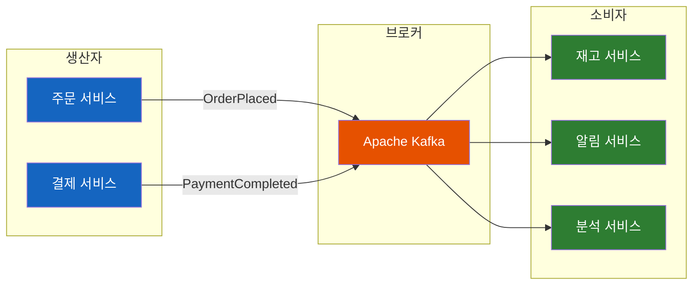
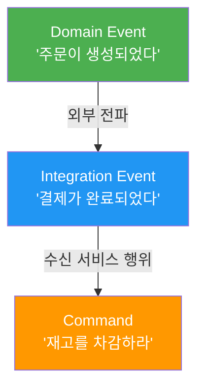
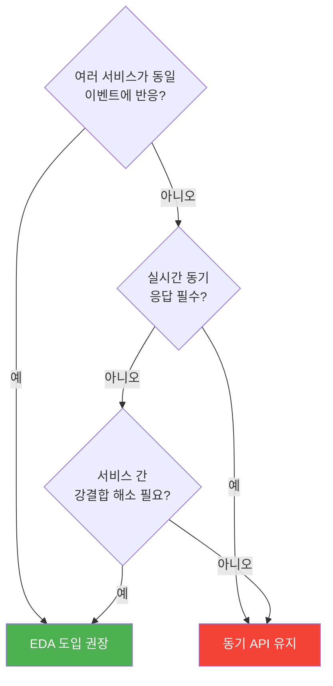
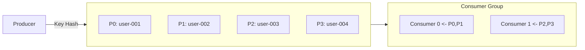
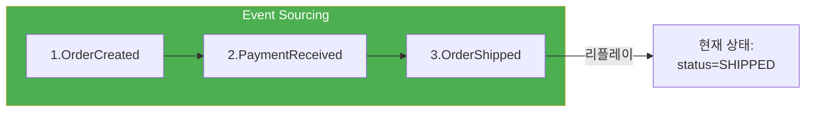
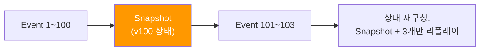
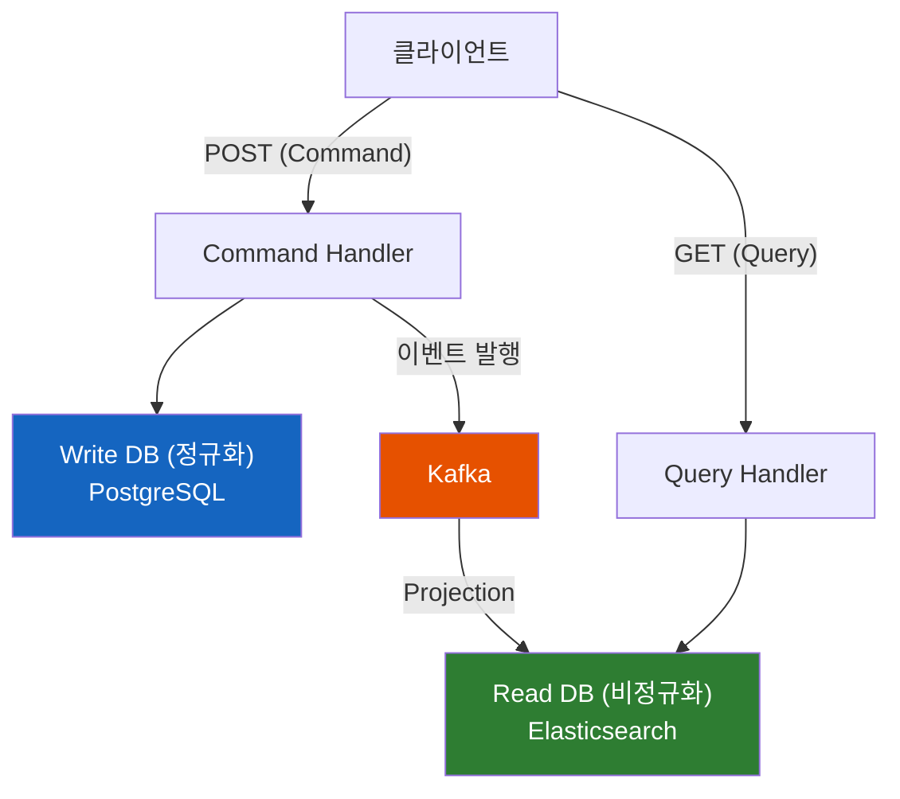
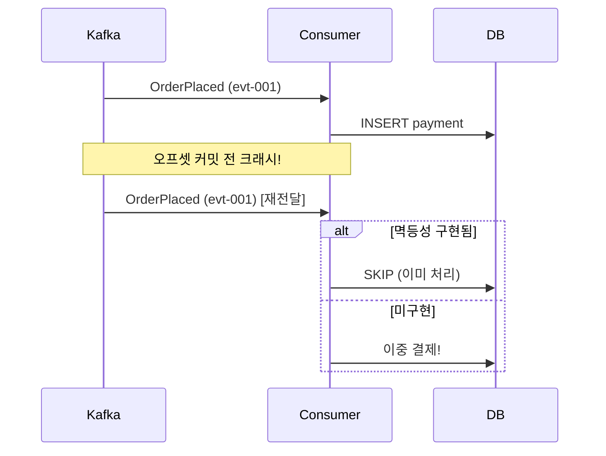
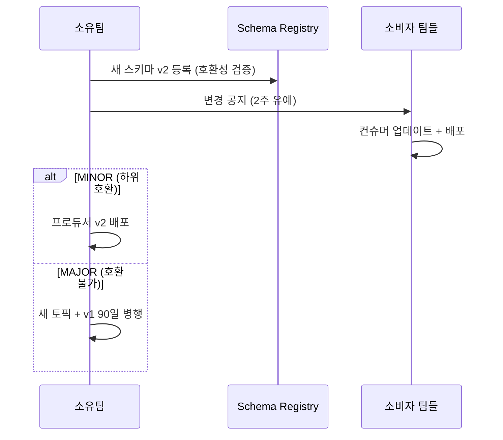
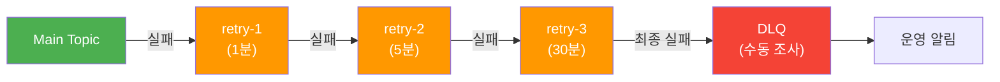

# 이벤트 드리븐 아키텍처(EDA) 설계 가이드

> **작성일**: 2026-03-12
> **기반 표준**: CloudEvents v1.0, AsyncAPI 3.0, Confluent Kafka Best Practices
> **적용 수준**: 빅테크 기준 팀 운영표준
> **적용 언어**: Python (aiokafka), Kotlin (Spring Kafka)

---

## 목차

1. [이벤트 드리븐 아키텍처 개요](#1-이벤트-드리븐-아키텍처-개요)
2. [Apache Kafka 설계 가이드](#2-apache-kafka-설계-가이드)
3. [이벤트 스키마 표준](#3-이벤트-스키마-표준)
4. [Event Sourcing](#4-event-sourcing)
5. [CQRS](#5-cqrs)
6. [이벤트 멱등성](#6-이벤트-멱등성)
7. [이벤트 카탈로그](#7-이벤트-카탈로그)
8. [EDA 안티패턴](#8-eda-안티패턴)

---

## 1. 이벤트 드리븐 아키텍처 개요

### 1.1 EDA란?

시스템 구성 요소 간 통신을 **이벤트(Event)** 매개로 수행하는 아키텍처 패턴이다. 서비스 간 직접 호출 대신 이벤트를 발행(Publish)하고 구독(Subscribe)하여 느슨한 결합을 달성한다.



### 1.2 이벤트 유형

| 유형 | 설명 | 시제 | 예시 |
|------|------|------|------|
| **Domain Event** | 도메인 내부에서 발생한 사실(fact) | 과거형 | `order.placed`, `user.registered` |
| **Integration Event** | 바운디드 컨텍스트 경계를 넘는 이벤트 | 과거형 | `payment.completed` |
| **Command** | 특정 행위 요청 메시지 | 명령형 | `payment.process`, `email.send` |



| 비교 기준 | Domain Event | Integration Event |
|-----------|-------------|-------------------|
| 범위 | 바운디드 컨텍스트 내부 | 컨텍스트 간 |
| 스키마 소유 | 해당 도메인팀 | 발행팀 + 소비팀 합의 |
| 직렬화 | 내부 객체 참조 가능 | 반드시 Avro/Protobuf 직렬화 |

### 1.3 EDA 장단점

| 장점 | 단점 |
|------|------|
| 느슨한 결합 -- 새 소비자 추가 시 기존 코드 변경 불필요 | 최종 일관성 -- 즉시 일관성 보장 불가 |
| 확장성 -- 컨슈머 그룹 스케일아웃 | 디버깅 난이도 -- 분산 트레이싱 필수 |
| 장애 격리 -- 소비자 간 독립적 | 순서 보장 -- 파티션 단위만 보장 |
| 이벤트 재처리 가능 | 운영 복잡도 -- 브로커+스키마+모니터링 |
| 감사 추적 용이 | 멱등성 구현 필수 (At-least-once) |

### 1.4 도입 결정 기준



---

## 2. Apache Kafka 설계 가이드

### 2.1 토픽 네이밍 컨벤션

**포맷**: `<domain>.<entity>.<event>`

| 구성 요소 | 설명 | 예시 |
|-----------|------|------|
| `domain` | 바운디드 컨텍스트 | `order`, `payment`, `user` |
| `entity` | Aggregate Root | `order`, `transaction`, `account` |
| `event` | 과거분사형 사건 | `placed`, `completed`, `failed` |

```
order.order.placed            # 주문 생성
payment.transaction.completed # 결제 완료
user.account.registered       # 사용자 등록
inventory.stock.reserved      # 재고 예약
order.order.placed.dlq        # Dead Letter Queue
order.order.placed.retry-1    # Retry 토픽
_internal.order.sync          # 내부 전용 토픽
```

**규칙**: 소문자만 사용, 구분자 `.`, 과거분사형, `auto.create.topics.enable=false`.

### 2.2 파티셔닝 전략



**키 기반** (순서 보장 필요): `order_id`, `user_id`, `transaction_id`를 파티션 키로 사용.
**라운드 로빈** (순서 무관): 로그 수집, 메트릭 전송 등 처리량 극대화.

#### Python -- 키 기반 발행

```python
from __future__ import annotations

from dataclasses import dataclass
from aiokafka import AIOKafkaProducer
import json

@dataclass(frozen=True)
class OrderPlacedEvent:
    order_id: str
    user_id: str
    total_amount: float

async def publish_order_placed(producer: AIOKafkaProducer, event: OrderPlacedEvent) -> None:
    """Publish OrderPlaced event with order_id as partition key."""
    await producer.send_and_wait(
        topic="order.order.placed",
        key=event.order_id.encode("utf-8"),
        value=json.dumps({"order_id": event.order_id, "user_id": event.user_id,
                          "total_amount": event.total_amount}).encode("utf-8"),
    )
```

#### Kotlin -- 키 기반 발행

```kotlin
@Service
class OrderEventPublisher(private val kafka: KafkaTemplate<String, OrderPlacedEvent>) {
    fun publish(event: OrderPlacedEvent) {
        kafka.send("order.order.placed", event.orderId, event)  // orderId = partition key
    }
}
```

### 2.3 컨슈머 그룹 설계

**네이밍**: `<service-name>.<purpose>` (예: `inventory-service.stock-deduction`)

| 원칙 | 설명 |
|------|------|
| 1 서비스 = 1 컨슈머 그룹 | 고유한 오프셋 관리 |
| 컨슈머 수 <= 파티션 수 | 초과 시 유휴 컨슈머 발생 |
| Cooperative Sticky Assignor | 리밸런싱 최소화 |

### 2.4 파티션 수 결정 기준

**공식**: `파티션 수 = max(목표 처리량 / 파티션당 처리량, 목표 처리량 / 컨슈머당 처리량)`

| 규모 | 처리량 | 권장 파티션 수 |
|------|--------|---------------|
| 소규모 | < 1K msg/s | 6 |
| 중규모 | 1K ~ 10K msg/s | 12 ~ 24 |
| 대규모 | 10K ~ 100K msg/s | 50 ~ 100 |
| 초대규모 | > 100K msg/s | 100 ~ 500 |

파티션은 **생성 후 줄일 수 없으므로** 보수적으로 시작. 브로커당 4,000개 이하 권장(KRaft).

### 2.5 Retention 정책

| 토픽 유형 | Retention | Cleanup Policy |
|-----------|-----------|----------------|
| 비즈니스 이벤트 | 7~30일 | delete |
| 감사 로그 | 90~365일 | delete |
| 상태 스냅샷 | 무제한 | compact |
| DLQ | 30~90일 | delete |

#### Kafka 토픽 설정 (YAML)

```yaml
topics:
  - name: order.order.placed
    partitions: 12
    replication_factor: 3
    config:
      retention.ms: 604800000        # 7 days
      cleanup.policy: delete
      min.insync.replicas: 2
      compression.type: lz4

  - name: user.account.state
    partitions: 6
    replication_factor: 3
    config:
      cleanup.policy: compact
      min.cleanable.dirty.ratio: 0.5
      min.insync.replicas: 2
```

#### Kafka 클러스터 핵심 설정 (YAML)

```yaml
broker:
  auto.create.topics.enable: false     # production 필수
  default.replication.factor: 3
  min.insync.replicas: 2
producer:
  acks: all
  enable.idempotence: true
  compression.type: lz4
  linger.ms: 5
consumer:
  enable.auto.commit: false            # manual commit
  auto.offset.reset: earliest
  partition.assignment.strategy: CooperativeStickyAssignor
```

### 2.6 Kafka vs RabbitMQ vs NATS

| 기준 | **Kafka** | **RabbitMQ** | **NATS** |
|------|----------|-------------|----------|
| 아키텍처 | 분산 로그 (Append-only) | 메시지 브로커 (Queue) | 경량 메시징 |
| 순서 보장 | 파티션 내 보장 | Queue 내 보장 | JetStream: Stream 내 |
| 메시지 보존 | 디스크 (retention 기반) | 소비 후 삭제 | 메모리 / JetStream: 디스크 |
| 처리량 | 수십만~수백만 msg/s | 수만 msg/s | 수백만 msg/s |
| Exactly-once | 트랜잭션 지원 | 미지원 | At-least-once |
| 재처리 | 오프셋 리셋 | 불가(기본) | JetStream: 가능 |
| 운영 복잡도 | 높음 | 중간 | 낮음 |
| 적합 사례 | 이벤트 소싱, 스트리밍 | 작업 큐, 라우팅 | IoT, 실시간 |

---

## 3. 이벤트 스키마 표준

### 3.1 CloudEvents 스펙

모든 이벤트는 [CloudEvents v1.0](https://cloudevents.io/) 스펙을 따른다.

| 필드 | 필수 | 설명 | 예시 |
|------|------|------|------|
| `id` | O | UUID v7 | `0192d3e0-7f3a-7b3c-...` |
| `type` | O | 이벤트 유형 (reverse DNS) | `com.mycompany.order.placed` |
| `source` | O | 발생 출처 URI | `/order-service/v1` |
| `specversion` | O | 스펙 버전 | `1.0` |
| `time` | - | RFC 3339 타임스탬프 | `2026-03-12T09:30:00Z` |
| `datacontenttype` | - | 미디어 타입 | `application/json` |
| `correlationid` | - | 분산 트레이싱 ID | `trace-abc-123` |
| `causationid` | - | 원인 이벤트 ID | `evt-prev-456` |

```json
{
  "specversion": "1.0",
  "id": "0192d3e0-7f3a-7b3c-a4e1-9b2c3d4e5f6a",
  "type": "com.mycompany.order.placed",
  "source": "/order-service/v1",
  "time": "2026-03-12T09:30:00Z",
  "datacontenttype": "application/json",
  "correlationid": "trace-abc-123",
  "data": {
    "order_id": "order-12345",
    "user_id": "user-789",
    "total_amount": 59800,
    "currency": "KRW"
  }
}
```

#### Python -- CloudEvent 모델

```python
from __future__ import annotations
import uuid
from dataclasses import dataclass, field
from datetime import datetime, timezone
from typing import Any

@dataclass(frozen=True)
class CloudEvent:
    """CloudEvents v1.0 compliant event envelope."""
    type: str
    source: str
    data: dict[str, Any]
    id: str = field(default_factory=lambda: str(uuid.uuid4()))
    specversion: str = "1.0"
    time: str = field(default_factory=lambda: datetime.now(timezone.utc).isoformat())
    datacontenttype: str = "application/json"
    correlationid: str | None = None
    causationid: str | None = None
```

#### Kotlin -- CloudEvent 모델

```kotlin
data class CloudEvent<T>(
    val type: String, val source: String, val data: T,
    val id: String = UUID.randomUUID().toString(),
    val specversion: String = "1.0",
    val time: Instant = Instant.now(),
    val datacontenttype: String = "application/json",
    val correlationid: String? = null,
    val causationid: String? = null,
)
```

### 3.2 AsyncAPI 문서화

AsyncAPI는 이벤트 기반 API의 OpenAPI에 해당한다.

```yaml
asyncapi: 3.0.0
info:
  title: Order Service Events
  version: 2.0.0
channels:
  orderPlaced:
    address: order.order.placed
    messages:
      orderPlacedMessage:
        payload:
          type: object
          required: [order_id, user_id, total_amount, currency]
          properties:
            order_id: { type: string }
            user_id: { type: string }
            total_amount: { type: integer }
            currency: { type: string, enum: [KRW, USD] }
operations:
  publishOrderPlaced:
    action: send
    channel: { $ref: '#/channels/orderPlaced' }
```

### 3.3 Schema Registry

| 기준 | **Avro** | **Protobuf** | **JSON Schema** |
|------|---------|-------------|-----------------|
| 인코딩 | 바이너리 | 바이너리 | 텍스트 (JSON) |
| 스키마 진화 | 우수 (네이티브) | 우수 (필드 번호) | 보통 |
| 메시지 크기 | 작음 | 작음 | 큼 (3~10배) |
| 가독성 | 낮음 | 낮음 | 높음 |
| 권장 | Kafka + 대용량 | gRPC + Kafka 혼용 | 소규모, 디버깅 우선 |

### 3.4 스키마 진화 (Schema Evolution)

| 호환성 | 설명 | 허용 변경 | 권장 |
|--------|------|-----------|------|
| **Backward** | 새 스키마로 이전 데이터 읽기 | 필드 추가(기본값 필수), 삭제 | 컨슈머 먼저 배포 |
| **Forward** | 이전 스키마로 새 데이터 읽기 | 필드 추가, 삭제(기본값 필수) | 프로듀서 먼저 배포 |
| **Full** | 양방향 호환 | 기본값 있는 필드 추가/삭제만 | **운영 환경 권장** |

**안전한 변경**: 기본값 있는 필드 추가/삭제.
**위험한 변경**: 필드 타입 변경, 필수 필드 삭제, 필드명 변경.

---

## 4. Event Sourcing

### 4.1 개념

엔터티의 현재 상태 대신 **상태를 변경한 모든 이벤트 시퀀스**를 저장하는 패턴이다.



### 4.2 적용 기준

| 적합 | 부적합 |
|------|--------|
| 감사(audit) 요구사항 (금융, 의료) | 단순 CRUD |
| 특정 시점 상태 재구성 필요 | 강한 일관성 필수 |
| 이벤트 리플레이로 버그 수정 | 팀 경험 부족 |
| CQRS와 결합 | 높은 읽기 비율 (CQRS 없이) |

### 4.3 스냅샷 전략

이벤트 수 증가에 따른 재구성 비용을 줄이기 위해 주기적으로 스냅샷을 생성한다.



| 전략 | 설명 |
|------|------|
| 이벤트 수 기반 | N개마다 스냅샷 (예: 100개) |
| 시간 기반 | 주기적 생성 (예: 1시간) |
| 조건 기반 | 특정 이벤트 시 생성 (예: 주문 완료) |

#### Python -- Event Sourcing 핵심

```python
from __future__ import annotations
from dataclasses import dataclass, field
from typing import Any

SNAPSHOT_THRESHOLD = 100

@dataclass(frozen=True)
class DomainEvent:
    aggregate_id: str
    event_type: str
    data: dict[str, Any]
    version: int

@dataclass
class OrderAggregate:
    order_id: str
    status: str = "CREATED"
    version: int = 0

    def apply(self, event: DomainEvent) -> OrderAggregate:
        """Apply event to produce new state."""
        handlers = {"OrderCreated": "CREATED", "OrderPaid": "PAID", "OrderShipped": "SHIPPED"}
        new_status = handlers.get(event.event_type, self.status)
        return OrderAggregate(order_id=self.order_id, status=new_status, version=event.version)
```

#### Kotlin -- Event Sourcing 핵심

```kotlin
sealed interface OrderEvent { val aggregateId: String; val version: Int }
data class OrderCreated(override val aggregateId: String, override val version: Int, val totalAmount: Long) : OrderEvent
data class OrderPaid(override val aggregateId: String, override val version: Int) : OrderEvent
data class OrderShipped(override val aggregateId: String, override val version: Int) : OrderEvent

data class OrderAggregate(val orderId: String, val status: String = "CREATED", val version: Int = 0) {
    fun apply(event: OrderEvent): OrderAggregate = when (event) {
        is OrderCreated -> copy(status = "CREATED", version = event.version)
        is OrderPaid -> copy(status = "PAID", version = event.version)
        is OrderShipped -> copy(status = "SHIPPED", version = event.version)
    }
}
```

---

## 5. CQRS

### 5.1 개념

**쓰기(Command)** 와 **읽기(Query)** 책임을 분리하여 각각 독립 최적화하는 패턴이다.



### 5.2 읽기/쓰기 모델 분리

| 구분 | Command (쓰기) | Query (읽기) |
|------|---------------|-------------|
| 목적 | 상태 변경 | 데이터 조회 |
| 모델 | 정규화 (3NF) | 비정규화 (조회 최적화) |
| 저장소 | PostgreSQL | Elasticsearch, Redis |
| 반환 | 식별자만 | 화면 최적화 DTO |

### 5.3 적용 시점

| 권장 | 비권장 |
|------|--------|
| 읽기/쓰기 비율 불균형 (10:1+) | 단순 CRUD |
| 복잡한 조회 (다중 조인, 전문검색) | 강한 일관성 필수 |
| 독립적 스케일링 필요 | 소규모 시스템 |
| Event Sourcing 결합 | 팀 경험 부족 |

---

## 6. 이벤트 멱등성

### 6.1 왜 필요한가?

네트워크 장애, 컨슈머 재시작으로 동일 이벤트가 2회 이상 전달될 수 있다.



### 6.2 전달 보장 수준

| 수준 | 중복 | 유실 | 복잡도 |
|------|------|------|--------|
| At-most-once | 없음 | 가능 | 낮음 |
| **At-least-once** | 가능 | 없음 | 중간 |
| Exactly-once | 없음 | 없음 | 높음 |

**권장**: At-least-once + 컨슈머 측 멱등성. Kafka EOS는 Kafka-to-Kafka에서만 완전 보장.

### 6.3 Idempotency Key 패턴

```sql
CREATE TABLE processed_events (
    event_id       VARCHAR(255) PRIMARY KEY,
    topic          VARCHAR(255) NOT NULL,
    consumer_group VARCHAR(255) NOT NULL,
    processed_at   TIMESTAMPTZ NOT NULL DEFAULT now()
);
```

#### Python -- Idempotent Consumer

```python
from __future__ import annotations
import asyncpg
from typing import Any

async def process_idempotently(pool: asyncpg.Pool, event_id: str, topic: str, handler: Any) -> bool:
    """Process event with idempotency via DB transaction."""
    async with pool.acquire() as conn:
        async with conn.transaction():
            if await conn.fetchval("SELECT 1 FROM processed_events WHERE event_id = $1", event_id):
                return False  # already processed
            await handler(conn)
            await conn.execute(
                "INSERT INTO processed_events (event_id, topic, consumer_group) VALUES ($1, $2, $3)",
                event_id, topic, "inventory-service.stock-deduction",
            )
    return True
```

#### Kotlin -- Idempotent Consumer

```kotlin
@KafkaListener(topics = ["order.order.placed"], groupId = "inventory-service.stock-deduction")
@Transactional
fun handleOrderPlaced(event: CloudEvent<OrderPlacedData>) {
    if (processedEventRepository.existsById(event.id)) return  // skip duplicate
    inventoryService.reserveStock(event.data.orderId, event.data.items)
    processedEventRepository.save(ProcessedEvent(eventId = event.id, topic = "order.order.placed"))
}
```

### 6.4 Deduplication 전략 선택

| 전략 | 장점 | 단점 |
|------|------|------|
| DB Unique + `ON CONFLICT` | 간단, 확실 | DB 부하 |
| Processed Events Table | 감사 추적 가능 | 테이블 크기 증가 |
| Redis Set (TTL) | 빠름 | Redis 장애 시 중복 가능 |
| Bloom Filter | 매우 빠름, 메모리 효율 | False Positive |
| Kafka Transactions | Kafka-to-Kafka 완전 보장 | 외부 시스템 미지원 |

---

## 7. 이벤트 카탈로그

### 7.1 카탈로그 양식

모든 이벤트의 정의, 소유팀, 스키마, 소비자를 중앙에서 관리한다.

| 이벤트 | 토픽 | 소유팀 | 버전 | 소비자 | Criticality |
|--------|------|--------|------|--------|-------------|
| `order.placed` | `order.order.placed` | 주문팀 | v2 | 재고, 알림, 분석 | HIGH |
| `order.cancelled` | `order.order.cancelled` | 주문팀 | v1 | 재고, 결제, 알림 | HIGH |
| `payment.completed` | `payment.transaction.completed` | 결제팀 | v3 | 주문, 알림 | HIGH |
| `user.registered` | `user.account.registered` | 사용자팀 | v1 | 알림, 분석, 마케팅 | MEDIUM |

### 7.2 버전 관리 정책

| 규칙 | 설명 |
|------|------|
| MAJOR 변경 | 호환성 깨짐 -- 새 토픽 생성 또는 병행 운영 |
| MINOR 변경 | 하위 호환 -- 스키마만 업데이트 |
| Deprecation | 이전 버전 최소 90일 병행 운영 후 폐기 |



### 7.3 소유팀 레지스트리

```yaml
teams:
  - name: order-team
    slack_channel: "#team-order"
    owned_events:
      - event: order.placed
        topic: order.order.placed
        schema_version: v2
        criticality: HIGH
  - name: payment-team
    slack_channel: "#team-payment"
    owned_events:
      - event: payment.completed
        topic: payment.transaction.completed
        schema_version: v3
        criticality: HIGH
```

**원칙**: 발행자 소유, 단일 소유, 스키마 변경 시 소비자 협의 필수, 계약 테스트 수행.

---

## 8. EDA 안티패턴

### 8.1 이벤트 스파게티

서비스 간 이벤트 의존성이 무분별하게 엮여 흐름 추적이 불가능한 상태.

**원인**: 카탈로그 부재, 서비스 경계 불명확, 순환 의존 (A->B->C->A).
**해결**: 이벤트 카탈로그, DDD 바운디드 컨텍스트, 순환 의존 금지, 복잡한 워크플로우는 Saga Orchestrator로 전환.

### 8.2 과도한 이벤트

```
# BAD: 필드마다 개별 이벤트
user.name.updated / user.email.updated / user.phone.updated ...

# GOOD: 비즈니스 단위로 통합
user.profile.updated / user.address.updated / user.preferences.updated
```

**발행 기준**: (1) 비즈니스적으로 의미 있는가? (2) 소비자가 존재하는가? (3) 다른 서비스가 반응해야 하는가?

### 8.3 동기적 이벤트 처리

이벤트 발행 후 소비자 처리 완료를 동기 대기하는 패턴. EDA의 비동기/느슨한 결합 장점을 상실한다.

**해결**: 이벤트 발행 후 즉시 `202 Accepted` 응답, 결과는 상태 폴링 또는 콜백/웹훅으로 처리.

### 8.4 안티패턴 요약

| 안티패턴 | 설명 | 해결 |
|----------|------|------|
| 이벤트에 명령 포함 | 이벤트 = 사실, 명령 혼재 금지 | Domain Event와 Command 분리 |
| 거대 이벤트 | 수 KB~MB 페이로드 | 필요 데이터만 + 참조 ID |
| 글로벌 순서 의존 | 전역 순서 보장 불가 | 파티션 키 기반 로컬 순서 사용 |
| 스키마 미관리 | 자유 포맷 JSON | Schema Registry + 호환성 검증 |
| DLQ 미설정 | 실패 이벤트 유실 | DLQ + 재처리 파이프라인 |
| Retry 무한 루프 | 처리 불가 이벤트 반복 | 지수 백오프 + 최대 횟수 + DLQ |

### 8.5 DLQ + Retry 설계



#### Kotlin -- Spring Kafka Retry + DLQ

```kotlin
@Configuration
class KafkaErrorConfig(private val kafkaTemplate: KafkaTemplate<String, Any>) {
    @Bean
    fun errorHandler(): DefaultErrorHandler {
        val recoverer = DeadLetterPublishingRecoverer(kafkaTemplate) { record, _ ->
            TopicPartition("${record.topic()}.dlq", record.partition())
        }
        val backOff = ExponentialBackOff().apply {
            initialInterval = 1000L; multiplier = 2.0; maxElapsedTime = 10000L
        }
        return DefaultErrorHandler(recoverer, backOff)
    }
}
```

#### Python -- aiokafka Retry + DLQ

```python
from __future__ import annotations
import asyncio
from aiokafka import AIOKafkaProducer

MAX_RETRIES = 3
RETRY_DELAYS = (60, 300, 1800)

async def send_to_retry_or_dlq(
    producer: AIOKafkaProducer, topic: str, key: bytes, value: bytes, retry_count: int,
) -> None:
    """Route failed message to retry topic or DLQ."""
    if retry_count < MAX_RETRIES:
        await asyncio.sleep(RETRY_DELAYS[retry_count])
        await producer.send_and_wait(
            f"{topic}.retry-{retry_count + 1}", key=key, value=value,
            headers=[(b"retry-count", str(retry_count + 1).encode())],
        )
    else:
        await producer.send_and_wait(
            f"{topic}.dlq", key=key, value=value,
            headers=[(b"failure-reason", b"max retries exceeded")],
        )
```

---

## 참고 자료

| 자료 | 설명 |
|------|------|
| [CloudEvents](https://cloudevents.io/) | CNCF 이벤트 메타데이터 표준 |
| [AsyncAPI](https://www.asyncapi.com/) | 이벤트 기반 API 문서화 표준 |
| [Confluent Docs](https://docs.confluent.io/) | Kafka 운영 가이드 |
| [M. Fowler - Event Sourcing](https://martinfowler.com/eaaDev/EventSourcing.html) | Event Sourcing 패턴 |
| [M. Fowler - CQRS](https://martinfowler.com/bliki/CQRS.html) | CQRS 패턴 |
| [Designing Data-Intensive Applications](https://dataintensive.net/) | Ch.11 Stream Processing |
