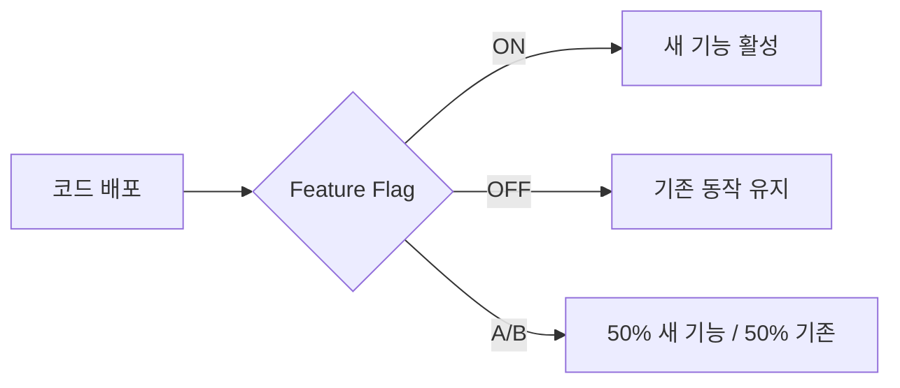
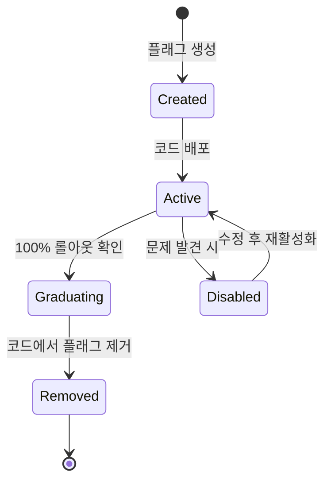

# Feature Flag 관리 가이드

> 안전한 배포와 실험을 위한 Feature Flag 설계, 운영, 위생 관리 표준.

---

## 1. Feature Flag 유형

| 유형 | 목적 | 수명 | 예시 |
|------|------|------|------|
| **Release Toggle** | 미완성 기능 숨김 | 단기 (1-4주) | `ENABLE_NEW_CHECKOUT` |
| **Experiment Toggle** | A/B 테스트 | 중기 (2-8주) | `EXPERIMENT_PRICING_V2` |
| **Ops Toggle** | 운영 중 기능 비활성화 | 장기 | `ENABLE_HEAVY_REPORT` |
| **Permission Toggle** | 사용자/그룹별 기능 | 영구 | `FEATURE_ADMIN_PANEL` |



---

## 2. 설계 원칙

### 2.1 네이밍 컨벤션

```
<TYPE>_<DOMAIN>_<FEATURE>

RELEASE_CHECKOUT_NEW_FLOW
EXPERIMENT_PRICING_TIERED
OPS_REPORT_HEAVY_DISABLE
PERMISSION_ADMIN_ADVANCED
```

### 2.2 코드 패턴

**Python:**
```python
from feature_flags import is_enabled

async def get_recommendations(user: User) -> list[Product]:
    if is_enabled("EXPERIMENT_RECOMMENDATION_V2", user_id=user.id):
        return await recommendation_v2(user)
    return await recommendation_v1(user)
```

**Kotlin:**
```kotlin
fun getRecommendations(user: User): List<Product> {
    return if (featureFlags.isEnabled("EXPERIMENT_RECOMMENDATION_V2", user.id)) {
        recommendationV2(user)
    } else {
        recommendationV1(user)
    }
}
```

**TypeScript:**
```typescript
async function getRecommendations(user: User): Promise<Product[]> {
  if (await featureFlags.isEnabled("EXPERIMENT_RECOMMENDATION_V2", user.id)) {
    return recommendationV2(user);
  }
  return recommendationV1(user);
}
```

### 2.3 금지 패턴

| 패턴 | 문제 | 해결 |
|------|------|------|
| 중첩 플래그 (`if A && B`) | 조합 폭발, 테스트 불가 | 독립적 플래그 설계 |
| 플래그 내 비즈니스 로직 | 플래그 제거 시 로직 손실 | 로직을 서비스로 분리 |
| 플래그 없는 롤아웃 | 롤백 불가 | Release Toggle 필수 |

---

## 3. 위생 관리 (Hygiene)

### 3.1 생명주기



### 3.2 규칙

| 규칙 | 기준 |
|------|------|
| 만료 기한 필수 | 생성 시 `expires_at` 설정 |
| 최대 활성 플래그 수 | 팀당 30개 이하 |
| Release Toggle 최대 수명 | 4주 (초과 시 알림) |
| 분기 정리 스프린트 | 만료된 플래그 코드에서 제거 |
| 소유자 필수 | 모든 플래그에 담당 팀/개인 지정 |

### 3.3 정리 절차

```
1. 만료된 플래그 목록 추출
2. 각 플래그의 현재 상태 확인 (ON 100%? OFF?)
3. ON 100% → 플래그 코드 제거, 새 경로만 유지
4. OFF → 플래그 코드 제거, 기존 경로만 유지
5. PR + 테스트 → 배포
6. 플래그 시스템에서 삭제
```

---

## 4. A/B 테스트

### 4.1 실험 설계

```yaml
experiment:
  name: EXPERIMENT_PRICING_TIERED
  hypothesis: "가격 차등화가 전환율을 5% 향상시킨다"
  metric: conversion_rate
  variants:
    control: 50%    # 기존 단일 가격
    treatment: 50%  # 차등 가격제
  minimum_sample_size: 10000
  duration: 14_days
  owner: "@product-team"
```

### 4.2 통계적 유의성

- 최소 샘플: 변형당 1,000+ 사용자
- p-value: <0.05
- 실험 기간: 최소 7일 (주말 포함)
- 신규성 효과(Novelty Effect) 방지: 14일 권장

---

## 5. 도구 선택

| 도구 | 유형 | 장점 | 단점 |
|------|------|------|------|
| **LaunchDarkly** | SaaS | 가장 풍부한 기능, SDK 20+ | 비용 높음 |
| **Unleash** | Self-hosted/Cloud | 오픈소스, 자체 호스팅 | 기능 제한적 |
| **Flagsmith** | Self-hosted/Cloud | 오픈소스, 원격 설정 | 커뮤니티 작음 |
| **Statsig** | SaaS | A/B 테스트 강점, 자동 분석 | SaaS 의존 |
| **자체 구현** | Custom | 완전한 통제 | 유지보수 비용 |

---

## 6. 체크리스트

### 플래그 생성 시
- [ ] 네이밍 컨벤션 준수 (`TYPE_DOMAIN_FEATURE`)
- [ ] 만료 기한 설정
- [ ] 소유자 지정
- [ ] 기본값 = OFF (안전 기본값)
- [ ] 플래그 OFF 시 기존 동작 보장

### 분기별
- [ ] 만료된 플래그 목록 정리
- [ ] 활성 플래그 30개 이하 유지
- [ ] 100% 롤아웃된 플래그 코드에서 제거
- [ ] 미사용 플래그 삭제

---

## 참고 자료

- [Martin Fowler: Feature Toggles](https://martinfowler.com/articles/feature-toggles.html)
- [LaunchDarkly Best Practices](https://launchdarkly.com/blog/feature-flag-best-practices/)
