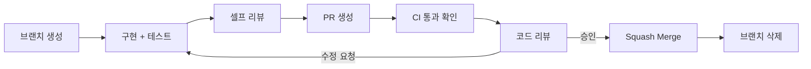
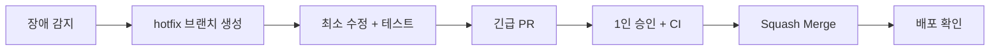

# Git 컨벤션 가이드

> 팀 전체가 일관된 Git 워크플로우를 유지하기 위한 규칙을 정의한다.

---

## 1. 커밋 메시지

### 정본 형식: 한글 커밋

팀 내부 프로젝트의 **기본 커밋 형식**은 한글이다. 오픈소스 또는 외부 공개 프로젝트에서는 영문 Conventional Commits를 사용한다.

```
<한글타입>: <제목> (50자 이내)

<본문> (선택, 72자 줄바꿈)
- 무엇을, 왜 변경했는지 설명

<꼬리말> (선택)
Fixes #123
```

### 타입 목록

| 한글 타입 | 영문 (오픈소스용) | 설명 | SemVer |
|-----------|-------------------|------|--------|
| `기능` | `feat` | 새 기능 추가 | MINOR |
| `수정` | `fix` | 버그 수정 | PATCH |
| `문서` | `docs` | 문서 변경 | - |
| `스타일` | `style` | 코드 포매팅 (로직 변경 없음) | - |
| `리팩터` | `refactor` | 리팩터링 (기능 변경 없음) | - |
| `성능` | `perf` | 성능 개선 | - |
| `테스트` | `test` | 테스트 추가/수정 | - |
| `빌드` | `build` | 빌드 시스템/의존성 변경 | - |
| `CI` | `ci` | CI 설정 변경 | - |
| `기타` | `chore` | 기타 변경 | - |
| `되돌림` | `revert` | 이전 커밋 되돌리기 | - |

### 예시

**한글 (기본):**
```
기능: 사용자 로그인 기능 추가

- JWT 토큰 기반 인증 구현
- 로그인 폼 컴포넌트 생성
- 세션 관리 로직 추가

Fixes #42
```

```
수정: 동시 결제 시 재고 경합 조건 해결

결제 프로세스에서 재고 잠금이 누락되어
동시 결제 시 초과 판매가 발생했음

Fixes #287
```

**영문 (오픈소스):**
```
feat(auth): add JWT token refresh endpoint

- Implement token rotation with sliding window
- Add refresh token storage in Redis
- Set 7-day expiry for refresh tokens

Closes #142
```

### Breaking Change 표기

한글: 제목 끝에 `(BREAKING)` 추가 + 본문에 변경 내용 명시.
영문: 타입 뒤에 `!` 또는 footer에 `BREAKING CHANGE:`.

```
기능: API 응답 포맷 변경 (BREAKING)

- /api/users 응답이 페이지네이션 포맷으로 변경
- 기존: [User, ...]
- 변경: { data: [User, ...], pagination: {...} }
```

### Squash Merge 커밋 메시지

Squash Merge 시 **PR 제목**을 커밋 메시지로 사용한다. PR 제목은 반드시 위의 커밋 형식을 따른다.

```
기능: 사용자 로그인 기능 추가 (#42)
```

---

## 2. 브랜치 전략

### 기본 전략: GitHub Flow

> 모든 팀은 GitHub Flow를 기본으로 사용한다. Trunk-Based Development는 CI/CD 성숙도와 테스트 커버리지 ≥80%를 충족한 팀에서 선택적으로 전환할 수 있다.

```mermaid
gitgraph
    commit id: "initial"
    branch feat/user-auth
    commit id: "add login"
    commit id: "add tests"
    checkout main
    merge feat/user-auth id: "PR #1"
    branch fix/login-error
    commit id: "fix null check"
    checkout main
    merge fix/login-error id: "PR #2"
```

**규칙:**
- `main` 브랜치는 항상 배포 가능한 상태
- 모든 작업은 feature branch에서 수행
- PR을 통해서만 main에 병합
- main에 직접 커밋 금지

### 브랜치 네이밍

```
<type>/<short-description>
```

| 타입 | 예시 |
|------|------|
| `feat/` | `feat/user-authentication`, `feat/42-user-auth` |
| `fix/` | `fix/login-null-pointer` |
| `refactor/` | `refactor/payment-service` |
| `docs/` | `docs/api-documentation` |
| `chore/` | `chore/upgrade-dependencies` |
| `hotfix/` | `hotfix/critical-security-patch` |

**규칙:**
- 소문자 + 하이픈(`-`) 사용
- 이슈 번호 포함 권장: `feat/42-user-auth`
- 개인 접두사 지양: ~~`john/feat/login`~~

### Branch Protection 설정 (GitHub)

`main` 브랜치에 아래 보호 규칙을 반드시 적용한다:

```yaml
# GitHub Settings > Branches > Branch protection rules
main:
  require_pull_request:
    required_approving_review_count: 1
    dismiss_stale_reviews: true         # 코드 변경 시 기존 승인 무효화
    require_code_owner_reviews: true    # CODEOWNERS 승인 필수
  require_status_checks:
    strict: true                        # 최신 main 기반 확인
    contexts:
      - "ci/quality-gate"              # CI 파이프라인 통과 필수
  enforce_admins: true                  # 관리자도 규칙 적용
  restrictions:
    push: []                            # 직접 push 차단
  allow_force_pushes: false             # force push 금지
  allow_deletions: false                # 브랜치 삭제 금지
```

### TBD 전환 조건 (선택적)

Trunk-Based Development로 전환하려면 아래 조건을 모두 충족해야 한다:

| 조건 | 기준 |
|------|------|
| 테스트 커버리지 | ≥80% |
| CI 파이프라인 | 전체 통과 시간 ≤10분 |
| Feature Flag 시스템 | 도입 완료 |
| 자동화 배포 | 검증 완료 |

---

## 3. Pull Request 규칙

### PR 크기

| 크기 | 줄 수 | 리뷰 난이도 | 권장 |
|------|-------|-------------|------|
| XS | ~50줄 | 쉬움 | O |
| S | ~200줄 | 적절 | O |
| M | ~400줄 | 보통 | O (최대) |
| L | ~800줄 | 어려움 | X (분할 필요) |
| XL | 800줄+ | 매우 어려움 | X (반드시 분할) |

### PR 프로세스



### Merge 전략

| 전략 | 사용 시점 | 결과 |
|------|-----------|------|
| **Squash and Merge** | 일반 feature PR (기본) | 깔끔한 히스토리, PR 제목이 커밋 메시지 |
| **Rebase and Merge** | 커밋 히스토리 보존 필요 시 | 선형 히스토리 |
| **Merge Commit** | 사용 금지 | 불필요한 merge 커밋 생성 |

### 필수 조건

- CI 파이프라인 통과
- 최소 1명 이상의 리뷰어 승인
- 코드 소유자(CODEOWNERS) 승인 (해당 시)
- 모든 BLOCKER 코멘트 해결

---

## 4. Hotfix & Revert 절차

### Hotfix (프로덕션 긴급 수정)



```bash
git checkout main && git pull
git checkout -b hotfix/critical-security-patch
# 최소 수정 후
gh pr create --title "수정: 긴급 보안 패치" --label hotfix
```

- Hotfix는 **최소 수정 원칙** (근본 수정은 이후 별도 PR)
- 1인 승인으로 병합 가능 (긴급 시)
- 병합 후 즉시 배포 확인

### Revert (롤백)

```bash
# 특정 커밋 되돌리기
git revert <commit-hash>
git push origin main

# PR을 통한 revert (권장)
gh pr create --title "되돌림: <원래 커밋 제목>"
```

---

## 5. 태그 & 릴리스

### 시맨틱 버저닝

```
MAJOR.MINOR.PATCH
```

| 변경 유형 | 버전 증가 | 예시 |
|-----------|-----------|------|
| Breaking Change | MAJOR | 1.0.0 → **2**.0.0 |
| 새 기능 (하위 호환) | MINOR | 1.0.0 → 1.**1**.0 |
| 버그 수정 | PATCH | 1.0.0 → 1.0.**1** |

```bash
git tag -a v1.2.0 -m "Release v1.2.0: 사용자 인증 기능"
git push origin v1.2.0
```

---

## 6. .gitignore 필수 항목

```gitignore
# Environment
.env
.env.local
.env.*.local

# Secrets
*.pem
*.key
*.secret
credentials.json

# IDE
.idea/
.vscode/
*.swp
*.swo

# OS
.DS_Store
Thumbs.db

# Build artifacts (언어별 추가)
# Python: __pycache__/, .venv/, .mypy_cache/
# Kotlin/Java: build/, .gradle/, *.class
# Node: node_modules/, dist/
```

---

## 7. 금지 사항

| 금지 행위 | 이유 |
|-----------|------|
| `main` 브랜치에 직접 push | 코드 리뷰 우회 |
| `git push --force` (main) | 히스토리 파괴 |
| 시크릿 커밋 | 보안 사고, Git 히스토리에 영원히 잔존 |
| 대용량 바이너리 커밋 | 레포지토리 비대화 (Git LFS 사용) |
| WIP 커밋으로 main 병합 | 불완전한 코드 배포 위험 |
| `.gitignore` 무시한 커밋 | 불필요한 파일 추적 |
| Merge Commit | 불필요한 merge 커밋으로 히스토리 오염 |
