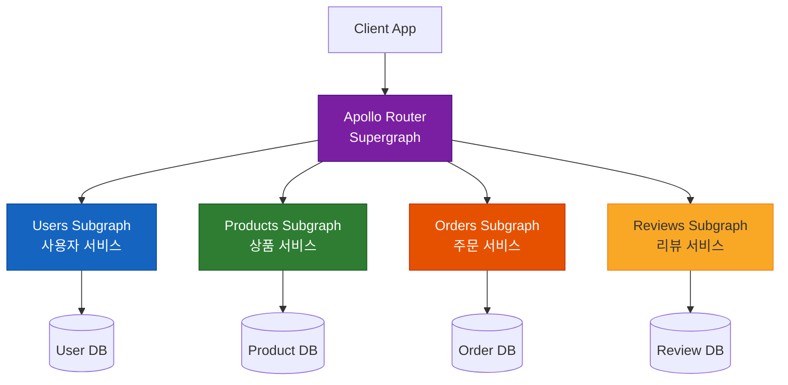
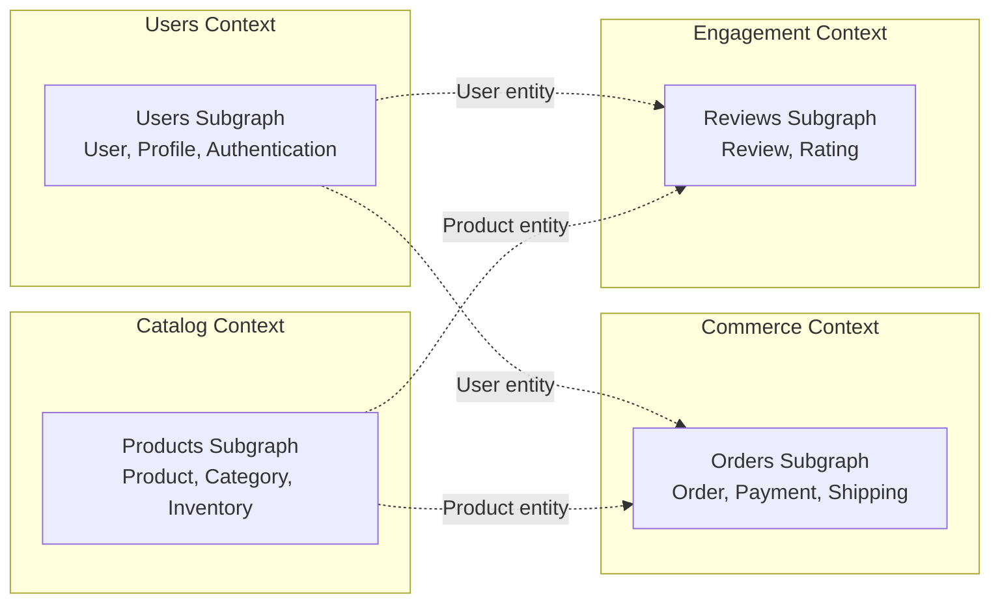

# GraphQL Federation 가이드

> **작성일**: 2026-03-14
> **목적**: 마이크로서비스 환경에서 GraphQL Federation 2.0을 활용한 분산 스키마 설계 및 운영 가이드

---

## 목차

1. [Federation 2.0 개요](#1-federation-20-개요)
2. [아키텍처 구조](#2-아키텍처-구조)
3. [스키마 설계](#3-스키마-설계)
4. [Apollo Router 설정](#4-apollo-router-설정)
5. [서비스별 서브그래프 분리 패턴](#5-서비스별-서브그래프-분리-패턴)
6. [에러 처리 및 복원력](#6-에러-처리-및-복원력)
7. [모니터링 및 운영](#7-모니터링-및-운영)
8. [모범 사례](#8-모범-사례)

---

## 1. Federation 2.0 개요

GraphQL Federation은 여러 마이크로서비스가 각자 서브그래프(Subgraph)를 소유하고, 이를 하나의 통합 스키마(Supergraph)로 합성하는 아키텍처이다.

### Federation 1.0 vs 2.0

| 항목 | Federation 1.0 | Federation 2.0 |
|------|----------------|----------------|
| **@key 다중 정의** | 불가 | 가능 (복합 키 지원) |
| **타입 공유** | 암묵적 (`extend type`) | 명시적 (`@shareable`) |
| **값 타입** | 엔티티만 공유 | 값 타입도 공유 가능 |
| **@override** | 없음 | 점진적 마이그레이션 지원 |
| **@inaccessible** | 없음 | 내부 전용 필드 숨김 가능 |
| **구성 규칙** | 암묵적 | 명시적 (composition 오류 감지) |

### 핵심 용어

| 용어 | 설명 |
|------|------|
| **Supergraph** | 모든 서브그래프를 합성한 통합 스키마 |
| **Subgraph** | 개별 서비스가 소유하는 GraphQL 스키마 |
| **Router** | 클라이언트 요청을 받아 서브그래프에 분배하는 게이트웨이 |
| **Entity** | 여러 서브그래프에 걸쳐 존재하는 공유 타입 |
| **Supergraph Schema (SDL)** | 합성된 전체 스키마 정의 |

---

## 2. 아키텍처 구조



**요청 흐름**:

1. 클라이언트가 Router에 단일 GraphQL 쿼리를 전송한다
2. Router가 Query Plan을 생성하여 필요한 서브그래프를 판별한다
3. 각 서브그래프에 병렬/순차 요청을 보낸다
4. 응답을 합성하여 클라이언트에 단일 응답을 반환한다

---

## 3. 스키마 설계

### 3.1 Entity 정의 (@key)

Entity는 여러 서브그래프에서 참조되는 공유 타입이다. `@key` 지시어로 고유 식별자를 정의한다.

```graphql
# -- Users Subgraph --
# Entity definition: this subgraph owns User
type User @key(fields: "id") {
  id: ID!
  name: String!
  email: String!
  createdAt: DateTime!
}

type Query {
  user(id: ID!): User
  me: User
}
```

```graphql
# -- Reviews Subgraph --
# Entity reference: extends User from Users subgraph
type User @key(fields: "id") {
  id: ID!
  reviews: [Review!]!    # This subgraph adds the reviews field
}

type Review @key(fields: "id") {
  id: ID!
  body: String!
  rating: Int!
  author: User!
  product: Product!
}
```

### 3.2 @external, @requires, @provides

| 지시어 | 용도 |
|--------|------|
| `@external` | 다른 서브그래프가 소유한 필드 참조 |
| `@requires` | 외부 필드 값을 기반으로 필드를 계산 |
| `@provides` | 중첩 엔티티의 특정 필드를 이 서브그래프가 제공 |

```graphql
# -- Orders Subgraph --
type Product @key(fields: "id") {
  id: ID!
  price: Float! @external       # Owned by Products subgraph
  weight: Float! @external      # Owned by Products subgraph
}

type Order @key(fields: "id") {
  id: ID!
  items: [OrderItem!]!
  totalPrice: Float!
  shippingCost: Float!
}

type OrderItem {
  product: Product!
  quantity: Int!
  subtotal: Float! @requires(fields: "product { price }")
}
```

### 3.3 @shareable (Federation 2.0)

값 타입(Value Type)을 여러 서브그래프에서 정의할 때 사용한다.

```graphql
# -- Both Products and Orders subgraphs can define this --
type Money @shareable {
  amount: Float!
  currency: String!
}
```

### 3.4 @override (점진적 마이그레이션)

필드 소유권을 한 서브그래프에서 다른 서브그래프로 이전할 때 사용한다.

```graphql
# -- New Products V2 Subgraph --
# Gradually migrate 'description' field from legacy Products subgraph
type Product @key(fields: "id") {
  id: ID!
  description: String! @override(from: "products-legacy")
}
```

---

## 4. Apollo Router 설정

### 4.1 기본 설정

Apollo Router는 Rust로 작성된 고성능 Federation 게이트웨이이다.

```yaml
# router.yaml
supergraph:
  listen: 0.0.0.0:4000

# Subgraph routing
override_subgraph_url:
  users: http://users-service:4001/graphql
  products: http://products-service:4002/graphql
  orders: http://orders-service:4003/graphql
  reviews: http://reviews-service:4004/graphql

# Query planning
query_planning:
  cache:
    in_memory:
      limit: 512

# Rate limiting
limits:
  max_depth: 15
  max_height: 200
  max_aliases: 30
  max_root_fields: 20

# CORS
cors:
  origins:
    - https://app.example.com
  allow_headers:
    - Content-Type
    - Authorization

# Telemetry
telemetry:
  exporters:
    tracing:
      otlp:
        enabled: true
        endpoint: http://otel-collector:4317
        protocol: grpc
    metrics:
      prometheus:
        enabled: true
        listen: 0.0.0.0:9090
        path: /metrics
```

### 4.2 Supergraph 합성

```bash
# Install Rover CLI
curl -sSL https://rover.apollo.dev/nix/latest | sh

# Compose supergraph from local subgraph schemas
rover supergraph compose --config ./supergraph.yaml > supergraph.graphql

# supergraph.yaml
federation_version: =2.9
subgraphs:
  users:
    routing_url: http://users-service:4001/graphql
    schema:
      file: ./subgraphs/users/schema.graphql
  products:
    routing_url: http://products-service:4002/graphql
    schema:
      file: ./subgraphs/products/schema.graphql
  orders:
    routing_url: http://orders-service:4003/graphql
    schema:
      file: ./subgraphs/orders/schema.graphql
```

### 4.3 Docker Compose 예시

```yaml
# docker-compose.yml
services:
  router:
    image: ghcr.io/apollographql/router:v2.1.0
    ports:
      - "4000:4000"
      - "9090:9090"  # Prometheus metrics
    volumes:
      - ./router.yaml:/dist/config/router.yaml
      - ./supergraph.graphql:/dist/config/supergraph.graphql
    command: --config /dist/config/router.yaml --supergraph /dist/config/supergraph.graphql

  users-service:
    build: ./services/users
    ports:
      - "4001:4001"

  products-service:
    build: ./services/products
    ports:
      - "4002:4002"

  orders-service:
    build: ./services/orders
    ports:
      - "4003:4003"
```

---

## 5. 서비스별 서브그래프 분리 패턴

### 5.1 도메인 경계 기준 분리

서브그래프는 마이크로서비스의 Bounded Context와 1:1로 대응하는 것이 원칙이다.



### 5.2 분리 체크리스트

| 질문 | 가이드라인 |
|------|-----------|
| 이 타입을 누가 소유하는가? | CRUD 권한이 있는 서비스가 소유자 |
| 여러 서비스가 필드를 추가하는가? | Entity로 정의하고 `@key`로 참조 |
| 이 데이터는 자주 함께 조회되는가? | 같은 서브그래프에 배치 (네트워크 비용 절감) |
| 독립 배포가 가능한가? | 서브그래프 간 순환 의존이 없어야 한다 |

### 5.3 __resolveReference 구현 (서브그래프 서버)

각 서브그래프는 Entity의 참조를 해석하는 `__resolveReference` 함수를 구현해야 한다.

```typescript
// Users subgraph (TypeScript + Apollo Server)
const resolvers = {
  User: {
    __resolveReference(ref: { id: string }, context: Context) {
      // Router sends { id } from @key, resolve full User object
      return context.dataSources.usersAPI.getUserById(ref.id);
    },
  },
  Query: {
    me: (_: unknown, __: unknown, context: Context) => {
      return context.dataSources.usersAPI.getCurrentUser(context.userId);
    },
  },
};
```

---

## 6. 에러 처리 및 복원력

### 6.1 서브그래프 장애 격리

```yaml
# router.yaml -- traffic shaping
traffic_shaping:
  subgraphs:
    all:
      timeout: 5s            # Per-subgraph timeout
    orders:
      timeout: 10s           # Order service gets more time
      experimental_retry:
        min_per_sec: 10
        ttl: 10s
        retry_percent: 0.2
```

### 6.2 Partial Response

서브그래프 하나가 실패해도 나머지 데이터는 정상 반환한다. nullable 필드를 적절히 활용한다.

```graphql
# If Reviews subgraph is down, product data still returns
type Product @key(fields: "id") {
  id: ID!
  name: String!         # Always available (Products subgraph)
  price: Float!         # Always available (Products subgraph)
  reviews: [Review!]    # Nullable -- degrades gracefully when Reviews is down
}
```

---

## 7. 모니터링 및 운영

### 필수 메트릭

| 메트릭 | 설명 | 임계값 |
|--------|------|--------|
| `apollo_router_http_request_duration` | 전체 요청 레이턴시 | p99 < 500ms |
| `apollo_router_query_planning_time` | Query Plan 생성 시간 | p99 < 50ms |
| `apollo_router_subgraph_request_duration` | 서브그래프 개별 레이턴시 | p99 < 200ms |
| `apollo_router_subgraph_error_total` | 서브그래프 에러 카운트 | 비정상 급증 알림 |

### 스키마 변경 CI 체크

```bash
# CI pipeline: schema check before deploy
rover subgraph check my-graph@production \
  --name users \
  --schema ./subgraphs/users/schema.graphql
```

이 명령은 스키마 변경이 기존 클라이언트 쿼리와 호환되는지 확인한다. Breaking change가 감지되면 배포를 차단한다.

---

## 8. 모범 사례

### 스키마 설계 원칙

1. **Entity 소유권을 명확히 정의한다**: 하나의 서브그래프만 Entity의 핵심 필드를 소유한다
2. **N+1 문제를 방지한다**: DataLoader 패턴으로 배치 조회를 구현한다
3. **순환 참조를 피한다**: A -> B -> A 형태의 참조는 Query Plan을 복잡하게 만든다
4. **@key는 변하지 않는 식별자로 설정한다**: `id`, `sku`, `slug` 등 불변 필드 사용
5. **값 타입은 @shareable로 공유한다**: 주소, 금액 등 동일한 정의를 여러 서브그래프에서 사용

### 운영 원칙

1. **스키마 레지스트리를 사용한다**: Apollo Studio 또는 자체 레지스트리로 스키마 버전을 관리한다
2. **Subgraph를 독립 배포한다**: 다른 서브그래프에 영향 없이 배포할 수 있어야 한다
3. **Schema Check를 CI에 포함한다**: 모든 PR에서 breaking change를 자동 감지한다
4. **Query Plan 캐싱을 활성화한다**: 동일 쿼리의 반복 실행 성능을 최적화한다
5. **Persisted Queries를 사용한다**: 프로덕션에서 임의 쿼리 실행을 방지하고 성능을 개선한다

---

## 참고 자료

| 리소스 | URL |
|--------|-----|
| Apollo Federation 2 공식 문서 | <https://www.apollographql.com/docs/federation/> |
| Apollo Router 문서 | <https://www.apollographql.com/docs/router/> |
| Rover CLI | <https://www.apollographql.com/docs/rover/> |
| Federation 스펙 | <https://www.apollographql.com/docs/federation/federation-spec/> |
