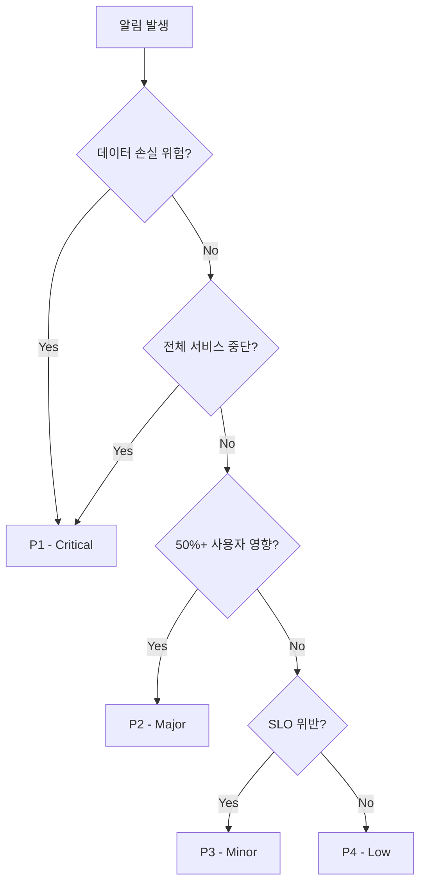
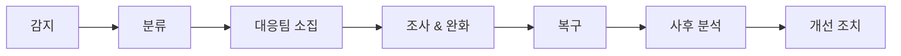
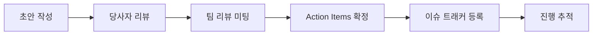

# 인시던트 관리 프로세스 가이드

> Blameless Post-mortem 문화 기반의 체계적 인시던트 관리 프로세스.
> Google SRE + PagerDuty 모범 사례 기반.

---

## 1. 인시던트 심각도 분류

| 심각도 | 이름 | 기준 | 초기 대응 | 에스컬레이션 |
|--------|------|------|-----------|-------------|
| **P1** | Critical | 전체 서비스 중단, 데이터 손실 위험, SLO 대폭 위반 | 즉시 (5분 이내) | VP/CTO |
| **P2** | Major | 주요 기능 장애, 50%+ 사용자 영향, SLO 위반 | 15분 이내 | Engineering Manager |
| **P3** | Minor | 부분 기능 저하, 우회 가능, SLO 근접 | 1시간 이내 | Tech Lead |
| **P4** | Low | 미미한 영향, 모니터링 알림만 | 업무 시간 내 | 담당 팀 |

### 심각도 판단 플로차트



---

## 2. 인시던트 대응 프로세스



### 2.1 감지 (Detection)

- 모니터링 알림 (Prometheus/Grafana, PagerDuty, OpsGenie)
- 사용자 리포트 (고객 지원 채널)
- 자동화된 Health Check 실패
- SLO Error Budget 소진 알림

### 2.2 분류 (Triage)

온콜 엔지니어가 5분 이내 심각도를 판단하고 인시던트를 선언한다.

```
# Slack 인시던트 선언 예시
/incident create
  제목: 결제 API 500 에러 급증
  심각도: P2
  영향: 결제 실패율 15% → 45%
  담당: @oncall-backend
```

### 2.3 대응 역할

| 역할 | 책임 |
|------|------|
| **인시던트 커맨더(IC)** | 전체 조율, 의사결정, 커뮤니케이션 |
| **기술 리드** | 근본 원인 조사, 해결 방안 실행 |
| **커뮤니케이션 리드** | 이해관계자 업데이트, 상태 페이지 관리 |
| **서기** | 타임라인 기록, 조치 사항 문서화 |

### 2.4 조사 & 완화 (Investigate & Mitigate)

**우선순위: 완화(Mitigate) > 근본 원인 분석(RCA)**

```
1. 최근 배포가 있었는가? → 롤백 검토
2. 외부 의존성 장애인가? → Fallback/Circuit Breaker 확인
3. 트래픽 급증인가? → Auto-scaling/Rate Limiting
4. 데이터 문제인가? → 데이터 복구 절차 시작
```

### 2.5 복구 & 검증

- 서비스 상태 정상 확인 (Health Check, Smoke Test)
- SLI 메트릭이 SLO 기준 내로 복귀 확인
- 영향받은 사용자에게 복구 알림
- 인시던트 상태를 "Resolved"로 변경

---

## 3. Blameless Post-mortem

> "Post-mortem은 **시스템**을 개선하기 위한 것이지, **사람**을 비난하기 위한 것이 아니다."
> — Google SRE

### 3.1 작성 시점

| 심각도 | Post-mortem 필수 | 작성 기한 |
|--------|-----------------|-----------|
| P1 | 필수 | 3 영업일 이내 |
| P2 | 필수 | 5 영업일 이내 |
| P3 | 권장 | 7 영업일 이내 |
| P4 | 선택 | - |

### 3.2 Post-mortem 템플릿

```markdown
# Post-mortem: [인시던트 제목]

## 메타데이터
- **날짜**: YYYY-MM-DD
- **심각도**: P1/P2/P3
- **인시던트 커맨더**: @name
- **영향 시간**: HH:MM ~ HH:MM (N시간 M분)
- **영향 범위**: (사용자 수, 거래 금액 등)

## 요약
1-2문장으로 무슨 일이 일어났는지 설명.

## 타임라인 (KST)
| 시간 | 이벤트 |
|------|--------|
| 14:00 | 배포 v2.3.1 완료 |
| 14:15 | 결제 API 500 에러 알림 발생 |
| 14:20 | 온콜 엔지니어 대응 시작 |
| 14:35 | 근본 원인 파악 (DB 커넥션 풀 고갈) |
| 14:45 | 롤백 완료 |
| 15:00 | SLI 정상 복귀 확인 |

## 근본 원인 (Root Cause)
기술적 원인을 상세히 기술. 5 Whys 분석 포함.

1. **Why**: 결제 API가 500 에러를 반환했다
2. **Why**: DB 커넥션 풀이 고갈되었다
3. **Why**: 새 배포에서 커넥션을 반환하지 않는 버그가 있었다
4. **Why**: 트랜잭션 종료 시 `finally` 블록에서 커넥션을 해제하지 않았다
5. **Why**: 코드 리뷰에서 리소스 해제 패턴을 검증하지 못했다

## 영향
- 사용자 영향: 결제 실패 1,234건
- 매출 영향: 약 ₩XX,XXX,XXX
- SLO 영향: Error Budget X% 소진

## 감지 (Detection)
- 어떻게 감지했는가? (모니터링? 사용자 리포트?)
- 감지까지 걸린 시간은?
- 더 빨리 감지할 수 있었는가?

## 대응 (Response)
- 대응 시작까지 걸린 시간은?
- 어떤 조치를 취했는가?
- 무엇이 효과적이었고, 무엇이 비효과적이었는가?

## 재발 방지 조치 (Action Items)
| # | 조치 | 유형 | 담당 | 기한 | 상태 |
|---|------|------|------|------|------|
| 1 | DB 커넥션 해제 코드 수정 | Bug Fix | @dev1 | 2026-03-15 | 완료 |
| 2 | 커넥션 풀 모니터링 알림 추가 | Monitoring | @sre1 | 2026-03-20 | 진행중 |
| 3 | 리소스 해제 린트 규칙 추가 | Prevention | @dev2 | 2026-03-25 | 미시작 |
| 4 | 부하 테스트에 커넥션 시나리오 추가 | Testing | @qa1 | 2026-03-30 | 미시작 |

## 교훈 (Lessons Learned)
### 잘한 점
- 알림이 15분 이내 발생하여 빠른 감지가 가능했다
- 롤백 절차가 자동화되어 있어 10분 내 복구했다

### 개선할 점
- DB 커넥션 모니터링이 없어 근본 원인 파악에 시간이 걸렸다
- 스테이징 환경에서 부하 테스트를 하지 않아 배포 전 발견하지 못했다

### 행운이었던 점
- 피크 시간대가 아니어서 영향 범위가 제한되었다
```

### 3.3 Post-mortem 리뷰 절차



**리뷰 미팅 규칙:**
- 30분 이내 (타임라인 + 근본 원인 + Action Items)
- "누가 실수했는가"가 아닌 "시스템이 왜 이를 방지하지 못했는가"에 집중
- 모든 Action Item에 담당자 + 기한 지정
- Action Item은 이슈 트래커(Jira/Linear)에 등록하여 추적

---

## 4. 에스컬레이션 매트릭스

| 조건 | 에스컬레이션 대상 | 방법 |
|------|-------------------|------|
| P1 인시던트 선언 | VP/CTO + 전사 | Slack #incident + 전화 |
| 30분 내 완화 불가 | Engineering Manager | Slack DM + 전화 |
| 데이터 유출 의심 | Security Team + Legal | 즉시 전화 |
| 외부 서비스 장애 | 해당 벤더 | 서포트 티켓 + 전화 |
| SLO Error Budget 0% | 릴리스 동결 선언 → Tech Lead | Slack #engineering |

---

## 5. 커뮤니케이션 템플릿

### 내부 업데이트 (Slack #incident)

```
🔴 [P2] 결제 API 장애 — 업데이트 #3
시간: 14:45 KST
상태: 조사 중
영향: 결제 실패율 45%
현재 조치: DB 커넥션 풀 설정 조정 중
다음 업데이트: 15:00 KST
IC: @oncall-backend
```

### 외부 상태 페이지

```
[조사 중] 결제 서비스 일시적 장애
일부 사용자가 결제 시 오류를 경험할 수 있습니다.
현재 원인을 조사 중이며, 최대한 빠르게 해결하겠습니다.
최종 업데이트: 14:45 KST
```

---

## 6. 인시던트 메트릭

| 메트릭 | 설명 | 목표 |
|--------|------|------|
| **MTTD** (Mean Time to Detect) | 장애 발생 → 감지 | P1: <5분, P2: <15분 |
| **MTTA** (Mean Time to Acknowledge) | 감지 → 대응 시작 | P1: <5분, P2: <15분 |
| **MTTR** (Mean Time to Recover) | 대응 시작 → 복구 | P1: <1시간, P2: <4시간 |
| **MTBF** (Mean Time Between Failures) | 장애 간 평균 시간 | 증가 추세 유지 |
| **Post-mortem 완료율** | P1+P2 인시던트 중 PM 작성 비율 | 100% |
| **Action Item 완료율** | PM Action Item 기한 내 완료 비율 | ≥90% |

---

## 7. 인시던트 관리 체크리스트

### 인시던트 발생 시
- [ ] 심각도 판단 (P1~P4)
- [ ] #incident 채널에 인시던트 선언
- [ ] 역할 배정 (IC, 기술 리드, 커뮤니케이션, 서기)
- [ ] 타임라인 기록 시작
- [ ] 이해관계자 첫 번째 업데이트 발송

### 복구 후
- [ ] SLI 메트릭 정상 확인
- [ ] 영향 범위 최종 산정
- [ ] #incident 채널에 "Resolved" 선언
- [ ] Post-mortem 작성 기한 설정 (P1: 3일, P2: 5일)

### Post-mortem 작성 후
- [ ] 팀 리뷰 미팅 완료
- [ ] Action Items 이슈 트래커에 등록
- [ ] Action Items 담당자 + 기한 확인
- [ ] Post-mortem 문서 공유 (전사 또는 팀)

---

## 참고 자료

- [Google SRE Book - Chapter 15: Postmortem Culture](https://sre.google/sre-book/postmortem-culture/)
- [PagerDuty Incident Response Guide](https://response.pagerduty.com/)
- [Atlassian Incident Management Handbook](https://www.atlassian.com/incident-management)
