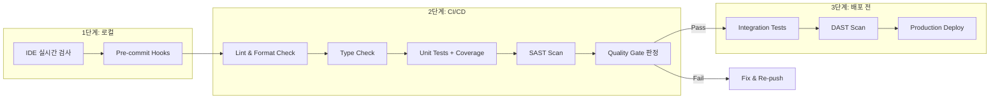
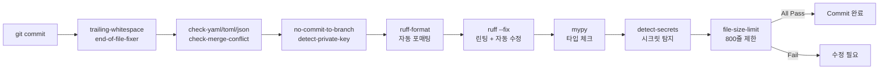
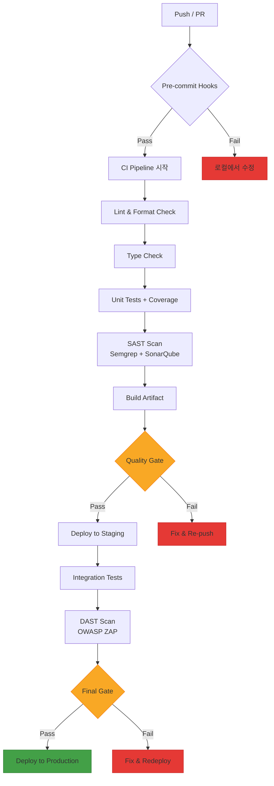
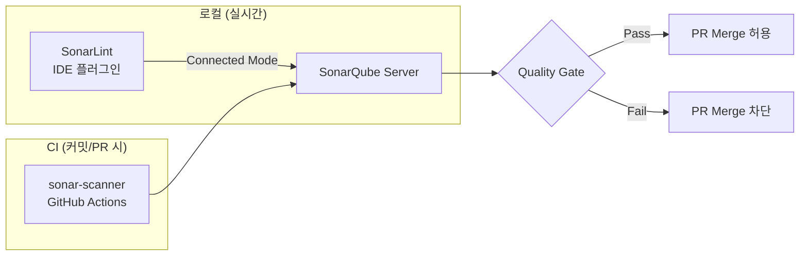
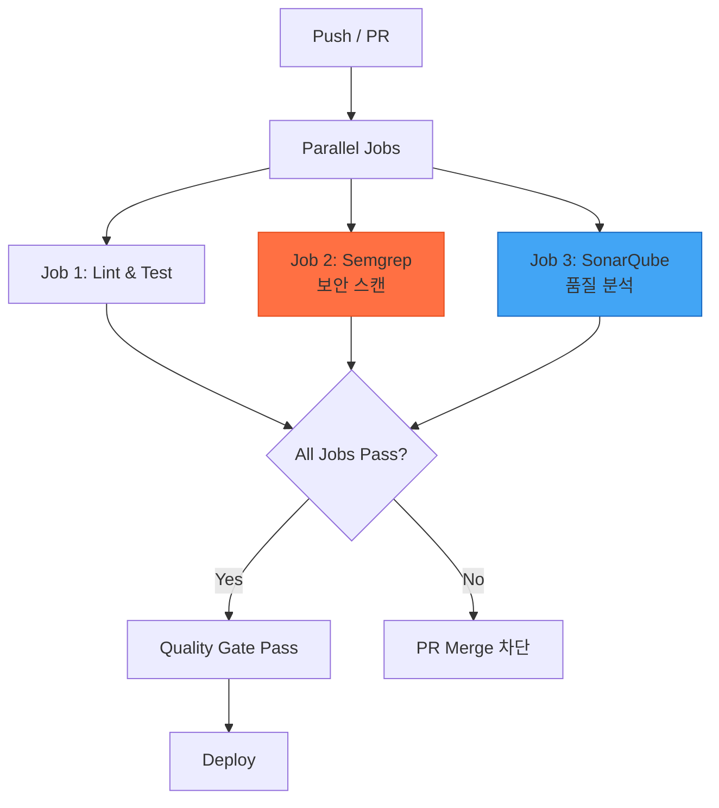
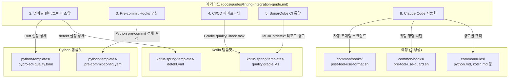

# 린팅 & CI/CD 통합 가이드

> **최종 수정**: 2026-03-11
> **대상 언어**: Python, Kotlin, TypeScript, Java
> **목적**: 로컬 개발 환경부터 CI/CD 파이프라인까지 일관된 코드 품질 자동화 체계 구축

---

## 목차

1. [개요 — 품질 자동화 전략](#1-개요--품질-자동화-전략)
2. [언어별 린터/포매터 조합](#2-언어별-린터포매터-조합)
3. [Pre-commit Hooks 구성](#3-pre-commit-hooks-구성)
4. [CI/CD 파이프라인 품질 게이트](#4-cicd-파이프라인-품질-게이트)
5. [SonarQube CI 통합](#5-sonarqube-ci-통합)
6. [Semgrep CI 통합](#6-semgrep-ci-통합)
7. [IDE 통합](#7-ide-통합)
8. [Claude Code 자동화](#8-claude-code-자동화)
9. [기존 템플릿과의 관계](#9-기존-템플릿과의-관계)
10. [참고 자료](#10-참고-자료)

---

## 1. 개요 — 품질 자동화 전략

코드 품질은 개발자 개인의 습관에 의존해서는 안 된다. **3단계 방어선**을 구축하여, 어느 단계에서든 품질 위반을 자동으로 차단한다.



### 품질 자동화 원칙

| 원칙 | 설명 |
|------|------|
| **빠른 피드백** | 로컬에서 1초 이내에 포매팅/린팅 결과를 제공한다 |
| **일관성** | 로컬과 CI의 도구 버전, 설정이 동일해야 한다 |
| **탈출 불가** | pre-commit 우회 시에도 CI가 최종 방어선 역할을 한다 |
| **자동 수정 우선** | 가능한 문제는 자동으로 고치고, 고칠 수 없는 문제만 오류로 보고한다 |

### 공통 품질 기준 (하드 리밋)

| 메트릭 | 기준값 | 적용 대상 |
|--------|--------|-----------|
| 함수 길이 | 50줄 이하 | 전 언어 |
| 파일 길이 | 800줄 이하 (Kotlin: 600줄) | 전 언어 |
| 순환 복잡도 (McCabe/Cyclomatic) | 15 이하 | 전 언어 |
| 테스트 커버리지 | 80% 이상 | 전 언어 |
| 중첩 깊이 | 4단계 이하 | 전 언어 |
| 중복 코드 비율 | 3% 이하 | 전 언어 |

---

## 2. 언어별 린터/포매터 조합

### 2.1 Python

| 역할 | 추천 도구 | 대체 도구 | 비고 |
|------|-----------|-----------|------|
| **린터** | Ruff | Flake8, pylint | Rust 기반, 10-100x 빠름, 800+ 규칙 |
| **포매터** | Ruff format | Black | Black과 99.9% 호환, Ruff에 통합 |
| **import 정렬** | Ruff (isort 규칙) | isort | Ruff에 내장 |
| **타입 체크** | mypy --strict | pyright, pytype | Google 내부에서도 mypy 사용 |
| **보안** | Ruff S 규칙셋 (bandit) | bandit | Ruff에 bandit 규칙 내장 |
| **시크릿 탐지** | detect-secrets | gitleaks | pre-commit 통합 |

**pyproject.toml 핵심 설정** (전체 설정은 `python/templates/pyproject-quality.toml` 참조):

```toml
[tool.ruff]
target-version = "py311"
src = ["src", "tests"]
line-length = 99

[tool.ruff.lint]
select = [
    "E", "F", "W",   # pycodestyle + pyflakes
    "I",              # isort
    "N",              # pep8-naming
    "UP",             # pyupgrade
    "B",              # flake8-bugbear
    "A",              # flake8-builtins
    "SIM",            # flake8-simplify
    "TCH",            # flake8-type-checking
    "PT",             # flake8-pytest-style
    "PERF",           # perflint (성능)
    "RUF",            # Ruff 전용 규칙
    "S",              # bandit (보안)
    "C90",            # mccabe 복잡도
    "PL",             # pylint
]
ignore = [
    "B008",           # FastAPI: Depends() 허용
    "S101",           # assert 허용 (pytest)
    "PLR2004",        # magic-value: 점진적 상수화 목표
    "PLR0913",        # too-many-arguments: Depends() 리팩터 후 제거
]

[tool.ruff.lint.mccabe]
max-complexity = 15

[tool.ruff.lint.per-file-ignores]
"tests/**/*.py" = ["S101", "S106", "S107", "PLR2004", "PLR0913"]

[tool.mypy]
python_version = "3.11"
strict = true
warn_return_any = true
warn_unused_configs = true
```

### 2.2 Kotlin

| 역할 | 추천 도구 | 비고 |
|------|-----------|------|
| **린터/포매터** | ktlint | IntelliJ IDEA 스타일 기본, Gradle 플러그인 제공 |
| **정적 분석** | detekt | 복잡도, 네이밍, 코루틴, 코드 스멜 탐지 |
| **커버리지** | JaCoCo | >= 80% 기준 |
| **아키텍처** | ArchUnit | 계층 규칙, 순환 의존성 검증 |
| **의존성 보안** | OWASP Dependency Check | CVE 스캐닝 |

**detekt.yml 핵심 설정** (전체 설정은 `kotlin-spring/templates/detekt.yml` 참조):

```yaml
build:
  maxIssues: 0          # 위반 1건이라도 있으면 빌드 실패

complexity:
  CyclomaticComplexMethod:
    active: true
    threshold: 15        # Python mccabe와 일치
  LongMethod:
    active: true
    threshold: 50        # 함수 50줄 제한
  LargeClass:
    active: true
    threshold: 600       # 클래스 600줄 제한
  NestedBlockDepth:
    active: true
    threshold: 4         # 중첩 4단계 제한

naming:
  FunctionNaming:
    functionPattern: '([a-z][a-zA-Z0-9]*)|(`.*`)'
  ClassNaming:
    classPattern: '[A-Z][a-zA-Z0-9]*'
  BooleanPropertyNaming:
    allowedPattern: '^(is|has|are|was|should|can|will)[A-Z].*'
```

**quality.gradle.kts 핵심 구조** (전체 설정은 `kotlin-spring/templates/quality.gradle.kts` 참조):

```kotlin
plugins {
    id("dev.detekt")                        // 정적 분석 (detekt 2.0)
    id("org.jlleitschuh.gradle.ktlint")     // 포매터
    jacoco                                   // 커버리지
    id("org.owasp.dependencycheck")         // 보안 취약점
}

// 통합 검증 task
tasks.register("qualityCheck") {
    group = "verification"
    description = "ktlint + detekt + test + jacoco 통합 검증"
    dependsOn(
        "ktlintCheck", "detekt", "test",
        "jacocoTestReport", "jacocoTestCoverageVerification",
    )
}
```

### 2.3 TypeScript/JavaScript

| 역할 | 추천 도구 | 대체 도구 | 비고 |
|------|-----------|-----------|------|
| **린터** | ESLint (Flat Config) | Biome | ESLint 9+ flat config 기본 |
| **포매터** | Prettier | Biome | ESLint와 역할 분리 |
| **통합 대안** | Biome | - | 린팅+포매팅 통합, Rust 기반, 23x 빠름 |
| **타입 체크** | tsc --strict | - | TypeScript 컴파일러 내장 |
| **시크릿 탐지** | gitleaks | detect-secrets | CI 파이프라인 통합 |

**ESLint Flat Config (eslint.config.mjs)**:

```javascript
import eslint from '@eslint/js';
import tseslint from 'typescript-eslint';
import prettier from 'eslint-config-prettier';

export default [
  eslint.configs.recommended,
  ...tseslint.configs.recommended,
  prettier,  // Prettier와 충돌하는 규칙 비활성화 (반드시 마지막)
  {
    files: ['**/*.ts', '**/*.tsx'],
    rules: {
      '@typescript-eslint/no-unused-vars': 'error',
      '@typescript-eslint/explicit-function-return-type': 'warn',
      '@typescript-eslint/no-explicit-any': 'error',
      'max-lines-per-function': ['error', { max: 50 }],  // 'warn' exits 0 — CI would not block
      'max-depth': ['error', 4],
      'complexity': ['error', 15],
    },
  },
  {
    ignores: ['dist/', 'node_modules/', 'coverage/'],
  },
];
```

**Prettier 설정 (.prettierrc.json)**:

```json
{
  "semi": true,
  "trailingComma": "all",
  "singleQuote": true,
  "printWidth": 80,
  "tabWidth": 2,
  "arrowParens": "always",
  "endOfLine": "lf"
}
```

**Biome 대안 설정 (biome.json)** — ESLint + Prettier를 단일 도구로 대체:

```json
{
  "$schema": "https://biomejs.dev/schemas/1.9.0/schema.json",
  "organizeImports": { "enabled": true },
  "linter": {
    "enabled": true,
    "rules": {
      "recommended": true,
      "complexity": {
        "noExcessiveCognitiveComplexity": {
          "level": "warn",
          "options": { "maxAllowedComplexity": 15 }
        }
      },
      "suspicious": {
        "noExplicitAny": "error"
      }
    }
  },
  "formatter": {
    "enabled": true,
    "indentStyle": "space",
    "indentWidth": 2,
    "lineWidth": 80
  },
  "javascript": {
    "formatter": {
      "quoteStyle": "single",
      "trailingCommas": "all",
      "semicolons": "always"
    }
  }
}
```

### 2.4 Java

| 역할 | 추천 도구 | 비고 |
|------|-----------|------|
| **린터** | Checkstyle (Google Style) | `google_checks.xml` 기반 |
| **포매터** | google-java-format | Gradle/Maven 플러그인 제공 |
| **버그 탐지** | SpotBugs | FindBugs 후속, 바이트코드 분석 |
| **커버리지** | JaCoCo | >= 80% 기준 |
| **의존성 보안** | OWASP Dependency Check | CVE 스캐닝 |

**build.gradle.kts (Java 품질 설정)**:

```kotlin
plugins {
    id("checkstyle")
    id("com.github.spotbugs") version "6.5.13"
    jacoco
    id("org.owasp.dependencycheck") version "13.0.0"
}

checkstyle {
    toolVersion = "14.4.0"
    configFile = file("${rootDir}/config/checkstyle/google_checks.xml")
    maxWarnings = 0
}

spotbugs {
    toolVersion.set("4.10.5")
    effort.set(com.github.spotbugs.snom.Effort.MAX)
    reportLevel.set(com.github.spotbugs.snom.Confidence.MEDIUM)
    excludeFilter.set(file("${rootDir}/config/spotbugs/exclude.xml"))
}

jacoco { toolVersion = "0.8.16" }

tasks.jacocoTestCoverageVerification {
    violationRules {
        rule {
            limit {
                counter = "LINE"
                value = "COVEREDRATIO"
                minimum = "0.80".toBigDecimal()
            }
        }
    }
}
```

### 2.5 언어별 도구 비교 요약표

| 역할 | Python | Kotlin | TypeScript | Java |
|------|--------|--------|------------|------|
| **린터** | Ruff | detekt | ESLint / Biome | Checkstyle |
| **포매터** | Ruff format | ktlint | Prettier / Biome | google-java-format |
| **타입 체크** | mypy --strict | 컴파일러 내장 | tsc --strict | 컴파일러 내장 |
| **커버리지** | pytest-cov | JaCoCo | vitest / jest | JaCoCo |
| **보안** | Ruff S (bandit) | OWASP Dep Check | gitleaks | SpotBugs + OWASP |
| **복잡도 제한** | mccabe <= 15 | detekt <= 15 | ESLint complexity <= 15 | Checkstyle <= 15 |

---

## 3. Pre-commit Hooks 구성

Pre-commit hooks는 커밋 시점에 품질 검사를 자동 실행하여, 문제 있는 코드가 원격 저장소에 올라가는 것을 차단한다.

### 3.1 Python — pre-commit framework

Python 생태계에서는 [pre-commit](https://pre-commit.com/) 프레임워크가 사실상 표준이다.

**설치 및 초기화**:

```bash
pip install pre-commit
pre-commit install          # .git/hooks/pre-commit 생성
pre-commit install --hook-type pre-push  # push 시 detekt 등 실행
```

**.pre-commit-config.yaml** (전체 설정은 `python/templates/.pre-commit-config.yaml` 참조):

```yaml
repos:
  # -- 파일 위생 --
  - repo: https://github.com/pre-commit/pre-commit-hooks
    rev: v4.6.0
    hooks:
      - id: trailing-whitespace
      - id: end-of-file-fixer
      - id: check-yaml
      - id: check-toml
      - id: check-json
      - id: check-merge-conflict
      - id: check-added-large-files
        args: ["--maxkb=500"]
      - id: no-commit-to-branch
        args: ["--branch", "main"]   # main 직접 커밋 차단
      - id: detect-private-key
      - id: check-ast                # Python 문법 조기 감지

  # -- Ruff: format -> lint 순서 --
  - repo: https://github.com/astral-sh/ruff-pre-commit
    rev: v0.14.14
    hooks:
      - id: ruff-format              # 먼저 포매팅
      - id: ruff                     # 린팅 (자동 수정 포함)
        args: ["--fix", "--exit-non-zero-on-fix"]

  # -- mypy: 프로젝트 venv 직접 사용 --
  - repo: local
    hooks:
      - id: mypy
        name: mypy type check
        entry: bash -c 'cd "$(git rev-parse --show-toplevel)" && .venv/bin/mypy "$@" --no-error-summary' --
        language: system
        files: ^src/.*\.py$
        pass_filenames: true

  # -- 시크릿 탐지 --
  - repo: https://github.com/Yelp/detect-secrets
    rev: v1.5.0
    hooks:
      - id: detect-secrets
        args: ["--baseline", ".secrets.baseline"]

  # -- 파일 크기 제한 (800줄) --
  - repo: local
    hooks:
      - id: file-size-limit
        name: File size limit (800 lines)
        entry: >
          bash -c 'f=0; for x in "$@"; do
            l=$(wc -l < "$x"); if [ "$l" -gt 800 ]; then
            echo "FAIL: $x ($l lines, max 800)"; f=1; fi; done; exit $f' --
        language: system
        files: ^src/.*\.py$
        exclude: ^tests/
```

**실행 순서**:



### 3.2 TypeScript/JavaScript — Husky + lint-staged

JS/TS 생태계에서는 Husky(Git hooks 관리) + lint-staged(staged 파일만 검사)의 조합이 표준이다.

**설치**:

```bash
npm install -D husky lint-staged
npx husky init
```

**package.json 설정**:

```json
{
  "scripts": {
    "lint": "eslint .",
    "lint:fix": "eslint --fix .",
    "format": "prettier --write .",
    "format:check": "prettier --check .",
    "typecheck": "tsc --noEmit",
    "test": "vitest run",
    "test:coverage": "vitest run --coverage",
    "quality": "npm run lint && npm run typecheck && npm run test:coverage",
    "prepare": "husky"
  },
  "lint-staged": {
    "*.{ts,tsx,js,jsx}": [
      "eslint --fix",
      "prettier --write"
    ],
    "*.{json,md,yml,yaml,css,scss}": [
      "prettier --write"
    ]
  }
}
```

**.husky/pre-commit**:

```bash
npx lint-staged
```

**.husky/pre-push** (선택: push 시 전체 검증):

```bash
npm run typecheck && npm run test:coverage
```

**Biome를 사용하는 경우** — ESLint + Prettier를 Biome로 대체:

```json
{
  "lint-staged": {
    "*.{ts,tsx,js,jsx,json,css}": [
      "biome check --write"
    ]
  }
}
```

### 3.3 Kotlin — pre-commit framework + Gradle

Kotlin 프로젝트에서도 pre-commit 프레임워크를 사용할 수 있다. ktlint는 커밋 시, detekt는 push 시 실행하는 것이 성능상 최적이다.

**.pre-commit-config.yaml**:

```yaml
repos:
  # -- 파일 위생 (Python 프로젝트와 동일) --
  - repo: https://github.com/pre-commit/pre-commit-hooks
    rev: v4.6.0
    hooks:
      - id: trailing-whitespace
      - id: end-of-file-fixer
      - id: check-yaml
      - id: check-merge-conflict
      - id: check-added-large-files
        args: ["--maxkb=500"]
      - id: no-commit-to-branch
        args: ["--branch", "main"]

  # -- ktlint: 커밋 시 포매팅 검사 --
  - repo: https://github.com/macisamuele/language-formatters-pre-commit-hooks
    rev: v2.14.0
    hooks:
      - id: pretty-format-kotlin
        args: [--autofix]

  # -- detekt: push 시 정적 분석 (커밋마다 실행하면 느림) --
  - repo: local
    hooks:
      - id: detekt
        name: detekt static analysis
        language: script
        entry: ./gradlew detektMain
        stages: [pre-push]
        pass_filenames: false

  # -- 시크릿 탐지 --
  - repo: https://github.com/Yelp/detect-secrets
    rev: v1.5.0
    hooks:
      - id: detect-secrets
        args: ["--baseline", ".secrets.baseline"]
```

### 3.4 Java — pre-commit framework + Gradle/Maven

```yaml
repos:
  - repo: https://github.com/pre-commit/pre-commit-hooks
    rev: v4.6.0
    hooks:
      - id: trailing-whitespace
      - id: end-of-file-fixer
      - id: check-yaml
      - id: check-merge-conflict
      - id: no-commit-to-branch
        args: ["--branch", "main"]

  # -- google-java-format: 커밋 시 포매팅 --
  - repo: https://github.com/macisamuele/language-formatters-pre-commit-hooks
    rev: v2.14.0
    hooks:
      - id: pretty-format-java
        args: [--autofix, --google-java-formatter-version=1.25.2]

  # -- checkstyle + spotbugs: push 시 (느리므로) --
  - repo: local
    hooks:
      - id: checkstyle
        name: checkstyle
        language: script
        entry: ./gradlew checkstyleMain
        stages: [pre-push]
        pass_filenames: false
```

### 3.5 Pre-commit 전략 요약

| 단계 | 실행 시점 | 검사 내용 | 소요 시간 목표 |
|------|-----------|-----------|----------------|
| **pre-commit** | `git commit` | 포매팅, 린팅, 시크릿 탐지, 파일 위생 | 5초 이내 |
| **pre-push** | `git push` | 타입 체크, 정적 분석, 단위 테스트 | 30초 이내 |
| **CI** | Push/PR | 전체 테스트, 커버리지, SAST, Quality Gate | 5분 이내 |

---

## 4. CI/CD 파이프라인 품질 게이트

### 4.1 파이프라인 전체 구조



### 4.2 GitHub Actions — Python

```yaml
# .github/workflows/quality-python.yml
name: Python Quality Gate

on:
  push:
    branches: [main]
  pull_request:
    branches: [main]

permissions:
  contents: read

jobs:
  quality:
    runs-on: ubuntu-latest
    strategy:
      matrix:
        python-version: ["3.11", "3.12"]

    steps:
      - uses: actions/checkout@v4

      - name: Set up Python ${{ matrix.python-version }}
        uses: actions/setup-python@v5
        with:
          python-version: ${{ matrix.python-version }}

      - name: Install dependencies
        run: |
          python -m pip install --upgrade pip
          pip install -e ".[dev]"

      # -- 린팅 & 포매팅 검사 --
      - name: Lint (Ruff)
        run: ruff check . --output-format=github

      - name: Format Check (Ruff)
        run: ruff format --check .

      # -- 타입 체크 --
      - name: Type Check (mypy)
        run: mypy src/ --no-error-summary

      # -- 테스트 & 커버리지 --
      - name: Tests + Coverage
        run: |
          pytest --cov=src --cov-report=xml --cov-report=term-missing
          coverage report --fail-under=80

      # -- 보안 스캔 --
      - name: SAST (Semgrep)
        uses: semgrep/semgrep-action@v1
        with:
          config: >-
            p/python
            p/owasp-top-ten
            p/secrets

      # -- 커버리지 리포트 업로드 (PR 코멘트용) --
      - name: Upload Coverage
        if: github.event_name == 'pull_request'
        uses: codecov/codecov-action@v4
        with:
          files: coverage.xml
          fail_ci_if_error: false
```

### 4.3 GitHub Actions — Kotlin/Spring Boot

```yaml
# .github/workflows/quality-kotlin.yml
name: Kotlin Quality Gate

on:
  push:
    branches: [main]
  pull_request:
    branches: [main]

permissions:
  contents: read

jobs:
  quality:
    runs-on: ubuntu-latest

    steps:
      - uses: actions/checkout@v4

      - name: Set up JDK 17
        uses: actions/setup-java@v4
        with:
          java-version: '17'
          distribution: 'temurin'

      - name: Setup Gradle
        uses: gradle/actions/setup-gradle@v4

      # -- 포매팅 검사 --
      - name: ktlint Check
        run: ./gradlew ktlintCheck

      # -- 정적 분석 --
      - name: detekt
        run: ./gradlew detektMain detektTest

      # -- 테스트 & 커버리지 --
      - name: Test + Coverage
        run: ./gradlew test jacocoTestReport jacocoTestCoverageVerification

      # -- 통합 검증 (위 단계를 한번에 실행할 때) --
      # - name: Quality Check (All-in-one)
      #   run: ./gradlew qualityCheck

      # -- 보안 스캔 --
      - name: SAST (Semgrep)
        uses: semgrep/semgrep-action@v1
        with:
          config: >-
            p/java
            p/kotlin
            p/owasp-top-ten

      # -- detekt/JaCoCo 리포트 업로드 --
      - name: Upload Reports
        if: always()
        uses: actions/upload-artifact@v4
        with:
          name: quality-reports
          path: |
            build/reports/detekt/
            build/reports/jacoco/
```

### 4.4 GitHub Actions — TypeScript

```yaml
# .github/workflows/quality-typescript.yml
name: TypeScript Quality Gate

on:
  push:
    branches: [main]
  pull_request:
    branches: [main]

permissions:
  contents: read

jobs:
  quality:
    runs-on: ubuntu-latest

    steps:
      - uses: actions/checkout@v4

      - name: Setup Node.js
        uses: actions/setup-node@v4
        with:
          node-version: '22'
          cache: 'npm'

      - name: Install dependencies
        run: npm ci

      # -- 린팅 & 포매팅 --
      - name: Lint (ESLint)
        run: npx eslint . --max-warnings=0

      - name: Format Check (Prettier)
        run: npx prettier --check .

      # -- 타입 체크 --
      - name: Type Check (tsc)
        run: npx tsc --noEmit

      # -- 테스트 & 커버리지 --
      - name: Tests + Coverage
        run: npx vitest run --coverage --reporter=default --reporter=junit

      - name: Check Coverage Threshold
        run: |
          npx vitest run --coverage 2>&1 | \
            grep -E "All files" | \
            awk '{if ($NF+0 < 80) exit 1}'

      # -- 보안 스캔 --
      - name: SAST (Semgrep)
        uses: semgrep/semgrep-action@v1
        with:
          config: >-
            p/typescript
            p/nodejs
            p/owasp-top-ten
            p/secrets
```

---

## 5. SonarQube CI 통합

SonarQube는 코드 품질 + 보안을 통합 관리하는 플랫폼이다. CI/CD 파이프라인에 연동하여 **Quality Gate** 기반으로 배포를 차단하거나 허용한다.

> **역할 분리**: 본 가이드는 **CI 통합 방법(HOW)** 만 다룬다. Quality Gate 메트릭 정책, 신규/AI 코드 강화값, 프로젝트 유형별 게이트 설정 등 **정책(WHAT/WHY)** 은 [시큐어 코딩 가이드 §2](secure-coding-guide.md#2-sonarqube-quality-gate-설정)에서 단일 출처(single source of truth)로 관리한다.

### 5.1 Quality Gate 설정 (팀 표준)

| 항목 | 출처 |
|------|------|
| Quality Gate 메트릭 (커버리지, 중복률, 보안 등급 등) | [secure-coding-guide §2.2](secure-coding-guide.md#22-팀-표준-quality-gate-메트릭) |
| Sonar way vs 팀 표준 강화값 vs AI 코드 강화값 | [secure-coding-guide §2.2](secure-coding-guide.md#22-팀-표준-quality-gate-메트릭) |
| 프로젝트 유형별 Quality Gate (신규/레거시/AI) | [secure-coding-guide §2.2](secure-coding-guide.md#22-팀-표준-quality-gate-메트릭) |
| Quality Profile 확장 전략 (Sonar way → Team Standard) | [secure-coding-guide §2.3](secure-coding-guide.md#23-quality-profile-확장-전략) |
| Fudge Factor (소규모 변경 유예 임계값) | [secure-coding-guide §2.4](secure-coding-guide.md#24-fudge-factor-유예-임계값) |

본 섹션 5는 **위 정책을 CI에서 실제로 적용하는 워크플로우**만 다룬다.

### 5.2 sonar-project.properties

> 프로젝트 설정 템플릿은 [`common/security-templates/sonar-project.properties`](../../common/security-templates/sonar-project.properties)를 참조한다. 프로젝트 루트에 복사 후 `sonar.projectKey`, `sonar.organization`을 수정하여 사용한다.

### 5.3 GitHub Actions — SonarQube 연동

```yaml
# .github/workflows/sonarqube.yml
name: SonarQube Analysis

on:
  push:
    branches: [main]
  pull_request:
    branches: [main]

jobs:
  sonarqube:
    runs-on: ubuntu-latest

    steps:
      - uses: actions/checkout@v4
        with:
          fetch-depth: 0  # Full history for SonarQube analysis

      # -- 테스트 & 커버리지 리포트 생성 (SonarQube에 전달할 리포트) --
      - name: Run Tests with Coverage
        run: |
          pytest --cov=src --cov-report=xml:coverage.xml

      # -- SonarQube 스캔 --
      - name: SonarQube Scan
        uses: SonarSource/sonarqube-scan-action@v5
        env:
          SONAR_TOKEN: ${{ secrets.SONAR_TOKEN }}
          SONAR_HOST_URL: ${{ secrets.SONAR_HOST_URL }}

      # -- Quality Gate 결과 확인 (PR 차단 가능) --
      - name: SonarQube Quality Gate
        uses: SonarSource/sonarqube-quality-gate-action@v1
        timeout-minutes: 5
        env:
          SONAR_TOKEN: ${{ secrets.SONAR_TOKEN }}
```

### 5.4 Kotlin/Gradle — SonarQube 연동

Kotlin 프로젝트는 Gradle 플러그인을 통해 SonarQube와 연동한다.

**build.gradle.kts**:

```kotlin
plugins {
    id("org.sonarqube") version "6.0.1.5171"
}

sonarqube {
    properties {
        property("sonar.projectKey", "my-kotlin-project")
        property("sonar.projectName", "My Kotlin Project")
        property("sonar.host.url", System.getenv("SONAR_HOST_URL") ?: "")
        property("sonar.token", System.getenv("SONAR_TOKEN") ?: "")

        // detekt 리포트 연동
        property("sonar.kotlin.detekt.reportPaths",
            "build/reports/detekt/main.xml")   // detekt 2.0 detektMain

        // JaCoCo 커버리지 연동
        property("sonar.coverage.jacoco.xmlReportPaths",
            "build/reports/jacoco/test/jacocoTestReport.xml")
    }
}
```

**GitHub Actions**:

```yaml
      - name: Build, Test & Analyze
        run: |
          ./gradlew test jacocoTestReport detekt sonar \
            -Dsonar.host.url=${{ secrets.SONAR_HOST_URL }} \
            -Dsonar.token=${{ secrets.SONAR_TOKEN }}
```

### 5.5 SonarQube vs SonarLint 역할 분리



- **SonarLint**: IDE에서 실시간으로 이슈 탐지. Connected Mode로 SonarQube 서버의 규칙과 동기화.
- **SonarQube**: CI에서 전체 코드베이스를 분석하고 Quality Gate를 판정.
- Pre-commit에서 sonar-scanner를 직접 실행하는 것은 느려서 비실용적이다. **SonarLint(IDE) + SonarQube(CI)** 조합이 최적이다.

---

## 6. Semgrep CI 통합

SonarQube 단독 보안 탐지율은 약 19%에 불과하다. Semgrep은 SonarQube 대비 2.4배 높은 보안 탐지율을 제공하므로, **SonarQube(품질 게이트) + Semgrep(보안 탐지)** 병행이 최적이다.

### 6.1 Semgrep 특징

| 항목 | 설명 |
|------|------|
| **언어 지원** | 30+ 언어 (Python, Java, Kotlin, TypeScript, Go 등) |
| **규칙 형식** | YAML (읽기 쉬움, 커스텀 규칙 작성 용이) |
| **Taint Tracking** | 데이터 흐름 추적 기반 취약점 탐지 |
| **속도** | 10초 미만 빠른 스캔 (pre-commit 통합 가능) |
| **비용** | OSS 무료, Semgrep Cloud는 유료 |

### 6.2 GitHub Actions — Semgrep 단독 워크플로우

```yaml
# .github/workflows/semgrep.yml
name: Semgrep Security Scan

on:
  push:
    branches: [main]
  pull_request:
    branches: [main]
  schedule:
    - cron: '0 9 * * 1'  # 매주 월요일 09:00 UTC 전체 스캔

permissions:
  contents: read
  security-events: write  # GitHub Security tab에 결과 표시

jobs:
  semgrep:
    runs-on: ubuntu-latest

    steps:
      - uses: actions/checkout@v4

      # -- 기본 보안 스캔 (OWASP + 시크릿 + 언어별) --
      - name: Semgrep Scan
        uses: semgrep/semgrep-action@v1
        with:
          config: >-
            p/owasp-top-ten
            p/secrets
            p/python
            p/typescript
            p/java
            p/kotlin
          generateSarif: true

      # -- GitHub Security tab에 결과 업로드 --
      - name: Upload SARIF
        if: always()
        uses: github/codeql-action/upload-sarif@v3
        with:
          sarif_file: semgrep.sarif

      # -- 심각도 High/Critical 발견 시 실패 --
      - name: Check for Critical Issues
        run: |
          semgrep scan --config=auto --severity=ERROR \
            --json -o semgrep-results.json || true
          if jq -e '.results | length > 0' semgrep-results.json > /dev/null 2>&1; then
            echo "::error::Critical security issues found!"
            jq '.results[] | {path: .path, line: .start.line, rule: .check_id, message: .extra.message}' semgrep-results.json
            exit 1
          fi
```

### 6.3 커스텀 Semgrep 규칙

프로젝트 루트에 `.semgrep/` 디렉토리를 생성하고 커스텀 규칙을 추가할 수 있다.

```yaml
# .semgrep/custom-rules.yml
rules:
  # -- 하드코딩된 시크릿 탐지 --
  - id: hardcoded-secret
    patterns:
      - pattern-either:
          - pattern: $KEY = "sk-..."
          - pattern: $KEY = "AKIA..."
          - pattern: $KEY = "ghp_..."
    message: "Hardcoded secret detected. Use environment variables."
    languages: [python, typescript, java, kotlin]
    severity: ERROR

  # -- 안전하지 않은 SQL 쿼리 탐지 --
  - id: unsafe-sql-format
    patterns:
      - pattern: f"... {$VAR} ..."
      - pattern-inside: |
          cursor.execute(...)
    message: "SQL injection risk: use parameterized queries."
    languages: [python]
    severity: ERROR

  # -- console.log 금지 --
  - id: no-console-log
    pattern: console.log(...)
    message: "Remove console.log before committing."
    languages: [typescript, javascript]
    severity: WARNING
```

**CI에서 커스텀 규칙 사용**:

```yaml
      - name: Semgrep with Custom Rules
        run: |
          semgrep scan \
            --config=p/owasp-top-ten \
            --config=.semgrep/ \
            --error --severity=ERROR
```

### 6.4 SonarQube + Semgrep 병행 파이프라인



```yaml
# .github/workflows/quality-full.yml
name: Full Quality Pipeline

on:
  pull_request:
    branches: [main]

jobs:
  # -- Job 1: 린팅 & 테스트 --
  lint-and-test:
    runs-on: ubuntu-latest
    steps:
      - uses: actions/checkout@v4
      - run: ruff check . && ruff format --check .
      - run: mypy src/
      - run: pytest --cov=src --cov-report=xml

  # -- Job 2: Semgrep (보안) -- 병렬 실행
  semgrep:
    runs-on: ubuntu-latest
    steps:
      - uses: actions/checkout@v4
      - uses: semgrep/semgrep-action@v1
        with:
          config: p/owasp-top-ten p/secrets

  # -- Job 3: SonarQube (품질) -- 병렬 실행
  sonarqube:
    runs-on: ubuntu-latest
    needs: lint-and-test  # 커버리지 리포트 필요
    steps:
      - uses: actions/checkout@v4
        with:
          fetch-depth: 0
      - uses: SonarSource/sonarqube-scan-action@v5
        env:
          SONAR_TOKEN: ${{ secrets.SONAR_TOKEN }}
          SONAR_HOST_URL: ${{ secrets.SONAR_HOST_URL }}
      - uses: SonarSource/sonarqube-quality-gate-action@v1
        env:
          SONAR_TOKEN: ${{ secrets.SONAR_TOKEN }}
```

---

## 7. IDE 통합

### 7.1 VS Code — 추천 설정

**필수 확장 프로그램**:

```json
// .vscode/extensions.json
{
  "recommendations": [
    // -- Python --
    "charliermarsh.ruff",
    "ms-python.mypy-type-checker",

    // -- TypeScript --
    "dbaeumer.vscode-eslint",
    "esbenp.prettier-vscode",
    // 또는 Biome 사용 시:
    // "biomejs.biome",

    // -- 공통 --
    "SonarSource.sonarlint-vscode",
    "EditorConfig.EditorConfig"
  ]
}
```

**워크스페이스 설정**:

```json
// .vscode/settings.json
{
  // -- Editor 기본 --
  "editor.formatOnSave": true,
  "editor.codeActionsOnSave": {
    "source.fixAll": "explicit",
    "source.organizeImports": "explicit"
  },
  "files.trimTrailingWhitespace": true,
  "files.insertFinalNewline": true,

  // -- Python --
  "[python]": {
    "editor.defaultFormatter": "charliermarsh.ruff",
    "editor.formatOnSave": true,
    "editor.codeActionsOnSave": {
      "source.fixAll.ruff": "explicit",
      "source.organizeImports.ruff": "explicit"
    }
  },
  "mypy-type-checker.args": ["--strict"],

  // -- TypeScript --
  "[typescript]": {
    "editor.defaultFormatter": "esbenp.prettier-vscode"
  },
  "[typescriptreact]": {
    "editor.defaultFormatter": "esbenp.prettier-vscode"
  },

  // -- SonarLint (Connected Mode) --
  "sonarlint.connectedMode.connections.sonarqube": [
    {
      "connectionId": "my-sonar",
      "serverUrl": "https://sonarqube.example.com",
      "token": "${env:SONAR_TOKEN}"
    }
  ],
  "sonarlint.connectedMode.project": {
    "connectionId": "my-sonar",
    "projectKey": "my-project"
  }
}
```

### 7.2 IntelliJ IDEA — 추천 설정

**필수 플러그인**:

| 플러그인 | 용도 |
|----------|------|
| **SonarLint** | 실시간 코드 품질 검사 + Connected Mode |
| **detekt** | Kotlin 정적 분석 (IDE 내 실시간 피드백) |
| **ktlint** | Kotlin 코드 스타일 검사 |
| **CheckStyle-IDEA** | Java 코드 스타일 검사 |
| **Ruff (Python)** | Python 린팅 (PyCharm/IntelliJ Python 플러그인) |

**ktlint 통합 설정** (`.editorconfig`):

```ini
# .editorconfig
root = true

[*]
charset = utf-8
end_of_line = lf
insert_final_newline = true
trim_trailing_whitespace = true

[*.{kt,kts}]
indent_style = space
indent_size = 4
max_line_length = 120
# ktlint 전용 설정
ktlint_code_style = intellij_idea
ktlint_standard_no-wildcard-imports = enabled

[*.{ts,tsx,js,jsx,json,yml,yaml}]
indent_style = space
indent_size = 2

[*.py]
indent_style = space
indent_size = 4
max_line_length = 99

[*.java]
indent_style = space
indent_size = 2
max_line_length = 100
```

**IntelliJ Code Style 동기화**:

1. `Settings > Editor > Code Style > Kotlin` 에서 `Set from... > Kotlin Style Guide` 선택
2. `Settings > Tools > detekt` 에서 `Configuration file` 을 프로젝트의 `detekt.yml`로 지정
3. `Settings > Tools > SonarLint > Connected Mode` 에서 SonarQube 서버 연결

### 7.3 IDE 설정 공유 전략

팀 내 IDE 설정을 일관되게 유지하기 위한 방법:

| 방법 | 파일 | Git 커밋 여부 |
|------|------|---------------|
| **EditorConfig** | `.editorconfig` | O (필수) |
| **VS Code 설정** | `.vscode/settings.json`, `.vscode/extensions.json` | O (권장) |
| **IntelliJ 설정** | `.idea/codeStyles/`, `.idea/inspectionProfiles/` | 선택 (`.idea/`는 보통 gitignore) |
| **Ruff/ESLint 설정** | `pyproject.toml`, `eslint.config.mjs` | O (필수) |

> `.editorconfig`는 모든 에디터에서 지원하므로, 최소한의 포매팅 규칙을 여기에 정의하는 것이 가장 범용적이다.

---

## 8. Claude Code 자동화

Claude Code의 **Hooks** 기능을 활용하면, 파일 저장(Write/Edit) 시 린터를 자동 실행하여 AI 생성 코드의 품질을 실시간으로 보장할 수 있다.

### 8.1 PostToolUse 훅 — 자동 린터 실행

Claude Code가 파일을 작성하거나 수정할 때마다 해당 언어의 린터/포매터를 자동 실행한다.

**.claude/settings.json**:

```json
{
  "hooks": {
    "PostToolUse": [
      {
        "matcher": "Write|Edit",
        "command": "bash common/hooks/post-tool-use-format.sh",
        "description": "Auto-format on file save (ruff/ktlint/biome)"
      }
    ],
    "PreToolUse": [
      {
        "matcher": "Bash",
        "command": "bash common/hooks/pre-tool-use-guard.sh",
        "description": "Block dangerous commands (rm -rf, force push, main commit)"
      }
    ],
    "Stop": [
      {
        "type": "prompt",
        "prompt": "Before stopping, verify: all tests pass, no TODO placeholders, HANDOFF.md updated."
      }
    ]
  }
}
```

### 8.2 자동 포매팅 스크립트

**common/hooks/post-tool-use-format.sh**:

```bash
#!/usr/bin/env bash
# PostToolUse hook: auto-format files after Write/Edit
# Claude Code passes the modified file path via $CLAUDE_FILE or positional arg
set -euo pipefail

FILE="${CLAUDE_FILE:-${1:-}}"
if [[ -z "$FILE" || ! -f "$FILE" ]]; then
  exit 0
fi

case "$FILE" in
  *.py)
    # Python: Ruff format + lint fix
    if command -v ruff &>/dev/null; then
      ruff format "$FILE" 2>/dev/null || true
      ruff check --fix "$FILE" 2>/dev/null || true
    fi
    ;;
  *.kt | *.kts)
    # Kotlin: ktlint format
    if command -v ktlint &>/dev/null; then
      ktlint --format "$FILE" 2>/dev/null || true
    fi
    ;;
  *.ts | *.tsx | *.js | *.jsx)
    # TypeScript/JavaScript: Biome (or Prettier + ESLint)
    if command -v biome &>/dev/null; then
      biome check --write "$FILE" 2>/dev/null || true
    elif command -v prettier &>/dev/null; then
      prettier --write "$FILE" 2>/dev/null || true
      eslint --fix "$FILE" 2>/dev/null || true
    fi
    ;;
  *.java)
    # Java: google-java-format
    if command -v google-java-format &>/dev/null; then
      google-java-format --replace "$FILE" 2>/dev/null || true
    fi
    ;;
esac
```

### 8.3 위험 명령 차단 스크립트

**common/hooks/pre-tool-use-guard.sh**:

```bash
#!/usr/bin/env bash
# PreToolUse hook: block dangerous commands
set -euo pipefail

CMD="${CLAUDE_BASH_CMD:-${1:-}}"

# Dangerous patterns to block
BLOCKED_PATTERNS=(
  "rm -rf /"
  "rm -rf ~"
  "rm -rf \."
  "git push.*--force"
  "git push origin main"
  "git push origin master"
  "git checkout main && git commit"
  "git reset --hard"
)

for pattern in "${BLOCKED_PATTERNS[@]}"; do
  if echo "$CMD" | grep -qE "$pattern"; then
    echo "BLOCKED: Dangerous command detected: $CMD"
    echo "Pattern matched: $pattern"
    exit 1
  fi
done

exit 0
```

### 8.4 Claude Code Rules — 경로별 규칙

`.claude/rules/` 디렉토리에 파일 경로 패턴별 규칙을 정의하면, Claude가 해당 파일을 수정할 때만 해당 규칙이 활성화된다.

**.claude/rules/python.md**:

```yaml
---
paths: "**/*.py"
---
# Python 규칙
- from __future__ import annotations 필수 (파일 첫 줄)
- Protocol > ABC (structural subtyping)
- frozen=True dataclass + tuple (no list)
- contextlib.suppress > try/except/pass
- Named constants (no magic numbers)
- Ruff + mypy --strict 통과 필수
```

**.claude/rules/kotlin.md**:

```yaml
---
paths: "**/*.kt"
---
# Kotlin 규칙
- data class는 val only (불변)
- when 분기는 exhaustive (else 지양)
- lateinit var는 Spring DI 외 사용 금지
- Coroutine: GlobalScope 금지, Dispatcher 주입
- ktlint + detekt 통과 필수
```

**.claude/rules/typescript.md**:

```yaml
---
paths: "**/*.ts,**/*.tsx"
---
# TypeScript 규칙
- any 타입 절대 금지 (unknown 사용)
- interface > type alias (확장 가능성)
- const assertion 적극 활용
- console.log 금지 (logger 사용)
- ESLint + Prettier (또는 Biome) 통과 필수
```

---

## 9. 기존 템플릿과의 관계

이 가이드에서 설명하는 설정 예시는 sos 표준(`plugins/sos/standards/`)의 기존 템플릿 파일을 기반으로 한다.

### 템플릿 매핑표



### 가이드 vs 템플릿 역할 분리

| 구분 | 역할 | 위치 |
|------|------|------|
| **이 가이드** | "왜", "어떻게" — 전략, 설계 의도, 전체 그림 설명 | `docs/guides/` |
| **Python 템플릿** | "무엇을" — 복사하여 바로 사용 가능한 설정 파일 | `python/templates/` |
| **Kotlin 템플릿** | "무엇을" — 복사하여 바로 사용 가능한 설정 파일 | `kotlin-spring/templates/` |
| **공통 훅/규칙** | Claude Code 자동화에 사용할 스크립트와 규칙 | `common/hooks/`, `common/rules/` |

**사용 순서**:

1. 이 가이드를 읽고 프로젝트에 맞는 전략을 결정한다
2. 해당 언어의 `templates/` 디렉토리에서 설정 파일을 복사한다
3. 프로젝트 요구사항에 맞게 값을 조정한다 (예: Python 버전, 줄 길이 등)
4. CI/CD 파이프라인 YAML을 프로젝트에 추가한다
5. Claude Code 훅과 규칙을 설정한다

---

## 10. 참고 자료

### 공식 문서

| 도구 | URL |
|------|-----|
| Ruff | <https://docs.astral.sh/ruff/> |
| ESLint Flat Config | <https://eslint.org/docs/latest/use/configure/configuration-files> |
| Biome | <https://biomejs.dev/> |
| detekt | <https://detekt.dev/docs/rules/> |
| ktlint | <https://pinterest.github.io/ktlint/> |
| pre-commit | <https://pre-commit.com/> |
| Husky | <https://typicode.github.io/husky/> |
| lint-staged | <https://github.com/lint-staged/lint-staged> |
| SonarQube | <https://docs.sonarsource.com/sonarqube-server/> |
| Semgrep | <https://semgrep.dev/docs/> |

### 프로젝트 내부 참조

| 문서/템플릿 | 경로 |
|-------------|------|
| Python Ruff + mypy 설정 | `python/templates/pyproject-quality.toml` |
| Python pre-commit 설정 | `python/templates/.pre-commit-config.yaml` |
| Kotlin detekt 설정 | `kotlin-spring/templates/detekt.yml` |
| Kotlin Gradle 품질 설정 | `kotlin-spring/templates/quality.gradle.kts` |
| 빅테크 코딩 표준 리서치 | `docs/reports/2026-03-11_빅테크-코딩-표준-체계-리서치.md` |
| 종합 리서치 리포트 | `docs/reports/2026-03-11_종합-리서치-리포트.md` |
