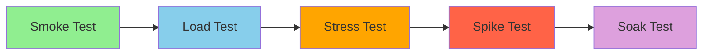
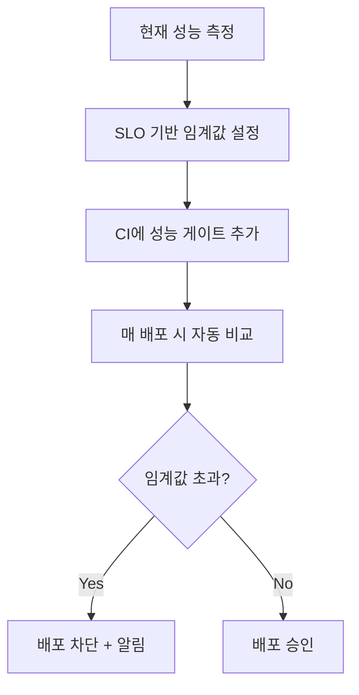

# Load / Performance Testing 가이드

> 프로덕션 배포 전 성능 기준선을 확보하고, 성능 회귀를 자동 감지하는 테스트 전략.

---

## 1. 부하 테스트 유형

| 유형 | 목적 | 부하 수준 | 시간 |
|------|------|-----------|------|
| **Smoke** | 기본 동작 검증 | 최소 (1-5 VU) | 1-3분 |
| **Load** | 정상 부하 성능 확인 | 예상 최대 (100%) | 10-30분 |
| **Stress** | 한계점 발견 | 예상 초과 (150-200%) | 10-30분 |
| **Spike** | 급격한 트래픽 대응 | 갑자기 10x | 5-10분 |
| **Soak** | 장시간 안정성 | 정상 부하 | 1-24시간 |



---

## 2. k6 가이드 (권장 도구)

### 2.1 기본 스크립트

```javascript
// load-tests/api-load-test.js
import http from "k6/http";
import { check, sleep } from "k6";
import { Rate, Trend } from "k6/metrics";

const errorRate = new Rate("errors");
const latency = new Trend("api_latency");

export const options = {
  stages: [
    { duration: "2m", target: 50 },   // Ramp up
    { duration: "5m", target: 50 },   // Steady state
    { duration: "2m", target: 100 },  // Peak
    { duration: "1m", target: 0 },    // Ramp down
  ],
  thresholds: {
    http_req_duration: ["p(95)<500", "p(99)<1000"],  // ms
    errors: ["rate<0.01"],                             // 1% 미만
    http_req_failed: ["rate<0.01"],
  },
};

export default function () {
  const res = http.get("https://api.example.com/users");

  check(res, {
    "status is 200": (r) => r.status === 200,
    "response time < 500ms": (r) => r.timings.duration < 500,
  });

  errorRate.add(res.status !== 200);
  latency.add(res.timings.duration);

  sleep(1);
}
```

### 2.2 시나리오 기반 테스트

```javascript
export const options = {
  scenarios: {
    browse: {
      executor: "ramping-vus",
      startVUs: 0,
      stages: [{ duration: "5m", target: 100 }],
      exec: "browsePage",
    },
    checkout: {
      executor: "constant-arrival-rate",
      rate: 10,           // 초당 10 요청
      timeUnit: "1s",
      duration: "5m",
      preAllocatedVUs: 50,
      exec: "checkoutFlow",
    },
  },
};

export function browsePage() {
  http.get("https://api.example.com/products");
  sleep(Math.random() * 3);
}

export function checkoutFlow() {
  const cart = http.post("https://api.example.com/cart", JSON.stringify({
    product_id: "prod_1",
    quantity: 1,
  }));
  const payment = http.post("https://api.example.com/payments", JSON.stringify({
    cart_id: cart.json().id,
  }));
  check(payment, { "payment success": (r) => r.status === 201 });
}
```

---

## 3. 성능 기준선 (Baseline)

### SLO 기반 임계값

| 메트릭 | Smoke | Load | Stress |
|--------|-------|------|--------|
| P95 Latency | <200ms | <500ms | <1000ms |
| P99 Latency | <500ms | <1000ms | <2000ms |
| Error Rate | <0.1% | <1% | <5% |
| Throughput | >10 rps | >100 rps | >50 rps |

### 기준선 설정 프로세스



---

## 4. CI/CD 통합

```yaml
# .github/workflows/performance.yml
name: Performance Tests
on:
  push:
    branches: [main]
  pull_request:

jobs:
  load-test:
    runs-on: ubuntu-latest
    steps:
      - uses: actions/checkout@v4

      - name: Run k6 smoke test
        uses: grafana/k6-action@v0.3.1
        with:
          filename: load-tests/smoke-test.js

      - name: Run k6 load test (main only)
        if: github.ref == 'refs/heads/main'
        uses: grafana/k6-action@v0.3.1
        with:
          filename: load-tests/api-load-test.js

      - name: Upload results
        uses: actions/upload-artifact@v4
        with:
          name: k6-results
          path: results/
```

---

## 5. 결과 분석

### 핵심 지표 해석

| 지표 | 정상 | 주의 | 위험 |
|------|------|------|------|
| P95 Latency | SLO 이내 | SLO 80-100% | SLO 초과 |
| Error Rate | <0.1% | 0.1-1% | >1% |
| CPU Usage | <60% | 60-80% | >80% |
| Memory | <70% | 70-85% | >85% |
| Connection Pool | <70% | 70-90% | >90% |

### 리포팅 표준

```markdown
# Performance Test Report — YYYY-MM-DD

## Summary
- Duration: 10 minutes
- Peak VUs: 100
- Total Requests: 12,345

## Results
| Metric | Value | Threshold | Status |
|--------|-------|-----------|--------|
| P95 Latency | 342ms | <500ms | PASS |
| P99 Latency | 891ms | <1000ms | PASS |
| Error Rate | 0.3% | <1% | PASS |
| Throughput | 120 rps | >100 rps | PASS |

## Observations
- (성능 이상 사항 기술)

## Recommendations
- (개선 권고 사항)
```

---

## 6. 체크리스트

- [ ] Smoke Test로 기본 동작 확인
- [ ] Load Test로 SLO 기준 검증
- [ ] 성능 기준선(Baseline) 설정
- [ ] CI에 성능 게이트 추가
- [ ] 배포 전 자동 성능 비교
- [ ] 분기별 Stress/Soak Test 실행
- [ ] 결과 리포트 자동화
