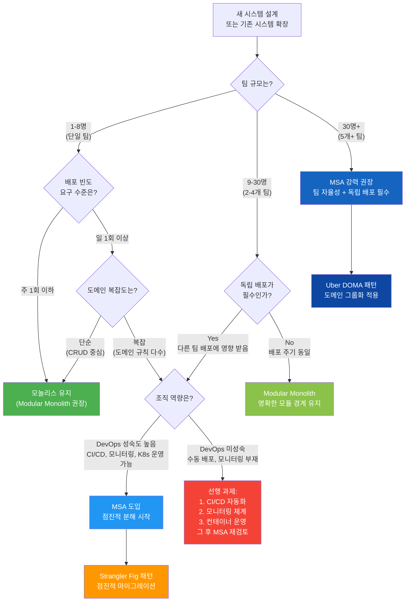
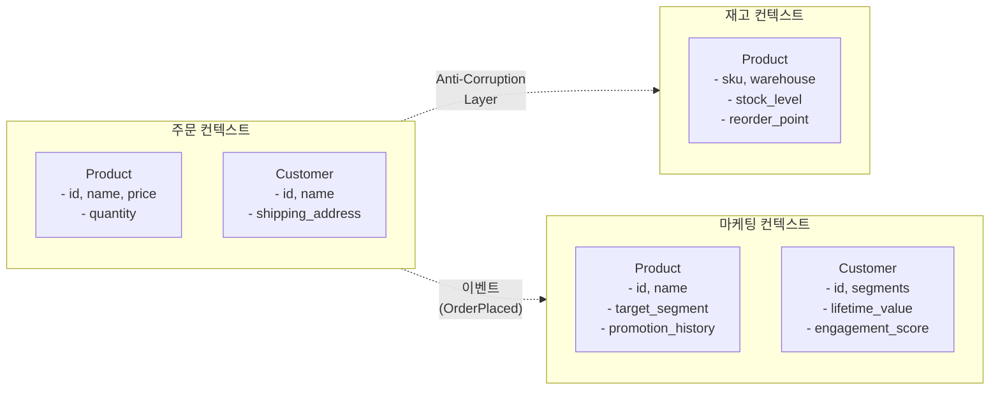
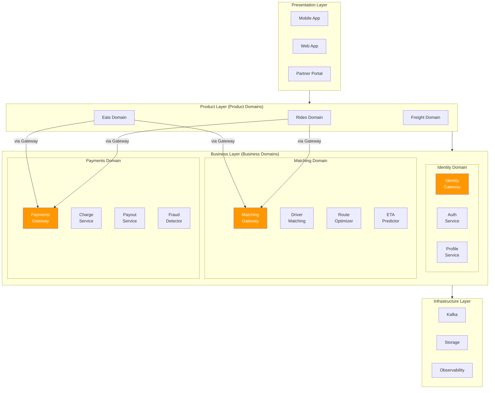
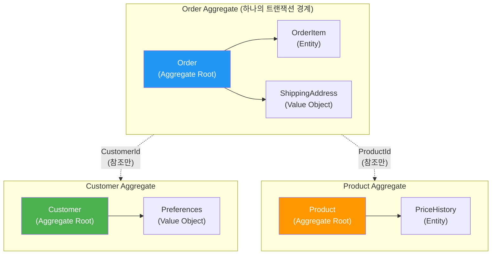
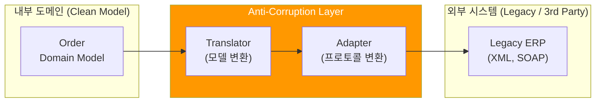
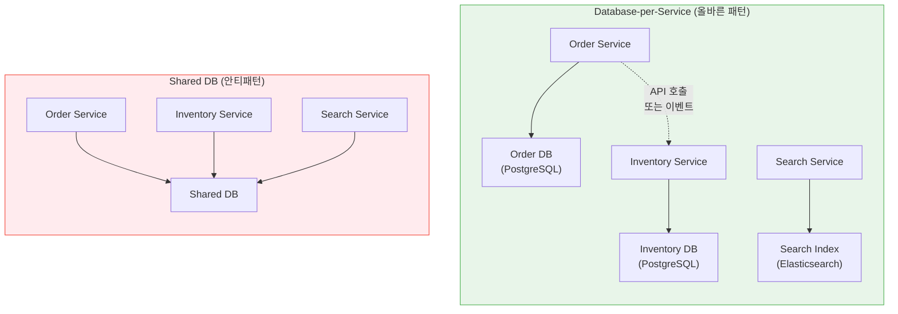
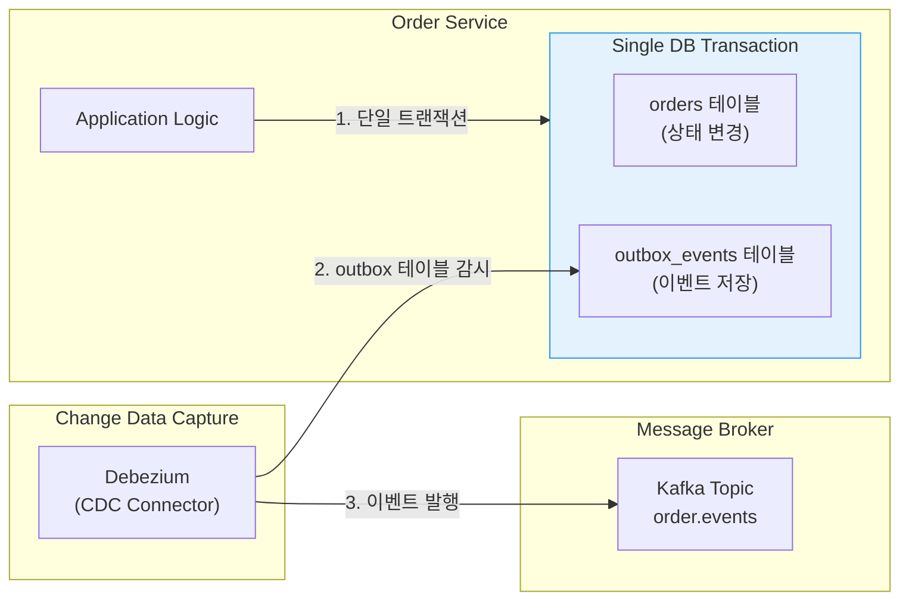
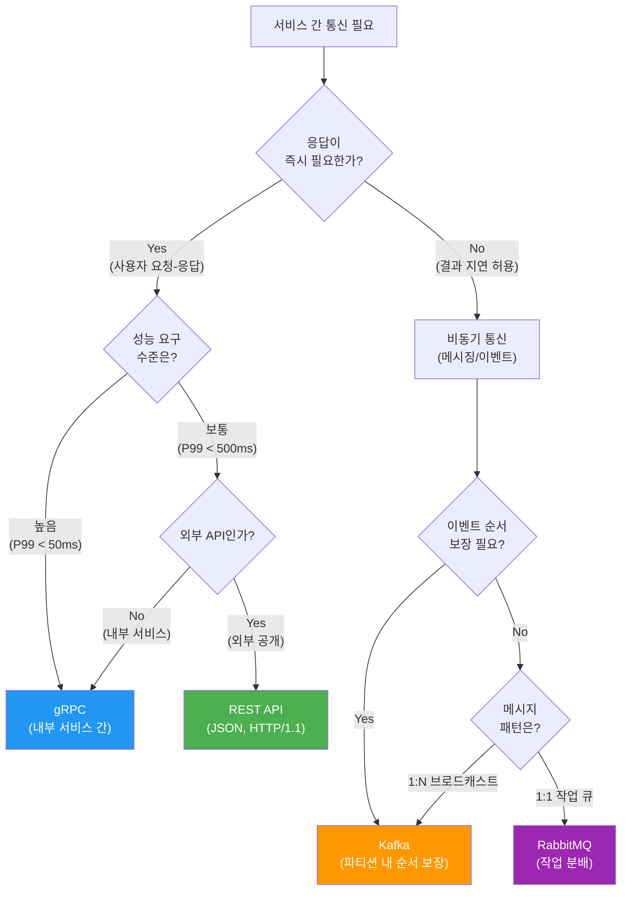
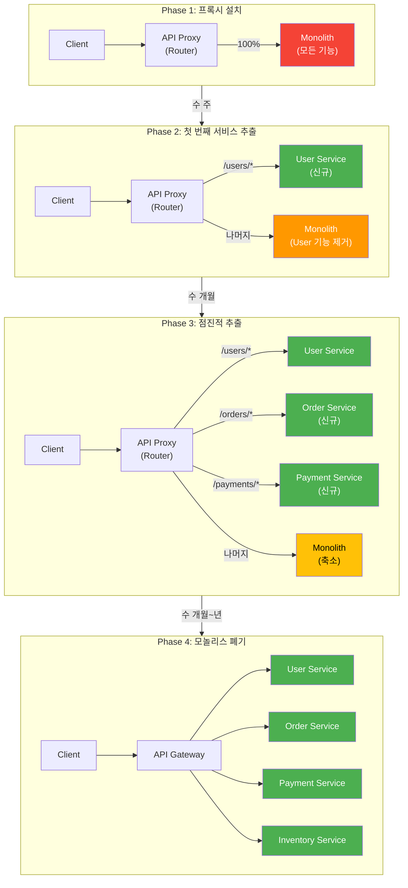
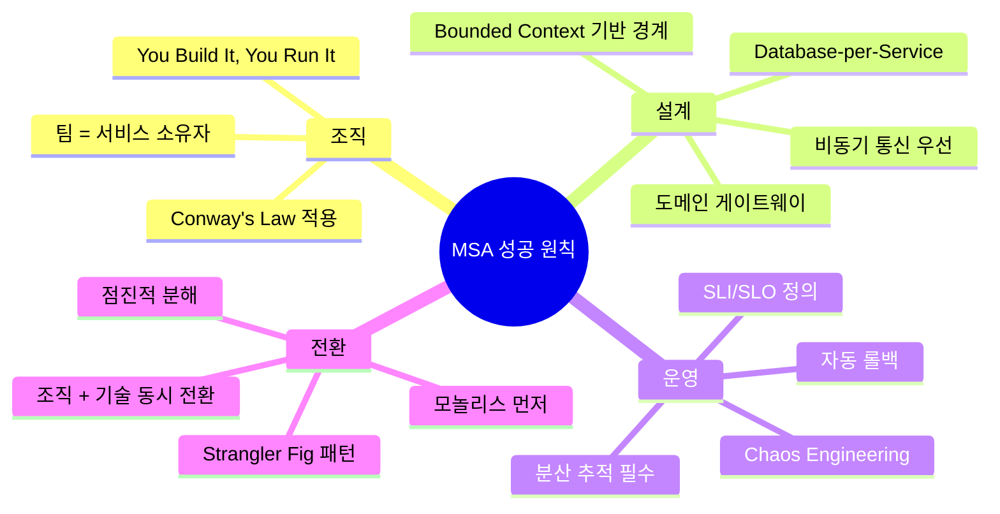

# 마이크로서비스 아키텍처 설계 가이드

> **작성일**: 2026-03-12
> **기반 표준**: Uber DOMA, Netflix MSA, Google SRE, Airbnb 전환 경험, Shopify 이벤트 아키텍처
> **적용 수준**: 빅테크 기준 팀 운영표준
> **참고**: [빅테크 코드품질 갭분석 리포트 섹션 4.2](../reports/2026-03-12_빅테크-코드품질-갭분석-리포트.md)

---

## 목차

1. [MSA 도입 판단 기준](#1-msa-도입-판단-기준)
2. [서비스 분해 원칙](#2-서비스-분해-원칙)
3. [Uber DOMA 패턴](#3-uber-doma-패턴)
4. [서비스 경계 설계](#4-서비스-경계-설계)
5. [데이터 소유권](#5-데이터-소유권)
6. [서비스 간 통신 개요](#6-서비스-간-통신-개요)
7. [모놀리스에서 MSA로 마이그레이션](#7-모놀리스에서-msa로-마이그레이션)
8. [MSA 안티패턴](#8-msa-안티패턴)
9. [MSA 체크리스트](#9-msa-체크리스트)
10. [빅테크 사례 연구](#10-빅테크-사례-연구)

---

## 1. MSA 도입 판단 기준

마이크로서비스는 만능 해법이 아니다. 잘못 도입하면 모놀리스보다 더 복잡한 "분산 모놀리스"가 된다. 도입 전 냉정한 자가 진단이 필수다.

### 1.1 모놀리스 vs MSA 의사결정 트리



### 1.2 도입 판단 기준표

| 기준 | 모놀리스 적합 | Modular Monolith | MSA 적합 |
|------|-------------|-----------------|----------|
| **팀 규모** | 1-8명 | 5-20명 | 15명+ |
| **도메인 복잡도** | 단순 CRUD | 중간 (3-5 도메인) | 높음 (6+ 도메인) |
| **배포 빈도** | 주 1회 이하 | 주 2-5회 | 일 1회 이상 |
| **확장 요구** | 균일한 확장 | 부분적 확장 | 서비스별 독립 확장 |
| **장애 격리** | 전체 재시작 허용 | 모듈 수준 격리 | 서비스 수준 격리 필수 |
| **기술 다양성** | 단일 스택 | 단일 스택 | 서비스별 최적 기술 선택 |
| **DevOps 성숙도** | 낮아도 가능 | 중간 이상 | 높음 필수 |
| **운영 비용** | 낮음 | 중간 | 높음 |

### 1.3 핵심 원칙: "모놀리스 먼저"

Martin Fowler의 "MonolithFirst" 원칙을 따른다.

1. **새 프로젝트는 모놀리스로 시작한다** -- 도메인을 충분히 이해하기 전에 서비스 경계를 긋는 것은 위험하다
2. **Modular Monolith로 경계를 명확히 한다** -- 모듈 간 의존성을 최소화하고 인터페이스를 명확히 정의한다
3. **분해가 필요할 때 분해한다** -- 배포 독립성, 확장성, 장애 격리 중 하나라도 절실히 필요할 때

> "서비스 경계를 잘못 긋는 비용은, 모놀리스를 유지하는 비용보다 훨씬 크다."
> -- Sam Newman, Building Microservices

---

## 2. 서비스 분해 원칙

### 2.1 DDD Bounded Context

서비스 경계의 가장 강력한 근거는 **Bounded Context(바운디드 컨텍스트)**다. 같은 용어가 다른 의미를 가지는 지점이 자연스러운 서비스 경계다.



**핵심**: 같은 "Product"라는 단어지만 주문/재고/마케팅 각 컨텍스트에서 속성과 행위가 완전히 다르다. 이것이 서비스 분리의 근거다.

#### Bounded Context 식별 절차

1. **EventStorming 워크숍**: 도메인 전문가와 함께 비즈니스 이벤트를 탐색한다
2. **유비쿼터스 언어 매핑**: 같은 용어의 의미가 달라지는 지점을 찾는다
3. **컨텍스트 맵 작성**: 컨텍스트 간 관계(Upstream/Downstream, Conformist, ACL)를 정의한다
4. **팀 매핑**: 하나의 컨텍스트는 하나의 팀이 소유한다

### 2.2 Team Topologies

서비스 경계는 조직 구조와 일치해야 한다 (Conway's Law).

| 팀 유형 | 역할 | 서비스 소유 방식 |
|---------|------|----------------|
| **Stream-aligned Team** | 비즈니스 도메인 흐름 담당 | 도메인 서비스 1-3개 소유 |
| **Platform Team** | 내부 플랫폼 제공 | 공통 인프라 서비스 소유 |
| **Enabling Team** | 기술 역량 지원 | 서비스 미소유, 역량 전파 |
| **Complicated Subsystem Team** | 전문 기술 영역 | 전문 서비스 1개 소유 |

**원칙**: 서비스 소유 팀은 해당 서비스의 설계, 개발, 배포, 운영 전체를 책임진다 ("You build it, you run it" -- Werner Vogels, Amazon CTO).

### 2.3 서비스 크기 기준

서비스 크기에 대한 절대적 기준은 없다. "마이크로"라는 접두사에 집착하지 않는다.

| 분류 | 코드 규모 | 팀 규모 | 특징 |
|------|----------|---------|------|
| **마이크로서비스** | ~5,000 LoC | 2-3명 | 단일 Aggregate, 높은 자율성 |
| **미니서비스** | 5,000-50,000 LoC | 3-6명 | Bounded Context 1개, 실용적 선택 |
| **매크로서비스** | 50,000+ LoC | 6-10명 | 복수 관련 Aggregate, 내부 모듈화 |

**실용적 기준**: "Two-Pizza Team(6-8명)이 전체 생명주기를 관리할 수 있는 크기"가 적정 서비스 크기다.

### 2.4 서비스 분해 시 자문 목록

서비스를 분리하기 전에 다음 질문에 답해야 한다:

- [ ] 이 서비스는 독립적으로 배포할 수 있는가?
- [ ] 이 서비스는 독립적으로 확장해야 하는가?
- [ ] 이 서비스의 장애가 다른 서비스에 전파되면 안 되는가?
- [ ] 이 서비스는 별도 팀이 소유하는가?
- [ ] 이 서비스의 데이터는 다른 서비스와 격리되어야 하는가?
- [ ] 이 서비스의 기술 스택이 나머지와 달라야 하는가?

3개 이상 "Yes"라면 분리를 진행한다.

---

## 3. Uber DOMA 패턴

Uber는 2,200+ 마이크로서비스를 운영하면서, 서비스 간 무질서한 의존성("마이크로서비스 스파게티")을 경험했다. 이를 해결하기 위해 **DOMA(Domain-Oriented Microservice Architecture)**를 도입했다.

### 3.1 DOMA 핵심 개념



### 3.2 DOMA 4계층 모델

| 계층 | 역할 | 예시 |
|------|------|------|
| **Infrastructure Layer** | 공통 인프라 서비스 | 메시징, 스토리지, 모니터링, 서비스 메시 |
| **Business Layer** | 핵심 비즈니스 기능 도메인 | 결제, 매칭, 인증, 알림 |
| **Product Layer** | 사용자 대면 제품 도메인 | Rides, Eats, Freight |
| **Presentation Layer** | 클라이언트 애플리케이션 | 모바일 앱, 웹, 파트너 포털 |

### 3.3 도메인 게이트웨이

DOMA의 핵심은 **도메인 게이트웨이**다. 외부 도메인은 게이트웨이를 통해서만 내부 서비스에 접근한다.

```python
# Python (FastAPI) -- Payments Domain Gateway
from __future__ import annotations

from dataclasses import dataclass
from enum import Enum

from fastapi import APIRouter, Depends, HTTPException

router = APIRouter(prefix="/payments", tags=["Payments Gateway"])


class PaymentMethod(str, Enum):
    CARD = "card"
    BANK_TRANSFER = "bank_transfer"


@dataclass(frozen=True)
class ChargeRequest:
    """External-facing request model (Gateway contract)."""
    order_id: str
    amount: int  # cents
    currency: str
    method: PaymentMethod


@dataclass(frozen=True)
class ChargeResponse:
    """External-facing response model (Gateway contract)."""
    charge_id: str
    status: str


@router.post("/charges", response_model=ChargeResponse)
async def create_charge(
    request: ChargeRequest,
    charge_service: ChargeService = Depends(),
    fraud_service: FraudDetector = Depends(),
) -> ChargeResponse:
    """Domain Gateway: orchestrates internal services.

    External domains call THIS endpoint, never internal services directly.
    """
    # Internal service calls are hidden behind the gateway
    fraud_check = await fraud_service.assess(request.order_id, request.amount)
    if not fraud_check.is_safe:
        raise HTTPException(status_code=422, detail="Payment flagged for review")

    charge = await charge_service.process(request)
    return ChargeResponse(charge_id=charge.id, status=charge.status)
```

```kotlin
// Kotlin (Spring Boot) -- Payments Domain Gateway
@RestController
@RequestMapping("/payments")
class PaymentsGatewayController(
    private val chargeService: ChargeService,
    private val fraudDetector: FraudDetector,
) {
    /**
     * Domain Gateway: orchestrates internal services.
     * External domains call THIS endpoint, never internal services directly.
     */
    @PostMapping("/charges")
    suspend fun createCharge(
        @Valid @RequestBody request: ChargeRequest,
    ): ResponseEntity<ChargeResponse> {
        val fraudCheck = fraudDetector.assess(request.orderId, request.amount)
        if (!fraudCheck.isSafe) {
            throw ResponseStatusException(
                HttpStatus.UNPROCESSABLE_ENTITY,
                "Payment flagged for review",
            )
        }

        val charge = chargeService.process(request)
        return ResponseEntity.ok(
            ChargeResponse(chargeId = charge.id, status = charge.status),
        )
    }
}

data class ChargeRequest(
    val orderId: String,
    val amount: Long, // cents
    val currency: String,
    val method: PaymentMethod,
)

data class ChargeResponse(
    val chargeId: String,
    val status: String,
)

enum class PaymentMethod { CARD, BANK_TRANSFER }
```

### 3.4 DOMA 의존성 규칙

| 규칙 | 설명 | 위반 시 영향 |
|------|------|------------|
| **상위 -> 하위만 허용** | Product Layer -> Business Layer -> Infrastructure Layer | 순환 의존 방지 |
| **동일 계층 간 직접 호출 금지** | Business Domain A는 Business Domain B의 게이트웨이만 호출 | 결합도 제어 |
| **게이트웨이 우회 금지** | 외부 도메인이 내부 서비스를 직접 호출하면 안 됨 | 캡슐화 보호 |
| **역방향 의존 금지** | Infrastructure Layer가 Business Layer를 호출하면 안 됨 | 계층 무결성 |

---

## 4. 서비스 경계 설계

### 4.1 Entity와 Aggregate Root

DDD의 **Aggregate** 패턴은 서비스 내부 데이터 일관성의 경계를 정의한다.



**원칙**:
- Aggregate 내부: 강한 일관성 (동일 트랜잭션)
- Aggregate 간: 최종적 일관성 (이벤트를 통한 동기화)
- 외부 Aggregate는 ID로만 참조한다 (객체 직접 참조 금지)

#### Python 예시: Aggregate Root

```python
from __future__ import annotations

from dataclasses import dataclass, field
from datetime import datetime
from typing import NewType
from uuid import uuid4

OrderId = NewType("OrderId", str)
CustomerId = NewType("CustomerId", str)
ProductId = NewType("ProductId", str)

MINIMUM_ORDER_AMOUNT = 1000  # cents


@dataclass(frozen=True)
class OrderItem:
    """Value Object within Order Aggregate."""
    product_id: ProductId
    quantity: int
    unit_price: int  # cents

    @property
    def subtotal(self) -> int:
        return self.quantity * self.unit_price


@dataclass(frozen=True)
class ShippingAddress:
    """Value Object -- immutable, compared by value."""
    street: str
    city: str
    postal_code: str
    country: str


@dataclass
class Order:
    """Aggregate Root -- the only entry point for state changes."""
    id: OrderId
    customer_id: CustomerId  # Reference by ID only, not by object
    items: tuple[OrderItem, ...] = ()
    shipping_address: ShippingAddress | None = None
    status: str = "draft"
    created_at: datetime = field(default_factory=datetime.utcnow)
    _events: list[dict] = field(default_factory=list, repr=False)

    @classmethod
    def create(cls, customer_id: CustomerId) -> Order:
        order = cls(
            id=OrderId(str(uuid4())),
            customer_id=customer_id,
        )
        order._events.append({"type": "OrderCreated", "order_id": order.id})
        return order

    def add_item(self, item: OrderItem) -> None:
        """Business rule: all mutations go through Aggregate Root."""
        self.items = (*self.items, item)
        self._events.append({
            "type": "OrderItemAdded",
            "order_id": self.id,
            "product_id": item.product_id,
        })

    def place(self) -> None:
        """Business rule: order must have items and address."""
        if not self.items:
            raise ValueError("Cannot place empty order")
        if self.shipping_address is None:
            raise ValueError("Shipping address required")
        if self.total < MINIMUM_ORDER_AMOUNT:
            raise ValueError(f"Minimum order: {MINIMUM_ORDER_AMOUNT} cents")
        self.status = "placed"
        self._events.append({"type": "OrderPlaced", "order_id": self.id})

    @property
    def total(self) -> int:
        return sum(item.subtotal for item in self.items)

    def collect_events(self) -> tuple[dict, ...]:
        events = tuple(self._events)
        self._events.clear()
        return events
```

#### Kotlin 예시: Aggregate Root

```kotlin
// Aggregate Root -- the only entry point for state changes
class Order private constructor(
    val id: OrderId,
    val customerId: CustomerId, // Reference by ID only
    private val _items: MutableList<OrderItem> = mutableListOf(),
    var shippingAddress: ShippingAddress? = null,
    var status: OrderStatus = OrderStatus.DRAFT,
    val createdAt: Instant = Instant.now(),
) {
    private val _events: MutableList<DomainEvent> = mutableListOf()

    val items: List<OrderItem> get() = _items.toList()
    val total: Long get() = _items.sumOf { it.subtotal }

    companion object {
        private const val MINIMUM_ORDER_AMOUNT = 1000L // cents

        fun create(customerId: CustomerId): Order {
            val order = Order(
                id = OrderId(UUID.randomUUID().toString()),
                customerId = customerId,
            )
            order._events.add(OrderCreated(order.id))
            return order
        }
    }

    fun addItem(item: OrderItem) {
        _items.add(item)
        _events.add(OrderItemAdded(id, item.productId))
    }

    fun place() {
        require(_items.isNotEmpty()) { "Cannot place empty order" }
        requireNotNull(shippingAddress) { "Shipping address required" }
        require(total >= MINIMUM_ORDER_AMOUNT) {
            "Minimum order: $MINIMUM_ORDER_AMOUNT cents"
        }
        status = OrderStatus.PLACED
        _events.add(OrderPlaced(id))
    }

    fun collectEvents(): List<DomainEvent> {
        val events = _events.toList()
        _events.clear()
        return events
    }
}

@JvmInline value class OrderId(val value: String)
@JvmInline value class CustomerId(val value: String)
@JvmInline value class ProductId(val value: String)

data class OrderItem(
    val productId: ProductId,
    val quantity: Int,
    val unitPrice: Long, // cents
) {
    val subtotal: Long get() = quantity * unitPrice
}

data class ShippingAddress(
    val street: String,
    val city: String,
    val postalCode: String,
    val country: String,
)

enum class OrderStatus { DRAFT, PLACED, CONFIRMED, SHIPPED, DELIVERED, CANCELLED }
```

### 4.2 Anti-Corruption Layer (ACL)

외부 시스템이나 레거시와 통합할 때, 외부 모델이 내부 도메인 모델을 오염시키지 않도록 **변환 계층**을 둔다.



```python
from __future__ import annotations

from dataclasses import dataclass


# External system model (legacy ERP format -- DO NOT use in domain)
@dataclass(frozen=True)
class LegacyOrderDTO:
    """External model from legacy ERP. Never leak into domain."""
    ord_num: str
    cust_code: str
    total_amt: float  # dollars, not cents
    stat: str  # "A", "P", "C"


# Anti-Corruption Layer: translates between external and internal models
class OrderTranslator:
    """ACL Translator -- converts legacy model to domain model."""

    LEGACY_STATUS_MAP: dict[str, str] = {
        "A": "placed",
        "P": "confirmed",
        "C": "cancelled",
    }

    @staticmethod
    def to_domain(legacy: LegacyOrderDTO) -> Order:
        return Order.create(
            customer_id=CustomerId(legacy.cust_code),
            # Convert dollars to cents
            total_override=int(legacy.total_amt * 100),
            status=OrderTranslator.LEGACY_STATUS_MAP.get(legacy.stat, "draft"),
        )

    @staticmethod
    def to_legacy(order: Order) -> LegacyOrderDTO:
        reverse_map = {v: k for k, v in OrderTranslator.LEGACY_STATUS_MAP.items()}
        return LegacyOrderDTO(
            ord_num=order.id,
            cust_code=order.customer_id,
            total_amt=order.total / 100.0,
            stat=reverse_map.get(order.status, "A"),
        )
```

---

## 5. 데이터 소유권

### 5.1 Database-per-Service 원칙

각 서비스는 자신의 데이터를 독점적으로 소유한다. 다른 서비스가 직접 DB에 접근하는 것을 금지한다.



### 5.2 데이터 일관성 전략

Database-per-Service를 적용하면 서비스 간 데이터 일관성 문제가 발생한다. 이를 해결하는 전략을 상황에 맞게 선택한다.

| 전략 | 일관성 수준 | 복잡도 | 적합한 상황 |
|------|-----------|--------|------------|
| **API Composition** | 실시간 | 낮음 | 단순 조회 (조인 대체) |
| **CQRS** | 최종적 (ms~sec) | 중간 | 읽기/쓰기 비대칭 |
| **Event-Driven Sync** | 최종적 (sec~min) | 중간 | 비동기 데이터 동기화 |
| **Saga** | 최종적 (sec~min) | 높음 | 분산 트랜잭션 |
| **CDC (Change Data Capture)** | 최종적 (ms~sec) | 중간 | DB 변경 스트리밍 |

#### Saga 패턴 예시: 주문 처리

```mermaid
sequenceDiagram
    participant Client
    participant OrderSvc as Order Service
    participant PaymentSvc as Payment Service
    participant InventorySvc as Inventory Service
    participant NotifySvc as Notification Service

    Client->>OrderSvc: POST /orders
    activate OrderSvc
    OrderSvc->>OrderSvc: Create Order (PENDING)
    OrderSvc->>PaymentSvc: Charge Request
    activate PaymentSvc

    alt Payment Success
        PaymentSvc-->>OrderSvc: Payment Confirmed
        deactivate PaymentSvc
        OrderSvc->>InventorySvc: Reserve Stock
        activate InventorySvc

        alt Stock Available
            InventorySvc-->>OrderSvc: Stock Reserved
            deactivate InventorySvc
            OrderSvc->>OrderSvc: Order CONFIRMED
            OrderSvc->>NotifySvc: Send Confirmation
            OrderSvc-->>Client: 201 Created (CONFIRMED)
        else Stock Unavailable
            InventorySvc-->>OrderSvc: Stock Unavailable
            deactivate InventorySvc
            OrderSvc->>PaymentSvc: Refund (Compensating Tx)
            OrderSvc->>OrderSvc: Order CANCELLED
            OrderSvc-->>Client: 409 Conflict
        end

    else Payment Failed
        PaymentSvc-->>OrderSvc: Payment Failed
        deactivate PaymentSvc
        OrderSvc->>OrderSvc: Order CANCELLED
        OrderSvc-->>Client: 402 Payment Required
    end
    deactivate OrderSvc
```

#### Orchestration Saga 구현 (Python)

```python
from __future__ import annotations

from dataclasses import dataclass
from enum import Enum
from typing import Protocol


class SagaStepStatus(str, Enum):
    PENDING = "pending"
    COMPLETED = "completed"
    COMPENSATING = "compensating"
    COMPENSATED = "compensated"
    FAILED = "failed"


class SagaStep(Protocol):
    """Each step in a Saga must define execute and compensate."""

    async def execute(self, context: dict) -> dict: ...
    async def compensate(self, context: dict) -> None: ...


@dataclass
class SagaOrchestrator:
    """Orchestrates a sequence of saga steps with compensation on failure."""
    steps: tuple[SagaStep, ...]

    async def run(self, initial_context: dict) -> dict:
        completed_steps: list[SagaStep] = []
        context = {**initial_context}

        for step in self.steps:
            try:
                result = await step.execute(context)
                context = {**context, **result}
                completed_steps.append(step)
            except Exception:
                # Compensate in reverse order
                for completed_step in reversed(completed_steps):
                    await completed_step.compensate(context)
                raise

        return context


# Concrete saga step
class PaymentStep:
    """Saga step: charge payment, compensate with refund."""

    def __init__(self, payment_client: PaymentClient) -> None:
        self._client = payment_client

    async def execute(self, context: dict) -> dict:
        charge = await self._client.charge(
            order_id=context["order_id"],
            amount=context["amount"],
        )
        return {"charge_id": charge.id}

    async def compensate(self, context: dict) -> None:
        await self._client.refund(charge_id=context["charge_id"])
```

#### Orchestration Saga 구현 (Kotlin)

```kotlin
// Saga Step interface
interface SagaStep {
    suspend fun execute(context: MutableMap<String, Any>): Map<String, Any>
    suspend fun compensate(context: Map<String, Any>)
}

// Saga Orchestrator
class SagaOrchestrator(
    private val steps: List<SagaStep>,
) {
    suspend fun run(initialContext: Map<String, Any>): Map<String, Any> {
        val context = initialContext.toMutableMap()
        val completedSteps = mutableListOf<SagaStep>()

        for (step in steps) {
            try {
                val result = step.execute(context)
                context.putAll(result)
                completedSteps.add(step)
            } catch (e: Exception) {
                // Compensate in reverse order
                completedSteps.reversed().forEach { it.compensate(context) }
                throw e
            }
        }
        return context.toMap()
    }
}

// Concrete saga step
class PaymentStep(
    private val paymentClient: PaymentClient,
) : SagaStep {

    override suspend fun execute(
        context: MutableMap<String, Any>,
    ): Map<String, Any> {
        val charge = paymentClient.charge(
            orderId = context["order_id"] as String,
            amount = context["amount"] as Long,
        )
        return mapOf("charge_id" to charge.id)
    }

    override suspend fun compensate(context: Map<String, Any>) {
        paymentClient.refund(chargeId = context["charge_id"] as String)
    }
}
```

### 5.3 Outbox 패턴

DB 트랜잭션과 이벤트 발행의 원자성을 보장한다. "DB에 저장했지만 이벤트 발행에 실패"하는 문제를 방지한다.



```sql
-- Outbox Events Table
CREATE TABLE outbox_events (
    id          UUID PRIMARY KEY DEFAULT gen_random_uuid(),
    aggregate_type  VARCHAR(100) NOT NULL,  -- 'Order'
    aggregate_id    VARCHAR(100) NOT NULL,  -- order_id
    event_type      VARCHAR(100) NOT NULL,  -- 'OrderPlaced'
    payload         JSONB NOT NULL,
    created_at      TIMESTAMPTZ NOT NULL DEFAULT now(),
    published_at    TIMESTAMPTZ  -- NULL until published by CDC
);

-- Index for CDC polling (if not using log-based CDC)
CREATE INDEX idx_outbox_unpublished
    ON outbox_events (created_at)
    WHERE published_at IS NULL;
```

---

## 6. 서비스 간 통신 개요

> **참고**: 서비스 간 통신의 상세한 구현 패턴(gRPC, Service Mesh, 복원력 패턴)은 별도 문서에서 다룬다. 이 섹션은 선택 기준과 개요에 집중한다.

### 6.1 동기 vs 비동기 선택 기준



### 6.2 통신 패턴 비교표

| 항목 | REST | gRPC | Kafka | RabbitMQ |
|------|------|------|-------|----------|
| **유형** | 동기 | 동기 | 비동기 | 비동기 |
| **프로토콜** | HTTP/1.1, JSON | HTTP/2, Protobuf | TCP, Binary | AMQP |
| **성능** | 보통 | 높음 (10x REST) | 매우 높음 | 보통 |
| **순서 보장** | N/A | N/A | 파티션 내 보장 | 큐 내 보장 |
| **스키마** | OpenAPI (선택적) | Proto (필수) | Avro/Proto (권장) | 자유 |
| **적합 사례** | 외부 API, 단순 CRUD | 내부 고성능 호출 | 이벤트 스트리밍 | 작업 큐, RPC |
| **스트리밍** | SSE, WebSocket | 네이티브 지원 | 네이티브 | 제한적 |
| **빅테크 활용** | Stripe (외부) | Google (내부) | Shopify, Uber | 소규모 팀 |

### 6.3 복원력 패턴 개요

서비스 간 동기 호출에는 반드시 복원력 패턴을 적용한다.

| 패턴 | 목적 | 적용 시점 |
|------|------|----------|
| **Circuit Breaker** | 장애 전파 차단 | 모든 외부 서비스 호출 |
| **Retry + Backoff** | 일시적 장애 복구 | Transient 에러 (5xx, timeout) |
| **Bulkhead** | 장애 격리 | 서비스별 리소스 풀 분리 |
| **Timeout** | 무한 대기 방지 | 모든 네트워크 호출 |
| **Fallback** | 대안 응답 제공 | 비필수 서비스 장애 시 |

```python
# Python -- Circuit Breaker with tenacity
from __future__ import annotations

import contextlib
from functools import wraps

import httpx
from tenacity import (
    retry,
    retry_if_exception_type,
    stop_after_attempt,
    wait_exponential_jitter,
)

RETRY_MAX_ATTEMPTS = 3
RETRY_MIN_WAIT = 1
RETRY_MAX_WAIT = 10


@retry(
    retry=retry_if_exception_type((httpx.TimeoutException, httpx.HTTPStatusError)),
    stop=stop_after_attempt(RETRY_MAX_ATTEMPTS),
    wait=wait_exponential_jitter(min=RETRY_MIN_WAIT, max=RETRY_MAX_WAIT),
)
async def call_payment_service(order_id: str, amount: int) -> dict:
    """External service call with retry + exponential backoff + jitter."""
    async with httpx.AsyncClient(timeout=5.0) as client:
        response = await client.post(
            "http://payment-service/charges",
            json={"order_id": order_id, "amount": amount},
        )
        response.raise_for_status()
        return response.json()
```

```kotlin
// Kotlin -- Circuit Breaker with Resilience4j
@Service
class PaymentClient(
    private val webClient: WebClient,
    private val circuitBreakerRegistry: CircuitBreakerRegistry,
) {
    private val circuitBreaker = circuitBreakerRegistry.circuitBreaker(
        "payment-service",
        CircuitBreakerConfig.custom()
            .failureRateThreshold(50f)
            .waitDurationInOpenState(Duration.ofSeconds(30))
            .slidingWindowSize(10)
            .build(),
    )

    suspend fun charge(orderId: String, amount: Long): ChargeResult {
        return circuitBreaker.executeSuspendFunction {
            webClient.post()
                .uri("/charges")
                .bodyValue(ChargeRequest(orderId, amount))
                .retrieve()
                .awaitBody<ChargeResult>()
        }
    }
}
```

---

## 7. 모놀리스에서 MSA로 마이그레이션

### 7.1 Strangler Fig 패턴

새 기능은 새 서비스에 구현하고, 기존 기능은 점진적으로 이전한다. 레거시 모놀리스를 한 번에 교체하는 "Big Bang" 접근은 금지한다.



### 7.2 Branch by Abstraction

모놀리스 내부에서 추상화 계층을 삽입하여, 구현체를 점진적으로 교체하는 패턴이다.

```python
from __future__ import annotations

from typing import Protocol, runtime_checkable


# Step 1: Define abstraction (interface)
@runtime_checkable
class NotificationSender(Protocol):
    async def send(self, user_id: str, message: str) -> None: ...


# Step 2: Legacy implementation (monolith internal)
class LegacyEmailNotifier:
    """Current monolith implementation."""

    async def send(self, user_id: str, message: str) -> None:
        # Direct DB access, SMTP call, etc.
        ...


# Step 3: New implementation (calls external microservice)
class NotificationServiceClient:
    """New microservice client -- replaces legacy when ready."""

    def __init__(self, base_url: str) -> None:
        self._base_url = base_url

    async def send(self, user_id: str, message: str) -> None:
        # HTTP call to notification microservice
        ...


# Step 4: Feature flag controls which implementation is used
class NotificationRouter:
    """Routes to legacy or new implementation based on feature flag."""

    def __init__(
        self,
        legacy: NotificationSender,
        new_service: NotificationSender,
        feature_flags: FeatureFlags,
    ) -> None:
        self._legacy = legacy
        self._new_service = new_service
        self._flags = feature_flags

    async def send(self, user_id: str, message: str) -> None:
        if self._flags.is_enabled("use_notification_service", user_id=user_id):
            await self._new_service.send(user_id, message)
        else:
            await self._legacy.send(user_id, message)
```

### 7.3 마이그레이션 단계별 전략

| 단계 | 활동 | 기간 | 산출물 |
|------|------|------|--------|
| **0. 준비** | 모니터링/CI-CD 인프라 구축, 팀 교육 | 1-2개월 | 인프라 준비 완료, 교육 자료 |
| **1. 분석** | 도메인 분석, EventStorming, 컨텍스트 맵 | 2-4주 | 컨텍스트 맵, 서비스 후보 목록 |
| **2. 프록시** | API 프록시/게이트웨이 설치, 트래픽 라우팅 | 1-2주 | 프록시 운영 |
| **3. 첫 추출** | 가장 덜 결합된 도메인 1개 추출 | 2-4주 | 첫 번째 독립 서비스 |
| **4. 검증** | 모니터링 확인, 성능 비교, 롤백 테스트 | 1-2주 | 운영 안정성 검증 |
| **5. 반복** | 나머지 도메인 순차 추출 | 도메인당 2-6주 | 점진적 서비스 분리 |
| **6. 폐기** | 모놀리스 최종 기능 이전, 모놀리스 종료 | 2-4주 | 모놀리스 폐기 |

#### 첫 추출 대상 선정 기준

1. **결합도가 가장 낮은 도메인**: 다른 도메인과의 의존성이 최소인 것
2. **독립 확장 필요성이 높은 도메인**: 트래픽 패턴이 다른 것 (예: 검색 vs 결제)
3. **팀이 가장 잘 이해하는 도메인**: 전환 중 발생하는 문제를 빠르게 해결 가능한 것
4. **비즈니스 위험이 낮은 도메인**: 장애 시 영향이 적은 것 (예: 알림 > 결제)

---

## 8. MSA 안티패턴

### 8.1 분산 모놀리스 (Distributed Monolith)

가장 흔하고 치명적인 안티패턴이다. 서비스는 분리했지만, 배포와 변경이 독립적이지 않은 상태다.

**증상**:
- 한 서비스를 배포하려면 다른 서비스도 함께 배포해야 한다
- 서비스 간 동기 호출 체인이 5단계 이상이다
- 모든 서비스가 같은 DB를 공유한다
- 서비스 간 릴리스 조율 미팅이 필요하다

**해결**: 서비스 경계를 재정의하고, 비동기 통신으로 전환하고, Database-per-Service를 적용한다.

### 8.2 과도한 분해 (Nano-services)

서비스를 너무 작게 쪼개어 운영 복잡도가 폭발하는 패턴이다.

**증상**:
- 단일 API 호출에 10개+ 서비스가 관여한다
- 서비스당 코드가 수백 줄에 불과하다
- 네트워크 호출 오버헤드가 비즈니스 로직보다 크다
- 서비스 수 > 개발자 수이다

**해결**: 관련 서비스를 병합하고, Uber DOMA처럼 도메인 단위로 그룹화한다.

### 8.3 공유 데이터베이스 (Shared Database)

여러 서비스가 동일 DB에 직접 접근하는 패턴이다. Database-per-Service 원칙 위반이다.

**증상**:
- DB 스키마 변경 시 여러 서비스를 동시에 수정해야 한다
- 한 서비스의 잘못된 쿼리가 다른 서비스의 성능에 영향을 준다
- DB가 단일 장애점이 된다

**해결**: 서비스별 전용 DB를 부여하고, 데이터 동기화는 이벤트 또는 API를 통한다.

### 8.4 동기 호출 체인 (Synchronous Chain)

A -> B -> C -> D -> E 형태의 긴 동기 호출 체인은 전체 지연을 합산하고, 하나의 장애가 전체를 마비시킨다.

**증상**:
- P99 레이턴시가 호출 체인 깊이에 비례하여 증가한다
- 최하위 서비스의 장애가 최상위까지 전파된다
- Timeout 설정이 서비스마다 달라 예측 불가능하다

**해결**:
- 비동기 통신으로 가능한 부분을 전환한다
- CQRS를 도입하여 읽기 경로를 단축한다
- API Composition 대신 데이터 복제를 고려한다

### 8.5 안티패턴 종합 비교

| 안티패턴 | 근본 원인 | 탐지 신호 | 해결 방향 |
|---------|----------|----------|----------|
| 분산 모놀리스 | 잘못된 서비스 경계 | 공동 배포 필수 | 경계 재정의, 비동기 전환 |
| 과도한 분해 | 크기 집착 | 서비스 > 개발자 | 도메인 단위 병합 |
| 공유 DB | DB 분리 미수행 | 스키마 공동 수정 | Database-per-Service |
| 동기 체인 | 통신 패턴 미설계 | P99 레이턴시 누적 | 비동기, CQRS |
| God Gateway | 게이트웨이에 비즈니스 로직 | 게이트웨이 비대화 | 로직을 서비스로 이동 |
| Chatty Service | 잦은 소규모 호출 | 네트워크 오버헤드 | Batch API, gRPC 스트리밍 |
| Hardcoded Endpoints | 서비스 디스커버리 미사용 | 서비스 IP 하드코딩 | Service Discovery, DNS |
| No Versioning | API 버전 관리 부재 | 동시 변경 강제 | API 버전 관리 정책 |

---

## 9. MSA 체크리스트

### 9.1 서비스 설계 체크리스트

| 카테고리 | 항목 | 필수 |
|---------|------|------|
| **경계** | Bounded Context 기반으로 서비스 경계를 정했는가? | MUST |
| **경계** | 서비스가 독립적으로 배포 가능한가? | MUST |
| **경계** | 서비스가 독립적으로 확장 가능한가? | MUST |
| **데이터** | Database-per-Service를 적용했는가? | MUST |
| **데이터** | 서비스 간 데이터 일관성 전략이 정의되었는가? (Saga, 이벤트 등) | MUST |
| **API** | 서비스 간 API 계약이 명시적으로 정의되었는가? (OpenAPI, Proto) | MUST |
| **API** | API 버전 관리 전략이 있는가? | MUST |
| **통신** | 동기/비동기 통신 패턴이 적절히 선택되었는가? | MUST |
| **통신** | Circuit Breaker, Retry, Timeout이 적용되었는가? | MUST |
| **도메인** | Aggregate Root가 식별되었는가? | SHOULD |
| **도메인** | 도메인 이벤트가 정의되었는가? | SHOULD |

### 9.2 운영 체크리스트

| 카테고리 | 항목 | 필수 |
|---------|------|------|
| **배포** | CI/CD 파이프라인이 서비스별 독립적인가? | MUST |
| **배포** | Canary 또는 Blue-Green 배포가 가능한가? | MUST |
| **배포** | 자동 롤백 메커니즘이 있는가? | MUST |
| **관측** | 분산 추적(Distributed Tracing)이 설정되었는가? | MUST |
| **관측** | 서비스별 SLI/SLO가 정의되었는가? | MUST |
| **관측** | 헬스체크 엔드포인트가 있는가? (/health, /ready) | MUST |
| **관측** | 구조화된 로깅에 Correlation ID가 포함되는가? | MUST |
| **보안** | 서비스 간 인증이 적용되었는가? (mTLS, JWT) | MUST |
| **보안** | 네트워크 정책으로 서비스 간 접근이 제한되는가? | SHOULD |
| **문서** | 서비스 카탈로그에 등록되었는가? | SHOULD |
| **문서** | 런북이 작성되었는가? | SHOULD |

### 9.3 모니터링 체크리스트

| 카테고리 | 항목 | 필수 |
|---------|------|------|
| **4 Golden Signals** | Latency (P50/P95/P99) 메트릭이 수집되는가? | MUST |
| **4 Golden Signals** | Traffic (RPS) 메트릭이 수집되는가? | MUST |
| **4 Golden Signals** | Error Rate (4xx/5xx) 메트릭이 수집되는가? | MUST |
| **4 Golden Signals** | Saturation (CPU/Memory/Disk) 메트릭이 수집되는가? | MUST |
| **알림** | SLO 기반 알림이 설정되었는가? | MUST |
| **알림** | 에러 버짓 소진 속도 알림이 있는가? | SHOULD |
| **추적** | 서비스 간 요청 흐름을 추적할 수 있는가? | MUST |
| **추적** | 느린 쿼리/요청을 자동 탐지하는가? | SHOULD |
| **대시보드** | 서비스별 핵심 메트릭 대시보드가 있는가? | MUST |
| **대시보드** | 서비스 의존성 맵이 시각화되는가? | SHOULD |

---

## 10. 빅테크 사례 연구

### 10.1 Netflix: 700+ 마이크로서비스의 대규모 운영

| 항목 | 내용 |
|------|------|
| **규모** | 700+ 마이크로서비스, 일 150억+ API 호출, 190+ 국가 |
| **핵심 패턴** | Federated GraphQL, Chaos Engineering, Circuit Breaker (Hystrix -> Resilience4j) |
| **API 통합** | DGS Framework (Domain Graph Service) -- GraphQL Federation으로 서비스 통합 |
| **복원력** | Chaos Monkey로 프로덕션 장애 주입. "장애는 피할 수 없으므로 연습한다" |
| **배포** | Spinnaker 기반 Canary 배포. 자동 롤백 + A/B 분석 |
| **교훈** | 서비스 경계는 팀 구조와 일치시키고, 장애를 전제한 설계가 필수다 |

### 10.2 Uber: DOMA로 2,200+ 서비스 정리

| 항목 | 내용 |
|------|------|
| **규모** | 2,200+ 마이크로서비스, 70+ 도메인 |
| **전환 이유** | 초기 MSA 도입 후 서비스 간 무질서한 의존성("마이크로서비스 스파게티") 경험 |
| **핵심 패턴** | DOMA (Domain-Oriented Microservice Architecture) |
| **게이트웨이** | 도메인별 게이트웨이 -- 외부 도메인은 게이트웨이만 호출, 내부 서비스 직접 접근 금지 |
| **계층화** | 4계층 (Infrastructure, Business, Product, Presentation) |
| **교훈** | "마이크로서비스의 수보다 도메인 간 경계와 계약이 중요하다" |

### 10.3 Airbnb: 모놀리스에서 MSA로의 체계적 전환

| 항목 | 내용 |
|------|------|
| **전환 배경** | Ruby on Rails 모놀리스의 한계 -- 배포 시간 증가, 팀 간 충돌 |
| **전환 전략** | Strangler Fig 패턴 -- API 프록시를 통한 점진적 추출 |
| **핵심 패턴** | Service-Oriented Architecture (SOA), 통합 API 계층 |
| **데이터 전략** | 데이터 소유권 명확화 + 이벤트 기반 동기화 |
| **조직 변화** | 기능 팀 -> 도메인 팀으로 조직 재편 (Conway's Law 적용) |
| **교훈** | "조직 구조 변경 없이 아키텍처만 바꾸면 실패한다. 기술 전환은 조직 전환과 함께 해야 한다" |

### 10.4 Shopify: 이벤트 기반 대규모 분산 시스템

| 항목 | 내용 |
|------|------|
| **규모** | Kafka 기반 66M msg/sec 이벤트 처리 |
| **핵심 패턴** | Event-Driven Architecture, Modular Monolith -> MSA 점진적 전환 |
| **이벤트 표준** | CloudEvents 스펙 기반 이벤트 스키마 표준화 |
| **Modular Monolith** | 전면 MSA가 아닌, 핵심 기능만 서비스로 분리하고 나머지는 모듈로 유지 |
| **교훈** | "모놀리스와 MSA는 이분법이 아니다. 비즈니스 요구에 따라 혼합 아키텍처가 현실적이다" |

### 10.5 빅테크 공통 교훈 요약



---

## 부록: 관련 문서

| 문서 | 경로 | 관계 |
|------|------|------|
| 디자인 패턴 및 아키텍처 가이드 | `docs/architecture/2026-03-11_디자인-패턴-및-아키텍처-가이드.md` | 레이어드 아키텍처의 상위 수준 |
| 배포 전략 가이드 | `docs/guides/deployment-strategy-guide.md` | 서비스별 배포 전략 |
| SLI/SLO/SLA 가이드 | `docs/guides/sli-slo-sla-guide.md` | 서비스 수준 목표 정의 |
| 시큐어 코딩 가이드 | `docs/guides/secure-coding-guide.md` | 서비스 간 보안 |
| Design Doc 프로세스 | `docs/guides/design-doc-process.md` | MSA 도입 전 설계 문서 |
| 갭분석 리포트 | `docs/reports/2026-03-12_빅테크-코드품질-갭분석-리포트.md` | 본 가이드의 배경 리서치 |

---

## Sources

### 빅테크 공식 자료
- [Uber: Service-Oriented Architecture](https://www.uber.com/blog/service-oriented-architecture/) -- DOMA 패턴 원문
- [Netflix: Microservices at Netflix](https://netflixtechblog.com/) -- Netflix 기술 블로그
- [Airbnb: Building Services at Airbnb](https://medium.com/airbnb-engineering) -- 모놀리스 전환 경험
- [Shopify Engineering Blog](https://shopify.engineering/) -- 이벤트 기반 아키텍처

### 설계 원칙
- Sam Newman, *Building Microservices* (2nd Edition, O'Reilly)
- Eric Evans, *Domain-Driven Design* (Addison-Wesley)
- Matthew Skelton & Manuel Pais, *Team Topologies* (IT Revolution)
- Martin Fowler, [MonolithFirst](https://martinfowler.com/bliki/MonolithFirst.html)
- Chris Richardson, [Microservices.io](https://microservices.io/) -- 패턴 카탈로그

### 운영 및 복원력
- [Google SRE Book](https://sre.google/sre-book/table-of-contents/)
- [Resilience4j Documentation](https://resilience4j.readme.io/)
- [Debezium CDC](https://debezium.io/) -- Change Data Capture
