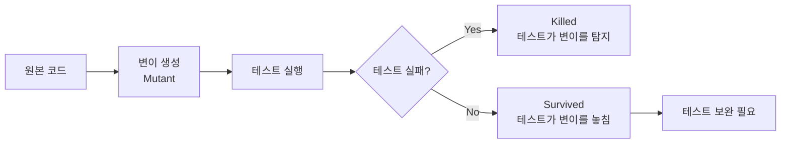

# Mutation Testing 가이드

> **작성일**: 2026-03-14
> **목적**: 테스트 스위트의 품질을 검증하기 위한 Mutation Testing 개념, 도구, CI 통합 방법 안내

---

## 목차

1. [개념](#1-개념)
2. [핵심 용어](#2-핵심-용어)
3. [도구별 안내](#3-도구별-안내)
4. [CI 통합 예시](#4-ci-통합-예시)
5. [언제 사용하는가](#5-언제-사용하는가)
6. [언제 불필요한가](#6-언제-불필요한가)
7. [모범 사례](#7-모범-사례)

---

## 1. 개념

코드 커버리지 80%라고 해서 테스트가 실제로 버그를 잡아낸다는 보장은 없다. Mutation Testing은 **소스 코드를 의도적으로 변이(mutate)시킨 뒤 테스트를 실행**하여, 테스트가 해당 변이를 탐지(kill)하는지 검증한다.



**핵심 질문**: "코드에 버그를 심으면, 기존 테스트가 이를 잡아내는가?"

---

## 2. 핵심 용어

| 용어 | 설명 |
|------|------|
| **Mutant** | 원본 코드에서 하나의 변경이 적용된 변이 코드 |
| **Killed** | 변이에 대해 테스트가 실패한 경우 (좋은 테스트) |
| **Survived** | 변이에 대해 테스트가 통과한 경우 (테스트 보완 필요) |
| **Mutation Score** | (Killed + Timeout) / (전체 − Skipped) * 100% — 테스트가 닿지 않은 변이(no coverage)도 분모에 넣는다 (Stryker · PIT · `mutmut badge` 와 같은 정의) |
| **Equivalent Mutant** | 동작이 원본과 동일한 변이 (false positive) |

### 주요 변이 연산자 (Mutation Operators)

| 연산자 | 원본 | 변이 |
|--------|------|------|
| 산술 연산자 교체 | `a + b` | `a - b` |
| 관계 연산자 교체 | `a > b` | `a >= b` |
| 논리 연산자 교체 | `a && b` | `a \|\| b` |
| 조건 부정 | `if (x)` | `if (!x)` |
| 반환값 변경 | `return true` | `return false` |
| 상수 변경 | `x = 0` | `x = 1` |
| 빈 반환 | `return list` | `return []` |

---

## 3. 도구별 안내

### 3.1 Stryker (JavaScript / TypeScript / C#)

가장 성숙한 Mutation Testing 프레임워크. JS/TS와 C# 모두 지원한다.

```bash
# TypeScript/JavaScript
npm install -D @stryker-mutator/core @stryker-mutator/vitest-runner
npx stryker init

# C#
dotnet tool install -g dotnet-stryker
dotnet stryker
```

**stryker.config.mjs** (TypeScript 예시):

```javascript
/** @type {import('@stryker-mutator/api/core').PartialStrykerOptions} */
const config = {
  testRunner: 'vitest',
  reporters: ['html', 'clear-text', 'progress'],
  coverageAnalysis: 'perTest',
  thresholds: {
    high: 80,
    low: 60,
    break: 50, // Mutation score below 50% fails the build
  },
  mutate: ['src/**/*.ts', '!src/**/*.test.ts', '!src/**/*.d.ts'],
};
export default config;
```

### 3.2 mutmut (Python)

Python 전용 Mutation Testing 도구. pytest와 자연스럽게 통합된다.

```bash
pip install "mutmut>=3.6"
mutmut run                 # targets come from [tool.mutmut] source_paths
mutmut results             # list surviving mutants
mutmut browse              # interactive result browser (there is no html report in mutmut 3)
mutmut export-cicd-stats   # writes mutants/mutmut-cicd-stats.json (killed / survived / total ...)
```

**pyproject.toml 설정** (mutmut 3.6+ — `paths_to_mutate` 는 `source_paths` 로 바뀌었고 `tests_dir` · `runner` 는 쓰지 않는다):

```toml
[tool.mutmut]
source_paths = ["src/"]
pytest_add_cli_args_test_selection = ["tests/"]
```

> **주의**: mutmut 3 의 `mutmut run` 은 살아남은 변이가 있어도 exit 0 으로 끝난다(2026-11-04 실측 — 변이 4개가 모두 살아남은 테스트에서도 0).
> CI 에서 막으려면 아래 예시처럼 `export-cicd-stats` 결과로 점수를 직접 판정한다.

### 3.3 PIT (Java / Kotlin)

JVM 생태계의 사실상 표준 Mutation Testing 도구. 바이트코드 수준에서 변이를 생성하여 빠르다.

```kotlin
// build.gradle.kts
plugins {
    id("info.solidsoft.pitest") version "1.15.0"
}

pitest {
    junit5PluginVersion.set("1.2.1")
    targetClasses.set(listOf("com.example.*"))
    targetTests.set(listOf("com.example.*Test"))
    mutationThreshold.set(60)
    coverageThreshold.set(80)
    outputFormats.set(listOf("HTML", "XML"))
    timestampedReports.set(false)
}
```

```bash
./gradlew pitest
# Report: build/reports/pitest/
```

### 3.4 cargo-mutants (Rust)

Rust 전용 Mutation Testing 도구. `cargo test`와 통합된다.

```bash
cargo install cargo-mutants
cargo mutants                      # Run mutation testing (exit 2 when a mutant is missed)
git diff origin/main.. > git.diff
cargo mutants --in-diff git.diff   # Only mutants in lines changed by the diff
```

### 도구 비교표

| 도구 | 언어 | 변이 수준 | 속도 | 비고 |
|------|------|-----------|------|------|
| **Stryker** | JS/TS, C# | AST | 빠름 (incremental) | 가장 성숙한 생태계 |
| **mutmut** | Python | AST | 보통 | pytest 통합 |
| **PIT** | Java, Kotlin | 바이트코드 | 빠름 | JVM 표준 |
| **cargo-mutants** | Rust | AST | 보통 | cargo 통합 |

---

## 4. CI 통합 예시

### GitHub Actions (TypeScript + Stryker)

```yaml
name: Mutation Testing

on:
  pull_request:
    branches: [main]

jobs:
  mutation:
    runs-on: ubuntu-latest
    steps:
      - uses: actions/checkout@v4

      - name: Setup Node.js
        uses: actions/setup-node@v4
        with:
          node-version: '22'
          cache: 'npm'

      - name: Install dependencies
        run: npm ci

      - name: Run Stryker
        run: npx stryker run

      - name: Upload Mutation Report
        if: always()
        uses: actions/upload-artifact@v4
        with:
          name: mutation-report
          path: reports/mutation/
```

### GitHub Actions (Python + mutmut)

```yaml
name: Mutation Testing

on:
  pull_request:
    branches: [main]

jobs:
  mutation:
    runs-on: ubuntu-latest
    steps:
      - uses: actions/checkout@v4

      - name: Set up Python
        uses: actions/setup-python@v5
        with:
          python-version: '3.12'

      - name: Install dependencies
        run: pip install -e ".[dev]" "mutmut==3.8.1"   # gate reads export-cicd-stats JSON; verified on 3.8.1

      - name: Run mutmut
        run: |
          mutmut run                 # exit code does not reflect survivors
          mutmut export-cicd-stats   # mutants/mutmut-cicd-stats.json
          mutmut results             # surviving mutants in the log

      # 최소 60% (아래 「목표 점수」). 분모는 skipped 를 뺀 전체 — 테스트가 닿지 않은 변이(no_tests)도 "못 잡음"으로 센다.
      # 변이가 0개면 실패한다. type_check_command 로 잡힌 변이는 JSON 에 없어 점수가 보수적으로(낮게) 나온다.
      - name: Enforce mutation score
        run: |
          jq -e '(.total - .skipped) > 0 and ((.killed + .timeout) / (.total - .skipped)) >= 0.60' \
            mutants/mutmut-cicd-stats.json \
            || { jq . mutants/mutmut-cicd-stats.json; echo "mutation score below 60%"; exit 1; }

      - name: Upload Mutation Report
        if: always()
        uses: actions/upload-artifact@v4
        with:
          name: mutation-report
          path: mutants/mutmut-cicd-stats.json
```

---

## 5. 언제 사용하는가

| 상황 | 이유 |
|------|------|
| **핵심 비즈니스 로직** | 결제, 인증, 정산 등 버그 비용이 높은 코드 |
| **커버리지는 높지만 신뢰가 낮을 때** | 커버리지 90%인데 실제 버그가 자주 발생하는 경우 |
| **알고리즘/계산 로직** | 경계값, 연산자 오류를 정밀하게 검증 |
| **리팩터링 전** | 기존 테스트가 안전망으로 충분한지 확인 |
| **코드 리뷰 보완** | "테스트가 진짜 이 로직을 검증하는가?" 객관적 수치 제공 |

---

## 6. 언제 불필요한가

| 상황 | 이유 |
|------|------|
| **I/O 바운드 코드** | DB 쿼리, HTTP 호출 등은 통합 테스트로 검증 |
| **UI/프론트엔드 컴포넌트** | Mutation Testing보다 E2E/비주얼 테스트가 효과적 |
| **설정/구성 코드** | 단순 설정에 변이 분석은 과도함 |
| **초기 프로토타이핑** | 코드가 빈번히 변경되는 단계에서는 비용 대비 효과가 낮음 |
| **빌드 시간이 이미 긴 프로젝트** | Mutation Testing은 수십~수백 회 테스트를 반복하므로 CI 비용 증가 |

---

## 7. 모범 사례

### Mutation Score 목표

| 수준 | Mutation Score | 적용 대상 |
|------|---------------|-----------|
| **최소** | 60% | 일반 비즈니스 로직 |
| **권장** | 80% | 핵심 도메인 로직 |
| **엄격** | 90%+ | 금융, 의료 등 고신뢰 시스템 |

### 실전 팁

1. **전체 코드에 적용하지 말 것**: 핵심 모듈만 선택적으로 적용한다
2. **증분(incremental) 실행**: PR에서 변경된 파일만 대상으로 실행하여 CI 시간을 절약한다
3. **Survived mutant 분석**: 생존한 변이를 분석하여 누락된 테스트 케이스를 추가한다
4. **Equivalent mutant는 무시**: 동작이 동일한 변이는 점수에서 제외한다
5. **CI에서는 break 임계값만 설정**: mutation score가 일정 수준 이하로 떨어지면 빌드를 실패시킨다

---

## 참고 자료

| 도구 | URL |
|------|-----|
| Stryker | <https://stryker-mutator.io/> |
| mutmut | <https://mutmut.readthedocs.io/> |
| PIT | <https://pitest.org/> |
| cargo-mutants | <https://github.com/sourcefrog/cargo-mutants> |
