# 신규 팀원 온보딩 가이드

> 신규 엔지니어가 30일 내 독립적으로 기여할 수 있도록 하는 구조화된 온보딩 프로그램.

---

## 1. 온보딩 타임라인

```mermaid
gantt
    title 신규 팀원 30일 온보딩
    dateFormat  X
    axisFormat %d일

    section 1주차 (환경)
    개발 환경 셋업         :a1, 0, 2d
    코드베이스 탐색         :a2, 2, 3d
    아키텍처 오버뷰         :a3, 3, 2d

    section 2주차 (이해)
    Good First Issue        :b1, 7, 3d
    코드 리뷰 참여          :b2, 7, 5d
    도메인 지식 학습         :b3, 10, 4d

    section 3주차 (기여)
    기능 구현 (페어)        :c1, 14, 5d
    PR 생성 + 리뷰 받기     :c2, 17, 3d

    section 4주차 (독립)
    독립 기능 구현           :d1, 21, 5d
    온콜 섀도잉             :d2, 24, 3d
    온보딩 피드백           :d3, 28, 2d
```



---

## 2. Day 1 체크리스트

### 계정 & 접근 권한
- [ ] GitHub 조직 초대 + 팀 추가
- [ ] Slack 채널 (#engineering, #team-xxx, #incident)
- [ ] Jira/Linear 프로젝트 접근
- [ ] 클라우드 콘솔 (AWS/GCP) 읽기 권한
- [ ] PagerDuty/OpsGenie 계정 (온콜 준비)
- [ ] 1Password/Vault 접근

### 개발 환경
- [ ] 레포지토리 클론
- [ ] sos 표준 적용: Claude Code 에서 `/sos:setup` (셸에서는 `bash "$SOS_STANDARDS/bootstrap.sh"`)
- [ ] 로컬 빌드 + 테스트 성공 확인
- [ ] IDE 설정 (린터, 포매터, 플러그인)
- [ ] Docker / K8s 로컬 환경 구동
- [ ] Claude Code 설정 (.claude/rules, hooks)

---

## 3. 1주차: 환경 + 이해

### 필수 읽기 자료

| 문서 | 목적 | 소요 |
|------|------|------|
| `README.md` | 프로젝트 개요, 빠른 시작 | 30분 |
| `CLAUDE.md` | AI 도구 컨텍스트 | 10분 |
| `docs/guides/coding-style-guide.md` | 코딩 규칙 이해 | 1시간 |
| `docs/guides/git-convention.md` | 커밋/PR 규칙 | 30분 |
| 아키텍처 다이어그램 | 시스템 전체 구조 | 1시간 |
| 주요 Design Docs | 핵심 설계 결정 이해 | 2시간 |

### 아키텍처 오버뷰 세션 (멘토와 1:1)

```markdown
세션 내용 (60분):
1. 전체 시스템 아키텍처 (15분)
   - 서비스 목록 + 역할
   - 주요 데이터 흐름
   - 외부 의존성

2. 팀이 소유한 서비스 (20분)
   - 코드 구조 (레이어드 아키텍처)
   - 핵심 도메인 모델
   - API 엔드포인트 목록

3. 개발 워크플로우 (15분)
   - 브랜치 전략, PR 프로세스
   - CI/CD 파이프라인
   - 배포 절차

4. Q&A (10분)
```

---

## 4. 2주차: 참여

### Good First Issue

- `good-first-issue` 라벨이 붙은 이슈 1-2개 할당
- 멘토가 사전에 컨텍스트 설명
- 목표: **프로세스 경험** (브랜치 → 구현 → 테스트 → PR → 리뷰 → 머지)

### 코드 리뷰 참여

- 팀원의 PR 리뷰에 참여 (읽기 목적)
- `[QUESTION]` 접두사로 질문 코멘트 적극 활용
- 최소 3개 PR 리뷰 참여

---

## 5. 3-4주차: 기여

### 페어 프로그래밍 → 독립 구현

| 주차 | 방식 | 난이도 |
|------|------|--------|
| 3주차 | 멘토와 페어로 기능 구현 | Medium |
| 4주차 | 독립적으로 기능 구현 (멘토는 리뷰어) | Medium-Hard |

### 온콜 섀도잉

- 4주차에 Primary 온콜과 함께 섀도잉
- 알림 대응, 런북 참조, 인시던트 대응 관찰
- 직접 대응하지 않고 관찰 + 질문만

---

## 6. 멘토 가이드

### 멘토의 역할

- 1:1 미팅: 첫 2주간 매일 15분, 이후 주 2회
- 질문 창구: Slack DM 또는 페어 세션
- 코드 리뷰: 신규 팀원의 모든 PR 리뷰
- 피드백: 2주차, 4주차 종료 시 서면 피드백

### 멘토 체크리스트

```markdown
## 1주차
- [ ] Day 1 셋업 완료 확인
- [ ] 아키텍처 오버뷰 세션 진행
- [ ] Good First Issue 할당
- [ ] 필수 읽기 자료 안내

## 2주차
- [ ] Good First Issue PR 리뷰 + 머지
- [ ] 코드 리뷰 참여 확인 (3개+)
- [ ] 중간 피드백 (잘하고 있는 점 + 개선점)

## 3주차
- [ ] 페어 프로그래밍 세션 3회+
- [ ] 독립 구현 이슈 할당

## 4주차
- [ ] 독립 PR 리뷰
- [ ] 온콜 섀도잉 진행
- [ ] 최종 피드백 + 온보딩 완료 선언
```

---

## 7. 온보딩 완료 기준

| 항목 | 기준 |
|------|------|
| 개발 환경 | 독립적으로 빌드/테스트/배포 가능 |
| 코드 기여 | 최소 3개 PR 머지 |
| 코드 리뷰 | 최소 5개 PR 리뷰 코멘트 |
| 아키텍처 | 팀 서비스의 구조를 설명할 수 있음 |
| 프로세스 | Git 컨벤션, PR 규칙, 배포 절차 숙지 |
| 온콜 | 섀도잉 1회 이상 완료 |

---

## 8. 피드백 설문

```markdown
# 온보딩 피드백 — [이름] (Day 30)

1. 개발 환경 셋업 경험은? (1-5)
2. 아키텍처를 이해하는 데 충분한 자료가 제공되었나? (1-5)
3. 멘토링 경험은? (1-5)
4. 독립적으로 기여할 준비가 되었다고 느끼는가? (1-5)
5. 온보딩 과정에서 가장 도움이 된 것은?
6. 개선이 필요한 부분은?
```
