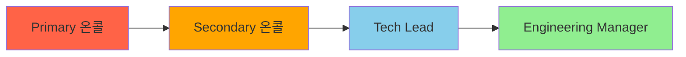

# 온콜 가이드

> 안정적인 서비스 운영을 위한 온콜 로테이션, 에스컬레이션, 번아웃 방지 표준.

---

## 1. 온콜 원칙

- **"너만 할 수 있는 일"은 온콜이 아니다** — 런북으로 누구나 대응 가능하게
- **온콜은 팀 책임** — 개인이 아닌 팀이 서비스를 소유
- **충분한 인원** — 최소 5명 이상의 로테이션 (번아웃 방지)
- **보상** — 온콜 수당 또는 대체 휴무 제공

---

## 2. 로테이션 정책

### 2.1 로테이션 구조



| 역할 | 책임 | 응답 시간 |
|------|------|-----------|
| **Primary** | 모든 알림 첫 대응, 인시던트 커맨더 | P1: 5분, P2: 15분 |
| **Secondary** | Primary 부재 시 백업, 에스컬레이션 대상 | P1: 15분, P2: 30분 |
| **Tech Lead** | 기술 판단 필요 시 합류 | 30분 |
| **EM** | 비즈니스 영향 커뮤니케이션 | 1시간 |

### 2.2 스케줄

| 항목 | 규칙 |
|------|------|
| 로테이션 주기 | 1주일 |
| 교대 시점 | 수요일 10:00 (주중 교대 = 인수인계 용이) |
| 최소 로테이션 인원 | 5명 (4주 온콜 + 1주 휴식) |
| 연속 온콜 제한 | 최대 2주 연속 금지 |
| 공휴일/연말 | 자원자 우선, 추가 보상 |

### 2.3 인수인계

교대 시 반드시 수행:
```markdown
## 온콜 인수인계 — YYYY-MM-DD

### 지난 주 요약
- 인시던트: P2 1건 (결제 API 지연, 해결 완료)
- 알림: 총 12건 (8건 자동 해소, 4건 수동 대응)
- 진행 중인 이슈: DB 마이그레이션 모니터링 중

### 주의 사항
- 수요일 14:00 결제 서비스 배포 예정
- Kafka 클러스터 패치 금요일 예정

### 유용한 런북
- [결제 API 장애 대응](link)
- [Kafka 컨슈머 지연 대응](link)
```

---

## 3. 알림 품질 관리

### 3.1 좋은 알림 기준

| 기준 | 설명 |
|------|------|
| **Actionable** | 알림을 받으면 조치가 필요한 것만 |
| **Timely** | 사용자 영향 전 또는 직후 |
| **Specific** | 어떤 서비스, 어떤 문제인지 명확 |
| **Linked** | 런북/대시보드 링크 포함 |

### 3.2 알림 건강도 지표

| 메트릭 | 건강 | 불건강 |
|--------|------|--------|
| 주간 알림 수 | <20건 | >50건 |
| 자동 해소 비율 | <30% | >70% (노이즈) |
| 알림 → 조치 비율 | >80% | <50% |
| 야간 알림 (00-08시) | <3건/주 | >10건/주 |

### 3.3 노이즈 제거 절차

```
1. 주간 알림 리뷰 (매주 온콜 교대 시)
2. Actionable하지 않은 알림 → 경고 레벨 낮추기 또는 삭제
3. 자동 해소되는 알림 → 임계값 조정 또는 딜레이 추가
4. 야간 알림 중 비긴급 → 업무 시간 알림으로 전환
```

---

## 4. 번아웃 방지

### 4.1 번아웃 신호

- 야간 호출 주 3회 이상
- "알림 피로" — 알림을 무시하기 시작
- 온콜 교대를 회피하려는 행동
- 온콜 후 생산성 급감

### 4.2 방지 조치

| 조치 | 설명 |
|------|------|
| **온콜 후 휴식** | 야간 호출 시 다음 날 오전 재택/휴식 |
| **로테이션 인원 확보** | 5명 미만이면 채용 우선순위 상향 |
| **노이즈 제거** | 주간 알림 20건 이하 유지 |
| **자동화 투자** | 반복 대응은 자동화 (Self-healing) |
| **인시던트 후 디브리핑** | 감정적 스트레스 공유 기회 |

---

## 5. 런북 작성 가이드

### 템플릿

```markdown
# [서비스명] — [알림명] 대응 런북

## 개요
- 알림 조건: (메트릭 > 임계값)
- 예상 원인: (원인 목록)
- 심각도: P1/P2/P3

## 확인 절차
1. 대시보드 확인: [링크]
2. 로그 확인: `kubectl logs -l app=서비스명 --tail=100`
3. 메트릭 확인: [Grafana 링크]

## 대응 절차
### 시나리오 A: [원인1]
1. 조치 1
2. 조치 2
3. 확인: [검증 방법]

### 시나리오 B: [원인2]
1. 조치 1
2. 에스컬레이션: @담당자

## 롤백 (필요 시)
```bash
# 롤백 명령어
```

## 에스컬레이션
- 30분 내 미해결: @tech-lead
- 데이터 영향: @dba-team
```

---

## 6. 체크리스트

### 팀 설정 시
- [ ] 로테이션 인원 5명 이상 확보
- [ ] PagerDuty/OpsGenie 설정
- [ ] 에스컬레이션 정책 정의
- [ ] 모든 서비스에 런북 작성
- [ ] 온콜 보상 정책 수립

### 매주 (교대 시)
- [ ] 인수인계 문서 작성
- [ ] 지난 주 알림 리뷰 (노이즈 제거)
- [ ] 런북 갱신 필요 여부 확인

---

## 참고 자료

- [Google SRE Book - Being On-Call](https://sre.google/sre-book/being-on-call/)
- [PagerDuty On-Call Guide](https://response.pagerduty.com/oncall/)
- [Increment Magazine - On-Call](https://increment.com/on-call/)
