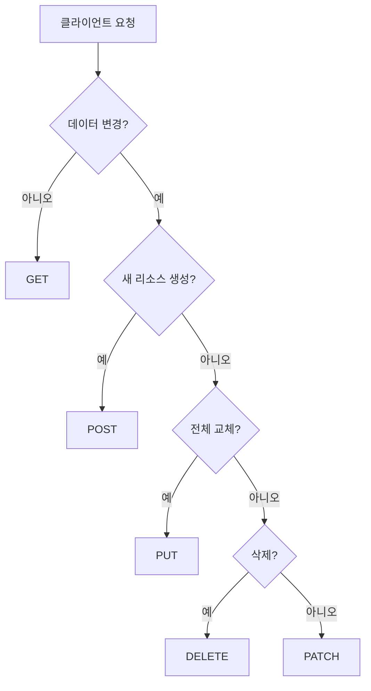
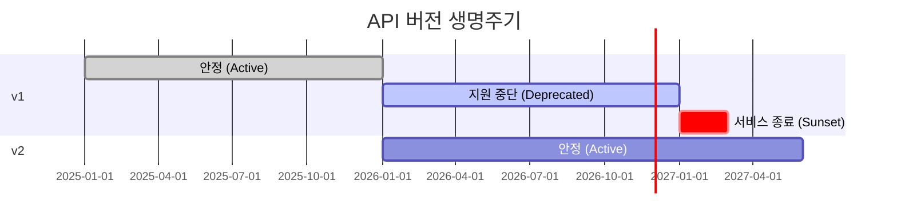
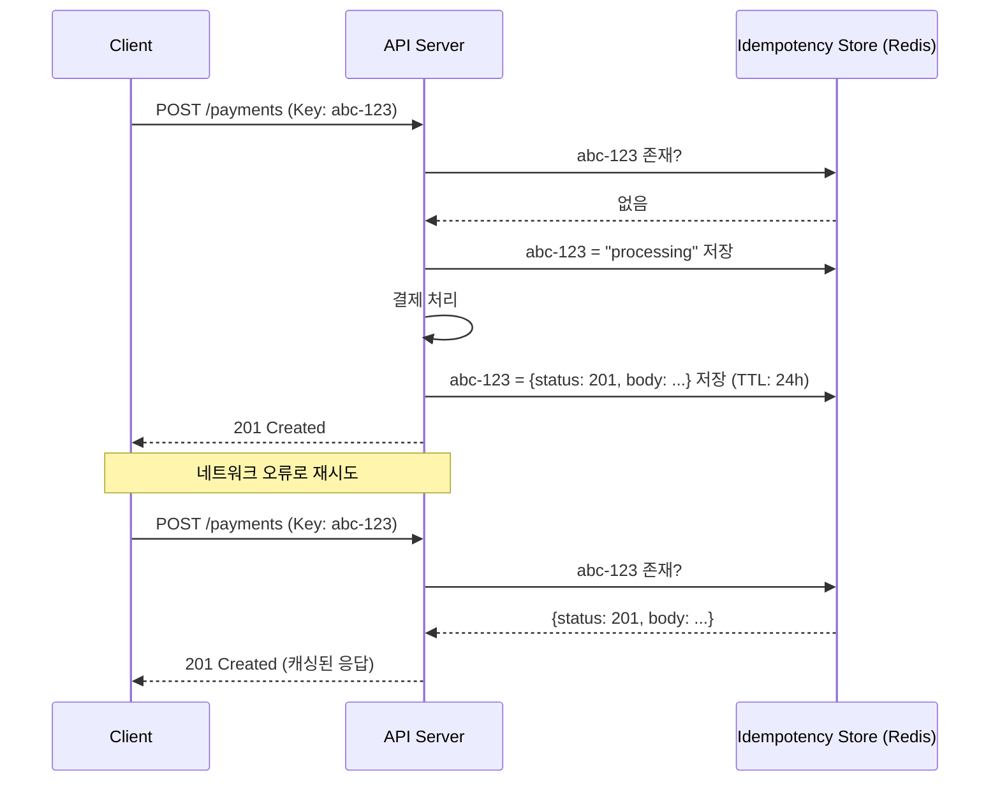
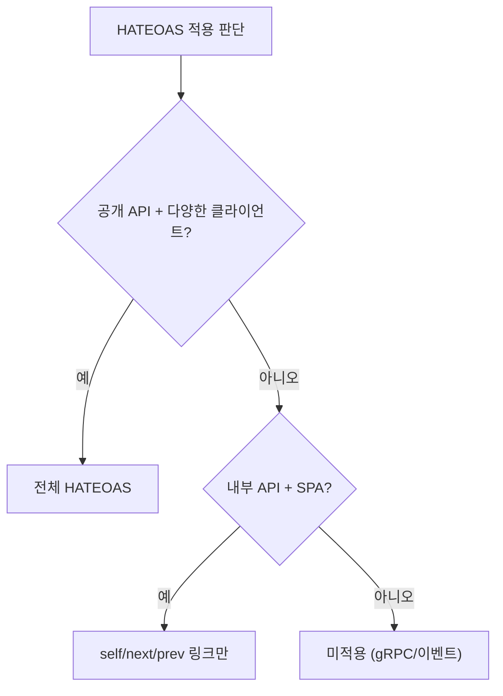
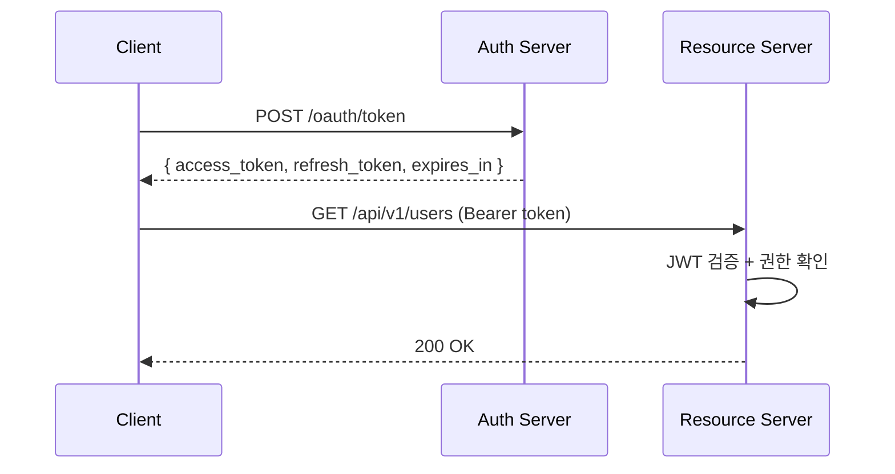

# REST API 설계 가이드

> **작성일**: 2026-03-12
> **기반 표준**: Google Cloud API Design Guide, Stripe API Conventions, Microsoft REST API Guidelines
> **대상 언어**: Python (FastAPI), TypeScript (Next.js API Routes), Go (net/http)
> **적용 수준**: 빅테크 기준 팀 개발표준

---

## 목차

1. [리소스 설계](#1-리소스-설계)
2. [HTTP 메서드 매핑](#2-http-메서드-매핑)
3. [URL 설계 규칙](#3-url-설계-규칙)
4. [버전 관리](#4-버전-관리)
5. [페이지네이션](#5-페이지네이션)
6. [필터링/정렬/검색](#6-필터링정렬검색)
7. [에러 응답 표준](#7-에러-응답-표준)
8. [멱등성](#8-멱등성)
9. [Rate Limiting](#9-rate-limiting)
10. [HATEOAS](#10-hateoas)
11. [보안](#11-보안)
12. [API 리뷰 체크리스트](#12-api-리뷰-체크리스트)

---

## 1. 리소스 설계

### 1.1 핵심 원칙

REST API는 **리소스(Resource)** 중심으로 설계한다. 동작은 HTTP 메서드가 담당하며, URL에 동사를 넣지 않는다.

```
# WRONG                           # CORRECT
POST /api/createUser              POST   /api/v1/users
GET  /api/getUserById?id=42       GET    /api/v1/users/42
POST /api/deleteOrder             DELETE /api/v1/orders/101
```

### 1.2 리소스 네이밍 규칙

| 규칙 | 올바른 예 | 잘못된 예 | 이유 |
|------|-----------|-----------|------|
| 복수형 명사 | `/users`, `/orders` | `/user`, `/order` | 컬렉션 표현 |
| 소문자 | `/payment-methods` | `/PaymentMethods` | URL 대소문자 구분 |
| 하이픈(`-`) 구분 | `/order-items` | `/order_items` | URL 가독성 표준 |
| 약어 지양 | `/organizations` | `/orgs` | 명확성 우선 |
| 도메인 용어 | `/invoices` | `/billing-documents` | 비즈니스 언어 반영 |

### 1.3 컬렉션 vs 단일 리소스, 계층 관계

```
컬렉션:     GET /api/v1/users           -> User[]
단일 리소스: GET /api/v1/users/42        -> User
서브컬렉션:  GET /api/v1/users/42/orders -> Order[]
```

리소스 중첩은 소유(ownership) 관계에만 사용하며 **최대 3단계**로 제한한다.

```
GET /api/v1/users/42/orders/101/items    # 3단계 (허용)
GET /api/v1/users/42/orders/101/items/7/reviews  # 4단계 (금지 -> 플랫하게 재설계)
GET /api/v1/order-items/7/reviews        # 플랫하게 개선
```

### 1.4 리소스 관계 패턴

| 관계 유형 | URL 패턴 | 예시 |
|-----------|----------|------|
| 소유 (1:N) | `/{parent}/{id}/{children}` | `/users/42/orders` |
| 단일 종속 (1:1) | `/{parent}/{id}/{singleton}` | `/users/42/profile` |
| 다대다 (M:N) | 독립 리소스로 분리 | `/memberships?user_id=42&team_id=5` |
| 행위 (Action) | `/{resource}/{id}/{action}` | `POST /orders/101/cancel` |

> **행위 엔드포인트**: CRUD로 표현 불가한 비즈니스 로직에 한해 동사를 허용한다. 남용하면 RPC 스타일이 되므로 최소한으로 제한한다.

---

## 2. HTTP 메서드 매핑

### 2.1 메서드별 의미

| 메서드 | 의미 | 멱등성 | 안전성 | 요청 본문 | 응답 코드 |
|--------|------|:------:|:------:|:---------:|-----------|
| `GET` | 조회 | O | O | X | 200 |
| `POST` | 생성 | X | X | O | 201 |
| `PUT` | 전체 교체 | O | X | O | 200 |
| `PATCH` | 부분 수정 | X* | X | O | 200 |
| `DELETE` | 삭제 | O | X | X | 204 |

> *PATCH는 구현에 따라 멱등할 수 있으나, 사양상 보장되지 않는다.

### 2.2 메서드 선택 의사결정



### 2.3 PUT vs PATCH

```json
// PUT /users/42 -- 전체 교체: 빠진 필드는 기본값/null
{ "name": "Alice Kim", "email": "alice@example.com", "role": "admin" }

// PATCH /users/42 -- 부분 수정: 명시한 필드만 변경
{ "role": "admin" }
```

---

## 3. URL 설계 규칙

### 3.1 규칙 요약

| # | 규칙 | 올바른 예 | 잘못된 예 |
|---|------|-----------|-----------|
| 1 | 소문자만 사용 | `/payment-methods` | `/PaymentMethods` |
| 2 | 하이픈(`-`) 구분 | `/order-items` | `/order_items` |
| 3 | 동사 금지 | `GET /users` | `GET /getUsers` |
| 4 | 확장자 금지 | `/reports/42` | `/reports/42.json` |
| 5 | 후행 슬래시 금지 | `/users` | `/users/` |
| 6 | 중첩 최대 3단계 | `/a/{id}/b/{id}/c` | `/a/{id}/b/{id}/c/{id}/d` |
| 7 | 복수형 명사 | `/users` | `/user` |
| 8 | API 접두사 | `/api/v1/users` | `/users` |

### 3.2 경로 vs 쿼리 파라미터

| 구분 | 용도 | 예시 |
|------|------|------|
| 경로 파라미터 | 리소스 식별 (필수) | `/users/42` |
| 쿼리 파라미터 | 필터링, 정렬 (선택) | `/users?role=admin&sort=-created_at` |

---

## 4. 버전 관리

### 4.1 전략 비교

| 전략 | 방식 | 장점 | 단점 |
|------|------|------|------|
| **URL Path** (권장) | `/api/v1/users` | 직관적, 캐싱 용이 | URL 변경 |
| **Header** | `Accept-Version: v1` | URL 불변 | 디버깅 어려움 |
| **Content-Type** | `Accept: application/vnd.api.v1+json` | 표준 준수 | 도구 지원 부족 |

URL Path 방식을 **기본 전략**으로 채택한다. Google, Stripe, GitHub 등 메이저 API가 사용하며 가장 직관적이다. Major 버전만 URL에 포함하고(`v1`, `v2`), 버전 번호는 정수로 표기한다.

### 4.2 Deprecation 정책



| 단계 | 기간 | 조치 |
|------|------|------|
| 예고 | 출시 6개월 전 | Changelog, 이메일 공지 |
| 지원 중단 | 12개월 | `Deprecation: true` + `Sunset` 헤더, 문서 경고 |
| 종료 | 3개월 유예 | `410 Gone` 응답 |

### 4.3 Breaking Change 판단

**버전 불필요** (하위 호환): 응답에 새 필드 추가, 새 엔드포인트, 선택적 파라미터 추가

**새 버전 필수** (Breaking): 필드 제거/이름 변경, 타입 변경, 필수 파라미터 추가, URL 변경

---

## 5. 페이지네이션

### 5.1 전략 비교

| 전략 | 장점 | 단점 | 적합한 상황 |
|------|------|------|-------------|
| **Cursor-based** (권장) | 일관된 결과, 대규모 가능 | 임의 페이지 이동 불가 | 피드, 타임라인, 대규모 목록 |
| **Offset-based** | 직관적, 임의 페이지 이동 | 중복/누락, 큰 offset 성능 저하 | 관리자 대시보드, 소규모 |

### 5.2 Cursor-based 표준 응답

```json
{
  "data": [
    { "id": 43, "name": "Alice" },
    { "id": 44, "name": "Bob" }
  ],
  "pagination": {
    "next_cursor": "eyJpZCI6NjJ9",
    "prev_cursor": "eyJpZCI6NDN9",
    "has_next": true,
    "has_prev": true,
    "limit": 20
  }
}
```

### 5.3 구현 예시

**Python (FastAPI):**

```python
from __future__ import annotations

import base64
import json

from fastapi import Depends, Query
from sqlalchemy import select
from sqlalchemy.ext.asyncio import AsyncSession


def decode_cursor(cursor: str | None) -> dict | None:
    """Decode base64 cursor into filter parameters."""
    if cursor is None:
        return None
    return json.loads(base64.urlsafe_b64decode(cursor).decode("utf-8"))


def encode_cursor(data: dict) -> str:
    """Encode filter parameters into base64 cursor."""
    return base64.urlsafe_b64encode(json.dumps(data).encode("utf-8")).decode("utf-8")


async def list_users(
    limit: int = Query(default=20, ge=1, le=100),
    cursor: str | None = Query(default=None),
    db: AsyncSession = Depends(get_db),
):
    """List users with cursor-based pagination."""
    query = select(User).order_by(User.id)
    decoded = decode_cursor(cursor)
    if decoded is not None:
        query = query.where(User.id > decoded["id"])

    rows = (await db.execute(query.limit(limit + 1))).scalars().all()
    has_next = len(rows) > limit
    items = rows[:limit]

    return {
        "data": [UserSchema.model_validate(u) for u in items],
        "pagination": {
            "next_cursor": encode_cursor({"id": items[-1].id}) if has_next else None,
            "has_next": has_next,
            "has_prev": cursor is not None,
            "limit": limit,
        },
    }
```

**TypeScript (Next.js):**

```typescript
// app/api/v1/users/route.ts
import { NextRequest, NextResponse } from "next/server";

function decodeCursor(cursor: string): { id: number } {
  return JSON.parse(Buffer.from(cursor, "base64url").toString("utf-8"));
}

function encodeCursor(data: { id: number }): string {
  return Buffer.from(JSON.stringify(data)).toString("base64url");
}

export async function GET(request: NextRequest) {
  const { searchParams } = request.nextUrl;
  const limit = Math.min(Number(searchParams.get("limit") ?? 20), 100);
  const cursorParam = searchParams.get("cursor");

  const where = cursorParam ? { id: { gt: decodeCursor(cursorParam).id } } : {};
  const users = await prisma.user.findMany({ where, orderBy: { id: "asc" }, take: limit + 1 });
  const hasNext = users.length > limit;
  const items = users.slice(0, limit);

  return NextResponse.json({
    data: items,
    pagination: {
      next_cursor: hasNext ? encodeCursor({ id: items[items.length - 1].id }) : null,
      has_next: hasNext,
      has_prev: cursorParam !== null,
      limit,
    },
  });
}
```

**Go (net/http):**

```go
func ListUsers(w http.ResponseWriter, r *http.Request) {
    limit := clampInt(r.URL.Query().Get("limit"), 1, 100, 20)
    cursorParam := r.URL.Query().Get("cursor")

    var afterID int64
    if cursorParam != "" {
        if data, err := decodeCursor(cursorParam); err == nil {
            afterID = data.ID
        }
    }

    users, _ := db.ListUsersAfter(r.Context(), afterID, limit+1)
    hasNext := len(users) > limit
    if hasNext {
        users = users[:limit]
    }

    var nextCursor *string
    if hasNext {
        encoded := encodeCursor(CursorData{ID: users[len(users)-1].ID})
        nextCursor = &encoded
    }

    writeJSON(w, http.StatusOK, map[string]any{
        "data": users,
        "pagination": map[string]any{
            "next_cursor": nextCursor, "has_next": hasNext,
            "has_prev": cursorParam != "", "limit": limit,
        },
    })
}
```

---

## 6. 필터링/정렬/검색

### 6.1 쿼리 파라미터 표준

```
GET /api/v1/users?filter[status]=active&filter[role]=admin&sort=-created_at&fields=id,name
```

| 파라미터 | 용도 | 예시 |
|----------|------|------|
| `filter[field]` | 필드별 필터링 | `filter[status]=active` |
| `sort` | 정렬 (`-` = 내림차순) | `sort=-created_at,name` |
| `fields` | 응답 필드 선택 | `fields=id,name` |
| `search` | 전문 검색 | `search=alice` |

### 6.2 필터 연산자

| 연산자 | 의미 | 예시 |
|--------|------|------|
| (없음) | 동등 | `filter[status]=active` |
| `[gt]` / `[gte]` | 초과 / 이상 | `filter[age][gt]=18` |
| `[lt]` / `[lte]` | 미만 / 이하 | `filter[price][lt]=10000` |
| `[in]` | 목록 포함 | `filter[status][in]=active,pending` |

### 6.3 정렬 규칙

- 접두사 없음 = ASC, `-` 접두사 = DESC
- 쉼표(`,`)로 다중 정렬: `sort=-created_at,name`
- **화이트리스트**: 허용된 필드만 정렬 가능

### 6.4 복합 검색

URL 길이 제한(~2,000자)을 초과하는 복합 검색은 `POST` 전용 엔드포인트를 제공한다.

```
POST /api/v1/users/search
Content-Type: application/json

{ "query": "alice", "filters": { "status": "active" }, "sort": [{ "field": "relevance", "direction": "desc" }] }
```

---

## 7. 에러 응답 표준

### 7.1 RFC 9457 (Problem Details)

모든 에러 응답은 [RFC 9457](https://www.rfc-editor.org/rfc/rfc9457) 형식을 따른다.

```json
{
  "type": "https://api.example.com/errors/validation-error",
  "title": "Validation Error",
  "status": 400,
  "detail": "The 'email' field must be a valid email address.",
  "instance": "/api/v1/users",
  "errors": [
    { "field": "email", "code": "INVALID_FORMAT", "message": "Must be a valid email address." },
    { "field": "name", "code": "REQUIRED", "message": "This field is required." }
  ],
  "trace_id": "abc-123-def-456"
}
```

### 7.2 에러 코드 체계

| HTTP 상태 | 에러 코드 | 의미 |
|-----------|-----------|------|
| 400 | `VALIDATION_ERROR` | 유효성 검사 실패 |
| 401 | `UNAUTHENTICATED` | 인증 실패 |
| 403 | `PERMISSION_DENIED` | 권한 부족 |
| 404 | `NOT_FOUND` | 리소스 없음 |
| 409 | `CONFLICT` | 리소스 충돌 |
| 422 | `UNPROCESSABLE_ENTITY` | 문법 정상, 처리 불가 |
| 429 | `RATE_LIMITED` | 요청 한도 초과 |
| 500 | `INTERNAL_ERROR` | 서버 내부 오류 |
| 503 | `SERVICE_UNAVAILABLE` | 서비스 일시 중단 |

### 7.3 다국어 에러 메시지

`Accept-Language` 헤더로 언어를 결정한다. 기본은 영어이며, `localized_message` 필드에 번역을 제공한다. 에러 코드(`code`)는 항상 영어 상수로 유지한다.

```json
{
  "type": "https://api.example.com/errors/validation-error",
  "title": "Validation Error",
  "status": 400,
  "detail": "The 'email' field must be a valid email address.",
  "localized_message": "이메일 필드는 유효한 이메일 주소여야 합니다."
}
```

### 7.4 Python (FastAPI) 에러 핸들러

```python
from __future__ import annotations

from dataclasses import dataclass
from typing import Any

from fastapi import FastAPI, Request
from fastapi.responses import JSONResponse


@dataclass(frozen=True)
class ProblemDetail:
    """RFC 9457 Problem Details response."""
    type: str
    title: str
    status: int
    detail: str
    instance: str = ""
    errors: tuple[dict[str, str], ...] = ()
    trace_id: str = ""

    def to_dict(self) -> dict[str, Any]:
        """Convert to JSON-serializable dictionary."""
        result: dict[str, Any] = {"type": self.type, "title": self.title, "status": self.status, "detail": self.detail}
        if self.instance:
            result["instance"] = self.instance
        if self.errors:
            result["errors"] = list(self.errors)
        if self.trace_id:
            result["trace_id"] = self.trace_id
        return result


class APIError(Exception):
    def __init__(self, problem: ProblemDetail) -> None:
        self.problem = problem
        super().__init__(problem.detail)

app = FastAPI()

@app.exception_handler(APIError)
async def api_error_handler(request: Request, exc: APIError) -> JSONResponse:
    return JSONResponse(
        status_code=exc.problem.status,
        content=exc.problem.to_dict(),
        headers={"Content-Type": "application/problem+json"},
    )
```

### 7.5 Go (net/http) 에러 핸들러

```go
type ProblemDetail struct {
    Type     string       `json:"type"`
    Title    string       `json:"title"`
    Status   int          `json:"status"`
    Detail   string       `json:"detail"`
    Errors   []FieldError `json:"errors,omitempty"`
    TraceID  string       `json:"trace_id,omitempty"`
}

func WriteProblem(w http.ResponseWriter, p ProblemDetail) {
    w.Header().Set("Content-Type", "application/problem+json")
    w.WriteHeader(p.Status)
    json.NewEncoder(w).Encode(p)
}
```

---

## 8. 멱등성

### 8.1 메서드별 멱등성

동일한 요청을 여러 번 보내도 결과가 동일한 성질. 네트워크 오류 재시도 시 부작용 방지에 필수.

| 메서드 | 멱등성 | 비고 |
|--------|:------:|------|
| GET / PUT / DELETE | O | 설계상 멱등 |
| POST / PATCH | X | 중복 생성 / 상대적 변경 가능 |

### 8.2 Idempotency-Key 패턴

POST 멱등성 보장을 위해 `Idempotency-Key` 헤더를 사용한다 (Stripe 패턴).

```http
POST /api/v1/payments HTTP/1.1
Idempotency-Key: 550e8400-e29b-41d4-a716-446655440000

{ "amount": 10000, "currency": "KRW", "recipient_id": 42 }
```

### 8.3 처리 흐름



### 8.4 규칙

| 항목 | 기준 |
|------|------|
| 키 형식 | UUID v4 |
| 유효 기간 | 24시간 (TTL) |
| 저장소 | Redis (TTL 지원) |
| 동일 키 + 다른 본문 | `422 Unprocessable Entity` |
| 필수 여부 | 금융 API 필수, 나머지 선택 |

---

## 9. Rate Limiting

### 9.1 표준 응답 헤더

```http
HTTP/1.1 200 OK
X-RateLimit-Limit: 1000
X-RateLimit-Remaining: 999
X-RateLimit-Reset: 1709251200
```

| 헤더 | 의미 |
|------|------|
| `X-RateLimit-Limit` | 윈도우 내 최대 요청 수 |
| `X-RateLimit-Remaining` | 남은 요청 수 |
| `X-RateLimit-Reset` | 리셋 Unix timestamp |
| `Retry-After` | 429 시 재시도 대기 시간 (초) |

### 9.2 429 응답

```json
{
  "type": "https://api.example.com/errors/rate-limited",
  "title": "Rate Limit Exceeded",
  "status": 429,
  "detail": "Rate limit of 1000 requests/hour exceeded. Retry after 60 seconds."
}
```

### 9.3 티어별 한도

| 티어 | 요청/분 | 요청/시간 | 대상 |
|------|---------|-----------|------|
| Free | 60 | 1,000 | 개인 개발자 |
| Pro | 300 | 10,000 | 소규모 팀 |
| Enterprise | 1,000 | 50,000 | 대규모 조직 |

### 9.4 알고리즘 비교

| 알고리즘 | 특징 | 적합한 상황 |
|----------|------|-------------|
| **Fixed Window** | 구현 간단, 경계 burst | 내부 API |
| **Sliding Window** | 균일 분산, 메모리 증가 | 외부 공개 API |
| **Token Bucket** | burst 허용 + 평균 제한 | 결제 등 중요 API |

---

## 10. HATEOAS

### 10.1 개념

응답에 관련 리소스의 링크를 포함하여, 클라이언트가 API를 탐색할 수 있도록 하는 REST 성숙도 최상위 단계(Richardson Level 3).

```json
{
  "id": 42,
  "name": "Alice",
  "_links": {
    "self":       { "href": "/api/v1/users/42", "method": "GET" },
    "update":     { "href": "/api/v1/users/42", "method": "PATCH" },
    "orders":     { "href": "/api/v1/users/42/orders", "method": "GET" },
    "deactivate": { "href": "/api/v1/users/42/deactivate", "method": "POST" }
  }
}
```

### 10.2 적용 비용 분석

| 항목 | HATEOAS 적용 | 미적용 |
|------|:------------:|:------:|
| 결합도 | 낮음 | 높음 |
| 페이로드 증가 | +15~30% | 기본 |
| 구현 복잡도 | 높음 | 낮음 |
| API 진화 유연성 | 높음 | 낮음 |

### 10.3 권장 전략



---

## 11. 보안

### 11.1 인증 방식 비교

| 방식 | 장점 | 단점 | 적합한 상황 |
|------|------|------|-------------|
| **OAuth 2.0 + JWT** | 표준, 세밀한 권한, Stateless | 구현 복잡 | 사용자 대면 API |
| **API Key** | 구현 간단 | 세밀한 권한 어려움 | 서버 간 통신 |
| **mTLS** | 강력한 상호 인증 | 인증서 관리 복잡 | 마이크로서비스 |

### 11.2 OAuth 2.0 흐름



### 11.3 API Key 규칙

- 접두사로 환경/유형 구분: `pk_live_` (공개/운영), `sk_test_` (비밀/테스트)
- 최소 32자, DB에 해시값만 저장, 발급 시 1회만 전문 표시

### 11.4 CORS 설정

```python
from __future__ import annotations

from fastapi.middleware.cors import CORSMiddleware

ALLOWED_ORIGINS: tuple[str, ...] = (
    "https://app.example.com",
    "https://admin.example.com",
)

app.add_middleware(
    CORSMiddleware,
    allow_origins=ALLOWED_ORIGINS,     # "*" 금지
    allow_credentials=True,
    allow_methods=("GET", "POST", "PUT", "PATCH", "DELETE"),
    allow_headers=("Authorization", "Content-Type", "X-API-Key", "Idempotency-Key"),
    max_age=86400,
)
```

### 11.5 입력 검증

```python
from __future__ import annotations

import re
from pydantic import BaseModel, EmailStr, Field, field_validator

SAFE_STRING_PATTERN = re.compile(r"^[a-zA-Z0-9가-힣\s\-_.@]+$")

class CreateUserRequest(BaseModel):
    """Validated user creation request."""
    name: str = Field(min_length=1, max_length=100)
    email: EmailStr
    role: str = Field(pattern=r"^(user|admin|moderator)$")

    @field_validator("name")
    @classmethod
    def validate_name(cls, v: str) -> str:
        if not SAFE_STRING_PATTERN.match(v):
            raise ValueError("Name contains invalid characters")
        return v.strip()
```

### 11.6 보안 헤더

| 헤더 | 값 | 목적 |
|------|-----|------|
| `Strict-Transport-Security` | `max-age=31536000; includeSubDomains` | HTTPS 강제 |
| `X-Content-Type-Options` | `nosniff` | MIME 스니핑 방지 |
| `X-Frame-Options` | `DENY` | 클릭재킹 방지 |
| `Cache-Control` | `no-store` | 민감 데이터 캐싱 방지 |

---

## 12. API 리뷰 체크리스트

Stripe API 리뷰 프로세스 기반. 새 엔드포인트 배포 전 필수 확인 항목.

### 12.1 네이밍 & URL

- [ ] 리소스 이름이 복수형 명사인가?
- [ ] URL이 소문자 + 하이픈 규칙을 따르는가?
- [ ] 중첩이 3단계를 초과하지 않는가?
- [ ] 기존 API와 일관된 네이밍 패턴인가?

### 12.2 요청/응답

- [ ] HTTP 메서드가 의미에 맞는가?
- [ ] 필드 이름이 `snake_case`인가?
- [ ] 일관된 엔벨로프 구조인가? (`data`, `pagination`, `errors`)
- [ ] 날짜가 ISO 8601인가? (`2026-03-12T09:30:00Z`)
- [ ] 금액이 최소 단위인가? (`10000` = 10,000원)

### 12.3 에러 처리

- [ ] RFC 9457 형식을 따르는가?
- [ ] 적절한 HTTP 상태 코드인가?
- [ ] 민감 정보를 노출하지 않는가?
- [ ] 유효성 에러가 모든 필드 오류를 한 번에 반환하는가?

### 12.4 보안

- [ ] 인증 미들웨어가 적용되어 있는가?
- [ ] 서버 측 권한 검사가 있는가? (IDOR 방지)
- [ ] 서버 측 입력 검증이 있는가?
- [ ] Rate Limiting이 적용되어 있는가?
- [ ] CORS가 화이트리스트 방식인가?
- [ ] 민감 데이터가 로그에 남지 않는가?

### 12.5 성능 & 확장성

- [ ] 목록 조회에 페이지네이션이 있는가?
- [ ] N+1 쿼리가 없는가?
- [ ] 캐싱 헤더가 설정되어 있는가?
- [ ] 타임아웃이 설정되어 있는가?

### 12.6 문서화

- [ ] OpenAPI(Swagger) 스펙이 있는가?
- [ ] 모든 필드에 description이 있는가?
- [ ] 요청/응답/에러 예시가 있는가?
- [ ] Rate Limit 정책이 문서화되어 있는가?

### 12.7 하위 호환성

- [ ] 기존 필드를 제거/이름 변경하지 않는가?
- [ ] 새 필드가 optional인가?
- [ ] Breaking Change라면 새 버전이 준비되었는가?

### 12.8 운영

- [ ] 로깅이 있는가? (request_id, trace_id)
- [ ] 헬스체크 엔드포인트가 있는가? (`GET /health`)
- [ ] 메트릭 수집이 가능한가?

---

## 부록: 표준 응답 형식

```http
# 단일 리소스
HTTP/1.1 200 OK
{ "data": { "id": 42, "name": "Alice", "created_at": "2026-03-12T09:30:00Z" } }

# 컬렉션
HTTP/1.1 200 OK
{ "data": [...], "pagination": { "next_cursor": "...", "has_next": true, "limit": 20 } }

# 생성
HTTP/1.1 201 Created
Location: /api/v1/users/42
{ "data": { "id": 42, "name": "Alice" } }

# 삭제
HTTP/1.1 204 No Content

# 에러
HTTP/1.1 400 Bad Request
Content-Type: application/problem+json
{ "type": "...", "title": "Validation Error", "status": 400, "detail": "...", "errors": [...] }
```
