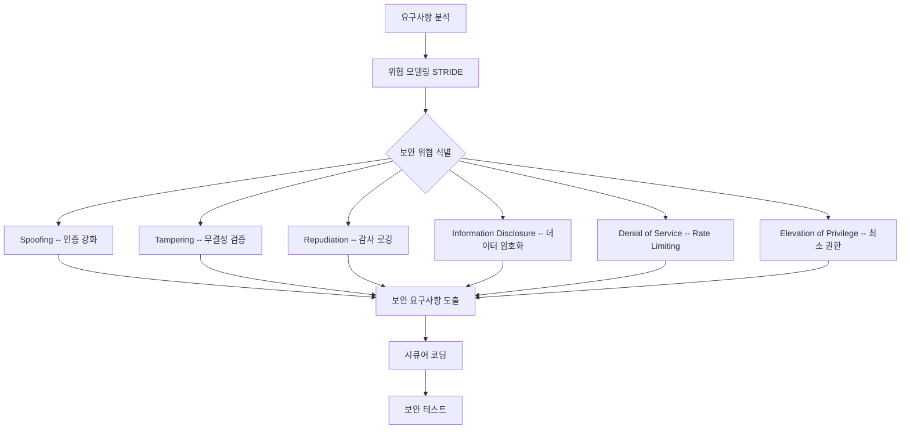
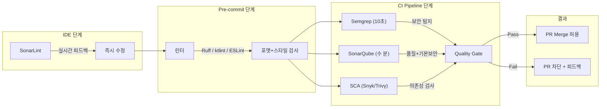
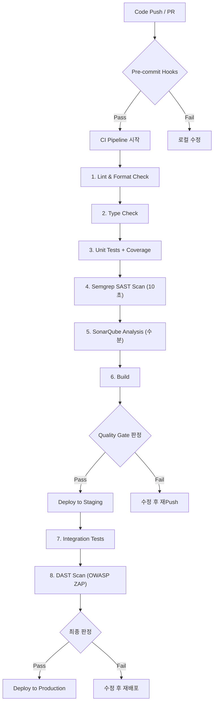
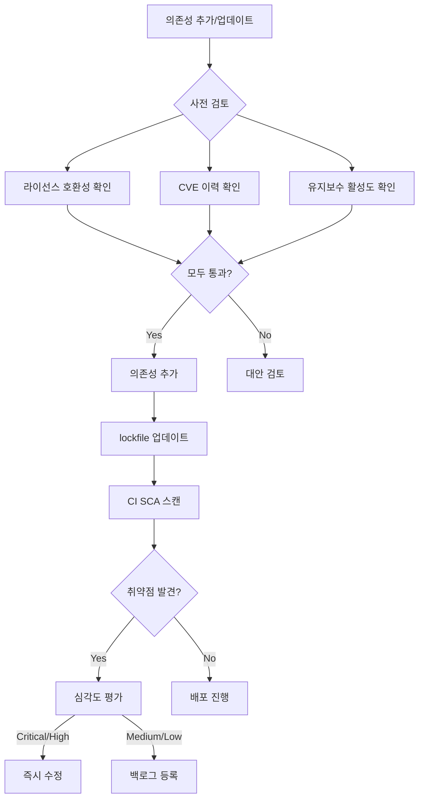
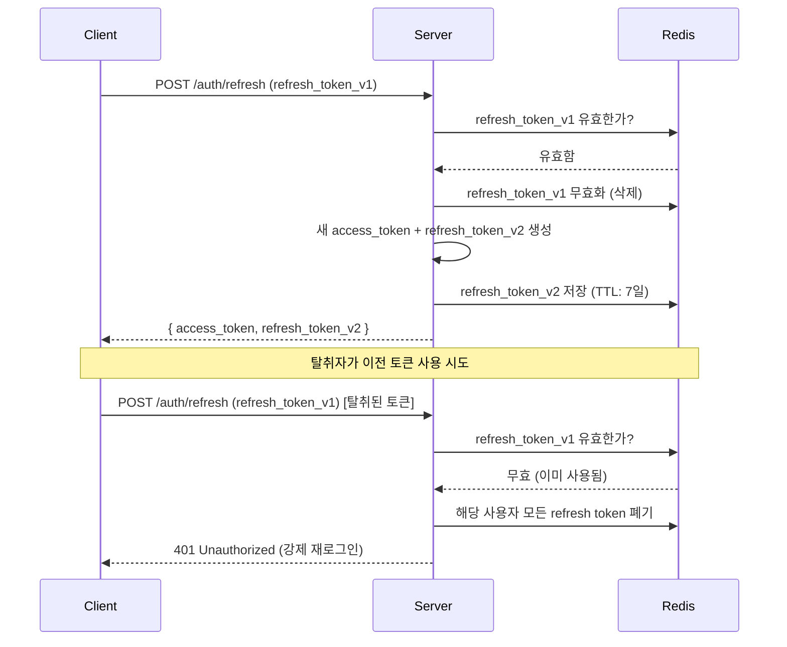

# 시큐어 코딩 가이드

> **작성일**: 2026-03-11
> **대상 언어**: Python, Kotlin, TypeScript
> **기반 표준**: OWASP Top 10 2025 (8th Edition), CWE Top 25, SonarQube 2026.1 LTA
> **적용 수준**: 빅테크 기준 팀 개발표준

---

## 목차

1. [OWASP Top 10 2025 대응 가이드](#1-owasp-top-10-2025-대응-가이드)
2. [SonarQube Quality Gate 설정](#2-sonarqube-quality-gate-설정)
3. [SAST 도구 전략](#3-sast-도구-전략)
4. [시큐어 코딩 체크리스트](#4-시큐어-코딩-체크리스트)
5. [의존성 보안](#5-의존성-보안)
6. [인증/인가 모범 사례](#6-인증인가-모범-사례)

---

## 1. OWASP Top 10 2025 대응 가이드

OWASP는 2025년에 제8판 Top 10을 발표했다. 175,000건 이상의 CVE 기록과 보안 전문가 피드백을 기반으로 한다. 아래는 각 항목별 위험, 대응 방법, 코드 예시를 정리한 것이다.

### 1.1 전체 요약표

| 순위 | 카테고리 | 변화 | 핵심 위험 | 자동 검출 도구 |
|------|----------|------|-----------|---------------|
| **A01** | Broken Access Control | 1위 유지 | 권한 우회, IDOR, CORS 오설정 | SonarQube, Semgrep |
| **A02** | Security Misconfiguration | 5위->2위 | 기본 설정 노출, 불필요 서비스 활성화 | SonarQube, Semgrep |
| **A03** | Software Supply Chain Failures | 신규 확장 | 악성 의존성, 빌드 파이프라인 변조 | Snyk, Trivy, OWASP Dep-Check |
| **A04** | Cryptographic Failures | 2위->4위 | 약한 암호화, 평문 전송, 키 노출 | SonarQube, Semgrep |
| **A05** | Injection | 3위->5위 | SQL/NoSQL/OS/LDAP 인젝션 | SonarQube, Semgrep, CodeQL |
| **A06** | Insecure Design | 4위->6위 | 위협 모델링 부재, 비즈니스 로직 결함 | 수동 리뷰 (자동화 제한적) |
| **A07** | Identification and Authentication Failures | 유지 | 약한 인증, 세션 고정, MFA 미적용 | SonarQube, Semgrep |
| **A08** | Software and Data Integrity Failures | 유지 | 역직렬화 공격, CI/CD 변조, 서명 미검증 | Semgrep, Snyk |
| **A09** | Security Logging and Monitoring Failures | 유지 | 로그 부재, 이상 탐지 미구축 | 수동 리뷰 + 런타임 모니터링 |
| **A10** | Mishandling of Exceptional Conditions | 신규 | 스택 트레이스 노출, 리소스 누수 | SonarQube, Ruff(S), detekt |

### 1.2 A01: Broken Access Control (접근 제어 실패)

**위험**: 인증된 사용자가 허가되지 않은 리소스에 접근하거나, 다른 사용자의 데이터를 조회/수정할 수 있다. IDOR(Insecure Direct Object Reference), CORS 오설정, 경로 탐색 등이 해당된다.

**대응 원칙**:
- 최소 권한 원칙(Principle of Least Privilege) 적용
- 모든 API 엔드포인트에 서버 측 권한 검증
- CORS 화이트리스트 방식 설정
- SSRF(Server-Side Request Forgery) 방지

#### Python (FastAPI)

```python
from __future__ import annotations

from fastapi import Depends, HTTPException, status
from sqlalchemy.orm import Session

from app.auth import get_current_user
from app.models import User, Document


# BAD: IDOR vulnerability -- no ownership check
@app.get("/documents/{document_id}")
async def get_document_bad(document_id: int, db: Session = Depends(get_db)):
    return db.query(Document).filter(Document.id == document_id).first()


# GOOD: ownership verification on every request
@app.get("/documents/{document_id}")
async def get_document(
    document_id: int,
    current_user: User = Depends(get_current_user),
    db: Session = Depends(get_db),
):
    document = db.query(Document).filter(
        Document.id == document_id,
        Document.owner_id == current_user.id,  # ownership check
    ).first()

    if document is None:
        raise HTTPException(
            status_code=status.HTTP_404_NOT_FOUND,
            detail="Document not found",
        )
    return document


# GOOD: role-based access control decorator
def require_role(required_role: str):
    """Enforce role-based access control.

    Args:
        required_role: The minimum role required to access the resource.

    Raises:
        HTTPException: If the user lacks the required role.
    """
    def role_checker(current_user: User = Depends(get_current_user)):
        if current_user.role != required_role:
            raise HTTPException(
                status_code=status.HTTP_403_FORBIDDEN,
                detail="Insufficient permissions",
            )
        return current_user
    return role_checker


@app.delete("/admin/users/{user_id}")
async def delete_user(
    user_id: int,
    admin: User = Depends(require_role("admin")),
    db: Session = Depends(get_db),
):
    # Only admin role can reach here
    ...
```

#### Kotlin (Spring Boot)

```kotlin
// BAD: no authorization check
@GetMapping("/documents/{id}")
fun getDocument(@PathVariable id: Long): Document =
    documentRepository.findById(id).orElseThrow()

// GOOD: ownership verification with Spring Security
@GetMapping("/documents/{id}")
fun getDocument(
    @PathVariable id: Long,
    @AuthenticationPrincipal user: UserPrincipal,
): Document {
    val document = documentRepository.findById(id)
        .orElseThrow { ResponseStatusException(HttpStatus.NOT_FOUND) }

    if (document.ownerId != user.id) {
        throw ResponseStatusException(HttpStatus.FORBIDDEN, "Access denied")
    }
    return document
}

// GOOD: method-level security with SpEL
@PreAuthorize("hasRole('ADMIN')")
@DeleteMapping("/admin/users/{id}")
fun deleteUser(@PathVariable id: Long) {
    userService.deleteUser(id)
}

// GOOD: CORS configuration -- whitelist only
@Configuration
class CorsConfig : WebMvcConfigurer {
    override fun addCorsMappings(registry: CorsRegistry) {
        registry.addMapping("/api/**")
            .allowedOrigins("https://app.example.com")
            .allowedMethods("GET", "POST", "PUT", "DELETE")
            .allowedHeaders("Authorization", "Content-Type")
            .allowCredentials(true)
            .maxAge(3600)
    }
}
```

#### TypeScript (Express/NestJS)

```typescript
// BAD: no ownership check
app.get("/documents/:id", async (req, res) => {
  const doc = await documentRepo.findById(req.params.id);
  res.json(doc);
});

// GOOD: ownership verification middleware
const verifyOwnership = async (
  req: AuthRequest,
  res: Response,
  next: NextFunction,
): Promise<void> => {
  const document = await documentRepo.findById(req.params.id);

  if (!document) {
    res.status(404).json({ error: "Document not found" });
    return;
  }

  if (document.ownerId !== req.user.id) {
    res.status(403).json({ error: "Access denied" });
    return;
  }

  req.document = document;
  next();
};

app.get("/documents/:id", authenticate, verifyOwnership, async (req, res) => {
  res.json(req.document);
});

// GOOD: role-based guard (NestJS)
@Controller("admin/users")
@UseGuards(AuthGuard, RolesGuard)
@Roles("admin")
export class AdminUserController {
  @Delete(":id")
  async deleteUser(@Param("id") id: string): Promise<void> {
    await this.userService.deleteUser(id);
  }
}
```

**린터 규칙 매핑**:
| 도구 | 규칙 ID | 설명 |
|------|---------|------|
| SonarQube | S5131 | 사용자 입력 기반 리다이렉트 탐지 |
| SonarQube | S5144 | SSRF 탐지 |
| Semgrep | `python.django.security.audit.unvalidated-redirect` | 미검증 리다이렉트 |
| Semgrep | `generic.secrets.security.detected-cors-wildcard` | CORS 와일드카드 탐지 |

---

### 1.3 A02: Security Misconfiguration (보안 구성 오류)

**위험**: 기본 계정/비밀번호 사용, 불필요한 기능 활성화, 보안 헤더 미설정, 에러 메시지의 내부 정보 노출 등이 해당된다.

**대응 원칙**:
- 프로덕션 환경에서 디버그 모드 비활성화
- 보안 HTTP 헤더 설정
- 불필요한 엔드포인트/서비스 비활성화
- 기본 자격 증명 제거

#### Python (FastAPI)

```python
from __future__ import annotations

import os

from fastapi import FastAPI
from fastapi.middleware.cors import CORSMiddleware
from starlette.middleware.trustedhost import TrustedHostMiddleware


def create_app() -> FastAPI:
    """Create and configure the FastAPI application."""
    debug_mode = os.getenv("DEBUG", "false").lower() == "true"

    app = FastAPI(
        debug=debug_mode,
        # GOOD: disable docs in production
        docs_url="/docs" if debug_mode else None,
        redoc_url="/redoc" if debug_mode else None,
    )

    # GOOD: restrict allowed hosts
    app.add_middleware(
        TrustedHostMiddleware,
        allowed_hosts=os.getenv("ALLOWED_HOSTS", "").split(","),
    )

    # GOOD: strict CORS -- no wildcard
    app.add_middleware(
        CORSMiddleware,
        allow_origins=os.getenv("CORS_ORIGINS", "").split(","),
        allow_credentials=True,
        allow_methods=["GET", "POST", "PUT", "DELETE"],
        allow_headers=["Authorization", "Content-Type"],
    )

    return app


# GOOD: security headers middleware
@app.middleware("http")
async def add_security_headers(request, call_next):
    response = await call_next(request)
    response.headers["X-Content-Type-Options"] = "nosniff"
    response.headers["X-Frame-Options"] = "DENY"
    response.headers["X-XSS-Protection"] = "0"  # modern browsers use CSP
    response.headers["Strict-Transport-Security"] = (
        "max-age=63072000; includeSubDomains; preload"
    )
    response.headers["Content-Security-Policy"] = "default-src 'self'"
    response.headers["Referrer-Policy"] = "strict-origin-when-cross-origin"
    response.headers["Permissions-Policy"] = (
        "camera=(), microphone=(), geolocation=()"
    )
    return response
```

#### Kotlin (Spring Boot)

```kotlin
// GOOD: Spring Security headers configuration
@Configuration
@EnableWebSecurity
class SecurityConfig {
    @Bean
    fun securityFilterChain(http: HttpSecurity): SecurityFilterChain =
        http
            .headers { headers ->
                headers
                    .contentTypeOptions { }
                    .frameOptions { it.deny() }
                    .httpStrictTransportSecurity {
                        it.includeSubDomains(true)
                        it.maxAgeInSeconds(63072000)
                    }
                    .contentSecurityPolicy { it.policyDirectives("default-src 'self'") }
                    .referrerPolicy {
                        it.policy(ReferrerPolicyHeaderWriter.ReferrerPolicy.STRICT_ORIGIN_WHEN_CROSS_ORIGIN)
                    }
                    .permissionsPolicy { it.policy("camera=(), microphone=()") }
            }
            .build()
}

// GOOD: production application.yml
// spring.devtools.enabled=false
// management.endpoints.web.exposure.include=health,info
// server.error.include-stacktrace=never
// server.error.include-message=never
```

#### TypeScript (Express)

```typescript
import helmet from "helmet";
import rateLimit from "express-rate-limit";

const app = express();

// GOOD: helmet sets security headers automatically
app.use(
  helmet({
    contentSecurityPolicy: { directives: { defaultSrc: ["'self'"] } },
    hsts: { maxAge: 63072000, includeSubDomains: true, preload: true },
    frameguard: { action: "deny" },
  }),
);

// GOOD: rate limiting
const limiter = rateLimit({
  windowMs: 15 * 60 * 1000, // 15 minutes
  max: 100, // limit each IP to 100 requests per window
  standardHeaders: true,
  legacyHeaders: false,
});
app.use("/api/", limiter);

// GOOD: disable X-Powered-By header
app.disable("x-powered-by");

// BAD: exposing stack trace in production
app.use((err: Error, req: Request, res: Response, next: NextFunction) => {
  res.status(500).json({ error: err.message, stack: err.stack }); // NEVER
});

// GOOD: generic error response in production
app.use((err: Error, req: Request, res: Response, next: NextFunction) => {
  console.error("Internal error:", err);
  res.status(500).json({ error: "Internal server error" });
});
```

**린터 규칙 매핑**:
| 도구 | 규칙 ID | 설명 |
|------|---------|------|
| SonarQube | S4507 | 프로덕션 디버그 모드 탐지 |
| SonarQube | S5122 | CORS 와일드카드 설정 탐지 |
| Semgrep | `python.flask.security.audit.debug-enabled` | Flask DEBUG=True 탐지 |
| Ruff | S104 | 0.0.0.0 바인딩 탐지 |

---

### 1.4 A03: Software Supply Chain Failures (소프트웨어 공급망 실패)

**위험**: 악성 패키지 설치, 취약한 의존성 사용, 빌드 파이프라인 변조, SBOM 미관리 등이 해당된다. 2025년 OWASP Top 10에서 독립 카테고리로 승격되었다.

> 상세 대응 방안은 [5. 의존성 보안](#5-의존성-보안) 섹션에서 다룬다.

---

### 1.5 A04: Cryptographic Failures (암호화 실패)

**위험**: 약한 해시 알고리즘(MD5, SHA1), 평문 데이터 전송, 하드코딩된 암호화 키, 부적절한 TLS 설정 등이 해당된다.

**대응 원칙**:
- TLS 1.2+ 강제 적용
- 비밀번호 해싱: bcrypt 또는 argon2 사용 (MD5/SHA1 금지)
- 대칭 암호화: AES-256-GCM 이상
- 키 관리: 환경변수 또는 시크릿 매니저 사용

#### Python

```python
from __future__ import annotations

import hashlib
import os
import secrets

from argon2 import PasswordHasher
from cryptography.fernet import Fernet

# BAD: weak hashing algorithm
password_hash = hashlib.md5(password.encode()).hexdigest()  # NEVER

# BAD: hardcoded encryption key
SECRET_KEY = "my-super-secret-key-12345"  # NEVER

# GOOD: argon2 password hashing
ph = PasswordHasher(
    time_cost=3,
    memory_cost=65536,
    parallelism=4,
)

def hash_password(password: str) -> str:
    """Hash a password using Argon2id."""
    return ph.hash(password)

def verify_password(stored_hash: str, password: str) -> bool:
    """Verify a password against its Argon2id hash."""
    return ph.verify(stored_hash, password)


# GOOD: encryption key from environment
ENCRYPTION_KEY = os.environ["ENCRYPTION_KEY"]
cipher = Fernet(ENCRYPTION_KEY)

def encrypt_sensitive_data(data: str) -> bytes:
    """Encrypt data using Fernet (AES-128-CBC + HMAC-SHA256)."""
    return cipher.encrypt(data.encode())


# GOOD: secure random token generation
def generate_api_token() -> str:
    """Generate a cryptographically secure API token."""
    return secrets.token_urlsafe(32)
```

#### Kotlin

```kotlin
import org.springframework.security.crypto.argon2.Argon2PasswordEncoder
import javax.crypto.Cipher
import javax.crypto.KeyGenerator
import javax.crypto.SecretKey
import javax.crypto.spec.GCMParameterSpec

// GOOD: Argon2 password encoding
val passwordEncoder = Argon2PasswordEncoder.defaultsForSpringSecurity_v5_8()

fun hashPassword(rawPassword: String): String =
    passwordEncoder.encode(rawPassword)

fun verifyPassword(rawPassword: String, encodedPassword: String): Boolean =
    passwordEncoder.matches(rawPassword, encodedPassword)

// GOOD: AES-256-GCM encryption
object AesGcmCipher {
    private const val GCM_TAG_LENGTH = 128
    private const val GCM_IV_LENGTH = 12

    fun encrypt(plaintext: ByteArray, key: SecretKey): Pair<ByteArray, ByteArray> {
        val iv = ByteArray(GCM_IV_LENGTH).also {
            java.security.SecureRandom().nextBytes(it)
        }
        val cipher = Cipher.getInstance("AES/GCM/NoPadding").apply {
            init(Cipher.ENCRYPT_MODE, key, GCMParameterSpec(GCM_TAG_LENGTH, iv))
        }
        return Pair(iv, cipher.doFinal(plaintext))
    }
}
```

#### TypeScript

```typescript
import { createHash, randomBytes, scryptSync, timingSafeEqual } from "crypto";

// BAD: weak hash
const hash = createHash("md5").update(password).digest("hex"); // NEVER

// GOOD: scrypt password hashing
function hashPassword(password: string): string {
  const salt = randomBytes(16).toString("hex");
  const hash = scryptSync(password, salt, 64).toString("hex");
  return `${salt}:${hash}`;
}

function verifyPassword(password: string, stored: string): boolean {
  const [salt, storedHash] = stored.split(":");
  const hash = scryptSync(password, salt, 64).toString("hex");
  // GOOD: timing-safe comparison to prevent timing attacks
  return timingSafeEqual(Buffer.from(hash), Buffer.from(storedHash));
}

// GOOD: secure token generation
function generateToken(): string {
  return randomBytes(32).toString("hex");
}
```

**린터 규칙 매핑**:
| 도구 | 규칙 ID | 설명 |
|------|---------|------|
| SonarQube | S2070 | SHA-1 / MD5 해시 사용 탐지 |
| SonarQube | S5547 | 약한 암호화 알고리즘 탐지 |
| Ruff | S303 | 취약한 hashlib 함수 호출 탐지 |
| Ruff | S324 | 취약한 해시 알고리즘 탐지 |
| Semgrep | `python.cryptography.security.insecure-hash` | 취약한 해시 사용 |
| detekt | `MagicNumber` | 하드코딩된 키 길이 등 탐지 |

---

### 1.6 A05: Injection (인젝션)

**위험**: 신뢰할 수 없는 데이터가 쿼리, 명령어, 표현식의 일부로 전달되어 의도하지 않은 동작을 유발한다. SQL, NoSQL, OS Command, LDAP, XSS 인젝션이 해당된다.

**대응 원칙**:
- 파라미터화 쿼리 (Parameterized Query) 사용
- ORM 활용
- 입력값 화이트리스트 검증
- OS 명령어 직접 실행 금지

#### Python

```python
from __future__ import annotations

import subprocess

from sqlalchemy.orm import Session

# --- SQL Injection ---

# BAD: string formatting in query
cursor.execute(f"SELECT * FROM users WHERE email = '{email}'")  # NEVER

# GOOD: parameterized query
cursor.execute("SELECT * FROM users WHERE email = %s", (email,))

# BEST: ORM usage
user = session.query(User).filter(User.email == email).first()


# --- OS Command Injection ---

# BAD: shell=True with user input
subprocess.run(f"ping {user_input}", shell=True)  # NEVER

# GOOD: argument list without shell
subprocess.run(
    ["ping", "-c", "4", validated_hostname],
    shell=False,
    capture_output=True,
    timeout=10,
)


# --- Template Injection ---

# BAD: eval with user input
result = eval(user_expression)  # NEVER

# GOOD: use safe evaluation libraries
import ast
result = ast.literal_eval(safe_expression)
```

#### Kotlin

```kotlin
// --- SQL Injection ---

// BAD: string concatenation in query
val query = "SELECT * FROM users WHERE email = '$email'"
jdbcTemplate.queryForObject(query, UserRowMapper())  // NEVER

// GOOD: parameterized query with JdbcTemplate
val user = jdbcTemplate.queryForObject(
    "SELECT * FROM users WHERE email = ?",
    UserRowMapper(),
    email,
)

// BEST: Spring Data JPA
interface UserRepository : JpaRepository<User, Long> {
    fun findByEmail(email: String): User?

    // GOOD: explicit JPQL with named parameters
    @Query("SELECT u FROM User u WHERE u.email = :email AND u.active = true")
    fun findActiveByEmail(@Param("email") email: String): User?
}
```

#### TypeScript

```typescript
// --- SQL Injection ---

// BAD: string interpolation in query
const query = `SELECT * FROM users WHERE email = '${email}'`; // NEVER
await db.query(query);

// GOOD: parameterized query
await db.query("SELECT * FROM users WHERE email = $1", [email]);

// BEST: ORM (Prisma)
const user = await prisma.user.findUnique({ where: { email } });

// --- NoSQL Injection (MongoDB) ---

// BAD: direct user input in query object
const user = await collection.findOne({ email: req.body.email }); // risky

// GOOD: explicit type validation
const email = String(req.body.email); // coerce to string
const user = await collection.findOne({ email });
```

**린터 규칙 매핑**:
| 도구 | 규칙 ID | 설명 |
|------|---------|------|
| SonarQube | S3649 | SQL 인젝션 탐지 |
| SonarQube | S2076 | OS 명령어 인젝션 탐지 |
| Ruff | S608 | SQL 문자열 포매팅 탐지 |
| Ruff | S602 | subprocess shell=True 탐지 |
| Semgrep | `python.lang.security.audit.exec-detected` | exec/eval 사용 탐지 |
| detekt | `TooGenericExceptionCaught` | 과도한 예외 범위 |

---

### 1.7 A06: Insecure Design (안전하지 않은 설계)

**위험**: 설계 단계에서 위협 모델링 없이 개발하여 발생하는 근본적인 보안 결함이다. 자동화 도구로는 탐지가 제한적이며, 보안 설계 리뷰가 필수이다.

**대응 원칙**:
- 위협 모델링(STRIDE, DREAD) 수행
- 비즈니스 로직 남용 시나리오 검토
- Rate Limiting 적용
- 실패 시 안전한 기본값(Fail Secure) 적용



---

### 1.8 A07: Identification and Authentication Failures (식별 및 인증 실패)

**위험**: 약한 비밀번호 허용, 무차별 대입 공격 방어 부재, 세션 고정 공격, 다중 인증(MFA) 미적용 등이 해당된다.

> 상세 구현 가이드는 [6. 인증/인가 모범 사례](#6-인증인가-모범-사례) 섹션에서 다룬다.

---

### 1.9 A08: Software and Data Integrity Failures (소프트웨어 및 데이터 무결성 실패)

**위험**: 안전하지 않은 역직렬화, CI/CD 파이프라인 변조, 소프트웨어 업데이트 서명 미검증 등이 해당된다.

#### Python

```python
from __future__ import annotations

import json
import pickle

# BAD: pickle deserialization of untrusted data
data = pickle.loads(untrusted_bytes)  # NEVER -- arbitrary code execution

# GOOD: use JSON for untrusted data
data = json.loads(untrusted_string)

# GOOD: if pickle is unavoidable, use hmac verification
import hmac
import hashlib

SIGNING_KEY = os.environ["SIGNING_KEY"].encode()

def verify_and_load(signed_data: bytes, signature: str) -> dict:
    """Verify HMAC signature before deserializing."""
    expected_sig = hmac.new(SIGNING_KEY, signed_data, hashlib.sha256).hexdigest()
    if not hmac.compare_digest(expected_sig, signature):
        raise ValueError("Invalid signature -- data may be tampered")
    return json.loads(signed_data)
```

#### Kotlin

```kotlin
// BAD: Java ObjectInputStream with untrusted data
val ois = ObjectInputStream(untrustedStream) // NEVER
val obj = ois.readObject()

// GOOD: use Jackson JSON deserialization with strict typing
val mapper = ObjectMapper().apply {
    // Disable default typing to prevent polymorphic deserialization attacks
    deactivateDefaultTyping()
    // Reject unknown properties
    configure(DeserializationFeature.FAIL_ON_UNKNOWN_PROPERTIES, true)
}
val user = mapper.readValue<UserDto>(jsonString)
```

#### TypeScript

```typescript
// BAD: eval-based deserialization
const data = eval(`(${untrustedString})`); // NEVER

// GOOD: JSON.parse with schema validation (zod)
import { z } from "zod";

const UserSchema = z.object({
  id: z.number(),
  email: z.string().email(),
  role: z.enum(["user", "admin"]),
});

function parseUser(raw: string): z.infer<typeof UserSchema> {
  const parsed = JSON.parse(raw);
  return UserSchema.parse(parsed); // throws on invalid data
}
```

**린터 규칙 매핑**:
| 도구 | 규칙 ID | 설명 |
|------|---------|------|
| Ruff | S301 | pickle.loads 사용 탐지 |
| SonarQube | S5135 | 안전하지 않은 역직렬화 탐지 |
| Semgrep | `python.lang.security.deserialization.avoid-pickle` | pickle 사용 탐지 |

---

### 1.10 A09: Security Logging and Monitoring Failures (보안 로깅 및 모니터링 실패)

**위험**: 로그인 실패, 접근 거부, 입력 검증 실패 등 보안 이벤트를 기록하지 않아 침해 탐지가 불가능하다.

**대응 원칙**:
- 인증 실패, 접근 거부, 입력 검증 실패를 반드시 로깅
- 로그에 민감 정보(비밀번호, 토큰, 개인정보) 포함 금지
- 중앙 집중식 로그 수집 및 이상 탐지 구성
- 로그 변조 방지 (append-only, 별도 저장소)

#### Python

```python
from __future__ import annotations

import logging
import re

logger = logging.getLogger("security")


# GOOD: security event logging
def login(email: str, password: str) -> AuthResult:
    """Authenticate user and log security events."""
    user = user_repo.find_by_email(email)

    if user is None or not verify_password(user.hashed_password, password):
        # Log failed attempt WITHOUT the password
        logger.warning(
            "Login failed",
            extra={
                "event": "auth_failure",
                "email": mask_email(email),
                "ip": request.client.host,
                "user_agent": request.headers.get("user-agent", ""),
            },
        )
        raise HTTPException(status_code=401, detail="Invalid credentials")

    logger.info(
        "Login successful",
        extra={"event": "auth_success", "user_id": user.id},
    )
    return create_token(user)


# GOOD: sanitize sensitive data from logs
def mask_email(email: str) -> str:
    """Mask email for safe logging: user@example.com -> u***@example.com."""
    local, domain = email.split("@")
    return f"{local[0]}***@{domain}"


# BAD: logging sensitive data
logger.info(f"User login: email={email}, password={password}")  # NEVER
logger.info(f"API call with token: {auth_token}")  # NEVER
```

---

### 1.11 A10: Mishandling of Exceptional Conditions (예외 조건 처리 오류)

**위험**: 예외 발생 시 스택 트레이스 노출, 리소스 미해제, 불안전한 기본 상태 전환 등이 해당된다. 2025년 신규 진입 항목이다.

#### Python

```python
from __future__ import annotations

import contextlib

# BAD: bare except that swallows everything
try:
    process_payment(order)
except:  # noqa: E722
    pass  # silently ignores errors -- payment state unknown

# BAD: exposing internal details
try:
    result = db.execute(query)
except Exception as e:
    return {"error": str(e)}  # leaks DB schema, query details

# GOOD: specific exception handling with safe error response
try:
    result = db.execute(query)
except DatabaseConnectionError:
    logger.error("Database connection failed", exc_info=True)
    raise HTTPException(
        status_code=503,
        detail="Service temporarily unavailable",
    )
except QueryExecutionError as e:
    logger.error("Query execution failed: %s", e, exc_info=True)
    raise HTTPException(
        status_code=500,
        detail="Internal server error",
    )

# GOOD: resource cleanup with context managers
async def process_file(path: str) -> ProcessResult:
    """Process file with guaranteed resource cleanup."""
    async with aiofiles.open(path) as f:
        content = await f.read()
        return await parse_content(content)
    # file handle automatically closed even on exception
```

#### Kotlin

```kotlin
// GOOD: structured exception handling with resource management
fun processFile(path: Path): ProcessResult =
    path.bufferedReader().use { reader ->  // auto-close guaranteed
        val content = reader.readText()
        parseContent(content)
    }

// GOOD: coroutine-safe resource management
suspend fun fetchData(url: String): ApiResponse =
    httpClient.use { client ->  // auto-close on completion or failure
        val response = client.get(url)
        if (!response.status.isSuccess()) {
            logger.warn("API call failed: status={}", response.status)
            throw ServiceUnavailableException("External service error")
        }
        response.body()
    }
```

#### TypeScript

```typescript
// GOOD: explicit error handling with resource cleanup
async function processUpload(stream: ReadableStream): Promise<Result> {
  const tempFile = await createTempFile();
  try {
    await writeStream(tempFile, stream);
    return await parseFile(tempFile.path);
  } catch (error) {
    logger.error("Upload processing failed", { error });
    throw new ServiceError("Failed to process upload");
  } finally {
    await tempFile.cleanup(); // always runs
  }
}

// GOOD: using Symbol.asyncDispose (TC39 Stage 3)
async function withDbConnection<T>(
  fn: (conn: DbConnection) => Promise<T>,
): Promise<T> {
  await using conn = await pool.getConnection();
  return fn(conn);
}
```

**린터 규칙 매핑**:
| 도구 | 규칙 ID | 설명 |
|------|---------|------|
| Ruff | E722 | bare except 탐지 |
| Ruff | S110 | try-except-pass 탐지 |
| SonarQube | S2095 | 리소스 미해제 탐지 |
| SonarQube | S1181 | Throwable 직접 catch 탐지 |
| detekt | `TooGenericExceptionCaught` | 범용 예외 catch 탐지 |
| detekt | `SwallowedException` | 무시된 예외 탐지 |

---

## 2. SonarQube Quality Gate 설정

### 2.1 핵심 철학: "Clean as You Code"

SonarQube의 핵심 철학은 **새 코드(New Code)에 집중**하는 것이다. 레거시 코드를 한꺼번에 고치는 대신, 변경되는 코드가 품질을 악화시키지 않도록 보장한다.

### 2.2 팀 표준 Quality Gate 메트릭

#### 기본 Quality Gate (Sonar way)

| 메트릭 | 조건 | 적용 대상 |
|--------|------|-----------|
| 새로운 이슈 없음 | 0건 | New Code |
| 보안 핫스팟 리뷰 완료 | 100% | New Code |
| 테스트 커버리지 | >= 80% | New Code |
| 코드 중복률 | <= 3% | New Code |

#### 팀 표준 강화 Quality Gate

| 메트릭 | 표준값 | AI 코드 강화값 | 비고 |
|--------|--------|---------------|------|
| 새로운 이슈 | 0건 | 0건 | 필수 -- 새 이슈 발생 시 즉시 차단 |
| 보안 핫스팟 리뷰 | 100% | 100% | 필수 -- 모든 보안 핫스팟 검토 |
| 커버리지 (New Code) | >= 80% | >= 90% | AI 코드는 즉시 생성 가능하므로 높은 기준 |
| 중복률 (New Code) | <= 3% | <= 1% | AI 코드 중복 생성 방지 |
| 신뢰성 등급 (New Code) | A | A | 버그 없음 |
| 보안 등급 (New Code) | A | A | 취약점 없음 |
| 보안 등급 (Overall) | A | A | 전체 보안 수준 유지 |
| 유지보수성 등급 (New Code) | B 이상 | A | 기술 부채 최소화 |
| 인지 복잡도 | <= 15 | <= 8 | 함수 분리 강제 |

> **AI 코드 강화값의 근거**: "AI가 방금 생성한 코드이므로 지금 고쳐야 한다. 코드 생성은 AI에게 비용이 저렴하므로 90% 커버리지와 1% 중복률도 합리적인 요구사항이다."

#### 프로젝트 유형별 Quality Gate

```yaml
# 신규 프로젝트: 엄격한 기준
quality_gate:
  name: "New Project Gate"
  conditions:
    new_code:
      - metric: new_reliability_rating
        value: A
      - metric: new_security_rating
        value: A
      - metric: new_maintainability_rating
        value: A
      - metric: new_coverage
        operator: ">="
        value: 80
      - metric: new_duplicated_lines_density
        operator: "<="
        value: 3
      - metric: new_security_hotspots_reviewed
        value: 100%
      - metric: new_issues
        value: 0

# 레거시 프로젝트: 점진적 개선
quality_gate:
  name: "Legacy Project Gate"
  conditions:
    new_code:
      - metric: new_reliability_rating
        value: A
      - metric: new_security_rating
        value: A
      - metric: new_maintainability_rating
        value: B       # 유지보수성은 B까지 허용
      - metric: new_coverage
        operator: ">="
        value: 70       # 70%로 완화
      - metric: new_duplicated_lines_density
        operator: "<="
        value: 5        # 5%로 완화

# AI 생성 코드: 강화 기준
quality_gate:
  name: "AI Code Hardened Gate"
  conditions:
    new_code:
      - metric: new_coverage
        operator: ">="
        value: 90       # 90% 커버리지
      - metric: new_duplicated_lines_density
        operator: "<="
        value: 1        # 1% 중복
      - metric: new_reliability_rating
        value: A
      - metric: new_security_rating
        value: A
    overall:
      - metric: security_rating
        value: A
```

### 2.3 Quality Profile 확장 전략

Sonar way 기본 프로파일을 직접 수정하지 않고, 자식 프로파일로 확장한다.

```
Sonar way (부모 프로파일)
  +-- Team Standard Profile (자식 프로파일)
       +-- OWASP Top 10 보안 규칙 전체 활성화
       +-- 인지 복잡도 임계값 15로 조정
       +-- 팀 컨벤션 규칙 추가
```

#### 언어별 핵심 커스터마이징

| 언어 | 추가 활성화 규칙 | 임계값 조정 |
|------|-----------------|------------|
| **Python** | S5754 (bare except 금지), S1192 (문자열 리터럴 중복 금지), 타입 힌팅 규칙 | 인지 복잡도 15 (AI: 8) |
| **Kotlin** | S6218 (equals/hashCode 일관성), Coroutine 규칙, nullable 남용 탐지 | 인지 복잡도 15 |
| **TypeScript** | S4325 (불필요한 타입 단언 금지), S1128 (미사용 import 금지), 타입 안전성 규칙 | 인지 복잡도 15 |

### 2.4 Fudge Factor (유예 임계값)

SonarQube는 소규모 변경에 대해 유예 임계값을 적용한다:
- 새 코드가 **20줄 미만**이면 중복률 조건 면제
- 커버 대상 새 코드가 **20줄 미만**이면 커버리지 조건 면제

프로젝트 관리자가 개별 프로젝트에서 이 설정을 재정의할 수 있다.

---

## 3. SAST 도구 전략

### 3.1 도구 비교 분석

| 항목 | SonarQube | Semgrep | CodeQL | Snyk Code |
|------|-----------|---------|--------|-----------|
| **주요 강점** | 코드 품질 + 기본 보안 | 보안 탐지 + 속도 | 깊은 시맨틱 분석 | 통합 생태계 + AI |
| **규칙 수** | 6,500+ | 2,400+ (OSS) / 20,000+ (Pro) | - | - |
| **스캔 속도 (50K LOC)** | 수 분 ~ 수십 분 | 10초 (diff-aware) | 8분 | 45초 |
| **취약점 탐지율** | 19% | 46% | 95% (SQL inj.) | 92% (SQL inj.) |
| **정확도 (FP율)** | - | 82% (FP: 12%) | 88% (FP: 5%) | 85% (FP: 8%) |
| **가격** | Community 무료 | 무료 ~ $35/dev/mo | GitHub 무료 | 무료 ~ $110/dev/mo |
| **커스텀 규칙** | Java/AST (어려움) | YAML (쉬움) | QL 언어 (고급) | 제한적 |
| **SCA (의존성 검사)** | Enterprise 추가 | O (12+ 언어) | X | O |
| **시크릿 탐지** | X | O | X | X |

> **핵심 인사이트**: SonarQube의 보안 탐지율(19%)은 Semgrep(46%)에 비해 낮다. SonarQube는 품질 관리에, Semgrep은 보안 탐지에 각각 최적화되어 있으므로 **병행 사용이 가장 효과적**이다.

### 3.2 SonarQube + Semgrep 병행 전략



| 단계 | 도구 | 역할 | 이유 |
|------|------|------|------|
| **IDE** | SonarLint (Connected Mode) | 실시간 코드 품질 분석 | SonarQube 규칙과 동기화 |
| **Pre-commit** | Ruff / ktlint / ESLint | 린트 + 포맷 검사 | 빠른 로컬 피드백 |
| **CI: 보안** | Semgrep | 보안 취약점 탐지 | 2.4배 높은 탐지율, 10초 스캔 |
| **CI: 품질** | SonarQube | 품질 게이트 + 기본 보안 | 유지보수성, 기술 부채 추적 최강 |
| **CI: SCA** | Snyk 또는 Trivy | 의존성 취약점 검사 | SonarQube Community에 SCA 없음 |
| **CI: 시크릿** | GitLeaks / detect-secrets | 하드코딩된 시크릿 탐지 | 커밋 전후 모두 검사 |

### 3.3 CI/CD 통합 파이프라인 — 보안 단계 흐름

본 가이드는 **보안 관점에서 어떤 단계가 들어가야 하는가**만 정의한다. 실제 GitHub Actions 워크플로우, `sonar-project.properties`, Kotlin/Gradle 플러그인 설정 등 **CI 통합 방법**은 [`linting-integration-guide.md` 섹션 5(SonarQube)/6(Semgrep)](linting-integration-guide.md#5-sonarqube-ci-통합)을 참조한다.



| 단계 | 도구 | 보안 책임 | 통합 가이드 |
|------|------|-----------|-------------|
| 4 | Semgrep | OWASP Top 10 + 시크릿 + 커스텀 보안 규칙 | linting-integration §6 |
| 5 | SonarQube | 보안 핫스팟 + 신뢰성/보안 등급 | linting-integration §5 |
| 5 | GitLeaks / detect-secrets | 하드코딩 시크릿 탐지 | linting-integration §6 |
| 7 | DAST (OWASP ZAP) | 런타임 취약점 검사 | 별도 |

#### 프로젝트 설정 파일

`sonar-project.properties` 템플릿은 [`common/security-templates/sonar-project.properties`](../../common/security-templates/sonar-project.properties)에 있다. 프로젝트 루트에 복사 후 `sonar.projectKey`, `sonar.organization`, 언어별 `sonar.sources`/`sonar.tests`/coverage 경로만 수정하면 된다.

### 3.4 Semgrep 커스텀 규칙 예시

Semgrep의 강점은 YAML 기반 커스텀 규칙을 쉽게 작성할 수 있다는 것이다.

```yaml
# .semgrep/team-rules.yml
rules:
  - id: no-hardcoded-jwt-secret
    patterns:
      - pattern: |
          jwt.encode($PAYLOAD, "...", ...)
    message: >
      JWT secret is hardcoded. Use environment variable instead.
    severity: ERROR
    languages: [python]
    metadata:
      owasp: "A02:2025 Security Misconfiguration"

  - id: no-raw-sql-string
    patterns:
      - pattern: |
          $DB.execute(f"...")
    message: >
      Raw SQL string detected. Use parameterized queries.
    severity: ERROR
    languages: [python]
    metadata:
      owasp: "A05:2025 Injection"
      cwe: "CWE-89"

  - id: require-csrf-protection
    patterns:
      - pattern: |
          @app.post(...)
          async def $FUNC(...):
              ...
      - pattern-not: |
          @app.post(...)
          async def $FUNC(..., csrf_token: ... = Depends(...), ...):
              ...
    message: >
      POST endpoint without CSRF protection.
    severity: WARNING
    languages: [python]
```

### 3.5 SonarQube 에디션 선택 가이드

| 팀 규모 / 상황 | 권장 에디션 | 보완 도구 |
|----------------|------------|-----------|
| 스타트업 / 소규모 (< 10명) | Community Build (무료) | Semgrep (무료) + Snyk Free |
| 중규모 (10-50명) | Developer Edition | Semgrep Team + Snyk |
| 대규모 / 규제 산업 | Enterprise | Semgrep Enterprise |
| AI 코드 집중 | SonarQube Cloud | AI Code Assurance + MCP 연동 |

---

## 4. 시큐어 코딩 체크리스트

코드 리뷰 및 커밋 전 반드시 확인해야 하는 보안 점검 항목이다.

### 4.1 SQL Injection 방지

| # | 점검 항목 | 자동 검출 | 규칙 ID |
|---|----------|-----------|---------|
| 1 | 모든 SQL 쿼리에 파라미터 바인딩 사용 | O | SonarQube S3649, Ruff S608 |
| 2 | 문자열 포매팅/연결로 쿼리 생성 금지 | O | Semgrep `python.lang.security.audit.formatted-sql-query` |
| 3 | ORM 사용 시에도 raw query에 파라미터 바인딩 적용 | O | SonarQube S3649 |
| 4 | 동적 테이블명/컬럼명은 화이트리스트 검증 | X | 수동 리뷰 |
| 5 | 저장 프로시저 내에서도 파라미터화 쿼리 사용 | X | 수동 리뷰 |

### 4.2 XSS (Cross-Site Scripting) 방지

| # | 점검 항목 | 자동 검출 | 규칙 ID |
|---|----------|-----------|---------|
| 1 | 사용자 입력을 HTML에 렌더링 시 이스케이프 처리 | O | SonarQube S5131 |
| 2 | `innerHTML`, `dangerouslySetInnerHTML` 사용 금지 | O | Semgrep `typescript.react.security.audit.react-dangerouslysetinnerhtml` |
| 3 | Content-Security-Policy 헤더 설정 | X | 수동 확인 |
| 4 | 프레임워크 자동 이스케이프 기능 활용 (React JSX, Jinja2 autoescape) | X | 수동 리뷰 |
| 5 | URL 파라미터를 DOM에 직접 삽입 금지 | O | Semgrep `javascript.browser.security.dom-based-xss` |

#### XSS 방지 코드 예시

```python
# Python (Jinja2)
# BAD: autoescape disabled
template = jinja2.Template("Hello {{ name }}")  # no autoescape

# GOOD: autoescape enabled
env = jinja2.Environment(autoescape=jinja2.select_autoescape())
template = env.get_template("hello.html")
```

```kotlin
// Kotlin (Spring MVC) -- Thymeleaf auto-escapes by default
// BAD: unescaped output
// th:utext="${userInput}"  // NEVER with untrusted data

// GOOD: escaped output (default behavior)
// th:text="${userInput}"   // auto-escaped
```

```typescript
// TypeScript (React)
// BAD: dangerouslySetInnerHTML
<div dangerouslySetInnerHTML={{ __html: userInput }} />  // NEVER

// GOOD: React JSX auto-escapes by default
<div>{userInput}</div>

// GOOD: DOMPurify for cases where HTML rendering is necessary
import DOMPurify from "dompurify";
const sanitized = DOMPurify.sanitize(userInput);
<div dangerouslySetInnerHTML={{ __html: sanitized }} />
```

### 4.3 CSRF (Cross-Site Request Forgery) 방지

| # | 점검 항목 | 자동 검출 | 규칙 ID |
|---|----------|-----------|---------|
| 1 | 상태 변경 요청(POST/PUT/DELETE)에 CSRF 토큰 적용 | X | 수동 확인 |
| 2 | SameSite 쿠키 속성 설정 (`Strict` 또는 `Lax`) | O | SonarQube S3330 |
| 3 | Origin/Referer 헤더 검증 (보조 수단) | X | 수동 확인 |
| 4 | API 서버: CORS 설정으로 허용 도메인 제한 | O | SonarQube S5122 |
| 5 | 쿠키 기반 인증 시 Double Submit Cookie 패턴 적용 | X | 수동 리뷰 |

### 4.4 인증/인가

| # | 점검 항목 | 자동 검출 | 규칙 ID |
|---|----------|-----------|---------|
| 1 | 비밀번호 해싱: bcrypt/argon2 사용, MD5/SHA1 금지 | O | SonarQube S2070, Ruff S303/S324 |
| 2 | JWT에 만료 시간(exp) 필수 설정 | X | 수동 리뷰 |
| 3 | Refresh Token Rotation 구현 | X | 수동 리뷰 |
| 4 | 세션 쿠키: HttpOnly + Secure + SameSite 속성 | O | SonarQube S3330, S2092 |
| 5 | 로그인 실패 시 Rate Limiting 적용 | X | 수동 확인 |
| 6 | 비밀번호 강도 정책 적용 (최소 12자, 복잡성 요구) | X | 수동 리뷰 |
| 7 | 모든 API 엔드포인트에 서버 측 인증/인가 검증 | X | 수동 리뷰 |

### 4.5 시크릿 관리

| # | 점검 항목 | 자동 검출 | 규칙 ID |
|---|----------|-----------|---------|
| 1 | 소스코드에 API 키, 비밀번호, 토큰 하드코딩 금지 | O | GitLeaks, detect-secrets |
| 2 | `.env` 파일은 반드시 `.gitignore`에 포함 | O | pre-commit `check-added-large-files` |
| 3 | 환경변수 또는 시크릿 매니저(AWS SSM, Vault) 사용 | X | 수동 리뷰 |
| 4 | CI/CD 시크릿은 저장소 Secret으로 관리 | X | 수동 확인 |
| 5 | 노출된 시크릿 발견 시 즉시 로테이션 | X | 인시던트 대응 |

#### 시크릿 관리 코드 예시

```python
from __future__ import annotations

import os

# BAD: hardcoded secrets
API_KEY = "sk-proj-abc123xyz789"  # NEVER
DB_PASSWORD = "super_secret_password"  # NEVER

# GOOD: environment variables with validation
API_KEY = os.environ.get("API_KEY")
if not API_KEY:
    raise RuntimeError("API_KEY environment variable is required")

# GOOD: pydantic settings for structured config
from pydantic_settings import BaseSettings

class Settings(BaseSettings):
    """Application settings loaded from environment."""

    api_key: str
    db_url: str
    jwt_secret: str

    class Config:
        env_file = ".env"
        env_file_encoding = "utf-8"

settings = Settings()
```

```kotlin
// GOOD: Spring Boot externalized configuration
@Configuration
@ConfigurationProperties(prefix = "app")
data class AppConfig(
    val apiKey: String = "",
    val jwtSecret: String = "",
    val dbPassword: String = "",
)

// application.yml (values from environment)
// app:
//   api-key: ${API_KEY}
//   jwt-secret: ${JWT_SECRET}
//   db-password: ${DB_PASSWORD}
```

```typescript
// GOOD: validated environment config
import { z } from "zod";

const EnvSchema = z.object({
  API_KEY: z.string().min(1, "API_KEY is required"),
  DATABASE_URL: z.string().url("DATABASE_URL must be a valid URL"),
  JWT_SECRET: z.string().min(32, "JWT_SECRET must be at least 32 chars"),
  NODE_ENV: z.enum(["development", "staging", "production"]),
});

// Validate at startup -- fail fast if misconfigured
const env = EnvSchema.parse(process.env);
export default env;
```

### 4.6 통합 보안 체크리스트 (커밋 전)

| 카테고리 | 점검 항목 | 자동 검출 여부 |
|----------|-----------|---------------|
| **입력 검증** | 모든 사용자 입력이 서버 측에서 검증되는가? | 부분적 (Semgrep) |
| **출력 인코딩** | HTML/URL/SQL 출력 시 적절히 인코딩되는가? | O (SonarQube) |
| **인증** | 비밀번호가 강력한 해시로 저장되는가? | O (SonarQube, Ruff) |
| **인가** | 모든 엔드포인트에 권한 검사가 있는가? | 부분적 |
| **암호화** | 민감 데이터가 전송/저장 시 암호화되는가? | O (SonarQube) |
| **시크릿** | 소스코드에 하드코딩된 시크릿이 없는가? | O (GitLeaks) |
| **에러 처리** | 에러 메시지에 내부 정보가 노출되지 않는가? | O (SonarQube) |
| **로깅** | 보안 이벤트가 적절히 로깅되는가? | X |
| **의존성** | 취약한 의존성이 없는가? | O (Snyk, Trivy) |
| **헤더** | 보안 HTTP 헤더가 설정되어 있는가? | 부분적 |

---

## 5. 의존성 보안

### 5.1 위험 개요

OWASP Top 10 2025에서 A03(Software Supply Chain Failures)이 독립 카테고리로 승격되었다. 이는 오픈소스 의존성을 통한 공급망 공격이 급증하고 있음을 반영한다.

### 5.2 SCA (Software Composition Analysis) 도구

| 도구 | 특징 | 비용 | 추천 대상 |
|------|------|------|-----------|
| **Snyk** | 넓은 DB, 자동 PR 수정 제안, SBOM 생성 | 무료 티어 있음 | 상용 프로젝트 |
| **Trivy** | 컨테이너/IaC/SBOM 통합 스캐닝, 가장 빠름 | 무료 (OSS) | 컨테이너 환경 |
| **OWASP Dependency Check** | NVD 기반 CVE 스캐닝, Gradle/Maven 통합 | 무료 (OSS) | Java/Kotlin 프로젝트 |
| **Semgrep Supply Chain** | SAST + SCA 통합, reachability 분석 | 유료 | Semgrep 사용 팀 |
| **pip-audit** | Python 전용, PyPI Advisory DB 기반 | 무료 (OSS) | Python 프로젝트 |
| **npm audit** | Node.js 내장, GitHub Advisory DB | 무료 (내장) | Node.js 프로젝트 |

### 5.3 의존성 보안 관리 프로세스



### 5.4 SBOM (Software Bill of Materials)

SBOM은 소프트웨어에 포함된 모든 구성요소의 목록이다. 미국 행정명령 14028(2021) 이후 정부 납품 소프트웨어에는 SBOM이 필수이다.

#### SBOM 생성 도구

```bash
# Python: pip-licenses + CycloneDX
pip install cyclonedx-bom
cyclonedx-py environment --output sbom.json --format json

# Node.js: CycloneDX
npx @cyclonedx/cyclonedx-npm --output-file sbom.json

# Java/Kotlin: CycloneDX Gradle Plugin
# build.gradle.kts
# plugins { id("org.cyclonedx.bom") version "1.10.0" }
# ./gradlew cyclonedxBom

# 컨테이너: Trivy
trivy image --format cyclonedx --output sbom.json my-app:latest
```

### 5.5 의존성 보안 체크리스트

| # | 점검 항목 | 자동화 도구 |
|---|----------|------------|
| 1 | 모든 의존성에 정확한 버전 명시 (lockfile 존재) | pip freeze, npm ci |
| 2 | 정기적 취약점 스캔 (최소 주 1회) | Snyk, Trivy, OWASP Dep-Check |
| 3 | Critical/High 취약점 즉시 패치 (SLA: 7일 이내) | Dependabot, Snyk Auto-fix |
| 4 | 미사용 의존성 정기 정리 | deptry (Python), depcheck (Node) |
| 5 | SBOM 생성 및 관리 | CycloneDX, Trivy |
| 6 | 새 의존성 추가 시 라이선스 검토 | pip-licenses, license-checker |
| 7 | 의존성 소스 레지스트리 고정 (typosquatting 방지) | .npmrc, pip.conf |

### 5.6 CI/CD 통합 예시

```yaml
# GitHub Actions: dependency security scan
- name: Dependency Scan (Python)
  run: |
    pip install pip-audit
    pip-audit --strict --desc

- name: Dependency Scan (Node.js)
  run: npm audit --audit-level=high

- name: Container Scan (Trivy)
  uses: aquasecurity/trivy-action@master
  with:
    image-ref: "my-app:${{ github.sha }}"
    format: "sarif"
    output: "trivy-results.sarif"
    severity: "CRITICAL,HIGH"

- name: SBOM Generation
  run: |
    trivy image --format cyclonedx \
      --output sbom.json \
      my-app:${{ github.sha }}
```

---

## 6. 인증/인가 모범 사례

### 6.1 JWT (JSON Web Token) 관리

#### 토큰 설계 원칙

| 항목 | 권장값 | 근거 |
|------|--------|------|
| Access Token 만료 | 15분 | 탈취 시 피해 범위 최소화 |
| Refresh Token 만료 | 7일 | 사용자 경험과 보안의 균형 |
| 서명 알고리즘 | RS256 (비대칭) 또는 HS256 (대칭) | RS256은 공개키 배포 가능, HS256은 단일 서비스 |
| 페이로드 | 최소한의 클레임만 포함 | 민감 정보 포함 금지 (JWT는 서명만, 암호화 아님) |
| 저장 위치 (웹) | HttpOnly + Secure 쿠키 | localStorage/sessionStorage 저장 금지 (XSS 취약) |

#### Python (FastAPI + python-jose)

```python
from __future__ import annotations

import os
from datetime import datetime, timedelta, timezone

from jose import JWTError, jwt

ACCESS_TOKEN_EXPIRE_MINUTES = 15
REFRESH_TOKEN_EXPIRE_DAYS = 7
JWT_ALGORITHM = "RS256"
JWT_PRIVATE_KEY = os.environ["JWT_PRIVATE_KEY"]
JWT_PUBLIC_KEY = os.environ["JWT_PUBLIC_KEY"]


def create_access_token(user_id: int, role: str) -> str:
    """Create a short-lived access token.

    Args:
        user_id: The authenticated user's ID.
        role: The user's role for RBAC.

    Returns:
        Encoded JWT access token string.
    """
    now = datetime.now(timezone.utc)
    payload = {
        "sub": str(user_id),
        "role": role,
        "type": "access",
        "iat": now,
        "exp": now + timedelta(minutes=ACCESS_TOKEN_EXPIRE_MINUTES),
    }
    return jwt.encode(payload, JWT_PRIVATE_KEY, algorithm=JWT_ALGORITHM)


def create_refresh_token(user_id: int) -> str:
    """Create a long-lived refresh token for token rotation."""
    now = datetime.now(timezone.utc)
    payload = {
        "sub": str(user_id),
        "type": "refresh",
        "iat": now,
        "exp": now + timedelta(days=REFRESH_TOKEN_EXPIRE_DAYS),
    }
    return jwt.encode(payload, JWT_PRIVATE_KEY, algorithm=JWT_ALGORITHM)


def verify_token(token: str, expected_type: str = "access") -> dict:
    """Verify and decode a JWT token.

    Args:
        token: The JWT token string.
        expected_type: Expected token type ('access' or 'refresh').

    Returns:
        Decoded token payload.

    Raises:
        HTTPException: If the token is invalid, expired, or wrong type.
    """
    try:
        payload = jwt.decode(token, JWT_PUBLIC_KEY, algorithms=[JWT_ALGORITHM])
        if payload.get("type") != expected_type:
            raise HTTPException(status_code=401, detail="Invalid token type")
        return payload
    except JWTError:
        raise HTTPException(status_code=401, detail="Invalid or expired token")
```

#### Kotlin (Spring Boot + jjwt)

```kotlin
@Component
class JwtTokenProvider(
    @Value("\${jwt.private-key}") private val privateKeyPem: String,
    @Value("\${jwt.public-key}") private val publicKeyPem: String,
    @Value("\${jwt.access-expiration-minutes:15}") private val accessExpMinutes: Long,
    @Value("\${jwt.refresh-expiration-days:7}") private val refreshExpDays: Long,
) {
    private val privateKey: PrivateKey by lazy { parsePrivateKey(privateKeyPem) }
    private val publicKey: PublicKey by lazy { parsePublicKey(publicKeyPem) }

    fun createAccessToken(userId: Long, role: String): String {
        val now = Instant.now()
        return Jwts.builder()
            .subject(userId.toString())
            .claim("role", role)
            .claim("type", "access")
            .issuedAt(Date.from(now))
            .expiration(Date.from(now.plus(accessExpMinutes, ChronoUnit.MINUTES)))
            .signWith(privateKey, Jwts.SIG.RS256)
            .compact()
    }

    fun createRefreshToken(userId: Long): String {
        val now = Instant.now()
        return Jwts.builder()
            .subject(userId.toString())
            .claim("type", "refresh")
            .issuedAt(Date.from(now))
            .expiration(Date.from(now.plus(refreshExpDays, ChronoUnit.DAYS)))
            .signWith(privateKey, Jwts.SIG.RS256)
            .compact()
    }

    fun verifyToken(token: String, expectedType: String = "access"): Claims {
        val claims = Jwts.parser()
            .verifyWith(publicKey)
            .build()
            .parseSignedClaims(token)
            .payload

        require(claims["type"] == expectedType) { "Invalid token type" }
        return claims
    }
}
```

#### TypeScript (jose)

```typescript
import { SignJWT, jwtVerify, importPKCS8, importSPKI } from "jose";

const ACCESS_TOKEN_EXPIRE = "15m";
const REFRESH_TOKEN_EXPIRE = "7d";
const ALGORITHM = "RS256";

const privateKey = await importPKCS8(process.env.JWT_PRIVATE_KEY!, ALGORITHM);
const publicKey = await importSPKI(process.env.JWT_PUBLIC_KEY!, ALGORITHM);

async function createAccessToken(
  userId: string,
  role: string,
): Promise<string> {
  return new SignJWT({ role, type: "access" })
    .setProtectedHeader({ alg: ALGORITHM })
    .setSubject(userId)
    .setIssuedAt()
    .setExpirationTime(ACCESS_TOKEN_EXPIRE)
    .sign(privateKey);
}

async function createRefreshToken(userId: string): Promise<string> {
  return new SignJWT({ type: "refresh" })
    .setProtectedHeader({ alg: ALGORITHM })
    .setSubject(userId)
    .setIssuedAt()
    .setExpirationTime(REFRESH_TOKEN_EXPIRE)
    .sign(privateKey);
}

async function verifyToken(
  token: string,
  expectedType: string = "access",
): Promise<JWTPayload> {
  const { payload } = await jwtVerify(token, publicKey, {
    algorithms: [ALGORITHM],
  });
  if (payload.type !== expectedType) {
    throw new Error("Invalid token type");
  }
  return payload;
}
```

### 6.2 Refresh Token Rotation

Refresh Token Rotation은 refresh token을 사용할 때마다 새 토큰을 발급하고, 이전 토큰을 무효화하는 방식이다. 토큰 탈취 시 피해를 최소화한다.



#### 핵심 구현 사항

```python
from __future__ import annotations

import redis

REDIS_TTL_REFRESH = 7 * 24 * 3600  # 7 days in seconds

redis_client = redis.Redis.from_url(os.environ["REDIS_URL"])


async def rotate_refresh_token(old_refresh_token: str) -> TokenPair:
    """Rotate refresh token -- invalidate old, issue new pair.

    Args:
        old_refresh_token: The current refresh token to rotate.

    Returns:
        New access and refresh token pair.

    Raises:
        HTTPException: If the old token is invalid or already used (replay attack).
    """
    payload = verify_token(old_refresh_token, expected_type="refresh")
    user_id = payload["sub"]
    token_key = f"refresh:{user_id}:{old_refresh_token}"

    # Check if token exists (not already used)
    if not redis_client.exists(token_key):
        # Possible replay attack -- revoke ALL tokens for this user
        revoke_all_tokens(user_id)
        raise HTTPException(status_code=401, detail="Token reuse detected")

    # Invalidate old token
    redis_client.delete(token_key)

    # Issue new token pair
    new_access = create_access_token(int(user_id), payload.get("role", "user"))
    new_refresh = create_refresh_token(int(user_id))

    # Store new refresh token
    new_key = f"refresh:{user_id}:{new_refresh}"
    redis_client.setex(new_key, REDIS_TTL_REFRESH, "valid")

    return TokenPair(access_token=new_access, refresh_token=new_refresh)


def revoke_all_tokens(user_id: str) -> None:
    """Revoke all refresh tokens for a user (emergency measure)."""
    pattern = f"refresh:{user_id}:*"
    for key in redis_client.scan_iter(match=pattern):
        redis_client.delete(key)
```

### 6.3 세션 관리

| 항목 | 권장 설정 | 근거 |
|------|-----------|------|
| 세션 쿠키 속성 | `HttpOnly; Secure; SameSite=Lax` | XSS/CSRF 방지 |
| 세션 ID 길이 | 128비트 이상 (32 hex chars) | 무차별 대입 방지 |
| 세션 만료 | 유휴 30분, 절대 8시간 | 세션 고정 공격 방지 |
| 로그인 시 | 새 세션 ID 발급 (세션 고정 방지) | 세션 고정 공격 방지 |
| 로그아웃 시 | 서버 측 세션 즉시 폐기 | 세션 재사용 방지 |

#### 쿠키 설정 예시

```python
# Python (FastAPI)
from fastapi.responses import JSONResponse

response = JSONResponse(content={"message": "Login successful"})
response.set_cookie(
    key="session_id",
    value=session_id,
    httponly=True,      # JavaScript 접근 차단
    secure=True,        # HTTPS only
    samesite="lax",     # CSRF 기본 방어
    max_age=1800,       # 30 minutes
    path="/",
    domain=".example.com",
)
```

```kotlin
// Kotlin (Spring Boot)
// application.yml
// server:
//   servlet:
//     session:
//       cookie:
//         http-only: true
//         secure: true
//         same-site: lax
//       timeout: 30m
```

```typescript
// TypeScript (Express)
import session from "express-session";

app.use(
  session({
    secret: process.env.SESSION_SECRET!,
    resave: false,
    saveUninitialized: false,
    cookie: {
      httpOnly: true,
      secure: true, // HTTPS only
      sameSite: "lax",
      maxAge: 30 * 60 * 1000, // 30 minutes
    },
  }),
);
```

### 6.4 API 키 관리

| 원칙 | 설명 |
|------|------|
| 키 저장 | 해시된 형태로 DB 저장 (비밀번호와 동일 취급) |
| 키 전달 | `Authorization: Bearer <key>` 헤더 사용 (URL 파라미터 금지) |
| 키 범위 | 최소 권한 원칙 적용 (읽기 전용, 특정 리소스만 등) |
| 키 로테이션 | 정기적 로테이션 (90일), 즉시 폐기 기능 제공 |
| Rate Limiting | API 키별 요청 제한 적용 |
| 모니터링 | 비정상 사용 패턴 탐지 (급격한 요청 증가, 새로운 IP 등) |

```python
from __future__ import annotations

import hashlib
import secrets


def generate_api_key() -> tuple[str, str]:
    """Generate an API key pair: raw key for client, hash for storage.

    Returns:
        Tuple of (raw_key, hashed_key).
    """
    prefix = "sk_live_"
    raw_key = prefix + secrets.token_urlsafe(32)
    hashed_key = hashlib.sha256(raw_key.encode()).hexdigest()
    return raw_key, hashed_key  # raw_key shown once, hashed_key stored


def verify_api_key(provided_key: str, stored_hash: str) -> bool:
    """Verify an API key against its stored hash.

    Args:
        provided_key: The raw API key from the request.
        stored_hash: The SHA-256 hash stored in the database.

    Returns:
        True if the key matches.
    """
    provided_hash = hashlib.sha256(provided_key.encode()).hexdigest()
    return secrets.compare_digest(provided_hash, stored_hash)
```

### 6.5 인증/인가 통합 체크리스트

| # | 점검 항목 | 카테고리 |
|---|----------|----------|
| 1 | 비밀번호는 bcrypt/argon2로 해싱하는가? | 인증 |
| 2 | JWT에 만료 시간(exp)이 설정되어 있는가? | 토큰 |
| 3 | Refresh Token Rotation이 구현되어 있는가? | 토큰 |
| 4 | 세션 쿠키에 HttpOnly/Secure/SameSite 속성이 있는가? | 세션 |
| 5 | 로그인 시 새 세션 ID를 발급하는가? | 세션 |
| 6 | 로그인 실패 시 Rate Limiting이 적용되는가? | 인증 |
| 7 | API 키가 해시된 형태로 저장되는가? | API |
| 8 | 모든 엔드포인트에 서버 측 권한 검증이 있는가? | 인가 |
| 9 | 최소 권한 원칙이 적용되는가? (RBAC/ABAC) | 인가 |
| 10 | 토큰/세션의 강제 폐기(revoke) 기능이 있는가? | 토큰/세션 |

---

## 부록: 보안 도구 빠른 참조

### SAST + SCA + 시크릿 탐지 오픈소스 스택

```
SAST (정적 분석):     Semgrep + SonarQube Community
SCA (의존성 검사):     Trivy / Snyk Free / OWASP Dependency Check
DAST (동적 분석):      OWASP ZAP
시크릿 탐지:           GitLeaks / detect-secrets
IaC 스캐닝:           Checkov
컨테이너 스캐닝:       Trivy
SBOM 생성:            CycloneDX / Trivy
```

### SonarQube OWASP Top 10 2025 언어별 커버리지

| OWASP 카테고리 | Python | Kotlin | TypeScript |
|----------------|--------|--------|------------|
| A01: Broken Access Control | O | O | O |
| A02: Security Misconfiguration | O | O | O |
| A03: Supply Chain Failures | O | O | O |
| A04: Cryptographic Failures | O | O | O |
| A05: Injection | O | O | O |
| A06: Insecure Design | - | - | - |
| A07: Auth Failures | O | O | O |
| A08: Integrity Failures | O | O | O |
| A09: Logging Failures | O | O | O |
| A10: Exception Handling | O | O | O |

> **주의**: A06(Insecure Design)은 설계 단계 문제로 SAST 도구로는 탐지 불가. 위협 모델링과 설계 리뷰로 대응해야 한다.

---

## Sources

### OWASP
- [OWASP Top 10:2025](https://owasp.org/Top10/2025/)
- [OWASP Cheat Sheet Series](https://cheatsheetseries.owasp.org/)
- [OWASP Dependency Check](https://owasp.org/www-project-dependency-check/)

### SonarQube
- [SonarQube Quality Gates Documentation](https://docs.sonarsource.com/sonarqube-server/quality-standards-administration/managing-quality-gates/introduction-to-quality-gates)
- [Security-related rules | SonarQube](https://docs.sonarsource.com/sonarqube-server/user-guide/rules/security-related-rules)
- [OWASP Security Coverage by Sonar](https://www.sonarsource.com/solutions/security/owasp/)

### SAST 도구
- [Semgrep Documentation](https://semgrep.dev/docs/)
- [CodeQL Documentation](https://codeql.github.com/)
- [Snyk Code Documentation](https://docs.snyk.io/products/snyk-code)

### 인증/인가
- [JWT Best Practices (RFC 8725)](https://datatracker.ietf.org/doc/html/rfc8725)
- [OWASP Authentication Cheat Sheet](https://cheatsheetseries.owasp.org/cheatsheets/Authentication_Cheat_Sheet.html)
- [OWASP Session Management Cheat Sheet](https://cheatsheetseries.owasp.org/cheatsheets/Session_Management_Cheat_Sheet.html)
