# 서비스 간 통신 가이드

> **작성일**: 2026-03-12
> **기반 표준**: Google API Design Guide, gRPC Best Practices, Istio/Linkerd Production Guidelines, Netflix OSS Patterns
> **적용 수준**: 빅테크 기준 팀 운영표준
> **적용 언어**: Python, Kotlin, Go

---

## 목차

1. [동기 통신](#1-동기-통신)
2. [비동기 통신](#2-비동기-통신)
3. [gRPC 스타일 가이드](#3-grpc-스타일-가이드)
4. [Service Mesh](#4-service-mesh)
5. [복원력 패턴 통합](#5-복원력-패턴-통합)
6. [서비스 디스커버리](#6-서비스-디스커버리)
7. [통신 안티패턴](#7-통신-안티패턴)
8. [체크리스트](#8-체크리스트)

---

## 1. 동기 통신

### 1.1 REST vs gRPC vs GraphQL 비교표

| 비교 기준 | REST | gRPC | GraphQL |
|-----------|------|------|---------|
| **프로토콜** | HTTP/1.1, HTTP/2 | HTTP/2 (필수) | HTTP/1.1, HTTP/2 |
| **직렬화** | JSON (텍스트) | Protocol Buffers (바이너리) | JSON (텍스트) |
| **스키마** | OpenAPI (선택) | Proto 파일 (필수) | SDL (필수) |
| **코드 생성** | 선택적 (OpenAPI Generator) | 필수 (protoc) | 선택적 (codegen) |
| **타입 안전성** | 낮음 (런타임 검증) | 높음 (컴파일 타임) | 중간 (SDL 기반) |
| **성능** | 중간 | 높음 (2-10x REST) | 중간 (오버페칭 감소) |
| **스트리밍** | SSE, WebSocket (별도) | 네이티브 양방향 스트리밍 | Subscription (별도) |
| **브라우저 지원** | 완전 지원 | gRPC-Web 필요 | 완전 지원 |
| **디버깅** | 쉬움 (curl, Postman) | 어려움 (grpcurl, Bloom) | 중간 (GraphiQL) |
| **캐싱** | HTTP 캐싱 자연스러움 | 별도 구현 필요 | 별도 구현 필요 |
| **학습 곡선** | 낮음 | 중간 | 중간~높음 |
| **적합한 상황** | 공개 API, CRUD | 서비스 간 내부 통신, 고성능 | 클라이언트 주도 데이터 요구 |

### 1.2 통신 방식 선택 기준

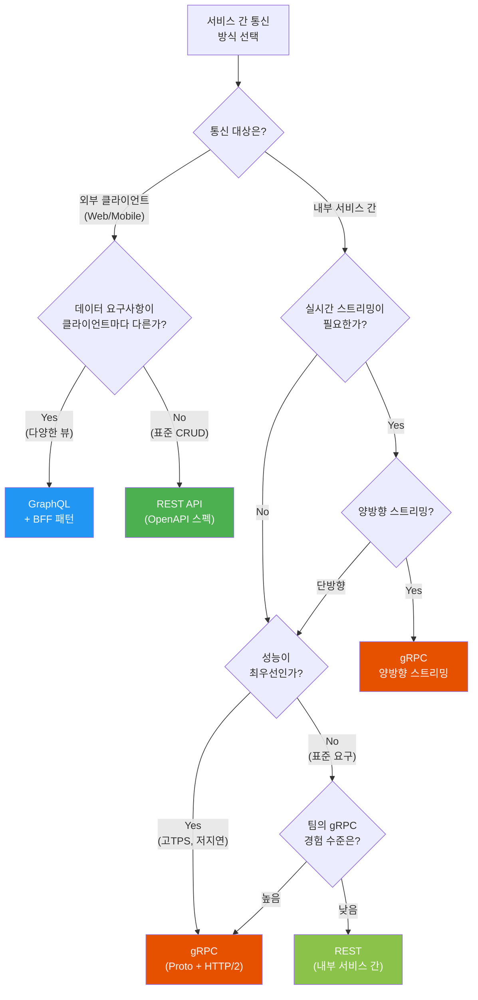

### 1.3 하이브리드 전략 (권장)

대부분의 프로덕션 환경에서는 단일 통신 방식이 아닌 하이브리드 전략을 채택한다.

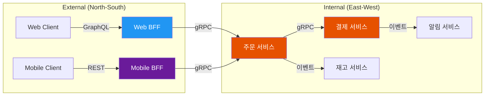

| 계층 | 프로토콜 | 이유 |
|------|---------|------|
| 외부 -> BFF | REST / GraphQL | 브라우저 호환, 개발자 친화적 |
| BFF -> 서비스 | gRPC | 고성능, 타입 안전성 |
| 서비스 -> 서비스 (동기) | gRPC | 저지연, 스트리밍 지원 |
| 서비스 -> 서비스 (비동기) | Kafka / RabbitMQ | 느슨한 결합, 탄력성 |

---

## 2. 비동기 통신

### 2.1 메시징 (Point-to-Point) vs 이벤트 (Pub/Sub)

| 비교 기준 | 메시징 (Point-to-Point) | 이벤트 (Pub/Sub) |
|-----------|------------------------|------------------|
| **모델** | 하나의 소비자만 메시지 수신 | 모든 구독자가 이벤트 수신 |
| **결합도** | 중간 (생산자가 큐를 앎) | 낮음 (생산자가 소비자를 모름) |
| **용도** | 명령/작업 위임 | 이벤트 통지, 상태 변경 알림 |
| **순서 보장** | 큐 내 FIFO 보장 | 파티션 내 보장 (Kafka) |
| **재처리** | 소비 후 삭제 (기본) | 오프셋 기반 재처리 가능 (Kafka) |
| **확장성** | 소비자 수 증가로 처리량 확장 | 독립적 소비자 그룹 추가 |
| **대표 도구** | RabbitMQ, SQS | Kafka, SNS, Pub/Sub |

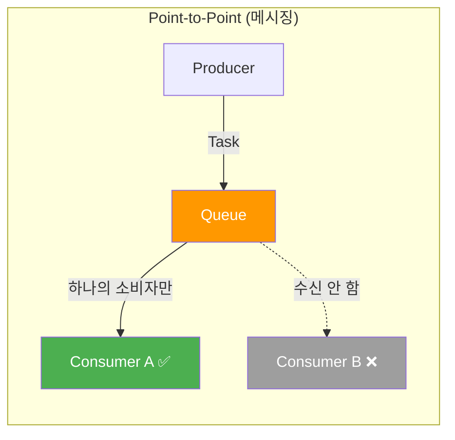

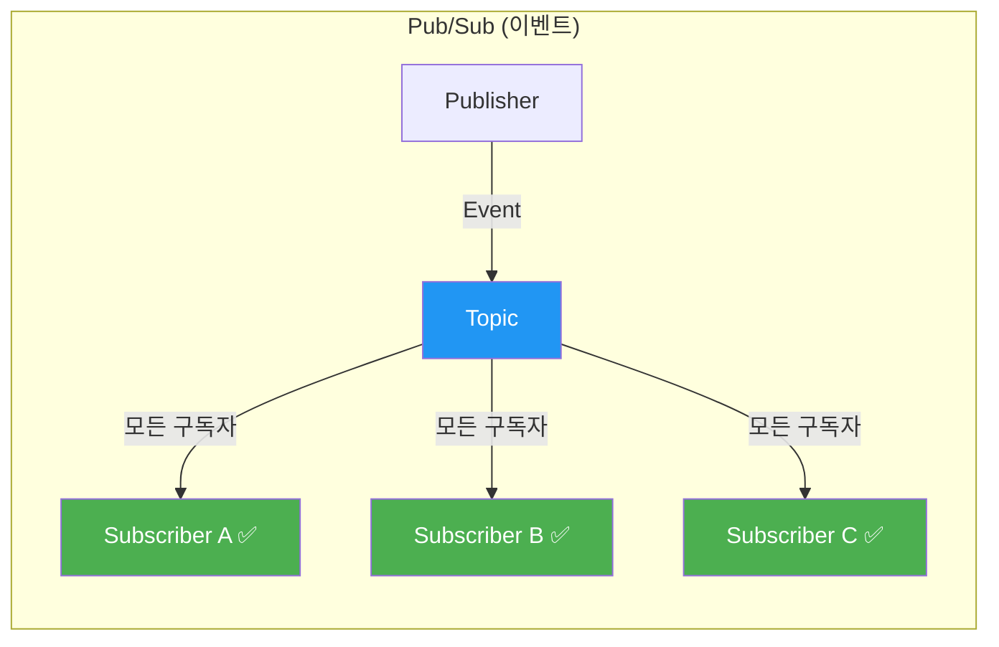

### 2.2 비동기 통신 선택 기준

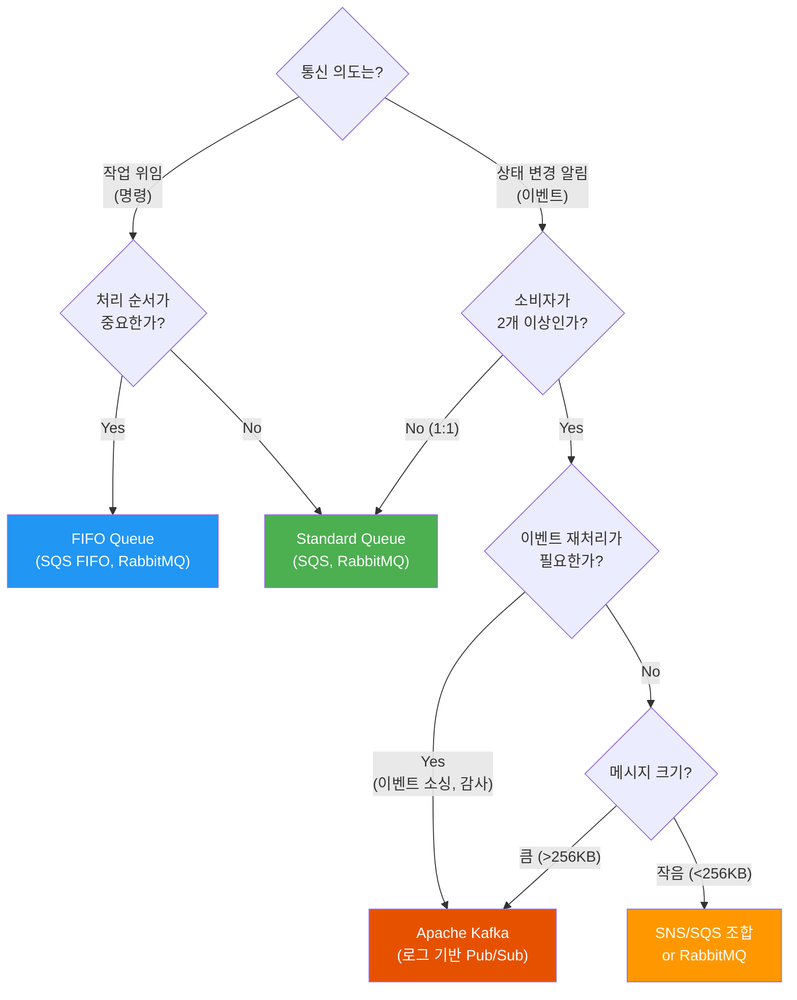

### 2.3 메시지 전달 보장 수준

| 보장 수준 | 설명 | 구현 | 적합한 상황 |
|-----------|------|------|------------|
| **At-most-once** | 최대 1회 (유실 가능) | Fire and forget, ACK 없음 | 로깅, 메트릭 (유실 허용) |
| **At-least-once** | 최소 1회 (중복 가능) | ACK 후 처리, 실패 시 재전송 | 대부분의 비즈니스 이벤트 |
| **Exactly-once** | 정확히 1회 | 멱등성 + At-least-once | 결제, 정산 (중복 불허) |

**Exactly-once 구현 패턴 (멱등성 기반):**

```python
from __future__ import annotations

from typing import Any

import asyncpg


async def process_event_exactly_once(
    conn: asyncpg.Connection,
    event_id: str,
    process_fn: Any,
    event_data: dict[str, Any],
) -> bool:
    """Achieve exactly-once semantics via idempotency check + local transaction."""
    async with conn.transaction():
        # Check if already processed
        existing = await conn.fetchval(
            "SELECT 1 FROM processed_events WHERE event_id = $1",
            event_id,
        )
        if existing:
            return False  # Already processed, skip

        # Process the event
        await process_fn(conn, event_data)

        # Mark as processed (same transaction)
        await conn.execute(
            "INSERT INTO processed_events (event_id, processed_at) VALUES ($1, NOW())",
            event_id,
        )
        return True
```

```go
package messaging

import (
	"context"
	"database/sql"
	"fmt"
)

// ProcessEventExactlyOnce ensures exactly-once semantics via idempotency check.
func ProcessEventExactlyOnce(
	ctx context.Context,
	db *sql.DB,
	eventID string,
	processFn func(ctx context.Context, tx *sql.Tx) error,
) (bool, error) {
	tx, err := db.BeginTx(ctx, nil)
	if err != nil {
		return false, fmt.Errorf("begin tx: %w", err)
	}
	defer tx.Rollback()

	// Check if already processed
	var exists bool
	err = tx.QueryRowContext(ctx,
		"SELECT EXISTS(SELECT 1 FROM processed_events WHERE event_id = $1)", eventID,
	).Scan(&exists)
	if err != nil {
		return false, fmt.Errorf("check processed: %w", err)
	}
	if exists {
		return false, nil // Already processed
	}

	// Process the event
	if err := processFn(ctx, tx); err != nil {
		return false, fmt.Errorf("process event: %w", err)
	}

	// Mark as processed
	_, err = tx.ExecContext(ctx,
		"INSERT INTO processed_events (event_id, processed_at) VALUES ($1, NOW())", eventID)
	if err != nil {
		return false, fmt.Errorf("mark processed: %w", err)
	}

	return true, tx.Commit()
}
```

---

## 3. gRPC 스타일 가이드

### 3.1 Proto 파일 컨벤션

**디렉토리 구조:**

```
proto/
  api/
    order/
      v1/
        order_service.proto    # Service definition
        order.proto            # Message types
        order_events.proto     # Event messages
    payment/
      v1/
        payment_service.proto
        payment.proto
  common/
    v1/
      pagination.proto         # Shared pagination types
      error_details.proto      # Shared error details
      money.proto              # Common domain types
```

**네이밍 규칙:**

| 대상 | 규칙 | 예시 |
|------|------|------|
| 패키지 | `{company}.{service}.v{N}` | `mycompany.order.v1` |
| 서비스 | `{Domain}Service` (PascalCase) | `OrderService` |
| RPC 메서드 | `{Verb}{Resource}` (PascalCase) | `CreateOrder`, `GetOrder` |
| 메시지 | PascalCase | `CreateOrderRequest` |
| 필드 | snake_case | `order_id`, `created_at` |
| Enum | UPPER_SNAKE_CASE | `ORDER_STATUS_PENDING` |
| Enum 0값 | `{ENUM_NAME}_UNSPECIFIED` | `ORDER_STATUS_UNSPECIFIED` |

### 3.2 Proto 파일 예시

```protobuf
syntax = "proto3";

package mycompany.order.v1;

option go_package = "github.com/mycompany/order/v1;orderv1";
option java_package = "com.mycompany.order.v1";
option java_multiple_files = true;

import "google/protobuf/timestamp.proto";
import "google/protobuf/field_mask.proto";
import "common/v1/pagination.proto";
import "common/v1/money.proto";

// OrderService provides order management operations.
service OrderService {
  // CreateOrder creates a new order.
  rpc CreateOrder(CreateOrderRequest) returns (CreateOrderResponse);

  // GetOrder retrieves an order by ID.
  rpc GetOrder(GetOrderRequest) returns (Order);

  // ListOrders lists orders with pagination and filtering.
  rpc ListOrders(ListOrdersRequest) returns (ListOrdersResponse);

  // UpdateOrder updates an existing order.
  rpc UpdateOrder(UpdateOrderRequest) returns (Order);

  // WatchOrderStatus streams order status changes.
  rpc WatchOrderStatus(WatchOrderStatusRequest) returns (stream OrderStatusEvent);
}

// Order represents an order entity.
message Order {
  string order_id = 1;
  string customer_id = 2;
  repeated OrderItem items = 3;
  OrderStatus status = 4;
  common.v1.Money total_amount = 5;
  google.protobuf.Timestamp created_at = 6;
  google.protobuf.Timestamp updated_at = 7;
}

message OrderItem {
  string product_id = 1;
  string product_name = 2;
  int32 quantity = 3;
  common.v1.Money unit_price = 4;
}

enum OrderStatus {
  ORDER_STATUS_UNSPECIFIED = 0;
  ORDER_STATUS_PENDING = 1;
  ORDER_STATUS_CONFIRMED = 2;
  ORDER_STATUS_SHIPPED = 3;
  ORDER_STATUS_DELIVERED = 4;
  ORDER_STATUS_CANCELLED = 5;
}

// --- Request/Response messages ---

message CreateOrderRequest {
  string customer_id = 1;
  repeated CreateOrderItem items = 2;
}

message CreateOrderItem {
  string product_id = 1;
  int32 quantity = 2;
}

message CreateOrderResponse {
  Order order = 1;
}

message GetOrderRequest {
  string order_id = 1;
}

message ListOrdersRequest {
  string customer_id = 1;
  OrderStatus status_filter = 2;
  common.v1.PaginationRequest pagination = 3;
}

message ListOrdersResponse {
  repeated Order orders = 1;
  common.v1.PaginationResponse pagination = 2;
}

message UpdateOrderRequest {
  Order order = 1;
  google.protobuf.FieldMask update_mask = 2;
}

message WatchOrderStatusRequest {
  string order_id = 1;
}

message OrderStatusEvent {
  string order_id = 1;
  OrderStatus previous_status = 2;
  OrderStatus current_status = 3;
  google.protobuf.Timestamp changed_at = 4;
}
```

**공통 타입 예시:**

```protobuf
// common/v1/pagination.proto
syntax = "proto3";
package common.v1;

message PaginationRequest {
  int32 page_size = 1;     // Maximum 100
  string page_token = 2;   // Cursor-based pagination
}

message PaginationResponse {
  string next_page_token = 1;
  int32 total_count = 2;
}
```

### 3.3 gRPC 에러 처리 (Status + Details)

gRPC는 `google.rpc.Status`를 표준 에러 모델로 사용한다. 추가 상세 정보는 `details` 필드에 Any 타입으로 포함한다.

| gRPC Status Code | HTTP 매핑 | 사용 상황 |
|-----------------|-----------|----------|
| `OK` | 200 | 성공 |
| `INVALID_ARGUMENT` | 400 | 입력값 오류 |
| `NOT_FOUND` | 404 | 리소스 미존재 |
| `ALREADY_EXISTS` | 409 | 중복 리소스 |
| `PERMISSION_DENIED` | 403 | 인가 실패 |
| `UNAUTHENTICATED` | 401 | 인증 실패 |
| `RESOURCE_EXHAUSTED` | 429 | Rate Limit 초과 |
| `UNAVAILABLE` | 503 | 일시적 불가 (재시도 가능) |
| `INTERNAL` | 500 | 서버 내부 오류 |
| `DEADLINE_EXCEEDED` | 504 | 타임아웃 |

**Python gRPC 에러 처리 예시:**

```python
from __future__ import annotations

from google.protobuf import any_pb2
from google.rpc import error_details_pb2, status_pb2
import grpc


def create_validation_error(
    field: str,
    description: str,
) -> grpc.StatusCode:
    """Create a rich gRPC error with validation details."""
    # Build error details
    bad_request = error_details_pb2.BadRequest()
    violation = bad_request.field_violations.add()
    violation.field = field
    violation.description = description

    # Build retry info for transient errors
    retry_info = error_details_pb2.RetryInfo()
    retry_info.retry_delay.seconds = 5

    # Pack into Status
    detail = any_pb2.Any()
    detail.Pack(bad_request)

    status = status_pb2.Status(
        code=grpc.StatusCode.INVALID_ARGUMENT.value[0],
        message=f"Invalid field: {field}",
        details=[detail],
    )
    return status


class OrderServicer(order_pb2_grpc.OrderServiceServicer):
    """gRPC service implementation with proper error handling."""

    async def GetOrder(
        self,
        request: order_pb2.GetOrderRequest,
        context: grpc.aio.ServicerContext,
    ) -> order_pb2.Order:
        if not request.order_id:
            await context.abort(
                grpc.StatusCode.INVALID_ARGUMENT,
                "order_id is required",
            )

        order = await self._repository.find_by_id(request.order_id)
        if order is None:
            await context.abort(
                grpc.StatusCode.NOT_FOUND,
                f"Order {request.order_id} not found",
            )

        return order.to_proto()

    async def CreateOrder(
        self,
        request: order_pb2.CreateOrderRequest,
        context: grpc.aio.ServicerContext,
    ) -> order_pb2.CreateOrderResponse:
        try:
            order = await self._service.create_order(request)
            return order_pb2.CreateOrderResponse(order=order.to_proto())
        except DuplicateOrderError as err:
            await context.abort(
                grpc.StatusCode.ALREADY_EXISTS,
                str(err),
            )
        except InsufficientStockError as err:
            await context.abort(
                grpc.StatusCode.FAILED_PRECONDITION,
                str(err),
            )
```

**Go gRPC 에러 처리 예시:**

```go
package server

import (
	"context"
	"fmt"

	"google.golang.org/genproto/googleapis/rpc/errdetails"
	"google.golang.org/grpc/codes"
	"google.golang.org/grpc/status"

	orderv1 "github.com/mycompany/order/v1"
)

type OrderServer struct {
	orderv1.UnimplementedOrderServiceServer
	repo OrderRepository
}

func (s *OrderServer) GetOrder(
	ctx context.Context,
	req *orderv1.GetOrderRequest,
) (*orderv1.Order, error) {
	if req.OrderId == "" {
		st := status.New(codes.InvalidArgument, "order_id is required")
		br := &errdetails.BadRequest{}
		v := &errdetails.BadRequest_FieldViolation{
			Field:       "order_id",
			Description: "must not be empty",
		}
		br.FieldViolations = append(br.FieldViolations, v)
		st, _ = st.WithDetails(br)
		return nil, st.Err()
	}

	order, err := s.repo.FindByID(ctx, req.OrderId)
	if err != nil {
		return nil, status.Errorf(codes.Internal, "failed to fetch order: %v", err)
	}
	if order == nil {
		return nil, status.Errorf(codes.NotFound, "order %s not found", req.OrderId)
	}

	return order.ToProto(), nil
}

func (s *OrderServer) CreateOrder(
	ctx context.Context,
	req *orderv1.CreateOrderRequest,
) (*orderv1.CreateOrderResponse, error) {
	order, err := s.service.CreateOrder(ctx, req)
	if err != nil {
		switch {
		case isDuplicateError(err):
			return nil, status.Errorf(codes.AlreadyExists, "order already exists: %v", err)
		case isInsufficientStockError(err):
			return nil, status.Errorf(codes.FailedPrecondition, "insufficient stock: %v", err)
		default:
			return nil, status.Errorf(codes.Internal, "create order failed: %v", err)
		}
	}
	return &orderv1.CreateOrderResponse{Order: order.ToProto()}, nil
}
```

**Kotlin gRPC 에러 처리 예시:**

```kotlin
import io.grpc.Status
import io.grpc.StatusException
import io.grpc.protobuf.StatusProto
import com.google.rpc.BadRequest

class OrderService(
    private val repository: OrderRepository,
) : OrderServiceGrpcKt.OrderServiceCoroutineImplBase() {

    override suspend fun getOrder(request: GetOrderRequest): Order {
        if (request.orderId.isBlank()) {
            val badRequest = BadRequest.newBuilder()
                .addFieldViolations(
                    BadRequest.FieldViolation.newBuilder()
                        .setField("order_id")
                        .setDescription("must not be empty")
                )
                .build()
            val status = com.google.rpc.Status.newBuilder()
                .setCode(Status.Code.INVALID_ARGUMENT.value())
                .setMessage("order_id is required")
                .addDetails(com.google.protobuf.Any.pack(badRequest))
                .build()
            throw StatusProto.toStatusRuntimeException(status)
        }

        val order = repository.findById(request.orderId)
            ?: throw Status.NOT_FOUND
                .withDescription("Order ${request.orderId} not found")
                .asRuntimeException()

        return order.toProto()
    }
}
```

### 3.4 gRPC 스트리밍 패턴

| 패턴 | 방향 | 사용 사례 |
|------|------|----------|
| **Unary** | 요청 1 -> 응답 1 | 일반 CRUD |
| **Server Streaming** | 요청 1 -> 응답 N | 대용량 목록 조회, 실시간 알림 |
| **Client Streaming** | 요청 N -> 응답 1 | 파일 업로드, 배치 데이터 전송 |
| **Bidirectional Streaming** | 요청 N <-> 응답 N | 채팅, 실시간 위치 추적 |

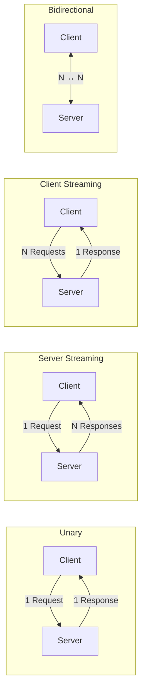

**Go Server Streaming 예시:**

```go
func (s *OrderServer) WatchOrderStatus(
	req *orderv1.WatchOrderStatusRequest,
	stream orderv1.OrderService_WatchOrderStatusServer,
) error {
	ctx := stream.Context()
	ch, err := s.eventBus.Subscribe(ctx, "order.status."+req.OrderId)
	if err != nil {
		return status.Errorf(codes.Internal, "subscribe failed: %v", err)
	}
	defer s.eventBus.Unsubscribe(ch)

	for {
		select {
		case <-ctx.Done():
			return ctx.Err()
		case event, ok := <-ch:
			if !ok {
				return nil
			}
			if err := stream.Send(event.ToProto()); err != nil {
				return err
			}
		}
	}
}
```

### 3.5 gRPC 서비스 정의 규칙

| 규칙 | 설명 |
|------|------|
| **Request/Response 메시지 분리** | 모든 RPC는 전용 Request/Response 메시지를 가진다 (primitive 직접 사용 금지) |
| **Enum 0값은 UNSPECIFIED** | 항상 0번째 값을 `_UNSPECIFIED`로 지정 |
| **FieldMask 사용** | 부분 업데이트 시 `google.protobuf.FieldMask` 활용 |
| **필드 번호 보존** | 삭제된 필드의 번호는 `reserved`로 표시 |
| **하위 호환성** | 필드 추가는 자유, 필드 삭제/타입 변경 금지 |
| **페이지네이션 표준** | `page_size` + `page_token` 커서 기반 |
| **Timestamp 표준** | `google.protobuf.Timestamp` 사용 (unix epoch 금지) |

---

## 4. Service Mesh

### 4.1 Service Mesh란?

서비스 간 통신을 관리하는 인프라 레이어다. 각 서비스 옆에 사이드카 프록시를 배치하여 트래픽 관리, 보안, 관찰가능성을 애플리케이션 코드 변경 없이 제공한다.

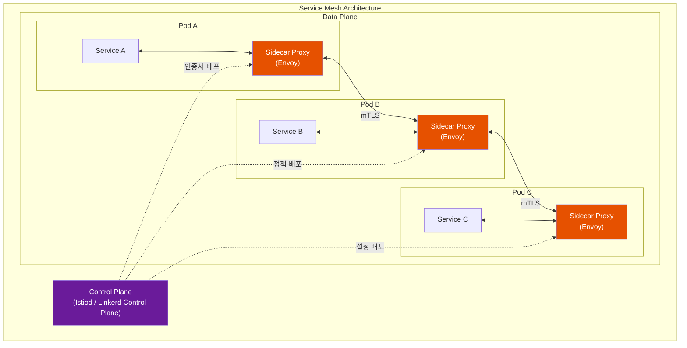

### 4.2 Istio vs Linkerd 비교

| 비교 기준 | Istio | Linkerd |
|-----------|-------|---------|
| **프록시** | Envoy (C++) | linkerd2-proxy (Rust) |
| **리소스 사용량** | 높음 (~50MB/sidecar) | 낮음 (~10MB/sidecar) |
| **지연 추가** | ~2-5ms | ~1ms |
| **학습 곡선** | 높음 (기능 풍부) | 낮음 (단순 명료) |
| **기능 범위** | 매우 넓음 (Traffic, Security, Observability) | 핵심 기능 집중 |
| **mTLS** | 자동 (SPIFFE 기반) | 자동 (SPIFFE 기반) |
| **트래픽 분할** | 정밀 (Header/Weight/Cookie) | 기본 (Weight 기반) |
| **Multi-cluster** | 지원 | 지원 (더 간편) |
| **프로토콜 지원** | HTTP, gRPC, TCP, WebSocket | HTTP, gRPC, TCP |
| **K8s CNI 통합** | Ambient Mesh (sidecarless 옵션) | 없음 |
| **적합한 상황** | 대규모 조직, 복잡한 트래픽 정책 | 중소 규모, 빠른 도입 |

### 4.3 mTLS (Mutual TLS)

Service Mesh는 서비스 간 모든 통신을 자동으로 mTLS로 암호화한다.

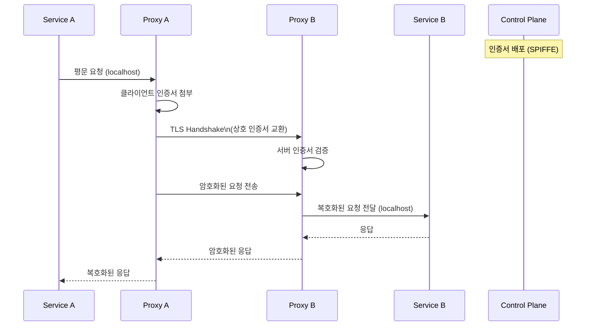

### 4.4 트래픽 관리

**Istio VirtualService 예시 (Canary 배포):**

```yaml
apiVersion: networking.istio.io/v1beta1
kind: VirtualService
metadata:
  name: order-service
spec:
  hosts:
    - order-service
  http:
    # Canary: 10% traffic to v2
    - match:
        - headers:
            x-canary:
              exact: "true"
      route:
        - destination:
            host: order-service
            subset: v2
    - route:
        - destination:
            host: order-service
            subset: v1
          weight: 90
        - destination:
            host: order-service
            subset: v2
          weight: 10
---
apiVersion: networking.istio.io/v1beta1
kind: DestinationRule
metadata:
  name: order-service
spec:
  host: order-service
  trafficPolicy:
    connectionPool:
      tcp:
        maxConnections: 100
      http:
        h2UpgradePolicy: UPGRADE
        maxRequestsPerConnection: 10
    outlierDetection:
      consecutive5xxErrors: 5
      interval: 30s
      baseEjectionTime: 30s
      maxEjectionPercent: 50
  subsets:
    - name: v1
      labels:
        version: v1
    - name: v2
      labels:
        version: v2
```

### 4.5 관찰가능성

Service Mesh가 자동으로 수집하는 텔레메트리:

| 유형 | 수집 내용 | 도구 |
|------|----------|------|
| **메트릭** | RPS, 지연 분포, 에러율 (4 Golden Signals) | Prometheus + Grafana |
| **분산 추적** | 서비스 간 요청 흐름, 지연 병목 | Jaeger, Zipkin, Tempo |
| **서비스 그래프** | 서비스 간 의존성 시각화 | Kiali (Istio), Linkerd Dashboard |
| **액세스 로그** | 요청/응답 상세 (선택적) | ELK, Loki |

---

## 5. 복원력 패턴 통합

### 5.1 패턴 조합 전략

개별 복원력 패턴은 단독으로 사용하기보다 **조합**하여 사용해야 효과적이다. 조합 순서가 중요하다.

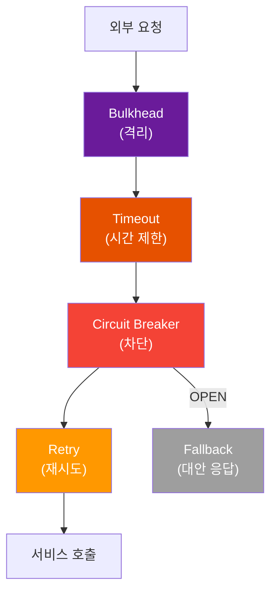

**적용 순서 (바깥 -> 안쪽):**

| 순서 | 패턴 | 역할 |
|------|------|------|
| 1 | **Bulkhead** | 리소스 격리 -- 한 서비스 장애가 다른 서비스에 전파되지 않도록 |
| 2 | **Timeout** | 최대 대기 시간 -- 무한 대기 방지 |
| 3 | **Circuit Breaker** | 장애 서비스 차단 -- 반복 실패 시 빠른 실패 |
| 4 | **Retry** | 일시적 오류 재시도 -- Circuit Breaker 안에서만 재시도 |

### 5.2 통합 구현

#### Python

```python
from __future__ import annotations

import asyncio
from dataclasses import dataclass
from typing import Any, Callable, Awaitable


@dataclass(frozen=True)
class ResilienceConfig:
    """Combined resilience configuration."""
    # Bulkhead
    max_concurrent_calls: int = 25
    max_wait_ms: int = 500

    # Timeout
    timeout_ms: int = 3000

    # Circuit Breaker
    failure_rate_threshold: float = 0.5
    minimum_calls: int = 10
    wait_duration_open_ms: int = 30000

    # Retry
    max_retries: int = 3
    initial_backoff_ms: int = 100
    max_backoff_ms: int = 2000
    retry_on_exceptions: tuple[type[Exception], ...] = (TimeoutError, ConnectionError)


class ResilientServiceCall:
    """Combines Bulkhead + Timeout + Circuit Breaker + Retry."""

    def __init__(self, config: ResilienceConfig) -> None:
        self._config = config
        self._semaphore = asyncio.Semaphore(config.max_concurrent_calls)
        self._circuit_breaker = CircuitBreaker(
            failure_rate_threshold=config.failure_rate_threshold,
            minimum_calls=config.minimum_calls,
            wait_duration_ms=config.wait_duration_open_ms,
        )

    async def execute(
        self,
        call: Callable[..., Awaitable[Any]],
        fallback: Callable[..., Awaitable[Any]] | None = None,
        **kwargs: Any,
    ) -> Any:
        # Layer 1: Bulkhead
        try:
            await asyncio.wait_for(
                self._semaphore.acquire(),
                timeout=self._config.max_wait_ms / 1000,
            )
        except asyncio.TimeoutError as err:
            raise BulkheadFullError("Bulkhead capacity exceeded") from err

        try:
            # Layer 2: Circuit Breaker
            if self._circuit_breaker.is_open():
                if fallback:
                    return await fallback(**kwargs)
                raise CircuitOpenError("Circuit breaker is open")

            # Layer 3: Retry
            last_error: Exception | None = None
            backoff_ms = self._config.initial_backoff_ms

            for attempt in range(self._config.max_retries + 1):
                try:
                    # Layer 4: Timeout
                    result = await asyncio.wait_for(
                        call(**kwargs),
                        timeout=self._config.timeout_ms / 1000,
                    )
                    self._circuit_breaker.record_success()
                    return result

                except self._config.retry_on_exceptions as err:
                    last_error = err
                    self._circuit_breaker.record_failure()
                    if attempt < self._config.max_retries:
                        await asyncio.sleep(backoff_ms / 1000)
                        backoff_ms = min(backoff_ms * 2, self._config.max_backoff_ms)
                except Exception as err:
                    self._circuit_breaker.record_failure()
                    raise

            if fallback:
                return await fallback(**kwargs)
            raise last_error  # type: ignore[misc]
        finally:
            self._semaphore.release()
```

#### Kotlin

```kotlin
import kotlinx.coroutines.*
import kotlinx.coroutines.sync.Semaphore
import kotlinx.coroutines.sync.withPermit

data class ResilienceConfig(
    val maxConcurrentCalls: Int = 25,
    val maxWaitMs: Long = 500,
    val timeoutMs: Long = 3000,
    val failureRateThreshold: Double = 0.5,
    val minimumCalls: Int = 10,
    val waitDurationOpenMs: Long = 30000,
    val maxRetries: Int = 3,
    val initialBackoffMs: Long = 100,
    val maxBackoffMs: Long = 2000,
)

class ResilientServiceCall(private val config: ResilienceConfig) {

    private val semaphore = Semaphore(config.maxConcurrentCalls)
    private val circuitBreaker = CircuitBreaker(
        failureRateThreshold = config.failureRateThreshold,
        minimumCalls = config.minimumCalls,
        waitDurationMs = config.waitDurationOpenMs,
    )

    suspend fun <T> execute(
        call: suspend () -> T,
        fallback: (suspend () -> T)? = null,
    ): T {
        // Layer 1: Bulkhead
        val acquired = withTimeoutOrNull(config.maxWaitMs) {
            semaphore.acquire()
            true
        } ?: throw BulkheadFullException("Bulkhead capacity exceeded")

        try {
            // Layer 2: Circuit Breaker
            if (circuitBreaker.isOpen()) {
                return fallback?.invoke()
                    ?: throw CircuitOpenException("Circuit breaker is open")
            }

            // Layer 3: Retry
            var lastError: Exception? = null
            var backoffMs = config.initialBackoffMs

            repeat(config.maxRetries + 1) { attempt ->
                try {
                    // Layer 4: Timeout
                    val result = withTimeout(config.timeoutMs) { call() }
                    circuitBreaker.recordSuccess()
                    return result
                } catch (e: TimeoutCancellationException) {
                    lastError = e
                    circuitBreaker.recordFailure()
                    if (attempt < config.maxRetries) {
                        delay(backoffMs)
                        backoffMs = (backoffMs * 2).coerceAtMost(config.maxBackoffMs)
                    }
                }
            }

            return fallback?.invoke() ?: throw lastError!!
        } finally {
            semaphore.release()
        }
    }
}
```

#### Go

```go
package resilience

import (
	"context"
	"fmt"
	"math"
	"time"

	"golang.org/x/sync/semaphore"
)

type Config struct {
	MaxConcurrentCalls int
	MaxWait            time.Duration
	Timeout            time.Duration
	MaxRetries         int
	InitialBackoff     time.Duration
	MaxBackoff         time.Duration
}

func DefaultConfig() Config {
	return Config{
		MaxConcurrentCalls: 25,
		MaxWait:            500 * time.Millisecond,
		Timeout:            3 * time.Second,
		MaxRetries:         3,
		InitialBackoff:     100 * time.Millisecond,
		MaxBackoff:         2 * time.Second,
	}
}

type ResilientCall struct {
	config  Config
	sem     *semaphore.Weighted
	breaker *CircuitBreaker
}

func NewResilientCall(config Config, breaker *CircuitBreaker) *ResilientCall {
	return &ResilientCall{
		config:  config,
		sem:     semaphore.NewWeighted(int64(config.MaxConcurrentCalls)),
		breaker: breaker,
	}
}

func (r *ResilientCall) Execute(
	ctx context.Context,
	call func(ctx context.Context) (any, error),
	fallback func(ctx context.Context) (any, error),
) (any, error) {
	// Layer 1: Bulkhead
	waitCtx, cancel := context.WithTimeout(ctx, r.config.MaxWait)
	defer cancel()
	if err := r.sem.Acquire(waitCtx, 1); err != nil {
		return nil, fmt.Errorf("bulkhead full: %w", err)
	}
	defer r.sem.Release(1)

	// Layer 2: Circuit Breaker
	if r.breaker.IsOpen() {
		if fallback != nil {
			return fallback(ctx)
		}
		return nil, fmt.Errorf("circuit breaker is open")
	}

	// Layer 3: Retry
	var lastErr error
	backoff := r.config.InitialBackoff

	for attempt := 0; attempt <= r.config.MaxRetries; attempt++ {
		// Layer 4: Timeout
		timeoutCtx, timeoutCancel := context.WithTimeout(ctx, r.config.Timeout)
		result, err := call(timeoutCtx)
		timeoutCancel()

		if err == nil {
			r.breaker.RecordSuccess()
			return result, nil
		}

		lastErr = err
		r.breaker.RecordFailure()

		if attempt < r.config.MaxRetries {
			select {
			case <-ctx.Done():
				return nil, ctx.Err()
			case <-time.After(backoff):
			}
			backoff = time.Duration(math.Min(
				float64(backoff)*2,
				float64(r.config.MaxBackoff),
			))
		}
	}

	if fallback != nil {
		return fallback(ctx)
	}
	return nil, lastErr
}
```

### 5.3 에러 핸들링 가이드 연계

복원력 패턴은 [에러 처리 및 복원력 패턴 가이드](./error-handling-guide.md)와 함께 사용한다.

| 이 문서의 범위 | 에러 핸들링 가이드 범위 |
|---------------|---------------------|
| 서비스 간 통신에서의 패턴 **조합** | 각 패턴의 **상세 구현** |
| 통신 레이어 적용 전략 | 에러 분류, 응답 표준, 언어별 구현 |
| Service Mesh와의 연계 | Circuit Breaker 상태 관리 상세 |

---

## 6. 서비스 디스커버리

### 6.1 개요

서비스 디스커버리는 분산 시스템에서 서비스 인스턴스의 네트워크 위치(IP:Port)를 동적으로 찾는 메커니즘이다.

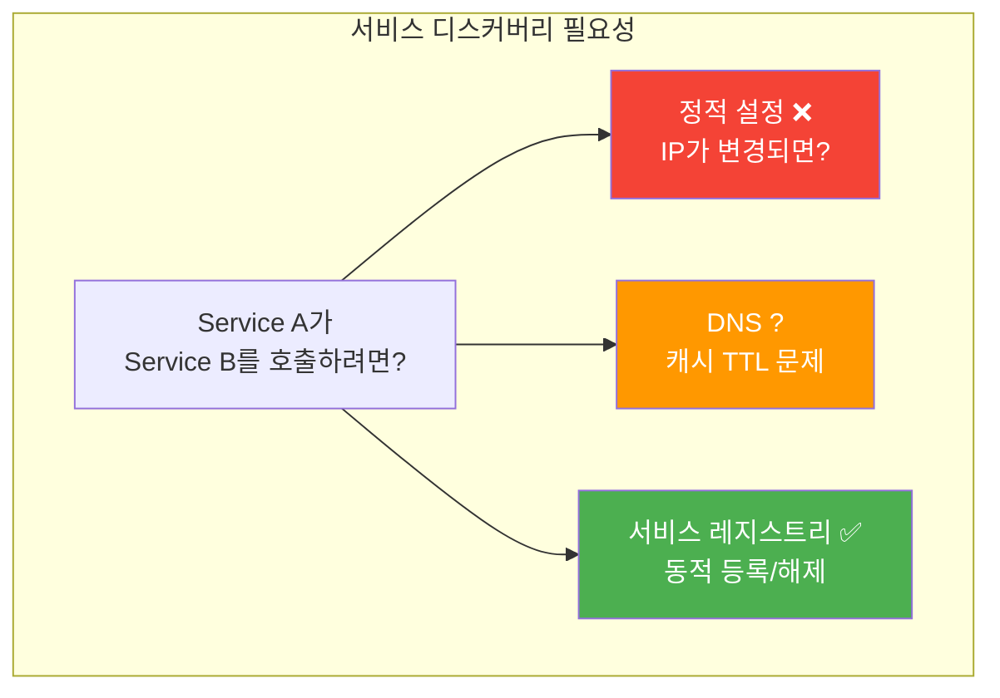

### 6.2 방식 비교

| 방식 | 동작 원리 | 장점 | 단점 |
|------|----------|------|------|
| **DNS 기반** | DNS SRV/A 레코드로 서비스 위치 해석 | 범용, 인프라 변경 불필요 | TTL 캐시로 인한 지연, 헬스체크 미지원 |
| **Consul** | 에이전트 기반 서비스 등록 + 헬스체크 | 멀티 데이터센터, KV 스토어, 헬스체크 | 별도 인프라 운영 필요 |
| **K8s Service** | kube-proxy + CoreDNS | K8s 네이티브, 추가 설치 불필요 | K8s 외부 서비스 연동 제한 |
| **etcd / ZooKeeper** | 분산 KV 스토어 기반 | 강한 일관성 | 직접 디스커버리 로직 구현 필요 |
| **Service Mesh** | Sidecar 프록시가 자동 처리 | 투명한 디스커버리, 로드밸런싱 포함 | Mesh 인프라 필수 |

### 6.3 클라이언트 사이드 vs 서버 사이드

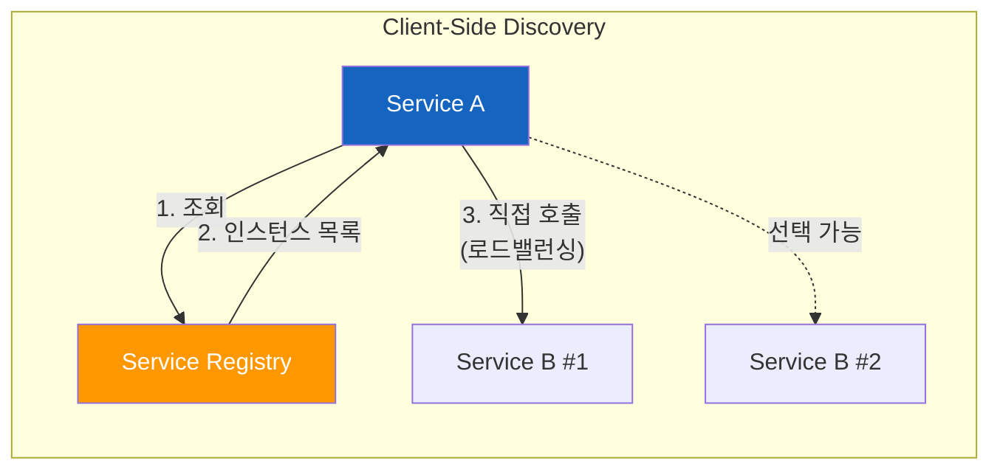

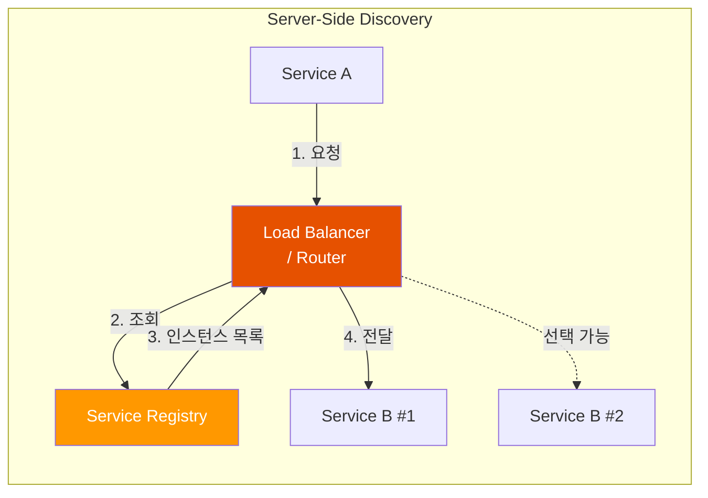

| 비교 기준 | Client-Side | Server-Side |
|-----------|------------|-------------|
| **로드밸런싱** | 클라이언트 라이브러리 | LB/Router |
| **클라이언트 복잡도** | 높음 (디스커버리 로직 포함) | 낮음 (LB 주소만 알면 됨) |
| **네트워크 홉** | 1홉 (직접 호출) | 2홉 (LB 경유) |
| **장애 격리** | 클라이언트마다 독립 판단 | LB가 중앙에서 관리 |
| **대표 구현** | Netflix Eureka + Ribbon | K8s Service, AWS ALB |

### 6.4 Kubernetes 서비스 디스커버리

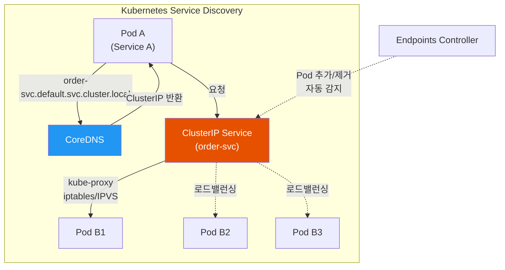

**K8s Service 유형:**

| 유형 | 용도 | 접근 범위 |
|------|------|----------|
| `ClusterIP` | 클러스터 내부 통신 (기본) | 클러스터 내부만 |
| `NodePort` | 외부에서 노드 포트로 접근 | 노드 IP:포트 |
| `LoadBalancer` | 클라우드 LB 자동 프로비저닝 | 외부 IP |
| `Headless` (`clusterIP: None`) | DNS로 개별 Pod IP 반환 | StatefulSet, gRPC 로드밸런싱 |

**gRPC + Headless Service (중요):**

gRPC는 HTTP/2 연결을 재사용하므로 일반 `ClusterIP`를 사용하면 하나의 Pod에만 요청이 집중된다. Headless Service + 클라이언트 사이드 로드밸런싱이 필요하다.

```yaml
# Headless service for gRPC load balancing
apiVersion: v1
kind: Service
metadata:
  name: order-svc-headless
spec:
  clusterIP: None  # Headless
  selector:
    app: order-service
  ports:
    - port: 50051
      targetPort: 50051
      protocol: TCP
```

```go
// Go gRPC client with client-side load balancing
import (
	"google.golang.org/grpc"
	"google.golang.org/grpc/credentials/insecure"
	_ "google.golang.org/grpc/xds" // Register xDS resolver
)

func newOrderClient() (*grpc.ClientConn, error) {
	return grpc.NewClient(
		"dns:///order-svc-headless.default.svc.cluster.local:50051",
		grpc.WithDefaultServiceConfig(`{"loadBalancingPolicy":"round_robin"}`),
		grpc.WithTransportCredentials(insecure.NewCredentials()),
	)
}
```

---

## 7. 통신 안티패턴

### 7.1 동기 호출 체인 (Synchronous Chain)

한 서비스의 응답이 다음 서비스 호출에 의존하는 깊은 동기 체인은 전체 지연을 누적시키고, 체인 중 하나라도 실패하면 전체가 실패한다.


**총 지연: 100 + 200 + 150 + 300 = 750ms** (최소). 어느 하나라도 느려지면 기하급수적으로 증가한다.

| 안티패턴 | 문제 | 올바른 접근 |
|----------|------|------------|
| 4단계 이상 동기 체인 | 누적 지연, 연쇄 장애 | 비동기 이벤트로 분리, API 조합 패턴 |
| 동기 호출 내 동기 호출 | 타임아웃 누적, 리소스 고갈 | 병렬 호출 (Promise.all / coroutineScope) |
| 동기 호출에 서킷브레이커 없음 | 장애 전파 | 모든 동기 호출에 서킷브레이커 필수 |

**올바른 접근 -- 병렬 호출:**

```python
from __future__ import annotations

import asyncio


async def get_order_details(order_id: str) -> OrderDetails:
    """Parallel service calls instead of sequential chain."""
    order, payment, shipping = await asyncio.gather(
        order_client.get_order(order_id),
        payment_client.get_payment(order_id),
        shipping_client.get_shipping(order_id),
    )
    return OrderDetails(order=order, payment=payment, shipping=shipping)
```

```go
func getOrderDetails(ctx context.Context, orderID string) (*OrderDetails, error) {
	g, ctx := errgroup.WithContext(ctx)

	var order *Order
	var payment *Payment
	var shipping *Shipping

	g.Go(func() error {
		var err error
		order, err = orderClient.GetOrder(ctx, orderID)
		return err
	})
	g.Go(func() error {
		var err error
		payment, err = paymentClient.GetPayment(ctx, orderID)
		return err
	})
	g.Go(func() error {
		var err error
		shipping, err = shippingClient.GetShipping(ctx, orderID)
		return err
	})

	if err := g.Wait(); err != nil {
		return nil, err
	}
	return &OrderDetails{Order: order, Payment: payment, Shipping: shipping}, nil
}
```

### 7.2 Chatty 통신

한 번의 비즈니스 작업을 위해 다수의 작은 호출을 수행하는 패턴이다. 네트워크 오버헤드가 누적된다.

| 안티패턴 | 예시 | 올바른 접근 |
|----------|------|------------|
| N+1 API 호출 | 주문 목록 조회 후 각 주문의 상세를 개별 호출 | 배치 API (`/orders?ids=1,2,3`) |
| 필드별 개별 호출 | 이름 조회, 이메일 조회, 주소 조회를 별도 API | 하나의 통합 API (`/users/123`) |
| 반복적 인증 토큰 교환 | 매 요청마다 토큰 교환 | 토큰 캐싱 + 만료 시에만 갱신 |

```python
from __future__ import annotations

# WRONG: Chatty - N+1 calls
async def get_orders_with_products_chatty(order_ids: list[str]) -> list[OrderWithProduct]:
    results = []
    for order_id in order_ids:
        order = await order_client.get_order(order_id)          # N calls
        product = await product_client.get_product(order.product_id)  # N calls
        results.append(OrderWithProduct(order=order, product=product))
    return results  # 2N network round trips!

# CORRECT: Batch API
async def get_orders_with_products_batch(order_ids: list[str]) -> list[OrderWithProduct]:
    orders = await order_client.get_orders_batch(order_ids)     # 1 call
    product_ids = [o.product_id for o in orders]
    products = await product_client.get_products_batch(product_ids)  # 1 call
    product_map = {p.id: p for p in products}
    return [
        OrderWithProduct(order=o, product=product_map[o.product_id])
        for o in orders
    ]  # 2 network round trips total
```

### 7.3 불안정한 계약 (Unstable Contract)

| 안티패턴 | 문제 | 올바른 접근 |
|----------|------|------------|
| API 스키마 없이 통신 | 필드 변경 시 소비자 장애 | Proto/OpenAPI 스키마 필수 |
| 하위 호환성 무시 | 필드 제거/타입 변경으로 소비자 깨짐 | 필드 추가만 허용, deprecated 표시 |
| 스키마 레지스트리 미사용 | 스키마 버전 관리 불가 | Confluent Schema Registry 사용 |
| Consumer-Driven Contract 없음 | 소비자 요구사항 무시 | Pact 등 CDC 테스트 도입 |

```protobuf
// WRONG: Breaking change -- field type changed
message Order {
  string order_id = 1;
  // Was: string total_amount = 5;
  // Changed to: double total_amount = 5;  // BREAKS existing clients!
}

// CORRECT: Backward compatible evolution
message Order {
  string order_id = 1;
  string total_amount = 5 [deprecated = true];  // Keep old field
  Money total = 8;  // Add new field with new number
  reserved 6, 7;    // Reserve deleted field numbers
}
```

### 7.4 타임아웃 전파 미흡

상위 서비스의 타임아웃이 하위 서비스에 전파되지 않으면, 상위가 이미 타임아웃되었는데 하위 서비스는 계속 처리하여 리소스를 낭비한다.

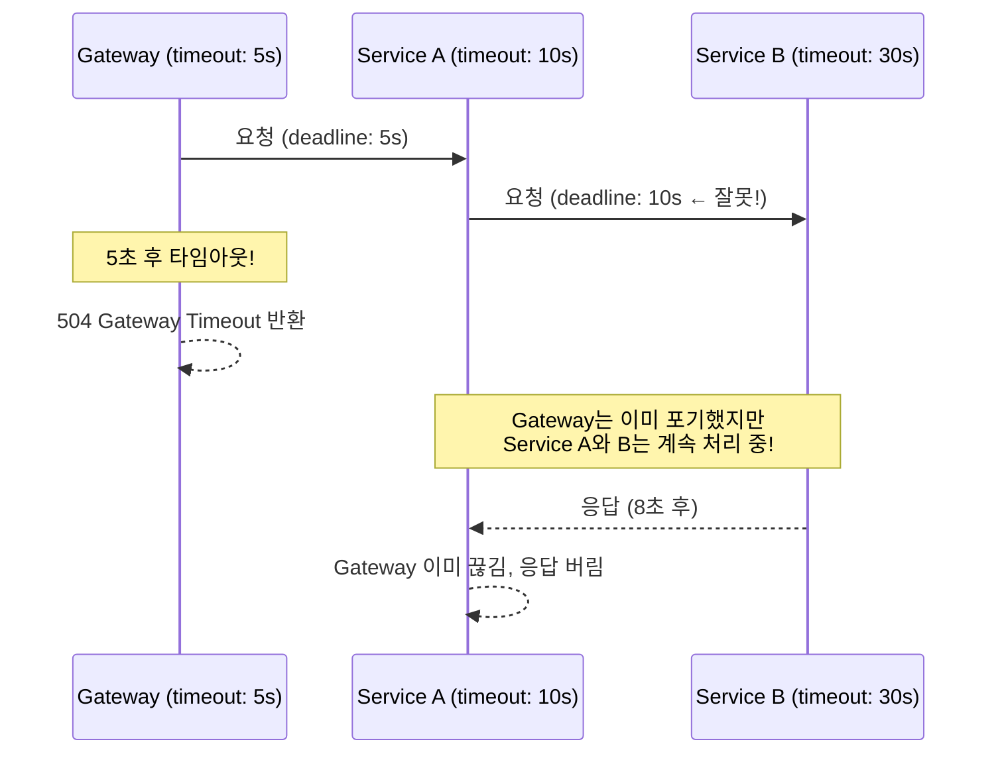

**올바른 접근 -- Deadline 전파:**

```go
// Go: Propagate deadline through context
func (s *ServiceA) HandleRequest(ctx context.Context, req *Request) (*Response, error) {
	// Context already has deadline from upstream (gRPC propagates automatically)
	deadline, ok := ctx.Deadline()
	if !ok {
		// Set default deadline if none exists
		var cancel context.CancelFunc
		ctx, cancel = context.WithTimeout(ctx, 5*time.Second)
		defer cancel()
	}

	// Downstream call inherits the deadline
	// If upstream has 3s remaining, downstream also has max 3s
	result, err := s.serviceB.Process(ctx, req)
	if err != nil {
		return nil, err
	}
	return result, nil
}
```

```python
from __future__ import annotations

import grpc


async def handle_request(
    request: Any,
    context: grpc.aio.ServicerContext,
) -> Any:
    """Propagate deadline to downstream calls."""
    # Get remaining time from incoming context
    remaining = context.time_remaining()

    if remaining is not None and remaining > 0:
        # Create downstream context with remaining deadline
        deadline = context.deadline()
        metadata = (("grpc-timeout", f"{int(remaining * 1000)}m"),)
        response = await downstream_stub.Process(
            request,
            timeout=remaining - 0.1,  # Small buffer for processing
            metadata=metadata,
        )
        return response
```

---

## 8. 체크리스트

### 8.1 통신 방식 선택 체크리스트

- [ ] 외부 API는 REST/GraphQL, 내부 통신은 gRPC를 기본으로 하고 있는가?
- [ ] 동기/비동기 선택 근거가 문서화되어 있는가?
- [ ] 비동기 통신에서 메시지 전달 보장 수준이 정의되어 있는가? (at-least-once + 멱등성)
- [ ] 3단계 이상의 동기 호출 체인이 없는가?

### 8.2 gRPC 체크리스트

- [ ] Proto 파일이 버전 관리되고 있는가? (패키지에 `v1`, `v2` 포함)
- [ ] 모든 Enum의 0값이 `_UNSPECIFIED`인가?
- [ ] 삭제된 필드 번호가 `reserved`로 표시되어 있는가?
- [ ] gRPC 에러가 적절한 Status Code + Details로 반환되는가?
- [ ] Deadline이 상위에서 하위로 전파되고 있는가?
- [ ] gRPC + K8s 환경에서 Headless Service를 사용하고 있는가?
- [ ] Proto 파일 lint(buf lint)가 CI에 포함되어 있는가?

### 8.3 Service Mesh 체크리스트

- [ ] mTLS가 모든 서비스 간 통신에 적용되어 있는가?
- [ ] 트래픽 분할(Canary) 정책이 정의되어 있는가?
- [ ] Outlier Detection이 설정되어 있는가?
- [ ] Service Mesh 메트릭(4 Golden Signals)이 수집되고 있는가?
- [ ] 분산 추적이 전 서비스에 걸쳐 동작하는가?

### 8.4 복원력 체크리스트

- [ ] 모든 외부 서비스 호출에 타임아웃이 설정되어 있는가?
- [ ] Circuit Breaker가 각 외부 서비스별로 설정되어 있는가?
- [ ] Bulkhead로 서비스 호출이 격리되어 있는가?
- [ ] 재시도 전략이 지수 백오프 + 최대 횟수로 설정되어 있는가?
- [ ] Fallback 응답이 정의되어 있는가?
- [ ] 복원력 패턴 적용 순서가 Bulkhead > Timeout > Circuit Breaker > Retry인가?

### 8.5 서비스 디스커버리 체크리스트

- [ ] 서비스 주소가 하드코딩되어 있지 않은가?
- [ ] 서비스 헬스체크가 등록되어 있는가?
- [ ] 불건전 인스턴스가 자동으로 제거되는가?
- [ ] DNS TTL이 적절하게 설정되어 있는가?
- [ ] gRPC 서비스에서 클라이언트 사이드 로드밸런싱이 적용되어 있는가?

### 8.6 계약 안정성 체크리스트

- [ ] 모든 서비스 간 통신에 스키마(Proto/OpenAPI)가 정의되어 있는가?
- [ ] 스키마 변경이 하위 호환되는가?
- [ ] 스키마 변경 시 CI에서 호환성 검사가 수행되는가?
- [ ] Consumer-Driven Contract 테스트가 존재하는가?
- [ ] 이벤트 스키마가 Schema Registry에 등록되어 있는가?

---

> **관련 문서:**
> - [마이크로서비스 아키텍처 가이드](./microservice-architecture-guide.md) -- 서비스 분해, 데이터 소유권
> - [API Gateway 설계 가이드](./api-gateway-guide.md) -- Gateway, BFF, 라우팅
> - [에러 처리 및 복원력 패턴 가이드](./error-handling-guide.md) -- Circuit Breaker, Retry, Timeout 상세
> - [분산 트랜잭션 가이드](./distributed-transaction-guide.md) -- Saga, Outbox, 보상 트랜잭션
> - [이벤트 드리븐 아키텍처 가이드](./event-driven-architecture-guide.md) -- Kafka, Event Sourcing, CQRS
> - [REST API 설계 가이드](./rest-api-design-guide.md) -- REST API 설계 표준
