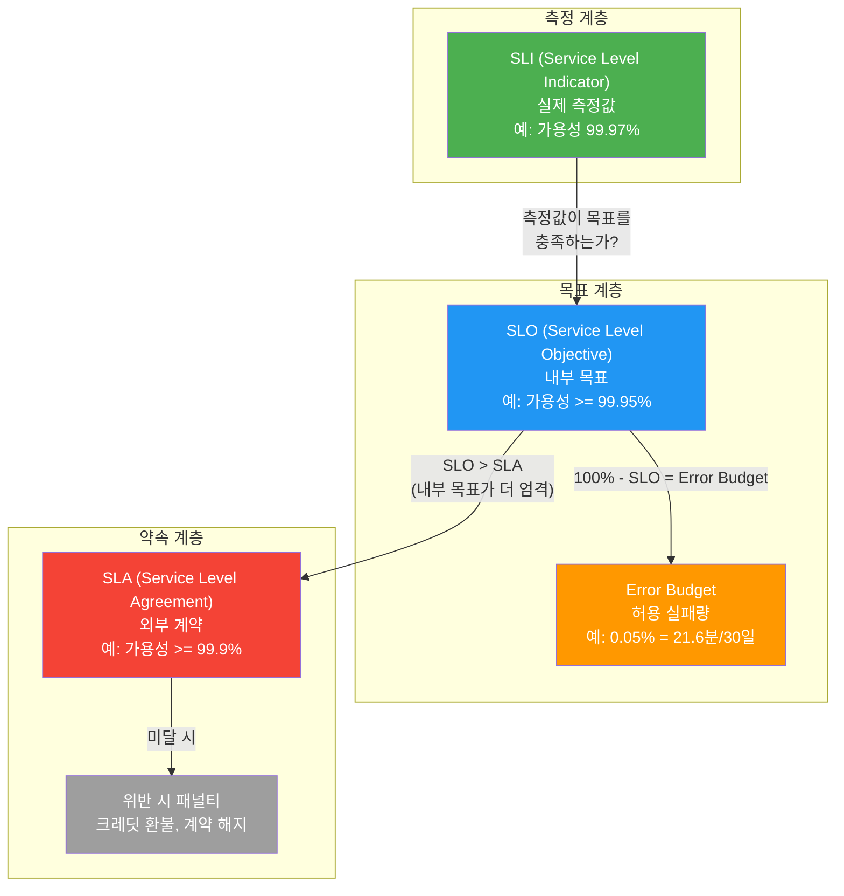
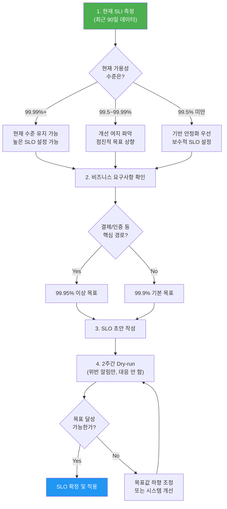
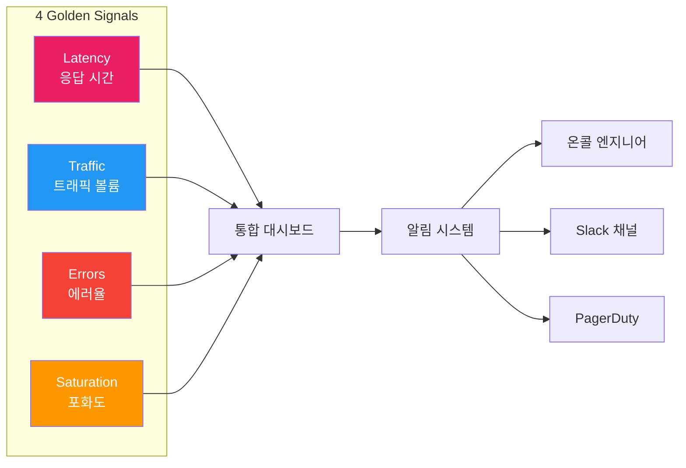
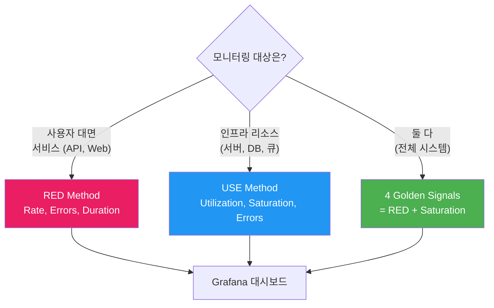
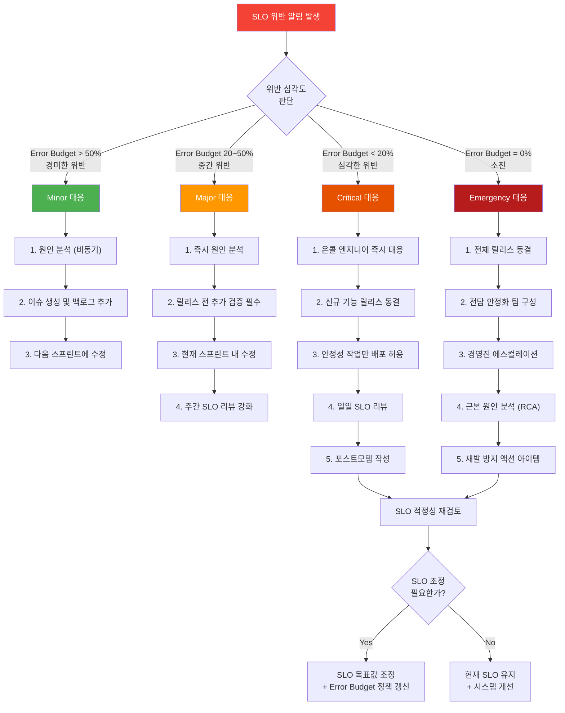

# SLI/SLO/SLA 정의 및 모니터링 가이드

> **작성일**: 2026-03-12
> **기반 표준**: Google SRE Book, Google SRE Workbook, Nobl9 SLO Best Practices
> **적용 수준**: 빅테크 기준 팀 운영표준
> **참고**: [빅테크 코드품질 갭분석 리포트 섹션 4.6](../reports/2026-03-12_빅테크-코드품질-갭분석-리포트.md)

---

## 목차

1. [개요: SLI/SLO/SLA 관계](#1-개요-slislosla-관계)
2. [SLI 정의 가이드](#2-sli-정의-가이드)
3. [SLO 설정 방법](#3-slo-설정-방법)
4. [Error Budget 정책](#4-error-budget-정책)
5. [SLA 작성 가이드](#5-sla-작성-가이드)
6. [4 Golden Signals 모니터링](#6-4-golden-signals-모니터링)
7. [RED/USE 메트릭 패턴](#7-reduse-메트릭-패턴)
8. [Prometheus/Grafana 대시보드](#8-prometheusgrafana-대시보드)
9. [SLO 위반 시 대응 프로세스](#9-slo-위반-시-대응-프로세스)
10. [실전 예시: 웹 서비스 SLI/SLO 정의서](#10-실전-예시-웹-서비스-slislo-정의서)

---

## 1. 개요: SLI/SLO/SLA 관계

### 1.1 핵심 개념

| 용어 | 정의 | 대상 | 예시 |
|------|------|------|------|
| **SLI** (Service Level Indicator) | 서비스 수준을 정량적으로 측정하는 지표 | 엔지니어링팀 | 요청 중 200ms 이내 응답 비율 |
| **SLO** (Service Level Objective) | SLI의 목표 범위 (내부 목표) | 엔지니어링팀 + 프로덕트팀 | 가용성 99.95% (Rolling 30일) |
| **SLA** (Service Level Agreement) | 고객과의 법적/계약적 약속 | 고객 + 비즈니스팀 | 가용성 99.9% 미달 시 크레딧 환불 |

### 1.2 관계 다이어그램



### 1.3 핵심 원칙

1. **SLO는 항상 SLA보다 엄격해야 한다** -- SLA 위반 전에 내부에서 먼저 감지하고 대응
2. **SLI는 사용자 경험을 반영해야 한다** -- 서버 내부 메트릭이 아닌, 사용자가 체감하는 지표
3. **완벽한 100%를 목표로 하지 않는다** -- 100% 가용성은 비현실적이며, 혁신 속도를 저해
4. **Error Budget은 "기능 배포 예산"이다** -- 안정성과 혁신의 균형을 수치로 관리

---

## 2. SLI 정의 가이드

### 2.1 SLI 선정 원칙

- **사용자 관점**: 시스템 내부 메트릭(CPU 사용률)이 아닌 사용자 체감 지표 사용
- **측정 가능**: 자동으로 수집, 계산 가능한 지표
- **비율 형태**: 0~100% 사이의 비율로 표현 (좋은 이벤트 / 전체 이벤트)
- **단순성**: 서비스당 3~5개 이내의 SLI 선정

### 2.2 가용성 (Availability)

**정의**: 전체 요청 중 성공적으로 처리된 요청의 비율

**계산 공식**:

```
Availability = (성공 요청 수 / 전체 요청 수) x 100%
```

**측정 방법**:

| 방법 | 설명 | 장점 | 단점 |
|------|------|------|------|
| 서버 측 로그 | HTTP 상태 코드 기반 (2xx, 3xx = 성공) | 구현 간단 | 네트워크 장애 미반영 |
| 로드 밸런서 메트릭 | ALB/NLB 성공률 | 서버 다운도 감지 | LB 장애 시 사각지대 |
| 합성 모니터링 | 정기적 헬스체크 요청 | 사용자 관점 근사 | 실제 트래픽 미반영 |
| 실 사용자 모니터링(RUM) | 클라이언트에서 측정 | 가장 정확 | 구현 복잡 |

**성공 기준 정의 예시**:

```yaml
# What counts as "successful"
success_criteria:
  http_status_codes:
    success: [200, 201, 204, 301, 302, 304]
    failure: [500, 502, 503, 504]
    excluded: [429]  # rate limiting is expected behavior
  timeout_threshold: 10s  # requests exceeding this are failures
```

### 2.3 레이턴시 (Latency)

**정의**: 요청을 받은 시점부터 응답을 반환한 시점까지의 소요 시간

**계산 공식**:

```
Latency SLI = (threshold 이내 응답 요청 수 / 전체 요청 수) x 100%
```

**측정 방법**:

| 백분위수 | 용도 | 설명 |
|----------|------|------|
| **P50** (중앙값) | 일반적 사용자 경험 | 절반의 사용자가 경험하는 레이턴시 |
| **P95** | 대부분의 사용자 경험 | 95%의 요청이 이 값 이내 |
| **P99** | 최악 사례 근사 | 100건 중 1건의 최악 응답 시간 |
| **P99.9** | 극단 사례 | 1,000건 중 1건. SLA 민감 서비스에 사용 |

**레이턴시 SLI 분류 (2계층 추천)**:

```yaml
latency_sli:
  # Tier 1: "fast enough" threshold
  fast_threshold:
    target: 200ms
    description: "Most users perceive as instant"

  # Tier 2: "acceptable" threshold
  acceptable_threshold:
    target: 1000ms
    description: "Users notice delay but tolerate it"

  # Beyond acceptable = failure
  failure_threshold:
    target: 10000ms
    description: "User likely abandons the request"
```

### 2.4 에러율 (Error Rate)

**정의**: 전체 요청 중 에러로 처리된 요청의 비율

**계산 공식**:

```
Error Rate = (에러 요청 수 / 전체 요청 수) x 100%
Error Rate SLI = 100% - Error Rate
```

**에러 분류**:

| 분류 | HTTP 상태 코드 | SLI 포함 여부 | 설명 |
|------|---------------|--------------|------|
| 서버 에러 | 5xx | 포함 (실패) | 서비스 내부 장애 |
| 클라이언트 에러 (유효) | 400, 401, 403 | **제외** | 정상적인 검증 동작 |
| 클라이언트 에러 (버그) | 404 (잘못된 라우팅) | 상황별 판단 | API 변경으로 인한 404는 포함 |
| 타임아웃 | 504, 408 | 포함 (실패) | 서비스 응답 지연 |
| 속도 제한 | 429 | **제외** | 의도된 동작 |

### 2.5 처리량 (Throughput)

**정의**: 단위 시간당 처리한 요청/작업의 수

**계산 공식**:

```
Throughput = 요청 수 / 시간 단위
Throughput SLI = (처리된 요청 수 / 기대 처리량) x 100%
```

**측정 포인트**:

```yaml
throughput_metrics:
  requests_per_second: "HTTP 요청 처리량"
  messages_per_second: "메시지 큐 소비량"
  jobs_per_minute: "배치 작업 완료량"
  bytes_per_second: "데이터 전송량"
```

> **참고**: 처리량 자체보다는 처리량 감소가 시스템 이상의 선행 지표로 더 유용하다. 트래픽이 일정한데 처리량이 떨어지면 시스템에 문제가 있다는 신호다.

---

## 3. SLO 설정 방법

### 3.1 Rolling Window vs Calendar Window

| 구분 | Rolling Window | Calendar Window |
|------|---------------|-----------------|
| **정의** | 현재 시점 기준 N일 이동 평균 | 월/분기 단위 고정 기간 |
| **계산** | 최근 30일간 가용성 | 3월 1일~31일 가용성 |
| **장점** | 최근 이벤트 민감, 지속적 모니터링 | 비즈니스 리포팅에 적합 |
| **단점** | 과거 대형 장애가 30일 후 갑자기 빠짐 | 월말 리셋으로 과거 장애 무시 |
| **권장 용도** | **SLO 모니터링 (권장)** | SLA 리포팅, 비즈니스 보고 |

**권장**: 30일 Rolling Window를 기본으로 사용한다.

```yaml
slo_window:
  type: rolling
  duration: 30d
  rationale: >
    30-day rolling window provides continuous visibility into service health
    without the "reset effect" of calendar-based windows.
```

### 3.2 목표값 선정 기준

#### 가용성 목표별 허용 다운타임

| 목표 | 월간 다운타임 | 연간 다운타임 | 적합한 서비스 |
|------|-------------|-------------|--------------|
| 99% | 7시간 18분 | 3일 15시간 | 내부 도구, 개발 환경 |
| 99.5% | 3시간 39분 | 1일 19시간 | 비핵심 서비스 |
| 99.9% | 43분 50초 | 8시간 46분 | 일반 웹 서비스 |
| 99.95% | 21분 55초 | 4시간 23분 | 핵심 API 서비스 |
| 99.99% | 4분 23초 | 52분 36초 | 결제, 인증 서비스 |
| 99.999% | 26초 | 5분 16초 | 인프라 코어 (DNS, LB) |

#### 목표값 선정 프로세스



### 3.3 SLO 문서 템플릿

```yaml
# SLO Definition Document
service: order-api
version: "1.0"
owner: platform-team
last_reviewed: 2026-03-12

slos:
  - name: availability
    description: "Order API 가용성"
    sli:
      type: availability
      good_events: "HTTP status < 500"
      total_events: "all HTTP requests (excluding health checks)"
    objective: 99.95%
    window:
      type: rolling
      duration: 30d
    consequence: "Error budget 소진 시 릴리스 동결"

  - name: latency_fast
    description: "Order API 빠른 응답 비율"
    sli:
      type: latency
      threshold: 200ms
      good_events: "requests with latency < 200ms"
      total_events: "all successful HTTP requests"
    objective: 95%
    window:
      type: rolling
      duration: 30d

  - name: latency_slow
    description: "Order API 허용 응답 비율"
    sli:
      type: latency
      threshold: 1000ms
      good_events: "requests with latency < 1000ms"
      total_events: "all successful HTTP requests"
    objective: 99.9%
    window:
      type: rolling
      duration: 30d
```

---

## 4. Error Budget 정책

### 4.1 Error Budget 계산법

**공식**:

```
Error Budget = 100% - SLO 목표값

예: SLO = 99.95%
    Error Budget = 0.05%
    30일 기준 = 0.05% x 30일 x 24시간 x 60분 = 21.6분
```

**실전 계산 예시**:

| SLO 목표 | Error Budget (%) | 30일 기준 (분) | 의미 |
|----------|-----------------|---------------|------|
| 99.9% | 0.1% | 43.2분 | 30일간 총 43분의 장애 허용 |
| 99.95% | 0.05% | 21.6분 | 30일간 총 22분의 장애 허용 |
| 99.99% | 0.01% | 4.3분 | 30일간 총 4분의 장애 허용 |

### 4.2 Error Budget 소진율 모니터링

**번다운 차트 개념**:

```
Error Budget 잔여량
100% |***
     |   ***
     |      **
     |        ****          <-- 정상 소진 속도
     |            ***
     |               ****
     |                   **
     |                     ***
  0% |_________________________ 시간
     Day 1              Day 30

     정상: 선형적으로 소진 (또는 소진되지 않음)
     위험: 급격한 소진 (대형 장애 발생)
```

**소진율 기반 알림 기준**:

| 소진율 | 잔여 예산 | 알림 수준 | 대응 |
|--------|----------|----------|------|
| 정상 | 70%+ 잔여 | 없음 | 정상 개발 진행 |
| 주의 | 50~70% 잔여 | INFO | 소진 원인 분석 |
| 경고 | 30~50% 잔여 | WARNING | 안정성 작업 우선순위 상향 |
| 위험 | 10~30% 잔여 | CRITICAL | 신규 기능 배포 제한 |
| 소진 | 0% | EMERGENCY | **릴리스 동결** |

### 4.3 Error Budget 소진 시 대응 정책

```yaml
error_budget_policy:
  # Phase 1: Normal (budget > 50%)
  normal:
    actions:
      - "정상 개발 및 릴리스 진행"
      - "주간 SLO 리포트 검토"

  # Phase 2: Warning (budget 20-50%)
  warning:
    actions:
      - "릴리스 전 추가 안정성 검증 필수"
      - "신규 기능보다 안정성 작업 우선"
      - "주 2회 SLO 리포트 검토"
    approval_required: "Tech Lead"

  # Phase 3: Critical (budget 0-20%)
  critical:
    actions:
      - "신규 기능 릴리스 동결"
      - "안정성 개선 작업만 배포 허용"
      - "일일 SLO 리포트 검토"
      - "포스트모템 필수 작성"
    approval_required: "Engineering Manager"
    exceptions:
      - "보안 패치"
      - "심각한 버그 수정"
      - "법적/규정 요구사항"

  # Phase 4: Exhausted (budget = 0%)
  exhausted:
    actions:
      - "모든 릴리스 동결 (보안 패치 제외)"
      - "전체 팀 안정성 개선 스프린트"
      - "경영진 에스컬레이션"
      - "근본 원인 분석 (RCA) 필수"
    approval_required: "VP of Engineering"
```

### 4.4 Error Budget 번다운 차트 PromQL

```promql
# Error budget remaining (percentage)
# Assumes 30-day rolling window, SLO = 99.95%

(
  1 - (
    (
      sum(rate(http_requests_total{status=~"5.."}[30d]))
      /
      sum(rate(http_requests_total[30d]))
    ) / (1 - 0.9995)
  )
) * 100
```

---

## 5. SLA 작성 가이드

### 5.1 SLA vs SLO 구분

| 항목 | SLO (내부) | SLA (외부) |
|------|-----------|-----------|
| 대상 | 엔지니어링팀 | 고객, 파트너사 |
| 강제력 | 팀 자율 (Error Budget 정책) | 법적 구속력 |
| 목표값 | 더 엄격 (예: 99.95%) | 더 완화 (예: 99.9%) |
| 위반 결과 | 릴리스 동결, 안정성 스프린트 | 크레딧 환불, 계약 해지 |
| 변경 절차 | 팀 내 합의 | 계약 수정 절차 |

### 5.2 SLA 작성 시 비즈니스팀 협업 포인트

1. **측정 방법 합의**: "가용성"의 정의가 기술팀과 비즈니스팀 간 다를 수 있다
2. **제외 조건 명확화**: 정기 점검, 고객 원인 장애, 불가항력을 SLA에서 제외
3. **크레딧 구조**: 위반 수준별 보상 비율을 단계적으로 설정
4. **측정 주기**: 월간 vs 분기별 리포팅 주기
5. **에스컬레이션 경로**: 분쟁 발생 시 해결 절차

### 5.3 SLA 크레딧 구조 예시

```yaml
sla_credits:
  service: "Order Processing API"
  measurement_period: "calendar_month"

  tiers:
    - availability_range: "99.9% ~ 100%"
      credit: "0%"
      description: "SLA 충족"

    - availability_range: "99.0% ~ 99.9%"
      credit: "10%"
      description: "해당 월 요금의 10% 크레딧"

    - availability_range: "95.0% ~ 99.0%"
      credit: "25%"
      description: "해당 월 요금의 25% 크레딧"

    - availability_range: "< 95.0%"
      credit: "50%"
      description: "해당 월 요금의 50% 크레딧"

  exclusions:
    - "사전 공지된 정기 점검 (최소 72시간 전 공지)"
    - "고객 인프라 또는 네트워크 문제"
    - "불가항력 (천재지변, 법률 변경)"
    - "고객이 권장 사양을 따르지 않은 경우"
```

### 5.4 법적 고려사항

| 항목 | 권장 사항 |
|------|----------|
| 측정 주체 | 제공자 측 모니터링 시스템의 데이터를 기준으로 한다고 명시 |
| 클레임 기한 | 장애 발생 후 30일 이내 크레딧 요청 |
| 최대 보상 | 해당 월 요금의 50%를 초과하지 않음 |
| 면책 조항 | 간접 손해, 데이터 손실에 대한 면책 명시 |
| 유일한 구제 수단 | SLA 크레딧이 서비스 장애에 대한 유일한 보상 수단임을 명시 |

---

## 6. 4 Golden Signals 모니터링

Google SRE가 정의한 4가지 핵심 모니터링 신호. 모든 서비스는 이 4가지를 반드시 모니터링해야 한다.

### 6.1 개요



### 6.2 Latency (응답 시간)

**무엇을 측정하는가**: 요청을 처리하는 데 걸리는 시간

**핵심 원칙**: 성공한 요청의 레이턴시와 실패한 요청의 레이턴시를 **분리하여** 측정한다. 빠른 500 에러는 레이턴시를 왜곡한다.

**Prometheus 구현**:

```yaml
# Histogram for latency measurement
- name: http_request_duration_seconds
  type: histogram
  help: "HTTP request duration in seconds"
  labels:
    - method
    - route
    - status_class  # "2xx", "4xx", "5xx"
  buckets: [0.005, 0.01, 0.025, 0.05, 0.1, 0.25, 0.5, 1, 2.5, 5, 10]
```

```promql
# P50 latency (successful requests only)
histogram_quantile(0.5,
  sum(rate(http_request_duration_seconds_bucket{status_class="2xx"}[5m])) by (le)
)

# P95 latency (successful requests only)
histogram_quantile(0.95,
  sum(rate(http_request_duration_seconds_bucket{status_class="2xx"}[5m])) by (le)
)

# P99 latency
histogram_quantile(0.99,
  sum(rate(http_request_duration_seconds_bucket{status_class="2xx"}[5m])) by (le)
)
```

**알림 규칙**:

```yaml
# Alert: P95 latency exceeds 500ms for 5 minutes
- alert: HighLatencyP95
  expr: |
    histogram_quantile(0.95,
      sum(rate(http_request_duration_seconds_bucket{status_class="2xx"}[5m])) by (le, service)
    ) > 0.5
  for: 5m
  labels:
    severity: warning
  annotations:
    summary: "{{ $labels.service }} P95 latency above 500ms"
    description: "P95 latency is {{ $value }}s for {{ $labels.service }}"
```

### 6.3 Traffic (트래픽 볼륨)

**무엇을 측정하는가**: 서비스에 들어오는 요청량 (수요)

**Prometheus 구현**:

```promql
# Requests per second (overall)
sum(rate(http_requests_total[5m]))

# Requests per second by endpoint
sum(rate(http_requests_total[5m])) by (method, route)

# Requests per second by service
sum(rate(http_requests_total[5m])) by (service)
```

**알림 규칙**:

```yaml
# Alert: Traffic drop (potential upstream issue or DNS failure)
- alert: TrafficDrop
  expr: |
    sum(rate(http_requests_total[5m])) by (service)
    < sum(rate(http_requests_total[5m] offset 1h)) by (service) * 0.5
  for: 10m
  labels:
    severity: warning
  annotations:
    summary: "{{ $labels.service }} traffic dropped >50% vs 1h ago"

# Alert: Traffic spike (potential DDoS or viral event)
- alert: TrafficSpike
  expr: |
    sum(rate(http_requests_total[5m])) by (service)
    > sum(rate(http_requests_total[5m] offset 1h)) by (service) * 3
  for: 5m
  labels:
    severity: warning
  annotations:
    summary: "{{ $labels.service }} traffic spiked 3x vs 1h ago"
```

### 6.4 Errors (에러율)

**무엇을 측정하는가**: 실패한 요청의 비율

**에러 유형**:
- **명시적 에러**: HTTP 5xx 상태 코드
- **암묵적 에러**: 200 응답이지만 잘못된 콘텐츠 반환
- **정책 위반**: 1초 이상 걸린 200 응답 (SLO 관점에서 에러)

**Prometheus 구현**:

```promql
# Error rate (5xx only)
sum(rate(http_requests_total{status_class="5xx"}[5m])) by (service)
/
sum(rate(http_requests_total[5m])) by (service)

# Error rate by endpoint
sum(rate(http_requests_total{status_class="5xx"}[5m])) by (method, route)
/
sum(rate(http_requests_total[5m])) by (method, route)
```

**알림 규칙**:

```yaml
# Alert: Error rate exceeds 1% for 5 minutes
- alert: HighErrorRate
  expr: |
    (
      sum(rate(http_requests_total{status_class="5xx"}[5m])) by (service)
      /
      sum(rate(http_requests_total[5m])) by (service)
    ) > 0.01
  for: 5m
  labels:
    severity: critical
  annotations:
    summary: "{{ $labels.service }} error rate above 1%"
    description: "Error rate is {{ $value | humanizePercentage }} for {{ $labels.service }}"
```

### 6.5 Saturation (포화도)

**무엇을 측정하는가**: 서비스 리소스의 사용률. "가장 제약이 큰 리소스가 얼마나 가득 찼는가"

**핵심 리소스**:

| 리소스 | 메트릭 | 위험 임계값 |
|--------|--------|-----------|
| CPU | `process_cpu_seconds_total` | > 80% |
| 메모리 | `process_resident_memory_bytes` | > 85% |
| 디스크 I/O | `node_disk_io_time_seconds_total` | > 80% |
| 네트워크 | `node_network_transmit_bytes_total` | > 70% |
| 커넥션 풀 | `db_connections_active / db_connections_max` | > 80% |
| 스레드 풀 | `thread_pool_active / thread_pool_max` | > 80% |
| 큐 깊이 | `queue_messages_pending` | > 80% capacity |

**Prometheus 구현**:

```promql
# CPU saturation
rate(process_cpu_seconds_total[5m])
/ on(instance) group_left
count without(cpu) (node_cpu_seconds_total{mode="idle"})

# Memory saturation
process_resident_memory_bytes
/ on(instance) group_left
node_memory_MemTotal_bytes

# DB connection pool saturation
db_connections_active / db_connections_max

# Goroutine/Thread saturation (Go example)
go_goroutines / go_threads
```

**알림 규칙**:

```yaml
# Alert: High CPU usage
- alert: HighCPUSaturation
  expr: |
    (
      rate(process_cpu_seconds_total[5m])
      / on(instance) group_left
      count without(cpu) (node_cpu_seconds_total{mode="idle"})
    ) > 0.8
  for: 10m
  labels:
    severity: warning
  annotations:
    summary: "{{ $labels.instance }} CPU usage above 80%"

# Alert: DB connection pool near exhaustion
- alert: DBConnectionPoolSaturation
  expr: |
    db_connections_active / db_connections_max > 0.8
  for: 5m
  labels:
    severity: critical
  annotations:
    summary: "DB connection pool at {{ $value | humanizePercentage }} capacity"
```

---

## 7. RED/USE 메트릭 패턴

### 7.1 RED Method (요청 기반 서비스)

Tom Wilkie가 제안. **사용자 대면 서비스**에 적합하다.

| 메트릭 | 설명 | PromQL 예시 |
|--------|------|------------|
| **R**ate | 초당 요청 수 | `sum(rate(http_requests_total[5m]))` |
| **E**rrors | 초당 실패 요청 수 | `sum(rate(http_requests_total{status=~"5.."}[5m]))` |
| **D**uration | 요청 소요 시간 분포 | `histogram_quantile(0.95, ...)` |

### 7.2 USE Method (리소스 기반)

Brendan Gregg가 제안. **인프라 리소스**에 적합하다.

| 메트릭 | 설명 | 대상 |
|--------|------|------|
| **U**tilization | 리소스 사용률 (%) | CPU, 메모리, 디스크, 네트워크 |
| **S**aturation | 대기 큐 길이 (리소스 초과 요청) | 런큐 길이, 스왑 사용량 |
| **E**rrors | 에러 이벤트 수 | 디스크 에러, 네트워크 패킷 드롭 |

### 7.3 적용 가이드



---

## 8. Prometheus/Grafana 대시보드

### 8.1 SLO 대시보드 구성

**권장 패널 레이아웃**:

```
+--------------------------------------------------+
| SLO Overview (Row 1)                             |
| [Availability] [Latency P95] [Error Budget]      |
| [Stat Panel]   [Stat Panel]  [Gauge Panel]       |
+--------------------------------------------------+
| Error Budget Burndown (Row 2)                    |
| [Time Series: 30-day burndown chart]             |
+--------------------------------------------------+
| 4 Golden Signals (Row 3)                         |
| [Latency Heatmap] [Traffic RPS] [Error%] [CPU%]  |
+--------------------------------------------------+
| Detail Panels (Row 4)                            |
| [Top 5 Slowest Endpoints] [Error Breakdown]      |
+--------------------------------------------------+
```

### 8.2 핵심 PromQL 쿼리 모음

#### 가용성 (30일 Rolling)

```promql
# 30-day availability
1 - (
  sum(increase(http_requests_total{status_class="5xx"}[30d]))
  /
  sum(increase(http_requests_total[30d]))
)
```

#### Error Budget 잔여량 (%)

```promql
# Error budget remaining (SLO = 99.95%)
(
  1 - (
    sum(increase(http_requests_total{status_class="5xx"}[30d]))
    /
    sum(increase(http_requests_total[30d]))
    / 0.0005
  )
) * 100
```

#### 레이턴시 히트맵

```promql
# Latency distribution heatmap
sum(increase(http_request_duration_seconds_bucket[5m])) by (le)
```

#### Multi-Burn Rate Alert (Google SRE Workbook 권장)

"빠른 소진"과 "느린 소진"을 모두 감지하는 다중 윈도우 알림 방식이다.

```promql
# Fast burn: 2% budget consumed in 1 hour (= 14.4x normal burn rate)
(
  sum(rate(http_requests_total{status_class="5xx"}[1h]))
  /
  sum(rate(http_requests_total[1h]))
) > (14.4 * 0.0005)
and
(
  sum(rate(http_requests_total{status_class="5xx"}[5m]))
  /
  sum(rate(http_requests_total[5m]))
) > (14.4 * 0.0005)

# Slow burn: 5% budget consumed in 6 hours (= 6x normal burn rate)
(
  sum(rate(http_requests_total{status_class="5xx"}[6h]))
  /
  sum(rate(http_requests_total[6h]))
) > (6 * 0.0005)
and
(
  sum(rate(http_requests_total{status_class="5xx"}[30m]))
  /
  sum(rate(http_requests_total[30m]))
) > (6 * 0.0005)
```

### 8.3 Grafana Dashboard JSON 예시 (핵심 패널)

```json
{
  "panels": [
    {
      "title": "Availability (30d Rolling)",
      "type": "stat",
      "targets": [
        {
          "expr": "1 - (sum(increase(http_requests_total{status_class=\"5xx\"}[30d])) / sum(increase(http_requests_total[30d])))",
          "legendFormat": "Availability"
        }
      ],
      "fieldConfig": {
        "defaults": {
          "thresholds": {
            "steps": [
              { "color": "red", "value": 0 },
              { "color": "orange", "value": 0.999 },
              { "color": "green", "value": 0.9995 }
            ]
          },
          "unit": "percentunit"
        }
      }
    },
    {
      "title": "Error Budget Remaining",
      "type": "gauge",
      "targets": [
        {
          "expr": "(1 - (sum(increase(http_requests_total{status_class=\"5xx\"}[30d])) / sum(increase(http_requests_total[30d])) / 0.0005)) * 100"
        }
      ],
      "fieldConfig": {
        "defaults": {
          "min": 0,
          "max": 100,
          "thresholds": {
            "steps": [
              { "color": "red", "value": 0 },
              { "color": "orange", "value": 20 },
              { "color": "yellow", "value": 50 },
              { "color": "green", "value": 70 }
            ]
          },
          "unit": "percent"
        }
      }
    }
  ]
}
```

---

## 9. SLO 위반 시 대응 프로세스

### 9.1 대응 플로우



### 9.2 포스트모템 연계

SLO 위반이 Error Budget의 30% 이상을 소진한 경우 포스트모템을 작성한다.

포스트모템 필수 항목:
- **타임라인**: 장애 발생부터 복구까지의 상세 시간표
- **영향 범위**: SLI 수치 변화, 영향받은 사용자 수
- **Error Budget 소진량**: 이번 인시던트로 소진된 Error Budget 비율
- **근본 원인**: 5 Whys 분석
- **액션 아이템**: 재발 방지를 위한 구체적 작업 (담당자, 기한 포함)

### 9.3 SLO 리뷰 주기

| 항목 | 주기 | 참석자 | 내용 |
|------|------|--------|------|
| 주간 SLO 리뷰 | 매주 | 팀 엔지니어 | SLI 추세, Error Budget 잔여량 |
| 월간 SLO 리포트 | 매월 | 팀 + 프로덕트 | SLA 준수 여부, 트렌드 분석 |
| 분기 SLO 재평가 | 분기 | 팀 + 매니지먼트 | SLO 목표값 적정성 검토, 정책 조정 |

---

## 10. 실전 예시: 웹 서비스 SLI/SLO 정의서

### 10.1 서비스 개요

```yaml
service:
  name: "order-api"
  description: "주문 처리 REST API"
  team: "commerce-platform"
  tier: "Tier 1 (Business Critical)"
  dependencies:
    - "payment-service"
    - "inventory-service"
    - "notification-service"
    - "PostgreSQL (primary)"
    - "Redis (cache)"
```

### 10.2 SLI 정의

```yaml
slis:
  - name: "availability"
    type: "request-based"
    description: "Order API 요청 성공률"
    good_event: "HTTP response status < 500"
    valid_event: "All HTTP requests (excluding /healthz, /readyz)"
    data_source: "Prometheus (http_requests_total metric)"
    measurement_point: "Application-level middleware"

  - name: "latency_fast"
    type: "request-based"
    description: "빠른 응답 비율 (사용자 체감 즉시 응답)"
    good_event: "HTTP response time < 200ms"
    valid_event: "All successful HTTP requests (status < 500)"
    data_source: "Prometheus (http_request_duration_seconds histogram)"

  - name: "latency_acceptable"
    type: "request-based"
    description: "허용 가능 응답 비율"
    good_event: "HTTP response time < 1000ms"
    valid_event: "All successful HTTP requests (status < 500)"
    data_source: "Prometheus (http_request_duration_seconds histogram)"

  - name: "data_freshness"
    type: "window-based"
    description: "주문 상태 동기화 지연"
    good_event: "Order status updated within 5 seconds of state change"
    valid_event: "All order state change events"
    data_source: "Custom metric (order_sync_delay_seconds)"
```

### 10.3 SLO 정의

```yaml
slos:
  - name: "order-api-availability"
    sli: "availability"
    objective: 99.95%
    window:
      type: "rolling"
      duration: "30d"
    error_budget:
      total: "21.6 minutes per 30 days"
      alert_thresholds:
        - remaining: "50%"
          action: "warning notification"
        - remaining: "20%"
          action: "release freeze, daily review"
        - remaining: "0%"
          action: "full freeze, escalation"
    rationale: >
      Tier 1 서비스로서 결제 흐름의 핵심 경로.
      99.99%는 4.3분/30일로 정기 배포 시 리스크가 크므로 99.95%가 적정.

  - name: "order-api-latency-fast"
    sli: "latency_fast"
    objective: 95%
    window:
      type: "rolling"
      duration: "30d"
    rationale: >
      전체 요청의 95%가 200ms 이내에 응답해야 사용자가 즉각적이라고 느낌.
      나머지 5%는 복잡한 주문(대량 주문, 재고 확인 등)으로 허용.

  - name: "order-api-latency-acceptable"
    sli: "latency_acceptable"
    objective: 99.9%
    window:
      type: "rolling"
      duration: "30d"
    rationale: >
      1초를 초과하는 응답은 사용자 이탈의 직접적 원인.
      1,000건 중 1건만 1초 초과를 허용.

  - name: "order-data-freshness"
    sli: "data_freshness"
    objective: 99.9%
    window:
      type: "rolling"
      duration: "30d"
    rationale: >
      주문 상태가 5초 이상 지연되면 고객 문의 급증.
      결제 완료 후 주문 상태 미반영은 심각한 UX 문제.
```

### 10.4 모니터링 알림 설정

```yaml
alerts:
  # Multi-burn rate alerts (Google SRE Workbook recommended approach)
  - name: "order-api-fast-burn"
    description: "1시간 내 Error Budget 2% 소진 속도"
    severity: "critical"
    burn_rate: "14.4x"
    long_window: "1h"
    short_window: "5m"
    notification:
      - "PagerDuty (oncall)"
      - "#order-api-alerts (Slack)"

  - name: "order-api-slow-burn"
    description: "6시간 내 Error Budget 5% 소진 속도"
    severity: "warning"
    burn_rate: "6x"
    long_window: "6h"
    short_window: "30m"
    notification:
      - "#order-api-alerts (Slack)"

  - name: "order-api-latency-degradation"
    description: "P95 레이턴시 500ms 초과 지속"
    severity: "warning"
    condition: "P95 > 500ms for 5m"
    notification:
      - "#order-api-alerts (Slack)"
```

### 10.5 SLA 계약 (외부)

```yaml
sla:
  service: "Order Processing API"
  version: "1.0"
  effective_date: "2026-04-01"

  commitments:
    - metric: "Monthly Availability"
      target: "99.9%"
      measurement: "Calendar month, provider monitoring"
      credits:
        - range: "99.0% ~ 99.9%"
          credit: "10% of monthly fee"
        - range: "95.0% ~ 99.0%"
          credit: "25% of monthly fee"
        - range: "< 95.0%"
          credit: "50% of monthly fee"

    - metric: "API Response Time"
      target: "P95 < 500ms"
      measurement: "Calendar month, provider monitoring"

  exclusions:
    - "Scheduled maintenance (72h advance notice)"
    - "Force majeure events"
    - "Customer-caused issues"
    - "Beta/preview features"

  note: >
    SLO (99.95%) > SLA (99.9%)
    내부 목표가 더 엄격하여 SLA 위반 전에 대응 가능
```

---

## 참고 자료

- [Google SRE Book - Service Level Objectives](https://sre.google/sre-book/service-level-objectives/)
- [Google SRE Workbook - Implementing SLOs](https://sre.google/workbook/implementing-slos/)
- [Google SRE Workbook - Alerting on SLOs](https://sre.google/workbook/alerting-on-slos/)
- [Nobl9 - SLO Best Practices](https://www.nobl9.com/service-level-objectives/slo-best-practices)
- [incident.io - What are SLOs, SLAs, and SLIs?](https://incident.io/blog/slo-sla-sli)
- [Tom Wilkie - The RED Method](https://www.weave.works/blog/the-red-method-key-metrics-for-microservices-architecture/)
- [Brendan Gregg - The USE Method](https://www.brendangregg.com/usemethod.html)
