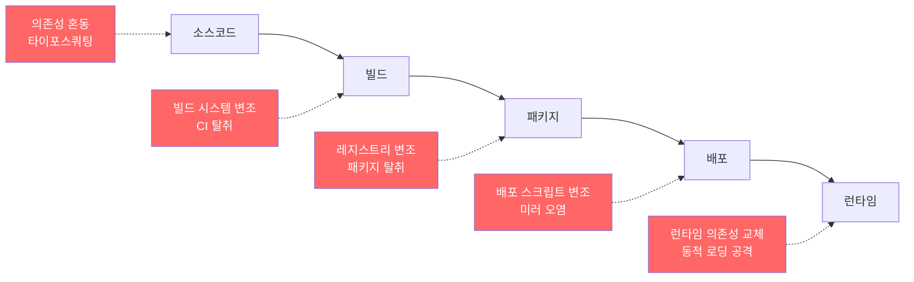
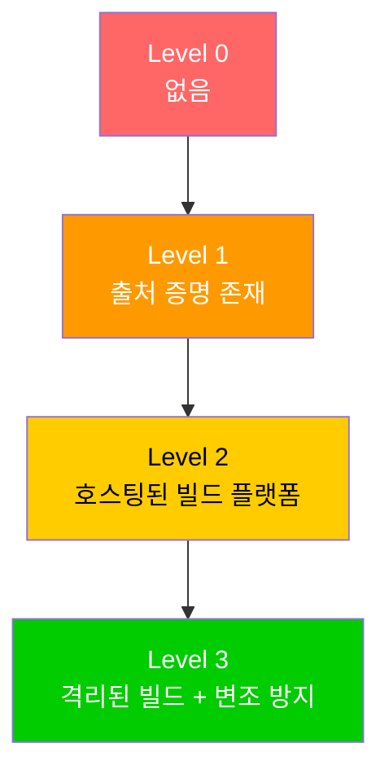
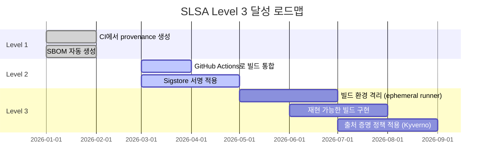
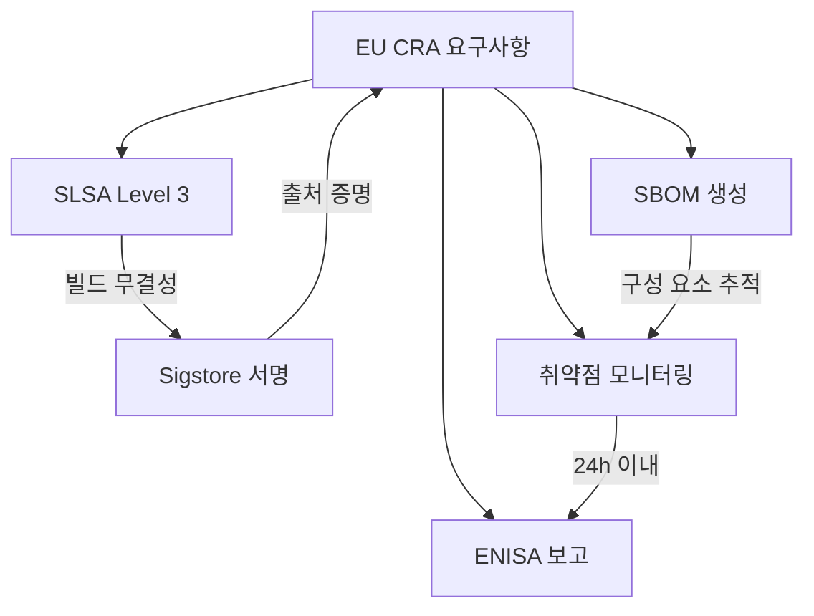
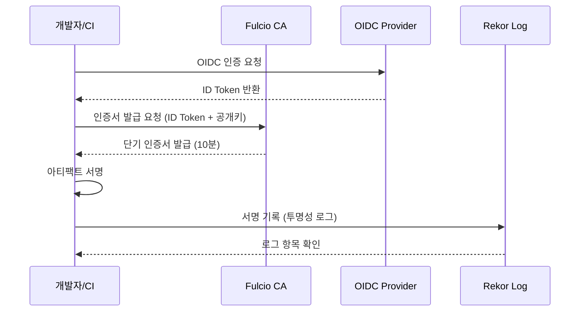

# 소프트웨어 공급망 보안 가이드

> **작성일**: 2026-03-14
> **대상**: 전 언어/플랫폼 공통
> **기반 표준**: SLSA v1.0, NIST SSDF, EU Cyber Resilience Act (2024/2847), OWASP Top 10 2025 A03/A08
> **적용 수준**: 빅테크 기준 팀 개발표준

---

## 목차

1. [개요 — 공급망 공격이란](#1-개요--공급망-공격이란)
2. [SBOM (Software Bill of Materials)](#2-sbom-software-bill-of-materials)
3. [SLSA (Supply-chain Levels for Software Artifacts)](#3-slsa-supply-chain-levels-for-software-artifacts)
4. [EU Cyber Resilience Act (CRA)](#4-eu-cyber-resilience-act-cra)
5. [Sigstore — 아티팩트 서명](#5-sigstore--아티팩트-서명)
6. [의존성 관리 전략](#6-의존성-관리-전략)
7. [GitHub Actions 보안 강화](#7-github-actions-보안-강화) (7.7 불변 릴리스)
8. [공급망 보안 체크리스트](#8-공급망-보안-체크리스트)

---

## 1. 개요 — 공급망 공격이란

### 1.1 정의

소프트웨어 공급망 공격(Supply Chain Attack)은 소프트웨어의 개발, 빌드, 배포 과정에서
신뢰하는 의존성이나 도구를 변조하여 최종 산출물에 악성 코드를 삽입하는 공격이다.

### 1.2 주요 사례

| 연도 | 사건 | 영향 | 공격 벡터 |
|------|------|------|-----------|
| 2020 | SolarWinds Orion | 18,000+ 고객, 미국 정부 기관 | 빌드 시스템 변조 |
| 2021 | Codecov Bash Uploader | CI 환경 변수 탈취 | 배포 스크립트 변조 |
| 2021 | ua-parser-js | 1,200만+ 주간 다운로드 | npm 패키지 계정 탈취 |
| 2022 | node-ipc (protestware) | 수백만 프로젝트 영향 | 의도적 악성 코드 삽입 |
| 2023 | 3CX Desktop App | 600,000+ 기업 고객 | 의존성 변조 (북한 APT) |
| 2024 | xz-utils (CVE-2024-3094) | Linux 배포판 전체 | 오픈소스 메인테이너 사칭 |
| 2025 | tj-actions/changed-files | 23,000+ 저장소 | GitHub Actions 태그 변조 |

### 1.3 공급망 공격 킬체인



### 1.4 방어 전략 요약

공급망 보안은 단일 도구가 아니라 **계층적 방어**(Defense in Depth)로 접근해야 한다.

| 계층 | 방어 수단 | 도구 |
|------|-----------|------|
| 의존성 | SBOM, 취약점 스캔, 라이선스 감사 | Trivy, Syft, FOSSA |
| 빌드 | 재현 가능한 빌드, 격리된 빌드 환경 | SLSA, GitHub Actions |
| 아티팩트 | 서명, 검증, 출처 증명 | Sigstore, cosign |
| 배포 | 이미지 서명 검증, 정책 적용 | Kyverno, OPA Gatekeeper |
| 모니터링 | 런타임 SBOM 검증, 이상 탐지 | Falco, Grype |

---

## 2. SBOM (Software Bill of Materials)

### 2.1 SBOM이란

SBOM(Software Bill of Materials)은 소프트웨어에 포함된 모든 구성 요소(의존성, 라이브러리, 프레임워크)의
목록이다. 식품의 성분표처럼 소프트웨어의 "재료 명세서" 역할을 한다.

**필수인 이유**:
- 미국 행정명령 EO 14028 (2021): 연방 정부 납품 소프트웨어에 SBOM 의무화
- EU CRA (2026.09.11 시행): 디지털 제품에 SBOM 포함 의무
- OWASP Top 10 2025 A03: Software Supply Chain Failures 대응 핵심 수단

### 2.2 표준 포맷 비교: CycloneDX vs SPDX

| 비교 항목 | CycloneDX | SPDX |
|-----------|-----------|------|
| **관리 주체** | OWASP | Linux Foundation |
| **최신 버전** | 1.6 (2024) | 2.3 (2024) |
| **ISO 표준** | - | ISO/IEC 5962:2021 |
| **주요 포맷** | JSON, XML, Protobuf | JSON, RDF, Tag-Value, YAML |
| **강점** | 보안 중심 (VEX, VDR 내장) | 라이선스 컴플라이언스 |
| **취약점 매핑** | 네이티브 지원 (VEX) | 외부 연동 필요 |
| **빌드 의존성** | 정밀한 범위 구분 | 관계형 모델 |
| **지원 생태계** | 보안 도구, OWASP 생태계 | 법률/컴플라이언스 도구 |
| **성능** | 경량, 빠른 파싱 | 표현력 높지만 무거움 |
| **권장 용도** | 보안 분석, DevSecOps | 라이선스 감사, 법적 준수 |

**권장**: 보안 목적이라면 **CycloneDX**, 라이선스 컴플라이언스가 주 목적이면 **SPDX**.
두 표준을 모두 생성하는 것이 가장 안전하다.

### 2.3 SBOM 생성 도구

#### Syft (Anchore)

오픈소스 SBOM 생성 도구. 컨테이너 이미지, 파일시스템, 아카이브에서 SBOM을 생성한다.

```bash
# 설치
curl -sSfL https://raw.githubusercontent.com/anchore/syft/main/install.sh | sh -s -- -b /usr/local/bin

# 컨테이너 이미지에서 SBOM 생성 (CycloneDX JSON)
syft packages registry.example.com/myapp:latest \
  -o cyclonedx-json=sbom-cyclonedx.json

# 컨테이너 이미지에서 SBOM 생성 (SPDX JSON)
syft packages registry.example.com/myapp:latest \
  -o spdx-json=sbom-spdx.json

# 로컬 디렉토리에서 SBOM 생성
syft dir:. -o cyclonedx-json=sbom.json

# 여러 포맷 동시 출력
syft packages myapp:latest \
  -o cyclonedx-json=sbom-cdx.json \
  -o spdx-json=sbom-spdx.json \
  -o table
```

#### Trivy (Aqua Security)

취약점 스캐너이자 SBOM 생성 도구. 스캔과 SBOM 생성을 동시에 수행할 수 있다.

```bash
# 설치
curl -sfL https://raw.githubusercontent.com/aquasecurity/trivy/main/contrib/install.sh | sh -s -- -b /usr/local/bin

# SBOM 생성
trivy image --format cyclonedx --output sbom.json myapp:latest

# SBOM 기반 취약점 스캔
trivy sbom sbom.json

# 파일시스템 스캔 + SBOM
trivy fs --format cyclonedx --output sbom.json .
```

#### cdxgen

CycloneDX 전용 SBOM 생성기. 다양한 언어의 패키지 매니저를 지원한다.

```bash
# 설치
npm install -g @cyclonedx/cdxgen

# SBOM 생성
cdxgen -o sbom.json -t python .   # Python
cdxgen -o sbom.json -t gradle .   # Kotlin/Java (Gradle)
cdxgen -o sbom.json -t npm .      # Node.js
cdxgen -o sbom.json -t go .       # Go
cdxgen -o sbom.json -t cargo .    # Rust
```

### 2.4 도구 비교표

| 기능 | Syft | Trivy | cdxgen |
|------|------|-------|--------|
| CycloneDX 출력 | O | O | O (네이티브) |
| SPDX 출력 | O | O | X |
| 취약점 스캔 | X (Grype 연동) | O (내장) | X |
| 컨테이너 이미지 | O | O | 부분적 |
| 빌드 의존성 분석 | 기본적 | 기본적 | 심층 분석 |
| CI 통합 용이성 | 높음 | 높음 | 중간 |
| 속도 | 빠름 | 보통 | 보통 |

**권장 조합**: **Syft** (SBOM 생성) + **Grype** (취약점 스캔) + **Trivy** (이미지 스캔)

### 2.5 CI 파이프라인 통합

```yaml
# .github/workflows/sbom.yml
name: SBOM Generation

on:
  push:
    branches: [main]
  release:
    types: [published]

permissions:
  contents: read
  packages: write

jobs:
  sbom:
    runs-on: ubuntu-latest
    steps:
      - name: Checkout
        uses: actions/checkout@11d5960a326750d5838078e36cf38b85af677262 # v4.4.0

      - name: Install Syft
        uses: anchore/sbom-action/download-syft@e11c554f704a0b820cbf8c51673f6945e0731532 # v0.18.2

      - name: Generate SBOM (CycloneDX)
        run: |
          syft dir:. \
            -o cyclonedx-json=sbom-cyclonedx.json \
            -o spdx-json=sbom-spdx.json

      - name: Scan SBOM for vulnerabilities
        uses: aquasecurity/trivy-action@18f2510ee396bbf400402947e7b4b01e007f9e69 # v0.31.0
        with:
          scan-type: sbom
          input: sbom-cyclonedx.json
          severity: CRITICAL,HIGH
          exit-code: 1

      - name: Upload SBOM artifacts
        uses: actions/upload-artifact@ea165f8d65b6e75b540449e92b4886f43607fa02 # v4.6.2
        with:
          name: sbom-reports
          path: |
            sbom-cyclonedx.json
            sbom-spdx.json
          retention-days: 90
```

### 2.6 SBOM 검증

생성된 SBOM이 유효한지 검증하는 것도 중요하다.

```bash
# CycloneDX SBOM 검증
pip install cyclonedx-bom
cyclonedx validate --input-format json --input-file sbom-cyclonedx.json

# SPDX SBOM 검증
pip install spdx-tools
pyspdxtools_parser sbom-spdx.json
```

---

## 3. SLSA (Supply-chain Levels for Software Artifacts)

### 3.1 SLSA란

SLSA("salsa"로 발음)는 Google이 주도하고 OpenSSF가 관리하는 소프트웨어 공급망 보안
프레임워크다. 빌드 과정의 무결성을 단계적으로 보장하는 체계를 제공한다.

### 3.2 SLSA 레벨 상세



#### Level 0: 기준 없음
- 빌드 출처에 대한 증명이 없음
- 대부분의 소프트웨어가 이 수준에 해당

#### Level 1: 출처 증명 존재 (Build Provenance)
- 빌드가 어떻게 수행되었는지에 대한 **출처 증명(provenance)** 생성
- 빌드 입력(소스, 의존성), 빌드 명령, 출력 아티팩트를 기록
- 수동으로 변조 가능하지만, 최소한의 추적성 제공

**달성 방법**:
```yaml
# GitHub Actions SLSA Level 1 — provenance 생성
- name: Generate SLSA Provenance
  uses: slsa-framework/slsa-github-generator/.github/workflows/generator_generic_slsa3.yml@v2.1.0
  with:
    base64-subjects: "${{ needs.build.outputs.digest }}"
```

#### Level 2: 호스팅된 빌드 플랫폼
- **신뢰할 수 있는 빌드 서비스**(GitHub Actions, Cloud Build 등)에서 빌드
- 빌드 서비스가 출처 증명에 서명
- 개발자 로컬 머신이 아닌 관리형 플랫폼에서 빌드 수행

**달성 방법**:
- GitHub Actions 사용 (Hosted Runner)
- 빌드 로그와 provenance를 자동 생성
- Sigstore 기반 서명

#### Level 3: 격리된 빌드 + 변조 방지 (2026 기준 목표)
- **격리된 빌드 환경**: 각 빌드가 독립된 환경에서 실행
- **변조 방지**: 빌드 중간에 아티팩트를 수정할 수 없음
- **재현 가능한 빌드**: 동일 입력에서 동일 출력 보장(권장)
- 빌드 파이프라인의 각 단계에 대한 암호학적 검증

**달성 방법**:
```yaml
# GitHub Actions SLSA Level 3 워크플로우
name: SLSA Build

on:
  push:
    tags: ['v*']

permissions:
  id-token: write   # OIDC 토큰 (Sigstore 서명)
  contents: write    # 릴리스 업로드
  attestations: write

jobs:
  build:
    runs-on: ubuntu-latest
    outputs:
      digest: ${{ steps.hash.outputs.digest }}

    steps:
      - name: Checkout
        uses: actions/checkout@11d5960a326750d5838078e36cf38b85af677262 # v4.4.0

      - name: Build artifact
        run: |
          # Build your application
          make build

      - name: Generate hash
        id: hash
        run: |
          DIGEST=$(sha256sum dist/myapp | base64 -w0)
          echo "digest=$DIGEST" >> "$GITHUB_OUTPUT"

  provenance:
    needs: build
    permissions:
      actions: read
      id-token: write
      contents: write
    uses: slsa-framework/slsa-github-generator/.github/workflows/generator_generic_slsa3.yml@v2.1.0
    with:
      base64-subjects: "${{ needs.build.outputs.digest }}"
      upload-assets: true
```

### 3.3 SLSA 요구사항 매트릭스

| 요구사항 | L1 | L2 | L3 |
|----------|----|----|-----|
| 출처 증명 생성 | 필수 | 필수 | 필수 |
| 호스팅된 빌드 | - | 필수 | 필수 |
| 출처 증명 서명 | - | 필수 | 필수 |
| 빌드 환경 격리 | - | - | 필수 |
| 변조 방지 | - | - | 필수 |
| 재현 가능한 빌드 | - | - | 권장 |
| 의존성 추적 | 권장 | 권장 | 필수 |

### 3.4 SLSA Level 3 달성 로드맵 (2026 목표)



---

## 4. EU Cyber Resilience Act (CRA)

### 4.1 규제 개요

EU Cyber Resilience Act (Regulation 2024/2847)는 디지털 요소가 포함된 제품(Products with
Digital Elements)의 사이버 보안 요구사항을 규정하는 EU 규정이다.

| 항목 | 내용 |
|------|------|
| **채택일** | 2024년 10월 10일 |
| **시행일** | 2024년 12월 10일 (발효) |
| **경과 조치 기한** | **2026년 9월 11일** (보고 의무 시행) |
| **완전 적용일** | **2027년 12월 11일** (전체 의무 시행) |
| **적용 대상** | EU 시장에 출시되는 디지털 요소 포함 제품 |
| **벌금** | 최대 1,500만 유로 또는 전 세계 매출 2.5% |

### 4.2 핵심 요구사항

#### 보안 설계 원칙 (Security by Design)

1. **위험 평가**: 제품 출시 전 사이버 보안 위험 평가 수행
2. **취약점 관리**: 알려진 취약점 없이 제품 출시
3. **보안 업데이트**: 최소 5년간 보안 업데이트 제공
4. **기본 보안**: 기본 설정이 안전한 상태(Secure by Default)
5. **공격 표면 최소화**: 불필요한 기능 비활성화

#### SBOM 의무 (CRA Article 13, Annex I)

- 제품에 포함된 모든 구성 요소의 SBOM 작성 및 유지
- 최소 최상위(top-level) 의존성 포함
- 기계 판독 가능한 형식(CycloneDX 또는 SPDX)
- 제품 수명 동안 업데이트 유지

#### 취약점 보고 의무 (2026.09.11 시행)

- **적극적으로 악용되는 취약점**: 인지 후 **24시간 이내** ENISA에 보고
- **보안 사고**: 인지 후 **24시간 이내** 보고
- **취약점 패치**: 지체 없이 패치 개발 및 배포

### 4.3 제품 분류

| 분류 | 예시 | 적합성 평가 |
|------|------|-------------|
| **기본(Default)** | 일반 소프트웨어, 앱 | 자체 적합성 선언 |
| **중요 Class I** | 브라우저, 비밀번호 관리자, VPN | 표준 기반 자체 평가 또는 제3자 평가 |
| **중요 Class II** | 운영체제, 하이퍼바이저, 방화벽 | 제3자 인증 필수 |
| **핵심(Critical)** | 스마트카드, HSM, 보안 요소 | EU 인증 스킴 필수 |

### 4.4 오픈소스와 CRA

CRA는 **상업적 활동과 무관한** 순수 오픈소스 소프트웨어는 적용 대상에서 제외한다.
그러나 다음 경우에는 적용된다:

- 오픈소스를 상업 제품에 통합하여 판매하는 경우
- 오픈소스를 서비스(SaaS)로 제공하는 경우
- 기업이 후원하는 오픈소스 프로젝트(상업적 의도가 있는 경우)

**Open Source Steward** 제도: 비영리 오픈소스 재단에 대한 경감된 의무(보안 정책 수립,
취약점 보고 협조 등).

### 4.5 CRA 대응 체크리스트

#### Phase 1: 2026.09.11 이전 (보고 의무 시행)

- [ ] 제품 인벤토리 작성 — CRA 적용 대상 제품 식별
- [ ] 취약점 보고 프로세스 구축 — ENISA 보고 체계
- [ ] 보안 사고 대응 절차 문서화
- [ ] SBOM 생성 파이프라인 구축 (CI/CD 통합)
- [ ] 취약점 모니터링 시스템 구축 (CVE, NVD 피드 구독)
- [ ] 내부 보안 연락 창구(PSIRT) 설정

#### Phase 2: 2027.12.11 이전 (완전 적용)

- [ ] 보안 위험 평가 프로세스 수립 (IEC 62443 기반)
- [ ] 제품 보안 업데이트 정책 수립 (최소 5년)
- [ ] 기술 문서 작성 (적합성 선언, 사용자 가이드)
- [ ] 패치 배포 자동화 시스템 구축
- [ ] CE 마킹 및 적합성 선언서 준비
- [ ] 공급업체 보안 요구사항 계약에 반영
- [ ] 보안 테스트(침투 테스트, 퍼징) 정기 수행
- [ ] 제품 수명 종료(EoL) 정책 문서화

### 4.6 CRA와 SBOM/SLSA 연계



---

## 5. Sigstore — 아티팩트 서명

### 5.1 Sigstore란

Sigstore는 Linux Foundation 산하 OpenSSF에서 운영하는 오픈소스 프로젝트로,
소프트웨어 아티팩트의 서명과 검증을 위한 공개 인프라를 제공한다.

### 5.2 Sigstore 구성 요소

| 구성 요소 | 역할 |
|-----------|------|
| **cosign** | 컨테이너 이미지/OCI 아티팩트 서명 및 검증 |
| **Rekor** | 변조 불가능한 투명성 로그(Transparency Log) |
| **Fulcio** | 단기 인증서 발급 CA (OIDC 기반) |
| **sigstore-go/sigstore-python** | 언어별 클라이언트 라이브러리 |

### 5.3 Keyless Signing (키리스 서명)

Sigstore의 핵심 혁신은 **키리스 서명**이다. 장기 관리가 필요한 개인키 대신
OIDC ID 토큰(GitHub Actions, Google, Microsoft 등)을 사용하여 단기 인증서를 발급받는다.



### 5.4 cosign 사용법

#### 설치

```bash
# macOS
brew install cosign

# Linux
curl -sSfL https://github.com/sigstore/cosign/releases/latest/download/cosign-linux-amd64 \
  -o /usr/local/bin/cosign && chmod +x /usr/local/bin/cosign

# Go
go install github.com/sigstore/cosign/v2/cmd/cosign@latest
```

#### 컨테이너 이미지 서명 (Keyless)

```bash
# 이미지 빌드 및 푸시
docker build -t ghcr.io/myorg/myapp:v1.0.0 .
docker push ghcr.io/myorg/myapp:v1.0.0

# Keyless 서명 (OIDC 인증 팝업 발생)
cosign sign ghcr.io/myorg/myapp:v1.0.0

# 서명 검증
cosign verify ghcr.io/myorg/myapp:v1.0.0 \
  --certificate-identity=user@example.com \
  --certificate-oidc-issuer=https://accounts.google.com
```

#### SBOM 첨부 및 서명

```bash
# SBOM을 이미지에 첨부
cosign attach sbom --sbom sbom-cyclonedx.json ghcr.io/myorg/myapp:v1.0.0

# 첨부된 SBOM도 서명
cosign sign ghcr.io/myorg/myapp:sha256-<digest>.sbom

# SBOM 다운로드 및 검증
cosign verify-attestation ghcr.io/myorg/myapp:v1.0.0 \
  --type cyclonedx \
  --certificate-identity-regexp='.*@myorg\.com' \
  --certificate-oidc-issuer=https://token.actions.githubusercontent.com
```

#### 블롭(Blob) 서명

```bash
# 일반 파일 서명
cosign sign-blob --output-signature sig.txt --output-certificate cert.pem myapp.tar.gz

# 검증
cosign verify-blob \
  --signature sig.txt \
  --certificate cert.pem \
  --certificate-identity=https://github.com/myorg/myapp/.github/workflows/release.yml@refs/tags/v1.0.0 \
  --certificate-oidc-issuer=https://token.actions.githubusercontent.com \
  myapp.tar.gz
```

### 5.5 GitHub Actions에서 cosign 통합

```yaml
# .github/workflows/sign.yml
name: Build, Sign, and Attest

on:
  push:
    tags: ['v*']

permissions:
  contents: read
  packages: write
  id-token: write    # OIDC 토큰 (keyless signing)
  attestations: write

env:
  REGISTRY: ghcr.io
  IMAGE_NAME: ${{ github.repository }}

jobs:
  build-sign:
    runs-on: ubuntu-latest
    steps:
      - name: Checkout
        uses: actions/checkout@11d5960a326750d5838078e36cf38b85af677262 # v4.4.0

      - name: Setup cosign
        uses: sigstore/cosign-installer@dc72c7d5c4d10cd6bcb8cf6e3fd625a9e5e537da # v3.7.0

      - name: Login to GHCR
        uses: docker/login-action@74a5d142397b4f367a81961eba4e8cd7edddf772 # v3.4.0
        with:
          registry: ${{ env.REGISTRY }}
          username: ${{ github.actor }}
          password: ${{ secrets.GITHUB_TOKEN }}

      - name: Extract metadata
        id: meta
        uses: docker/metadata-action@902fa8ec7d6ecbf8d84d538b9b233a880e428804 # v5.7.0
        with:
          images: ${{ env.REGISTRY }}/${{ env.IMAGE_NAME }}

      - name: Build and push
        id: build
        uses: docker/build-push-action@14487ce63c7a62a4a324b0bfb37086795e31c6c1 # v6.16.0
        with:
          context: .
          push: true
          tags: ${{ steps.meta.outputs.tags }}

      - name: Sign image (keyless)
        env:
          DIGEST: ${{ steps.build.outputs.digest }}
        run: |
          cosign sign --yes \
            ${{ env.REGISTRY }}/${{ env.IMAGE_NAME }}@${DIGEST}

      - name: Generate SBOM
        run: |
          syft packages ${{ env.REGISTRY }}/${{ env.IMAGE_NAME }}@${{ steps.build.outputs.digest }} \
            -o cyclonedx-json=sbom.json

      - name: Attest SBOM
        env:
          DIGEST: ${{ steps.build.outputs.digest }}
        run: |
          cosign attest --yes \
            --type cyclonedx \
            --predicate sbom.json \
            ${{ env.REGISTRY }}/${{ env.IMAGE_NAME }}@${DIGEST}
```

### 5.6 Kubernetes에서 서명 검증 (Kyverno)

```yaml
# kyverno-policy/verify-image-signature.yaml
apiVersion: kyverno.io/v1
kind: ClusterPolicy
metadata:
  name: verify-image-signatures
spec:
  validationFailureAction: Enforce
  rules:
    - name: verify-cosign-signature
      match:
        any:
          - resources:
              kinds:
                - Pod
      verifyImages:
        - imageReferences:
            - "ghcr.io/myorg/*"
          attestors:
            - entries:
                - keyless:
                    subject: "https://github.com/myorg/*"
                    issuer: "https://token.actions.githubusercontent.com"
                    rekor:
                      url: https://rekor.sigstore.dev
          attestations:
            - type: https://cyclonedx.org/bom
              conditions:
                - all:
                    - key: "{{ components[].name }}"
                      operator: AnyNotIn
                      value: ["blocklisted-package"]
```

---

## 6. 의존성 관리 전략

### 6.1 자동 업데이트 도구 비교

| 기능 | Dependabot | Renovate |
|------|------------|----------|
| **운영 주체** | GitHub (내장) | Mend.io (오픈소스) |
| **설정 위치** | `.github/dependabot.yml` | `renovate.json` |
| **자동 병합** | 제한적 (GitHub 기능) | 네이티브 지원 |
| **그룹핑** | 기본 그룹핑 | 고급 그룹핑 (regex) |
| **모노레포 지원** | 기본적 | 우수 |
| **커스터마이징** | 제한적 | 매우 유연 |
| **플랫폼** | GitHub 전용 | GitHub, GitLab, Bitbucket, Azure DevOps |
| **Docker/Helm** | 지원 | 우수한 지원 |
| **릴리스 노트** | PR에 포함 | PR에 포함 + 변경 요약 |
| **대시보드** | 없음 | Dependency Dashboard 이슈 |

### 6.2 Dependabot 설정

```yaml
# .github/dependabot.yml
version: 2
updates:
  # ── GitHub Actions ─────────────────────────────────────────
  - package-ecosystem: "github-actions"
    directory: "/"
    schedule:
      interval: "weekly"
      day: "monday"
    # 보안: Actions는 SHA 고정 필수 (태그 변조 방지)
    commit-message:
      prefix: "빌드"
    labels:
      - "dependencies"
      - "github-actions"
    groups:
      github-actions:
        patterns:
          - "*"

  # ── Python ─────────────────────────────────────────────────
  - package-ecosystem: "pip"
    directory: "/"
    schedule:
      interval: "weekly"
    commit-message:
      prefix: "빌드"
    labels:
      - "dependencies"
      - "python"
    # 보안 업데이트는 즉시, 기능 업데이트는 주간
    open-pull-requests-limit: 10
    groups:
      production:
        dependency-type: "production"
      development:
        dependency-type: "development"

  # ── npm ─────────────────────────────────────────────────────
  - package-ecosystem: "npm"
    directory: "/"
    schedule:
      interval: "weekly"
    commit-message:
      prefix: "빌드"
    labels:
      - "dependencies"
      - "npm"
    groups:
      typescript-eslint:
        patterns:
          - "@typescript-eslint/*"
      testing:
        patterns:
          - "vitest"
          - "@testing-library/*"
          - "playwright"

  # ── Docker ──────────────────────────────────────────────────
  - package-ecosystem: "docker"
    directory: "/"
    schedule:
      interval: "weekly"
    commit-message:
      prefix: "빌드"
    labels:
      - "dependencies"
      - "docker"

  # ── Gradle (Kotlin/Java) ────────────────────────────────────
  - package-ecosystem: "gradle"
    directory: "/"
    schedule:
      interval: "weekly"
    commit-message:
      prefix: "빌드"
    labels:
      - "dependencies"
      - "gradle"
```

### 6.3 Renovate 설정

```json
{
  "$schema": "https://docs.renovatebot.com/renovate-schema.json",
  "extends": [
    "config:recommended",
    "security:openssf-scorecard",
    ":dependencyDashboard",
    ":semanticCommits",
    ":automergeMinor",
    "group:recommended"
  ],
  "labels": ["dependencies"],
  "vulnerabilityAlerts": {
    "enabled": true,
    "labels": ["security"]
  },
  "packageRules": [
    {
      "description": "Development dependencies - auto merge",
      "matchDepTypes": ["devDependencies"],
      "matchUpdateTypes": ["minor", "patch"],
      "automerge": true,
      "automergeType": "pr",
      "platformAutomerge": true
    },
    {
      "description": "Production dependencies - require approval",
      "matchDepTypes": ["dependencies"],
      "matchUpdateTypes": ["major"],
      "automerge": false,
      "reviewers": ["team:security"]
    },
    {
      "description": "Pin GitHub Actions to SHA",
      "matchManagers": ["github-actions"],
      "pinDigests": true
    },
    {
      "description": "Pin Docker base images",
      "matchManagers": ["dockerfile"],
      "pinDigests": true
    },
    {
      "description": "Group testing libraries",
      "matchPackageNames": ["vitest", "@testing-library/**", "playwright"],
      "groupName": "testing libraries"
    }
  ],
  "customManagers": [
    {
      "customType": "regex",
      "fileMatch": ["\\.ya?ml$"],
      "matchStrings": [
        "# renovate: datasource=(?<datasource>.*?) depName=(?<depName>.*?)\\s.*?(?<currentValue>v?\\d+\\.\\d+\\.\\d+)"
      ]
    }
  ]
}
```

### 6.4 Lockfile 관리 전략

Lockfile은 의존성의 정확한 버전을 고정하여 재현 가능한 빌드를 보장한다.
**반드시 Git에 커밋해야 한다.**

| 언어 | Lockfile | 커밋 여부 |
|------|----------|-----------|
| Python | `uv.lock`, `poetry.lock`, `requirements.txt` | 필수 |
| Node.js | `package-lock.json`, `pnpm-lock.yaml` | 필수 |
| Go | `go.sum` | 필수 |
| Rust | `Cargo.lock` | 필수 (바이너리), 권장 (라이브러리) |
| Kotlin/Java | `gradle.lockfile` | 필수 |

```bash
# Gradle lockfile 생성
./gradlew dependencies --write-locks

# pnpm lockfile 검증 (CI에서)
pnpm install --frozen-lockfile

# uv lockfile 검증
uv sync --frozen

# Cargo lockfile 검증
cargo install --locked
```

### 6.5 의존성 보안 스캔 파이프라인

```yaml
# .github/workflows/dependency-audit.yml
name: Dependency Audit

on:
  pull_request:
    paths:
      - '**/package-lock.json'
      - '**/pnpm-lock.yaml'
      - '**/uv.lock'
      - '**/poetry.lock'
      - '**/go.sum'
      - '**/Cargo.lock'
      - '**/gradle.lockfile'
  schedule:
    - cron: '0 6 * * 1'  # 매주 월요일 06:00 UTC

permissions:
  contents: read
  security-events: write

jobs:
  audit:
    runs-on: ubuntu-latest
    steps:
      - name: Checkout
        uses: actions/checkout@11d5960a326750d5838078e36cf38b85af677262 # v4.4.0

      - name: Run Trivy vulnerability scan
        uses: aquasecurity/trivy-action@18f2510ee396bbf400402947e7b4b01e007f9e69 # v0.31.0
        with:
          scan-type: fs
          severity: CRITICAL,HIGH
          format: sarif
          output: trivy-results.sarif

      - name: Upload SARIF to GitHub Security
        uses: github/codeql-action/upload-sarif@v3
        with:
          sarif_file: trivy-results.sarif

      - name: License audit
        run: |
          npm install -g license-checker
          license-checker --failOn "GPL-3.0;AGPL-3.0" --summary
```

### 6.6 의존성 혼동 공격 방지

의존성 혼동(Dependency Confusion) 공격은 내부 패키지와 동일한 이름의 악성 패키지를
공개 레지스트리에 등록하여 빌드 시스템이 악성 패키지를 설치하도록 유도하는 공격이다.

**방지 전략**:

```ini
# .npmrc — npm 스코프를 내부 레지스트리로 고정
@myorg:registry=https://npm.pkg.github.com
//npm.pkg.github.com/:_authToken=${NODE_AUTH_TOKEN}
```

```toml
# pyproject.toml — pip 추가 인덱스 설정 시 주의
# WRONG: --extra-index-url (공개 + 사설 모두 검색)
# CORRECT: --index-url (사설만 검색) + 명시적 공개 패키지 허용
```

```kotlin
// build.gradle.kts — 저장소 순서 명시
repositories {
    // Internal first
    maven {
        url = uri("https://maven.pkg.github.com/myorg/*")
        credentials {
            username = System.getenv("GITHUB_ACTOR")
            password = System.getenv("GITHUB_TOKEN")
        }
        content {
            includeGroup("com.myorg")
        }
    }
    // Public - exclude internal group
    mavenCentral {
        content {
            excludeGroup("com.myorg")
        }
    }
}
```

---

## 7. GitHub Actions 보안 강화

### 7.1 SHA 고정 (Pin Actions to SHA)

GitHub Actions 태그(`@v4`)는 변조 가능하다. 2025년 tj-actions/changed-files 사건에서
태그가 악성 커밋으로 재지정되어 23,000+ 저장소의 CI 시크릿이 노출되었다.

**반드시 커밋 SHA로 고정해야 한다.**

```yaml
# WRONG: Tag pinning (vulnerable to tag mutation)
- uses: actions/checkout@v4
- uses: docker/build-push-action@v5

# CORRECT: SHA pinning (immutable)
- uses: actions/checkout@11d5960a326750d5838078e36cf38b85af677262 # v4.4.0
- uses: docker/build-push-action@14487ce63c7a62a4a324b0bfb37086795e31c6c1 # v6.16.0
```

SHA를 수동으로 관리하기 어려우므로 **Renovate** 또는 **Dependabot**으로 자동 업데이트한다.

```bash
# SHA 확인 방법
gh api repos/actions/checkout/git/ref/tags/v4.2.2 --jq '.object.sha'
```

### 7.2 harden-runner

StepSecurity의 harden-runner는 GitHub Actions 러너의 네트워크 트래픽과 파일 접근을
모니터링하여 공급망 공격을 탐지한다.

```yaml
jobs:
  build:
    runs-on: ubuntu-latest
    steps:
      # 반드시 첫 번째 step으로 배치
      - name: Harden Runner
        uses: step-security/harden-runner@0634a2670c59f64b4a01f0f96f84700a4088b9f0 # v2.12.0
        with:
          # audit 모드: 모니터링만 (초기 도입 시)
          egress-policy: audit
          # block 모드: 허용되지 않은 외부 접속 차단 (운영 환경)
          # egress-policy: block
          # allowed-endpoints: >
          #   ghcr.io:443
          #   github.com:443
          #   registry.npmjs.org:443
          #   pypi.org:443

      - name: Checkout
        uses: actions/checkout@11d5960a326750d5838078e36cf38b85af677262 # v4.4.0
```

**도입 순서**:
1. `egress-policy: audit` -- 기존 워크플로우의 네트워크 활동 파악
2. StepSecurity 대시보드에서 허용 목록 확인
3. `egress-policy: block` + `allowed-endpoints` 설정

### 7.3 OpenSSF Scorecard

Scorecard는 오픈소스 프로젝트의 보안 관행을 자동으로 평가하는 도구다.
자체 프로젝트에도 적용하여 보안 수준을 측정할 수 있다.

```yaml
# .github/workflows/scorecard.yml
name: OpenSSF Scorecard

on:
  push:
    branches: [main]
  schedule:
    - cron: '0 6 * * 1'  # 매주 월요일

permissions: read-all

jobs:
  scorecard:
    runs-on: ubuntu-latest
    permissions:
      security-events: write
      id-token: write
    steps:
      - name: Checkout
        uses: actions/checkout@11d5960a326750d5838078e36cf38b85af677262 # v4.4.0
        with:
          persist-credentials: false

      - name: Run Scorecard
        uses: ossf/scorecard-action@05b42c624433fc40578a4040d5cf5e36ddca94a2 # v2.4.1
        with:
          results_file: results.sarif
          results_format: sarif
          publish_results: true

      - name: Upload SARIF
        uses: github/codeql-action/upload-sarif@v3
        with:
          sarif_file: results.sarif
```

**주요 검사 항목**:

| 검사 항목 | 설명 | 점수 |
|-----------|------|------|
| Binary-Artifacts | 바이너리 파일 커밋 여부 | 0-10 |
| Branch-Protection | 브랜치 보호 규칙 | 0-10 |
| Code-Review | 코드 리뷰 프로세스 | 0-10 |
| Dangerous-Workflow | 위험한 워크플로우 패턴 | 0-10 |
| Dependency-Update-Tool | 자동 의존성 업데이트 | 0-10 |
| License | 라이선스 파일 존재 | 0-10 |
| Maintained | 프로젝트 활성 유지 | 0-10 |
| Pinned-Dependencies | 의존성 SHA 고정 | 0-10 |
| SAST | 정적 분석 도구 사용 | 0-10 |
| Security-Policy | SECURITY.md 존재 | 0-10 |
| Signed-Releases | 릴리스 서명 | 0-10 |
| Token-Permissions | 토큰 최소 권한 | 0-10 |
| Vulnerabilities | 알려진 취약점 | 0-10 |

### 7.4 OIDC (OpenID Connect) 토큰

장기 시크릿(AWS_ACCESS_KEY_ID 등)을 GitHub에 저장하는 대신, OIDC 토큰을 사용하여
클라우드 제공자에 단기 자격 증명을 요청한다.

```yaml
# OIDC를 사용한 AWS 인증
permissions:
  id-token: write
  contents: read

steps:
  - name: Configure AWS Credentials (OIDC)
    uses: aws-actions/configure-aws-credentials@e3dd6a429d7300a6a4c196c26e071d42e0343502 # v4.0.2
    with:
      role-to-assume: arn:aws:iam::123456789012:role/GitHubActionsRole
      aws-region: ap-northeast-2
      # No access key or secret key needed!
```

**AWS IAM 역할 신뢰 정책**:

```json
{
  "Version": "2012-10-17",
  "Statement": [
    {
      "Effect": "Allow",
      "Principal": {
        "Federated": "arn:aws:iam::123456789012:oidc-provider/token.actions.githubusercontent.com"
      },
      "Action": "sts:AssumeRoleWithWebIdentity",
      "Condition": {
        "StringEquals": {
          "token.actions.githubusercontent.com:aud": "sts.amazonaws.com"
        },
        "StringLike": {
          "token.actions.githubusercontent.com:sub": "repo:myorg/myrepo:*"
        }
      }
    }
  ]
}
```

### 7.5 최소 권한 원칙

```yaml
# 전역 최소 권한 선언
permissions:
  contents: read

jobs:
  build:
    runs-on: ubuntu-latest
    # 필요한 권한만 명시적으로 부여
    permissions:
      contents: read
      packages: write
      id-token: write

  deploy:
    runs-on: ubuntu-latest
    permissions:
      contents: read
      id-token: write
    # 환경 보호 규칙 적용
    environment:
      name: production
      url: https://myapp.example.com
```

### 7.6 워크플로우 보안 체크리스트

- [ ] 모든 Actions를 SHA로 고정 (`@<commit-sha>`)
- [ ] `permissions`를 최소 권한으로 선언 (전역 `read-all` 또는 `contents: read`)
- [ ] `pull_request_target` 이벤트 사용 시 코드 실행 금지 (untrusted input)
- [ ] `${{ github.event.pull_request.title }}` 등 사용자 입력을 직접 셸에 주입 금지
- [ ] 장기 시크릿 대신 OIDC 사용 (AWS, GCP, Azure)
- [ ] harden-runner로 네트워크 활동 모니터링
- [ ] Scorecard로 정기 보안 점수 측정
- [ ] 환경(environment) 보호 규칙 설정 (필수 리뷰어, 대기 시간)
- [ ] `CODEOWNERS` 파일로 `.github/workflows/` 변경 승인 필수화
- [ ] fork PR에서 시크릿 접근 차단 확인

---

### 7.7 GitHub 불변 릴리스 (Immutable releases)

릴리스를 발행한 뒤 **태그와 첨부 자산을 바꿀 수 없게** 하는 저장소·조직 설정이다. 태그를 다른 커밋으로 옮겨 이미 배포된 버전을
바꿔치기하는 공격(태그 하이재킹)과, 릴리스 바이너리를 몰래 교체하는 공격을 막는다.

| 항목 | 동작 (GitHub Docs) |
|---|---|
| 잠기는 것 | 릴리스의 Git 태그(커밋에 고정, 릴리스가 있는 동안 삭제 불가)와 첨부 파일 전부(수정·삭제 불가) |
| 바꿀 수 있는 것 | 제목·릴리스 노트, pre-release / latest 표시 |
| 태그 재사용 | 릴리스를 지운 뒤 태그를 지울 수는 있지만 **같은 태그 이름은 다시 쓸 수 없다** |
| 켜는 곳 | 저장소: Settings → Releases → "Enable release immutability" · 조직: Settings → Repository → General → Releases 정책(All / Selected repositories) |
| 소급 적용 | 안 된다 — 켠 뒤 **새로 발행하는 릴리스부터** |
| 증명 | 불변 릴리스를 만들면 태그·커밋 SHA·자산이 담긴 릴리스 attestation 이 자동 생성된다 |

권장 순서: 릴리스를 **draft 로 만들고 → 자산을 모두 첨부한 뒤 → 발행**한다(발행 뒤에는 자산을 추가·교체할 수 없다).

```bash
gh release create v1.2.0 --draft --title "v1.2.0" --notes-file CHANGELOG-1.2.0.md dist/*
gh release edit v1.2.0 --draft=false   # 발행 — 이 순간부터 태그·자산이 잠긴다
```

- 하위 프로젝트가 소비하는 쪽에서는 Actions 를 태그가 아니라 40자 SHA 로 고정하는 7.1 이 여전히 1차 방어다 — 불변 릴리스는 **배포하는 쪽**의 통제다
- 요금제별 제공 여부는 위 문서에서 확인하지 못했다 — 켜기 전에 저장소 Settings 에 항목이 보이는지 확인한다

출처: <https://docs.github.com/en/code-security/supply-chain-security/understanding-your-software-supply-chain/immutable-releases>

---

## 8. 공급망 보안 체크리스트

### 8.1 기본 (모든 프로젝트)

| 구분 | 항목 | 도구 | 상태 |
|------|------|------|------|
| SBOM | CI에서 SBOM 자동 생성 | Syft, Trivy | [ ] |
| SBOM | CycloneDX + SPDX 이중 생성 | Syft | [ ] |
| SBOM | SBOM을 릴리스 아티팩트로 첨부 | GitHub Actions | [ ] |
| 서명 | 컨테이너 이미지 cosign 서명 | cosign (keyless) | [ ] |
| 서명 | SBOM attestation 첨부 | cosign attest | [ ] |
| 취약점 | 의존성 취약점 정기 스캔 | Trivy, Grype | [ ] |
| 취약점 | CRITICAL/HIGH 취약점 CI 차단 | Trivy (exit-code 1) | [ ] |
| 라이선스 | 라이선스 감사 (GPL/AGPL 차단) | license-checker, FOSSA | [ ] |
| 의존성 | 자동 업데이트 활성화 | Dependabot/Renovate | [ ] |
| 의존성 | Lockfile Git 커밋 | - | [ ] |
| Actions | SHA 고정 | Renovate pinDigests | [ ] |
| Actions | 최소 권한 permissions 선언 | - | [ ] |
| Actions | harden-runner 적용 | StepSecurity | [ ] |
| 릴리스 | 불변 릴리스 켜기 (7.7) · draft → 자산 첨부 → 발행 | GitHub 설정 | [ ] |

### 8.2 중급 (프로덕션 서비스)

| 구분 | 항목 | 도구 | 상태 |
|------|------|------|------|
| SLSA | Level 2 달성 (호스팅 빌드 + 서명) | slsa-github-generator | [ ] |
| 서명 | Kubernetes 이미지 서명 검증 정책 | Kyverno | [ ] |
| 의존성 | 의존성 혼동 방지 설정 | .npmrc, pip config | [ ] |
| 의존성 | 의존성 대시보드 운영 | Renovate Dashboard | [ ] |
| 보안 | Scorecard 7점 이상 유지 | ossf/scorecard-action | [ ] |
| 보안 | OIDC 기반 클라우드 인증 | OIDC + IAM | [ ] |
| 보안 | SECURITY.md + 취약점 보고 정책 | - | [ ] |
| 모니터링 | 런타임 SBOM 검증 | Grype, Falco | [ ] |

### 8.3 고급 (규제 대상 / EU CRA)

| 구분 | 항목 | 도구 | 상태 |
|------|------|------|------|
| SLSA | Level 3 달성 (격리 빌드 + 변조 방지) | slsa-github-generator | [ ] |
| CRA | 제품 인벤토리 및 분류 완료 | - | [ ] |
| CRA | 취약점 24시간 보고 프로세스 수립 | PSIRT | [ ] |
| CRA | 보안 위험 평가 문서화 | IEC 62443 | [ ] |
| CRA | 5년 보안 업데이트 정책 수립 | - | [ ] |
| CRA | CE 마킹/적합성 선언서 준비 | - | [ ] |
| 빌드 | 재현 가능한 빌드 구현 | - | [ ] |
| 서명 | 전체 빌드 출처 증명 체인 | SLSA + cosign | [ ] |
| 감사 | VEX (Vulnerability Exploitability Exchange) 운영 | CycloneDX VEX | [ ] |
| 감사 | 공급업체 보안 요구사항 계약 반영 | - | [ ] |

---

## 부록

### A. 용어 사전

| 용어 | 설명 |
|------|------|
| **SBOM** | Software Bill of Materials. 소프트웨어 구성 요소 명세서 |
| **SLSA** | Supply-chain Levels for Software Artifacts. 공급망 보안 성숙도 프레임워크 |
| **CRA** | Cyber Resilience Act. EU 사이버 복원력 법 |
| **CycloneDX** | OWASP의 SBOM 표준 포맷 |
| **SPDX** | Linux Foundation의 SBOM 표준 포맷 (ISO 5962) |
| **Sigstore** | 오픈소스 아티팩트 서명 인프라 |
| **cosign** | Sigstore의 컨테이너 이미지 서명 도구 |
| **Rekor** | Sigstore의 투명성 로그 |
| **Fulcio** | Sigstore의 단기 인증서 발급 CA |
| **VEX** | Vulnerability Exploitability Exchange. 취약점 활용 가능성 정보 |
| **VDR** | Vulnerability Disclosure Report. 취약점 공개 보고서 |
| **Provenance** | 빌드 출처 증명. 아티팩트가 어떻게 생성되었는지에 대한 기록 |
| **OIDC** | OpenID Connect. 분산 인증 프로토콜 |
| **PSIRT** | Product Security Incident Response Team |
| **ENISA** | European Union Agency for Cybersecurity |

### B. 참고 자료

| 자료 | URL |
|------|-----|
| SLSA 공식 사이트 | https://slsa.dev |
| Sigstore 공식 사이트 | https://sigstore.dev |
| OpenSSF Scorecard | https://scorecard.dev |
| CycloneDX 스펙 | https://cyclonedx.org/specification |
| SPDX 스펙 | https://spdx.dev |
| EU CRA 원문 | https://eur-lex.europa.eu/eli/reg/2024/2847 |
| NIST SSDF | https://csrc.nist.gov/Projects/ssdf |
| StepSecurity harden-runner | https://github.com/step-security/harden-runner |
| Syft | https://github.com/anchore/syft |
| Grype | https://github.com/anchore/grype |
| Trivy | https://github.com/aquasecurity/trivy |

### C. 관련 프로젝트 내 문서

| 문서 | 경로 |
|------|------|
| 시큐어 코딩 가이드 | `docs/guides/secure-coding-guide.md` |
| 배포 전략 가이드 | `docs/guides/deployment-strategy-guide.md` |
| SLI/SLO/SLA 가이드 | `docs/guides/sli-slo-sla-guide.md` |
| 인시던트 관리 가이드 | `docs/guides/incident-management-guide.md` |
| GitHub Actions CI 템플릿 | `common/ci-templates/` |
| 보안 템플릿 (Semgrep) | `common/security-templates/.semgrep.yml` |
| SBOM CI 워크플로우 | `common/security-templates/sbom-ci.yml` |
