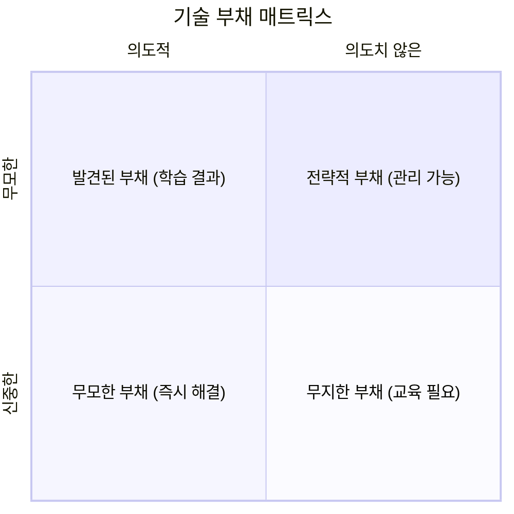
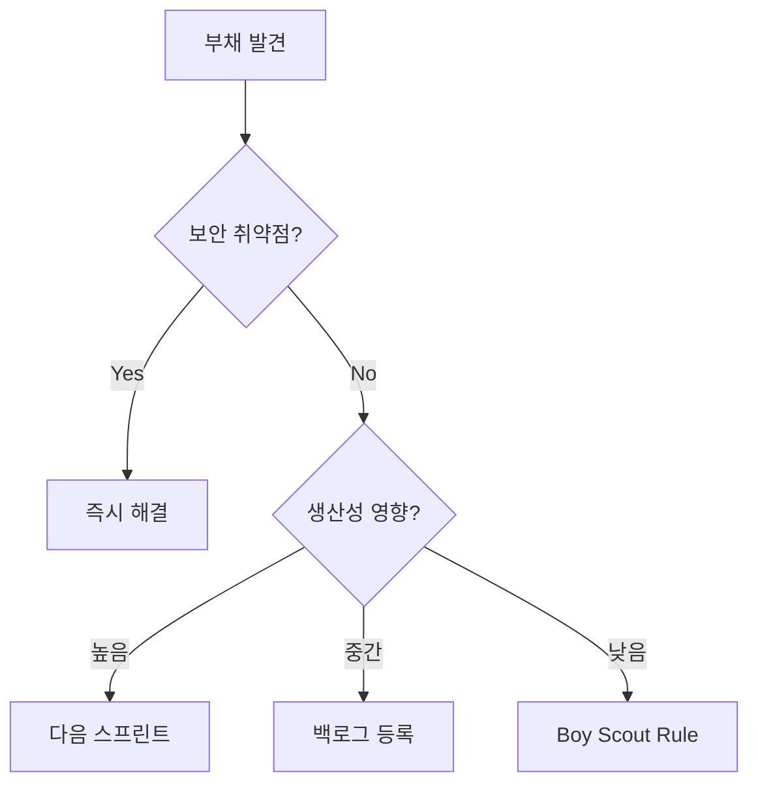

# 기술 부채 관리 가이드

> "기술 부채가 개발자 생산성 저해의 최대 요인이다." — Google

---

## 1. 기술 부채 분류

| 유형 | 예시 | 발생 원인 |
|------|------|-----------|
| **코드 부채** | 중복 코드, God class, 하드코딩 | 시간 압박, 지식 부족 |
| **설계 부채** | 레이어 위반, 순환 의존, 잘못된 추상화 | 초기 설계 부실, 요구사항 변경 |
| **테스트 부채** | 낮은 커버리지, 깨진 테스트, E2E 부재 | 테스트 문화 미성숙 |
| **인프라 부채** | EOL 런타임, 패치 안 된 의존성, 수동 배포 | 업그레이드 미루기 |
| **문서 부채** | 오래된 API 문서, 누락된 ADR, 빈 README | 문서화 경시 |

### 전략적 부채 vs 의도치 않은 부채



**전략적 부채**: "일정 내 배포를 위해 캐싱을 나중에 추가하기로 한다" → 이슈 등록 + 기한 설정
**무모한 부채**: "테스트 없이 배포한다" → 즉시 해결

---

## 2. 측정

### 2.1 정량적 메트릭

| 메트릭 | 도구 | 목표 |
|--------|------|------|
| 코드 중복률 | SonarQube | ≤3% |
| 기술 부채 비율 | SonarQube (Remediation Cost / Dev Cost) | ≤5% |
| 의존성 취약점 | Trivy, Snyk | Critical 0건 |
| EOL 런타임 | 수동 감사 | 0건 |
| 테스트 커버리지 | pytest-cov, JaCoCo | ≥80% |
| 린트 위반 수 | Ruff, detekt, ESLint | 감소 추세 |

### 2.2 정성적 측정 (Google 방식)

분기별 개발자 설문:
```
Q1: 현재 코드베이스에서 생산성을 저해하는 기술 부채가 있습니까? (1-5)
Q2: 해당 부채로 인해 지난 분기에 작업이 지연된 적이 있습니까? (Y/N)
Q3: 가장 심각한 부채 영역은? (코드/설계/테스트/인프라/문서)
Q4: 부채 해소에 충분한 시간이 할당되고 있습니까? (1-5)
```

---

## 3. 상환 전략

### 3.1 스프린트 할당

| 방식 | 비율 | 적합한 팀 |
|------|------|-----------|
| **20% 규칙** (Meta) | 매 스프린트 20% | 부채가 누적된 팀 |
| **Tech Debt Sprint** | 분기 1회 전담 스프린트 | 대규모 리팩토링 필요 |
| **Boy Scout Rule** | 매 PR에서 1개 개선 | 부채가 적은 성숙 팀 |
| **Hack Week** | 반기 1회 집중 개선 | 팀 동기 부여 목적 |

### 3.2 우선순위 결정



### 3.3 추적

이슈 트래커에 `tech-debt` 라벨로 관리:

```markdown
# [TECH-DEBT] 결제 서비스 에러 핸들링 통합

## 현재 상태
- 3개 결제 게이트웨이별로 다른 에러 핸들링
- 중복 코드 ~200줄

## 해결 방안
- 통합 PaymentError sealed class 도입
- Gateway별 Adapter 패턴 적용

## 영향
- 생산성: 새 게이트웨이 추가 시 2일 → 0.5일
- 안정성: 에러 핸들링 누락 버그 방지

## 추정 공수: 3일
## 우선순위: Medium
```

---

## 4. 의사결정 프레임워크

### 부채를 지금 갚을 것인가?

| 질문 | Yes = 지금 갚기 | No = 나중에 |
|------|-----------------|------------|
| 보안 취약점인가? | 즉시 | - |
| 이 영역을 곧 수정할 예정인가? | 함께 개선 | 별도 이슈 |
| 팀 생산성에 매일 영향을 주는가? | 다음 스프린트 | 백로그 |
| 6개월 후 더 어려워지는가? | 지금 | 나중에도 동일 |

---

## 5. 체크리스트

### 분기별
- [ ] SonarQube 기술 부채 비율 확인 (≤5%)
- [ ] 개발자 설문 실시
- [ ] `tech-debt` 이슈 정리 (완료/폐기/우선순위 재조정)
- [ ] 의존성 EOL 감사

### 매 스프린트
- [ ] 스프린트 용량의 20% 기술 부채 할당
- [ ] Boy Scout Rule: PR마다 1개 이상 개선

### 매 PR
- [ ] 새로운 기술 부채 도입 시 이슈 등록
- [ ] 기존 `tech-debt` 이슈 해결 시 라벨 제거

---

## 참고 자료

- [Google: Measuring Developer Productivity](https://research.google/pubs/pub47853/)
- [Meta: Better Engineering Initiative](https://engineering.fb.com/)
- [Martin Fowler: Technical Debt](https://martinfowler.com/bliki/TechnicalDebt.html)
