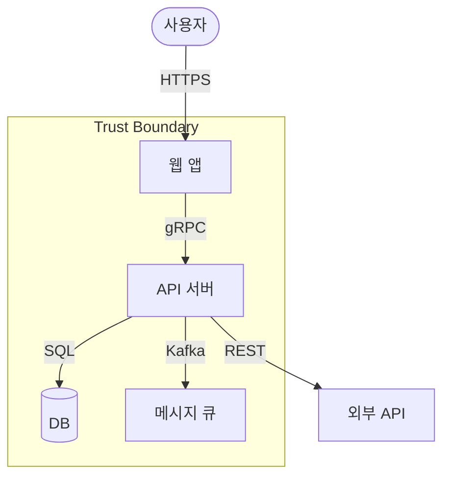

# 위협 모델링 가이드

> 시스템 설계 단계에서 보안 위협을 식별하고 대응하는 체계적 프로세스.
> STRIDE 프레임워크 기반.

---

## 1. 위협 모델링이란

**언제 수행하는가:**
- 새로운 서비스/기능 설계 시 (Design Doc과 함께)
- 아키텍처 변경 시
- 보안 인시던트 후 재검토
- 정기 보안 감사 (연 1회)


---

## 2. STRIDE 프레임워크

| 위협 | 설명 | 보안 속성 | 대응 |
|------|------|-----------|------|
| **S**poofing | 신원 위조 | 인증 (Authentication) | MFA, JWT, mTLS |
| **T**ampering | 데이터 변조 | 무결성 (Integrity) | 서명, 해시, HTTPS |
| **R**epudiation | 행위 부인 | 부인방지 (Non-repudiation) | 감사 로그, 타임스탬프 |
| **I**nformation Disclosure | 정보 유출 | 기밀성 (Confidentiality) | 암호화, 접근 제어 |
| **D**enial of Service | 서비스 거부 | 가용성 (Availability) | Rate Limiting, Auto-scaling |
| **E**levation of Privilege | 권한 상승 | 인가 (Authorization) | RBAC, 최소 권한 원칙 |

---

## 3. 위협 모델링 프로세스

### 3.1 시스템 이해 — DFD 작성



**식별할 요소:**
- **외부 엔티티**: 사용자, 외부 API, 서드파티
- **프로세스**: 웹 앱, API 서버, 배치 작업
- **데이터 저장소**: DB, Redis, S3
- **데이터 흐름**: 각 연결의 프로토콜과 데이터 종류
- **신뢰 경계**: 내부/외부 네트워크, 서비스 간 경계

### 3.2 위협 식별 — STRIDE 적용

각 데이터 흐름에 STRIDE를 적용:

| 데이터 흐름 | S | T | R | I | D | E |
|------------|---|---|---|---|---|---|
| 사용자 → 웹앱 | 세션 하이재킹 | XSS | - | 통신 도청 | DDoS | CSRF |
| 웹앱 → API | 토큰 위조 | 요청 변조 | - | 토큰 유출 | API 남용 | 권한 우회 |
| API → DB | - | SQL 인젝션 | 로그 누락 | DB 유출 | 슬로우 쿼리 | DB 권한 상승 |
| API → 외부 API | - | 응답 변조 | - | 키 유출 | 외부 장애 | - |

### 3.3 위험 평가 — DREAD 점수

| 기준 | 점수 1 (낮음) | 점수 5 (중간) | 점수 10 (높음) |
|------|-------------|-------------|--------------|
| **D**amage | 경미 | 일부 데이터 유출 | 전체 데이터 유출 |
| **R**eproducibility | 특수 조건 | 특정 사용자 | 누구나 |
| **E**xploitability | 전문 지식 필요 | 도구 필요 | 브라우저만으로 |
| **A**ffected Users | <1% | 1-50% | >50% |
| **D**iscoverability | 내부자만 | 탐색 필요 | 공개적 |

**위험도 = (D + R + E + A + D) / 5**

| 점수 | 등급 | 대응 |
|------|------|------|
| 8-10 | Critical | 즉시 해결, 릴리스 차단 |
| 5-7 | High | 다음 스프린트 |
| 3-4 | Medium | 백로그 등록 |
| 1-2 | Low | 수용 (Accept) |

### 3.4 대응 전략

| 전략 | 설명 | 예시 |
|------|------|------|
| **Mitigate** | 위험 감소 | 입력 검증, 암호화 |
| **Eliminate** | 위험 제거 | 기능 제거, 데이터 미저장 |
| **Transfer** | 위험 전가 | 보험, WAF 서비스 |
| **Accept** | 위험 수용 | 낮은 영향도 + 높은 비용 |

---

## 4. 데이터 분류

| 등급 | 데이터 유형 | 저장 | 전송 | 로깅 | 접근 |
|------|-----------|------|------|------|------|
| **Restricted** | 비밀번호, 카드번호, 개인키 | AES-256 암호화 | TLS 1.3 | 금지 | Need-to-know |
| **Confidential** | PII (이름, 이메일, 전화) | 암호화 권장 | TLS | 마스킹 | 팀 레벨 |
| **Internal** | 내부 비즈니스 데이터 | 평문 가능 | TLS | 허용 | 직원 |
| **Public** | 공개 데이터, 마케팅 | 평문 | 평문 가능 | 허용 | 전체 |

---

## 5. 위협 모델링 템플릿

```markdown
# Threat Model: [서비스/기능명]

## 범위
- 대상 시스템:
- 데이터 흐름 다이어그램: (Mermaid)
- 신뢰 경계:

## 자산 목록
| 자산 | 분류 | 소유팀 |
|------|------|--------|
| 사용자 PII | Confidential | Backend |
| API 키 | Restricted | Platform |

## 위협 분석
| # | 위협 | STRIDE | DREAD 점수 | 대응 전략 | 상태 |
|---|------|--------|-----------|-----------|------|
| 1 | SQL 인젝션 | T | 8.2 | Mitigate (ORM) | 완료 |
| 2 | 토큰 유출 | I | 7.0 | Mitigate (단기 만료) | 진행중 |

## 잔여 위험
| 위협 | 수용 사유 |
|------|-----------|
| DDoS | CDN + Rate Limit로 완화, 잔여 위험 수용 |
```

---

## 6. 체크리스트

- [ ] DFD(데이터 흐름 다이어그램) 작성
- [ ] 신뢰 경계 식별
- [ ] 각 데이터 흐름에 STRIDE 적용
- [ ] DREAD 점수로 위험 평가
- [ ] Critical/High 위협에 대응 전략 수립
- [ ] 데이터 분류 적용
- [ ] Design Doc에 위협 모델링 결과 포함
- [ ] 잔여 위험 문서화 및 수용 승인

---

## 참고 자료

- [OWASP Threat Modeling](https://owasp.org/www-community/Threat_Modeling)
- [Microsoft STRIDE](https://learn.microsoft.com/en-us/azure/security/develop/threat-modeling-tool-threats)
- [Adam Shostack: Threat Modeling](https://shostack.org/resources/threat-modeling)
